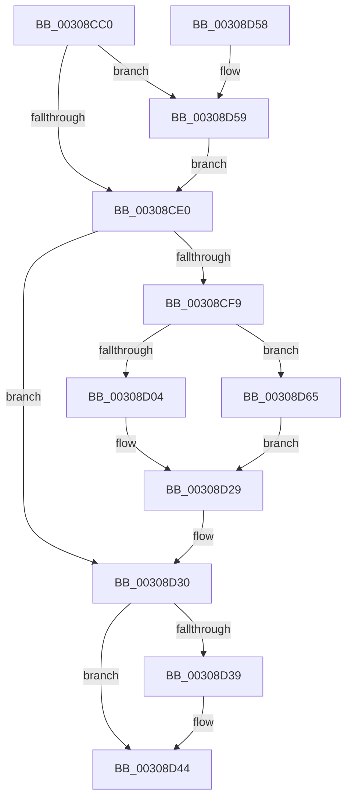

# KeInvalidateAllCaches

- RVA: `0x00308CC0`–`0x00308D69` (길이 `169` bytes)
- VA: `0x0000000140308CC0`
- 실행 섹션: `.text`
- PDB 이름 있음: `예`; PDB Function 태그: `아니요`
- unwind 정보 RVA: `0x00073A74`
- 디코드: `44`개 명령, `169/169` bytes 표시
- 미해석 바이트: `0` (있으면 어셈블리에 `.byte`로 보존)

> 이 문서는 커널 이미지의 기계어와 PDB 기호를 분석해 생성했습니다. 4번과 5번은 함수 원형과 자료형을 바이너리 사용 방식에서 추정한 C 해석이며 원본 소스 복구 결과는 아닙니다.

## 1. Dependencies

- 직접 호출 지점: **5**; 고유 호출 대상: **5**
- 직접 호출자로 확인된 함수: **10**
- RIP 상대 이미지 참조: **4**

### Outgoing calls
- `0x00308CF0` → [KxSetTimeStampBusy](../31/KxSetTimeStampBusy_function_00314CC0.md) (function, `0x00314CC0`)
- `0x00308D1A` → [KiIpiSendRequest](../31/KiIpiSendRequest_function_003113C0.md) (function, `0x003113C0`)
- `0x00308D24` → [KiIpiWaitForRequestBarrier](../31/KiIpiWaitForRequestBarrier_function_003133C0.md) (function, `0x003133C0`)
- `0x00308D3F` → [KiLowerIrqlProcessIrqlFlags](../4F/KiLowerIrqlProcessIrqlFlags_function_004F5698.md) (function, `0x004F5698`)
- `0x00308D5B` → [KiRaiseIrqlProcessIrqlFlags](../4F/KiRaiseIrqlProcessIrqlFlags_function_004F56FC.md) (function, `0x004F56FC`)

### Direct callers
- [MiChangePageAttributeBatch](../2A/MiChangePageAttributeBatch_function_002A06E0.md) at `0x002A0838`
- [KeInvalidateRangeAllCaches](KeInvalidateRangeAllCaches_function_00308880.md) at `0x00308936`
- [MiFlushCacheForAttributeChange](MiFlushCacheForAttributeChange_function_00308944.md) at `0x003089A5`
- [KeInvalidateRangeAllCachesNoIpi](KeInvalidateRangeAllCachesNoIpi_function_00308C50.md) at `0x00308C5C`
- [MiChangePageAttribute](../33/MiChangePageAttribute_function_00332ECC.md) at `0x003331F7`
- [MiRemovePhysicalMemoryBatchComplete](../67/MiRemovePhysicalMemoryBatchComplete_function_00673B98.md) at `0x00673BA7`
- [MiFlushCachedIoPfnRange](../67/MiFlushCachedIoPfnRange_function_0067BC24.md) at `0x0067BC86`
- [MiFlushCacheRange](../69/MiFlushCacheRange_function_006954C8.md) at `0x006954EE`
- [sub_006E9A0A](../6E/Unknown_function_006E9A0A.md) at `0x006E9A96`
- [MiInitializeCacheFlushing](../../init/C6/MiInitializeCacheFlushing_function_00C6ACF8.md) at `0x00C6AF58`

### Static image references
- `0x00308CD7` → RVA `0x00FC6D20` (`ALMOSTRO`; read)
- `0x00308CE9` → RVA `0x00FCF240` (`CACHEALI`; read)
- `0x00308CF9` → RVA `0x00FC6A80` (`ALMOSTRO`; read)
- `0x00308D29` → RVA `0x00FCF240` (`CACHEALI`; read/write)

## 2. Other-region calls and transfers

- 다른 실행 섹션으로 향하는 call: **0**
- 별도 외부 분기/꼬리 이동을 확인하지 못했습니다.

## 3. Assembly (complete function range)

```asm
00308CC0  48 89 5C 24 08                  mov qword ptr [rsp + 8], rbx
00308CC5  57                              push rdi
00308CC6  48 83 EC 30                     sub rsp, 0x30
00308CCA  44 0F 20 C3                     mov rbx, cr8
00308CCE  BA 0C 00 00 00                  mov edx, 0xc
00308CD3  44 0F 22 C2                     mov cr8, rdx
00308CD7  83 3D 42 E0 CB 00 00            cmp dword ptr [rip + 0xcbe042], 0
00308CDE  75 79                           jne 0x140308d59
00308CE0  65 48 8B 3C 25 20 00 00 00      mov rdi, qword ptr gs:[0x20]
00308CE9  48 8D 0D 50 65 CC 00            lea rcx, [rip + 0xcc6550]
00308CF0  E8 CB BF 00 00                  call 0x140314cc0
00308CF5  84 C0                           test al, al
00308CF7  74 37                           je 0x140308d30
00308CF9  8B 05 81 DD CB 00               mov eax, dword ptr [rip + 0xcbdd81]
00308CFF  83 F8 01                        cmp eax, 1
00308D02  76 61                           jbe 0x140308d65
00308D04  45 33 C9                        xor r9d, r9d
00308D07  48 C7 44 24 20 06 00 00 00      mov qword ptr [rsp + 0x20], 6
00308D10  45 33 C0                        xor r8d, r8d
00308D13  48 8B CF                        mov rcx, rdi
00308D16  41 8D 51 01                     lea edx, [r9 + 1]
00308D1A  E8 A1 86 00 00                  call 0x1403113c0
00308D1F  0F 09                           wbinvd
00308D21  48 8B CF                        mov rcx, rdi
00308D24  E8 97 A6 00 00                  call 0x1403133c0
00308D29  F0 FF 05 10 65 CC 00            lock inc dword ptr [rip + 0xcc6510]
00308D30  83 3D E9 DF CB 00 00            cmp dword ptr [rip + 0xcbdfe9], 0
00308D37  74 0B                           je 0x140308d44
00308D39  44 0F 20 C1                     mov rcx, cr8
00308D3D  8A D3                           mov dl, bl
00308D3F  E8 54 C9 1E 00                  call 0x1404f5698
00308D44  0F B6 CB                        movzx ecx, bl
00308D47  44 0F 22 C1                     mov cr8, rcx
00308D4B  48 8B 5C 24 40                  mov rbx, qword ptr [rsp + 0x40]
00308D50  B0 01                           mov al, 1
00308D52  48 83 C4 30                     add rsp, 0x30
00308D56  5F                              pop rdi
00308D57  C3                              ret
00308D58  CC                              int3
00308D59  8A CB                           mov cl, bl
00308D5B  E8 9C C9 1E 00                  call 0x1404f56fc
00308D60  E9 7B FF FF FF                  jmp 0x140308ce0
00308D65  0F 09                           wbinvd
00308D67  EB C0                           jmp 0x140308d29
```

## 4. C-style interpretation (structured pseudocode)

```c
__int64 __fastcall KeInvalidateAllCaches(__int64 a1, __int64 a2, int a3, int a4)
{
    __int64 result;
    __int64 v_rsp;
    unsigned __int64 v_stack_m18;
    unsigned __int64 v_stack_p8;

    v_stack_p8 = v_rbx;
    v_rsp = (v_rsp) - (48);
    if ((*(unsigned int *)(v_rip + 13361218)) != 0) goto loc_00308D59;
loc_00308CE0:
    result = KxSetTimeStampBusy(v_rip + 13395280, 12, a3, a4);
    if ((unsigned __int8)(result) == 0) goto loc_00308D30;
    if (((unsigned int)((unsigned int)(*(unsigned int *)(v_rip + 13360513)))) <= 1) goto loc_00308D65;
    a4 = 0;
    v_stack_m18 = 6;
    a3 = 0;
    result = KiIpiSendRequest(*(unsigned __int64 *)(gs_base + (0 + 32)), a4 + 1, a3, a4);
    result = KiIpiWaitForRequestBarrier(*(unsigned __int64 *)(gs_base + (0 + 32)), a4 + 1, a3, a4);
loc_00308D29:
loc_00308D30:
    if ((*(unsigned int *)(v_rip + 13361129)) != 0) {
        a1 = 12;
        a2 = (unsigned __int8)(v_cr8);
        result = KiLowerIrqlProcessIrqlFlags(a1, a2, a3, a4);
    }
    v_rsp = (v_rsp) + (48);
    return 1;
loc_00308D59:
    result = KiRaiseIrqlProcessIrqlFlags((unsigned __int8)(v_stack_p8), a2, a3, a4);
    goto loc_00308CE0;
loc_00308D65:
    goto loc_00308D29;
}
```

## 5. (Beta) C Style

```c
int64_t KeInvalidateAllCaches(int64_t Arg1, int64_t Arg2, int32_t Arg3, int32_t Arg4)
{
    int64_t result;
    int64_t local_rsp;
    uint64_t v_stack_m18;
    uint64_t v_stack_p8;

    v_stack_p8 = local_rbx;
    local_rsp = (local_rsp) - (48);
    if ((*(uint32_t *)(v_rip + 0xCBE042)) != 0) goto loc_00308D59;
loc_00308CE0:
    result = KxSetTimeStampBusy(v_rip + 13395280, 12, Arg3, Arg4);
    if ((uint8_t)(result) == 0) goto loc_00308D30;
    if (((uint32_t)((uint32_t)(*(uint32_t *)(v_rip + 0xCBDD81)))) <= 1) goto loc_00308D65;
    Arg4 = 0;
    v_stack_m18 = 6;
    Arg3 = 0;
    result = KiIpiSendRequest(*(uint64_t *)(gs_base + (0 + 0x20)), Arg4 + 1, Arg3, Arg4);
    result = KiIpiWaitForRequestBarrier(*(uint64_t *)(gs_base + (0 + 0x20)), Arg4 + 1, Arg3, Arg4);
loc_00308D29:
loc_00308D30:
    if ((*(uint32_t *)(v_rip + 0xCBDFE9)) != 0) {
        Arg1 = 12;
        Arg2 = (uint8_t)(v_cr8);
        result = KiLowerIrqlProcessIrqlFlags(Arg1, Arg2, Arg3, Arg4);
    }
    local_rsp = (local_rsp) + (48);
    return 1;
loc_00308D59:
    result = KiRaiseIrqlProcessIrqlFlags((uint8_t)(v_stack_p8), Arg2, Arg3, Arg4);
    goto loc_00308CE0;
loc_00308D65:
    goto loc_00308D29;
}
```

## 6. Execution-region graph

[열기: 2D/3D 그래프와 함수 탐색 컨트롤 패널](../../../control-panel.html?section=text&rva=0x00308CC0&view=graph)

- 2D 그래프는 위에서 아래로 흐르고, 3D 그래프는 빈 공간을 드래그해 회전합니다. Shift+드래그는 이동, 휠은 확대·축소, 함수 노드 선택은 대상 보고서 이동입니다.

### Static fallback


