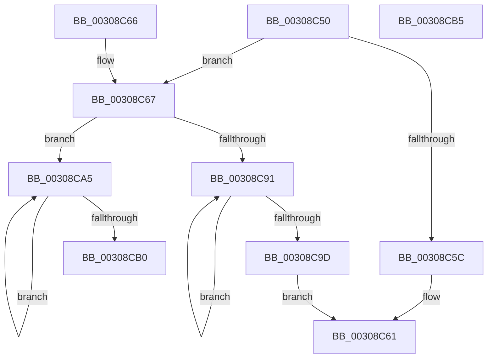

# KeInvalidateRangeAllCachesNoIpi

- RVA: `0x00308C50`–`0x00308CB6` (길이 `102` bytes)
- VA: `0x0000000140308C50`
- 실행 섹션: `.text`
- PDB 이름 있음: `예`; PDB Function 태그: `아니요`
- unwind 정보 RVA: `0x00073A64`
- 디코드: `29`개 명령, `102/102` bytes 표시
- 미해석 바이트: `0` (있으면 어셈블리에 `.byte`로 보존)

> 이 문서는 커널 이미지의 기계어와 PDB 기호를 분석해 생성했습니다. 4번과 5번은 함수 원형과 자료형을 바이너리 사용 방식에서 추정한 C 해석이며 원본 소스 복구 결과는 아닙니다.

## 1. Dependencies

- 직접 호출 지점: **1**; 고유 호출 대상: **1**
- 직접 호출자로 확인된 함수: **6**
- RIP 상대 이미지 참조: **2**

### Outgoing calls
- `0x00308C5C` → [KeInvalidateAllCaches](KeInvalidateAllCaches_function_00308CC0.md) (function, `0x00308CC0`)

### Direct callers
- [MiChangePageAttributeBatch](../2A/MiChangePageAttributeBatch_function_002A06E0.md) at `0x002A0915`
- [HalpIommuFlushPhysicalPtesFromCacheSize](HalpIommuFlushPhysicalPtesFromCacheSize_function_0030885C.md) at `0x00308869`
- [KeInvalidateRangeAllCaches](KeInvalidateRangeAllCaches_function_00308880.md) at `0x00308912`
- [MiChangePageAttribute](../33/MiChangePageAttribute_function_00332ECC.md) at `0x00333138`
- [MiFlushGraphicsPtes](../4E/MiFlushGraphicsPtes_function_004E1374.md) at `0x004E140A`
- [IvtInitializeIdentityMappings](../57/IvtInitializeIdentityMappings_function_005702A8.md) at `0x00570426`
- [IvtInitializeIdentityMappings](../57/IvtInitializeIdentityMappings_function_005702A8.md) at `0x0057045D`

### Static image references
- `0x00308C54` → RVA `0x00FC51C8` (`ALMOSTRO`; read)
- `0x00308C86` → RVA `0x00FC6B30` (`ALMOSTRO`; read)

## 2. Other-region calls and transfers

- 다른 실행 섹션으로 향하는 call: **0**
- 별도 외부 분기/꼬리 이동을 확인하지 못했습니다.

## 3. Assembly (complete function range)

```asm
00308C50  48 83 EC 28                     sub rsp, 0x28
00308C54  3B 15 6E C5 CB 00               cmp edx, dword ptr [rip + 0xcbc56e]
00308C5A  72 0B                           jb 0x140308c67
00308C5C  E8 5F 00 00 00                  call 0x140308cc0
00308C61  48 83 C4 28                     add rsp, 0x28
00308C65  C3                              ret
00308C66  CC                              int3
00308C67  65 48 8B 04 25 20 00 00 00      mov rax, qword ptr gs:[0x20]
00308C70  8B D2                           mov edx, edx
00308C72  48 03 D1                        add rdx, rcx
00308C75  44 8B 80 E8 00 00 00            mov r8d, dword ptr [rax + 0xe8]
00308C7C  49 8D 40 FF                     lea rax, [r8 - 1]
00308C80  48 F7 D0                        not rax
00308C83  48 23 C1                        and rax, rcx
00308C86  48 0F BA 25 A1 DE CB 00 23      bt qword ptr [rip + 0xcbdea1], 0x23
00308C8F  73 14                           jae 0x140308ca5
00308C91  66 0F AE 38                     clflushopt byte ptr [rax]
00308C95  49 03 C0                        add rax, r8
00308C98  48 3B C2                        cmp rax, rdx
00308C9B  72 F4                           jb 0x140308c91
00308C9D  F0 83 4C 24 38 00               lock or dword ptr [rsp + 0x38], 0
00308CA3  EB BC                           jmp 0x140308c61
00308CA5  0F AE 38                        clflush byte ptr [rax]
00308CA8  49 03 C0                        add rax, r8
00308CAB  48 3B C2                        cmp rax, rdx
00308CAE  72 F5                           jb 0x140308ca5
00308CB0  48 83 C4 28                     add rsp, 0x28
00308CB4  C3                              ret
00308CB5  CC                              int3
```

## 4. C-style interpretation (structured pseudocode)

```c
__int64 __fastcall KeInvalidateRangeAllCachesNoIpi(__int64 a1, int a2)
{
    __int64 result;
    __int64 v_rsp;
    unsigned int v_stack_p38;

    v_rsp = (v_rsp) - (40);
    if (a2 < (*(unsigned int *)(v_rip + 13354350))) goto loc_00308C67;
    result = KeInvalidateAllCaches(a1, a2, a3, a4);
loc_00308C61:
    v_rsp = (v_rsp) + (40);
    return result;
loc_00308C67:
    a2 = ((unsigned int)(a2)) + (a1);
    result = ~((unsigned int)(*(unsigned int *)(*(unsigned __int64 *)(gs_base + (0 + 32)) + 232)) - 1);
    result = (result) & (a1);
    if (condition_is_above_or_equal) goto loc_00308CA5;
loc_00308C91:
    result = (result) + ((unsigned int)(*(unsigned int *)(*(unsigned __int64 *)(gs_base + (0 + 32)) + 232)));
    if (result < a2) goto loc_00308C91;
    goto loc_00308C61;
loc_00308CA5:
    result = (result) + ((unsigned int)(*(unsigned int *)(*(unsigned __int64 *)(gs_base + (0 + 32)) + 232)));
    if (result < a2) goto loc_00308CA5;
    v_rsp = (v_rsp) + (40);
    return result;
}
```

## 5. (Beta) C Style

```c
int64_t KeInvalidateRangeAllCachesNoIpi(int64_t Arg1, int32_t Arg2)
{
    int64_t result;
    int64_t local_rsp;
    uint32_t v_stack_p38;

    local_rsp = (local_rsp) - (40);
    if (Arg2 < (*(uint32_t *)(v_rip + 0xCBC56E))) goto loc_00308C67;
    result = KeInvalidateAllCaches(Arg1, Arg2, a3, a4);
loc_00308C61:
    local_rsp = (local_rsp) + (40);
    return result;
loc_00308C67:
    Arg2 = ((uint32_t)(Arg2)) + (Arg1);
    result = ~((uint32_t)(*(uint32_t *)(*(uint64_t *)(gs_base + (0 + 0x20)) + 0xE8)) - 1);
    result = (result) & (Arg1);
    if (condition_is_above_or_equal) goto loc_00308CA5;
loc_00308C91:
    result = (result) + ((uint32_t)(*(uint32_t *)(*(uint64_t *)(gs_base + (0 + 0x20)) + 0xE8)));
    if (result < Arg2) goto loc_00308C91;
    goto loc_00308C61;
loc_00308CA5:
    result = (result) + ((uint32_t)(*(uint32_t *)(*(uint64_t *)(gs_base + (0 + 0x20)) + 0xE8)));
    if (result < Arg2) goto loc_00308CA5;
    local_rsp = (local_rsp) + (40);
    return result;
}
```

## 6. Execution-region graph

[열기: 2D/3D 그래프와 함수 탐색 컨트롤 패널](../../../control-panel.html?section=text&rva=0x00308C50&view=graph)

- 2D 그래프는 위에서 아래로 흐르고, 3D 그래프는 빈 공간을 드래그해 회전합니다. Shift+드래그는 이동, 휠은 확대·축소, 함수 노드 선택은 대상 보고서 이동입니다.

### Static fallback


