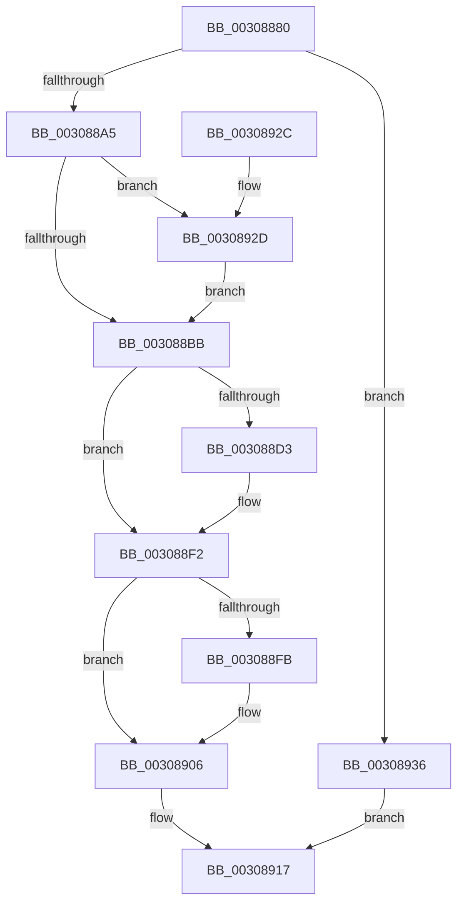

# KeInvalidateRangeAllCaches

- RVA: `0x00308880`–`0x0030893D` (길이 `189` bytes)
- VA: `0x0000000140308880`
- 실행 섹션: `.text`
- PDB 이름 있음: `예`; PDB Function 태그: `아니요`
- unwind 정보 RVA: `0x00073A10`
- 디코드: `48`개 명령, `189/189` bytes 표시
- 미해석 바이트: `0` (있으면 어셈블리에 `.byte`로 보존)

> 이 문서는 커널 이미지의 기계어와 PDB 기호를 분석해 생성했습니다. 4번과 5번은 함수 원형과 자료형을 바이너리 사용 방식에서 추정한 C 해석이며 원본 소스 복구 결과는 아닙니다.

## 1. Dependencies

- 직접 호출 지점: **6**; 고유 호출 대상: **6**
- 직접 호출자로 확인된 함수: **2**
- RIP 상대 이미지 참조: **3**

### Outgoing calls
- `0x003088E5` → [KiIpiSendRequest](../31/KiIpiSendRequest_function_003113C0.md) (function, `0x003113C0`)
- `0x003088ED` → [KiIpiWaitForRequestBarrier](../31/KiIpiWaitForRequestBarrier_function_003133C0.md) (function, `0x003133C0`)
- `0x00308901` → [KiLowerIrqlProcessIrqlFlags](../4F/KiLowerIrqlProcessIrqlFlags_function_004F5698.md) (function, `0x004F5698`)
- `0x00308912` → [KeInvalidateRangeAllCachesNoIpi](KeInvalidateRangeAllCachesNoIpi_function_00308C50.md) (function, `0x00308C50`)
- `0x0030892F` → [KiRaiseIrqlProcessIrqlFlags](../4F/KiRaiseIrqlProcessIrqlFlags_function_004F56FC.md) (function, `0x004F56FC`)
- `0x00308936` → [KeInvalidateAllCaches](KeInvalidateAllCaches_function_00308CC0.md) (function, `0x00308CC0`)

### Direct callers
- [KiFlushRangeAllCaches](../5B/KiFlushRangeAllCaches_function_005BE110.md) at `0x005BE199`
- [MiPersistMemory](../68/MiPersistMemory_function_00681A40.md) at `0x00681A56`

### Static image references
- `0x00308894` → RVA `0x00FC51C8` (`ALMOSTRO`; read)
- `0x003088B2` → RVA `0x00FC6D20` (`ALMOSTRO`; read)
- `0x003088C9` → RVA `0x00FC6A80` (`ALMOSTRO`; read)

## 2. Other-region calls and transfers

- 다른 실행 섹션으로 향하는 call: **0**
- 별도 외부 분기/꼬리 이동을 확인하지 못했습니다.

## 3. Assembly (complete function range)

```asm
00308880  48 89 5C 24 08                  mov qword ptr [rsp + 8], rbx
00308885  48 89 6C 24 10                  mov qword ptr [rsp + 0x10], rbp
0030888A  48 89 74 24 18                  mov qword ptr [rsp + 0x18], rsi
0030888F  57                              push rdi
00308890  48 83 EC 30                     sub rsp, 0x30
00308894  3B 15 2E C9 CB 00               cmp edx, dword ptr [rip + 0xcbc92e]
0030889A  8B FA                           mov edi, edx
0030889C  48 8B E9                        mov rbp, rcx
0030889F  0F 83 91 00 00 00               jae 0x140308936
003088A5  44 0F 20 C3                     mov rbx, cr8
003088A9  BA 0C 00 00 00                  mov edx, 0xc
003088AE  44 0F 22 C2                     mov cr8, rdx
003088B2  83 3D 67 E4 CB 00 00            cmp dword ptr [rip + 0xcbe467], 0
003088B9  75 72                           jne 0x14030892d
003088BB  65 48 8B 34 25 20 00 00 00      mov rsi, qword ptr gs:[0x20]
003088C4  BA 01 00 00 00                  mov edx, 1
003088C9  8B 05 B1 E1 CB 00               mov eax, dword ptr [rip + 0xcbe1b1]
003088CF  3B C2                           cmp eax, edx
003088D1  76 1F                           jbe 0x1403088f2
003088D3  45 33 C9                        xor r9d, r9d
003088D6  48 C7 44 24 20 07 00 00 00      mov qword ptr [rsp + 0x20], 7
003088DF  45 33 C0                        xor r8d, r8d
003088E2  48 8B CE                        mov rcx, rsi
003088E5  E8 D6 8A 00 00                  call 0x1403113c0
003088EA  48 8B CE                        mov rcx, rsi
003088ED  E8 CE AA 00 00                  call 0x1403133c0
003088F2  83 3D 27 E4 CB 00 00            cmp dword ptr [rip + 0xcbe427], 0
003088F9  74 0B                           je 0x140308906
003088FB  44 0F 20 C1                     mov rcx, cr8
003088FF  8A D3                           mov dl, bl
00308901  E8 92 CD 1E 00                  call 0x1404f5698
00308906  0F B6 C3                        movzx eax, bl
00308909  44 0F 22 C0                     mov cr8, rax
0030890D  8B D7                           mov edx, edi
0030890F  48 8B CD                        mov rcx, rbp
00308912  E8 39 03 00 00                  call 0x140308c50
00308917  48 8B 5C 24 40                  mov rbx, qword ptr [rsp + 0x40]
0030891C  48 8B 6C 24 48                  mov rbp, qword ptr [rsp + 0x48]
00308921  48 8B 74 24 50                  mov rsi, qword ptr [rsp + 0x50]
00308926  48 83 C4 30                     add rsp, 0x30
0030892A  5F                              pop rdi
0030892B  C3                              ret
0030892C  CC                              int3
0030892D  8A CB                           mov cl, bl
0030892F  E8 C8 CD 1E 00                  call 0x1404f56fc
00308934  EB 85                           jmp 0x1403088bb
00308936  E8 85 03 00 00                  call 0x140308cc0
0030893B  EB DA                           jmp 0x140308917
```

## 4. C-style interpretation (structured pseudocode)

```c
__int64 __fastcall KeInvalidateRangeAllCaches(__int64 a1, int a2, int a3, int a4)
{
    __int64 result;
    __int64 v_rsp;
    unsigned __int64 v_stack_m18;
    unsigned __int64 v_stack_p10;
    unsigned __int64 v_stack_p18;
    unsigned __int64 v_stack_p8;

    v_stack_p8 = v_rbx;
    v_stack_p10 = v_rbp;
    v_stack_p18 = v_rsi;
    v_rsp = (v_rsp) - (48);
    if (a2 >= (*(unsigned int *)(v_rip + 13355310))) goto loc_00308936;
    if ((*(unsigned int *)(v_rip + 13362279)) != 0) goto loc_0030892D;
loc_003088BB:
    result = (unsigned int)(*(unsigned int *)(v_rip + 13361585));
    if (((unsigned int)((unsigned int)(*(unsigned int *)(v_rip + 13361585)))) >= = 1) {
        a4 = 0;
        v_stack_m18 = 7;
        a3 = 0;
        a1 = *(unsigned __int64 *)(gs_base + (0 + 32));
        result = KiIpiSendRequest(a1, 1, a3, a4);
        a1 = *(unsigned __int64 *)(gs_base + (0 + 32));
        result = KiIpiWaitForRequestBarrier(a1, 1, a3, a4);
    }
    if ((*(unsigned int *)(v_rip + 13362215)) != 0) {
        a1 = 12;
        a2 = (unsigned __int8)(v_cr8);
        result = KiLowerIrqlProcessIrqlFlags(a1, a2, a3, a4);
    }
    result = KeInvalidateRangeAllCachesNoIpi(a1, (unsigned int)((unsigned int)((unsigned int)(a2))), a3, a4);
loc_00308917:
    v_rsp = (v_rsp) + (48);
    return result;
loc_0030892D:
    result = KiRaiseIrqlProcessIrqlFlags((unsigned __int8)(v_stack_p8), (unsigned int)((unsigned int)((unsigned int)(a2))), a3, a4);
    goto loc_003088BB;
loc_00308936:
    result = KeInvalidateAllCaches((unsigned __int8)(v_stack_p8), (unsigned int)((unsigned int)((unsigned int)(a2))), a3, a4);
    goto loc_00308917;
}
```

## 5. (Beta) C Style

```c
int64_t KeInvalidateRangeAllCaches(int64_t Arg1, int32_t Arg2, int32_t Arg3, int32_t Arg4)
{
    int64_t result;
    int64_t local_rsp;
    uint64_t v_stack_m18;
    uint64_t v_stack_p10;
    uint64_t v_stack_p18;
    uint64_t v_stack_p8;

    v_stack_p8 = local_rbx;
    v_stack_p10 = local_rbp;
    v_stack_p18 = local_rsi;
    local_rsp = (local_rsp) - (48);
    if (Arg2 >= (*(uint32_t *)(v_rip + 0xCBC92E))) goto loc_00308936;
    if ((*(uint32_t *)(v_rip + 0xCBE467)) != 0) goto loc_0030892D;
loc_003088BB:
    result = (uint32_t)(*(uint32_t *)(v_rip + 0xCBE1B1));
    if (((uint32_t)((uint32_t)(*(uint32_t *)(v_rip + 0xCBE1B1)))) >= = 1) {
        Arg4 = 0;
        v_stack_m18 = 7;
        Arg3 = 0;
        Arg1 = *(uint64_t *)(gs_base + (0 + 0x20));
        result = KiIpiSendRequest(Arg1, 1, Arg3, Arg4);
        Arg1 = *(uint64_t *)(gs_base + (0 + 0x20));
        result = KiIpiWaitForRequestBarrier(Arg1, 1, Arg3, Arg4);
    }
    if ((*(uint32_t *)(v_rip + 0xCBE427)) != 0) {
        Arg1 = 12;
        Arg2 = (uint8_t)(v_cr8);
        result = KiLowerIrqlProcessIrqlFlags(Arg1, Arg2, Arg3, Arg4);
    }
    result = KeInvalidateRangeAllCachesNoIpi(Arg1, (uint32_t)((uint32_t)((uint32_t)(Arg2))), Arg3, Arg4);
loc_00308917:
    local_rsp = (local_rsp) + (48);
    return result;
loc_0030892D:
    result = KiRaiseIrqlProcessIrqlFlags((uint8_t)(v_stack_p8), (uint32_t)((uint32_t)((uint32_t)(Arg2))), Arg3, Arg4);
    goto loc_003088BB;
loc_00308936:
    result = KeInvalidateAllCaches((uint8_t)(v_stack_p8), (uint32_t)((uint32_t)((uint32_t)(Arg2))), Arg3, Arg4);
    goto loc_00308917;
}
```

## 6. Execution-region graph

[열기: 2D/3D 그래프와 함수 탐색 컨트롤 패널](../../../control-panel.html?section=text&rva=0x00308880&view=graph)

- 2D 그래프는 위에서 아래로 흐르고, 3D 그래프는 빈 공간을 드래그해 회전합니다. Shift+드래그는 이동, 휠은 확대·축소, 함수 노드 선택은 대상 보고서 이동입니다.

### Static fallback


