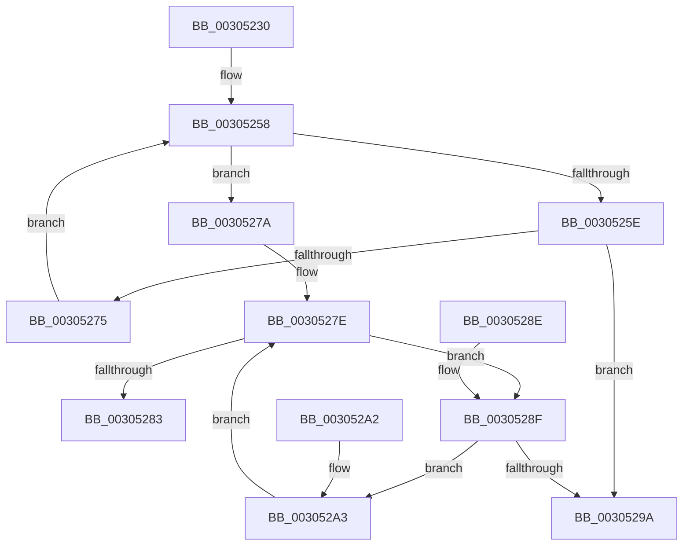

# KeIsEqualAffinityEx

- RVA: `0x00305230`–`0x003052A8` (길이 `120` bytes)
- VA: `0x0000000140305230`
- 실행 섹션: `.text`
- PDB 이름 있음: `예`; PDB Function 태그: `아니요`
- unwind 정보 RVA: `0x00073638`
- 디코드: `36`개 명령, `120/120` bytes 표시
- 미해석 바이트: `0` (있으면 어셈블리에 `.byte`로 보존)

> 이 문서는 커널 이미지의 기계어와 PDB 기호를 분석해 생성했습니다. 4번과 5번은 함수 원형과 자료형을 바이너리 사용 방식에서 추정한 C 해석이며 원본 소스 복구 결과는 아닙니다.

## 1. Dependencies

- 직접 호출 지점: **0**; 고유 호출 대상: **0**
- 직접 호출자로 확인된 함수: **12**
- RIP 상대 이미지 참조: **0**

### Outgoing calls
- 직접 디코드된 call 명령이 없습니다.

### Direct callers
- [PpmParkReportMask](PpmParkReportMask_function_00305190.md) at `0x003051B3`
- [KiForwardTick](../39/KiForwardTick_function_0039D40C.md) at `0x0039D52B`
- [EtwTraceThreadAffinity](../3C/EtwTraceThreadAffinity_function_003C29A0.md) at `0x003C2A00`
- [KeUpdateProcessorRestrictionsEx](../5B/KeUpdateProcessorRestrictionsEx_function_005B64E8.md) at `0x005B6804`
- [KeCpuPartitionMoveCpus](../5C/KeCpuPartitionMoveCpus_function_005C0B70.md) at `0x005C0C21`
- [KiCpuPartitionCheckGenericDpc](../5C/KiCpuPartitionCheckGenericDpc_function_005C159C.md) at `0x005C15B6`
- [PpmHeteroHgsDetectContainmentPresence](../5D/PpmHeteroHgsDetectContainmentPresence_function_005D8768.md) at `0x005D886E`
- [PpmHeteroHgsDetectContainmentPresence](../5D/PpmHeteroHgsDetectContainmentPresence_function_005D8768.md) at `0x005D892C`
- [PpmHeteroHgsDetectContainmentPresence](../5D/PpmHeteroHgsDetectContainmentPresence_function_005D8768.md) at `0x005D8A55`
- [PpmRegisterPerfStates](../../page/75/PpmRegisterPerfStates_function_0075B084.md) at `0x0075BB31`
- [PpmRegisterPerfStates](../../page/75/PpmRegisterPerfStates_function_0075B084.md) at `0x0075BC4F`
- [PpmHeteroComputeRelativePerformance](../../page/A7/PpmHeteroComputeRelativePerformance_function_00A7E038.md) at `0x00A7E06E`
- [ExpWorkQueueManagerThread](../../page/AF/ExpWorkQueueManagerThread_function_00AF6D60.md) at `0x00AF7217`
- [sub_00B18AF6](../../page/B1/Unknown_function_00B18AF6.md) at `0x00B18B4C`
- [PpmHeteroInitializeIntelWpsSupport](../../init/C4/PpmHeteroInitializeIntelWpsSupport_function_00C440C8.md) at `0x00C44193`

### Static image references
- 디코드된 RIP-relative 메모리 참조가 없습니다.

## 2. Other-region calls and transfers

- 다른 실행 섹션으로 향하는 call: **0**
- 별도 외부 분기/꼬리 이동을 확인하지 못했습니다.

## 3. Assembly (complete function range)

```asm
00305230  48 89 5C 24 08                  mov qword ptr [rsp + 8], rbx
00305235  0F B7 02                        movzx eax, word ptr [rdx]
00305238  4C 8B D2                        mov r10, rdx
0030523B  44 0F B7 01                     movzx r8d, word ptr [rcx]
0030523F  4C 8B DA                        mov r11, rdx
00305242  66 44 3B C0                     cmp r8w, ax
00305246  45 0F B7 C8                     movzx r9d, r8w
0030524A  48 8B D9                        mov rbx, rcx
0030524D  66 44 0F 43 C8                  cmovae r9w, ax
00305252  4C 0F 43 D1                     cmovae r10, rcx
00305256  33 C0                           xor eax, eax
00305258  66 41 3B C1                     cmp ax, r9w
0030525C  73 1C                           jae 0x14030527a
0030525E  0F B7 C8                        movzx ecx, ax
00305261  48 8D 14 CD 00 00 00 00         lea rdx, [rcx*8]
00305269  4A 8B 4C 1A 08                  mov rcx, qword ptr [rdx + r11 + 8]
0030526E  48 39 4C 1A 08                  cmp qword ptr [rdx + rbx + 8], rcx
00305273  75 25                           jne 0x14030529a
00305275  66 FF C0                        inc ax
00305278  EB DE                           jmp 0x140305258
0030527A  41 0F B7 12                     movzx edx, word ptr [r10]
0030527E  66 3B C2                        cmp ax, dx
00305281  72 0C                           jb 0x14030528f
00305283  B8 01 00 00 00                  mov eax, 1
00305288  48 8B 5C 24 08                  mov rbx, qword ptr [rsp + 8]
0030528D  C3                              ret
0030528E  CC                              int3
0030528F  0F B7 C8                        movzx ecx, ax
00305292  49 83 7C CA 08 00               cmp qword ptr [r10 + rcx*8 + 8], 0
00305298  74 09                           je 0x1403052a3
0030529A  48 8B 5C 24 08                  mov rbx, qword ptr [rsp + 8]
0030529F  33 C0                           xor eax, eax
003052A1  C3                              ret
003052A2  CC                              int3
003052A3  66 FF C0                        inc ax
003052A6  EB D6                           jmp 0x14030527e
```

## 4. C-style interpretation (structured pseudocode)

```c
__int64 __fastcall KeIsEqualAffinityEx(__int64 a1, __int64 a2)
{
    __int64 result;
    unsigned __int64 v_stack_p8;

    v_stack_p8 = v_rbx;
    a4 = (unsigned __int16)(*(unsigned __int16 *)(a1));
    if (((unsigned __int16)(*(unsigned __int16 *)(a1))) >= ((unsigned __int16)(*(unsigned __int16 *)(a2)))) {
        a4 = (unsigned __int16)(*(unsigned __int16 *)(a2));
        a2 = a1;
    }
    result = 0;
loc_00305258:
    if (0 >= ((unsigned __int16)(a4))) goto loc_0030527A;
    if ((*(unsigned __int64 *)(0 * 8 + a1 * 1 + 8)) != (*(unsigned __int64 *)(0 * 8 + a2 * 1 + 8))) goto loc_0030529A;
    result = (unsigned __int16)((result) + 1);
    goto loc_00305258;
loc_0030527A:
loc_0030527E:
    if (((unsigned __int16)(result)) < ((unsigned __int16)(*(unsigned __int16 *)(a2)))) goto loc_0030528F;
    return 1;
loc_0030528F:
    if ((*(unsigned __int64 *)(a2 + 1 * 8 + 8)) == 0) goto loc_003052A3;
loc_0030529A:
    result = 0;
    return result;
loc_003052A3:
    result = (unsigned __int16)((result) + 1);
    goto loc_0030527E;
}
```

## 5. (Beta) C Style

```c
int64_t KeIsEqualAffinityEx(void *Arg1, void *Arg2)
{
    uint8_t *arg1 = (uint8_t *)Arg1;
    uint8_t *arg2 = (uint8_t *)Arg2;

    int64_t result;
    uint64_t v_stack_p8;

    v_stack_p8 = local_rbx;
    a4 = (uint16_t)(*(uint16_t *)(arg1));
    if (((uint16_t)(*(uint16_t *)(arg1))) >= ((uint16_t)(*(uint16_t *)(arg2)))) {
        a4 = (uint16_t)(*(uint16_t *)(arg2));
        Arg2 = Arg1;
    }
    result = 0;
loc_00305258:
    if (0 >= ((uint16_t)(a4))) goto loc_0030527A;
    if ((*(uint64_t *)(0 * 8 + arg1 * 1 + 0x8)) != (*(uint64_t *)(0 * 8 + arg2 * 1 + 0x8))) goto loc_0030529A;
    result = (uint16_t)((result) + 1);
    goto loc_00305258;
loc_0030527A:
loc_0030527E:
    if (((uint16_t)(result)) < ((uint16_t)(*(uint16_t *)(arg2)))) goto loc_0030528F;
    return 1;
loc_0030528F:
    if ((*(uint64_t *)(arg2 + 0x1 * 8 + 0x8)) == 0) goto loc_003052A3;
loc_0030529A:
    result = 0;
    return result;
loc_003052A3:
    result = (uint16_t)((result) + 1);
    goto loc_0030527E;
}
```

### 관측된 메모리 오프셋

구조체 형식이 확인되지 않은 접근은 인자 기준의 오프셋으로만 기록했습니다.

| 기준 인자 | 오프셋 표현 | 폭 (bit) | 접근 |
|---|---:|---:|---|
| `Arg1` | `+ 0x0` | `16` | `R` |
| `Arg2` | `+ 0x0` | `16` | `R` |

## 6. Execution-region graph

[열기: 2D/3D 그래프와 함수 탐색 컨트롤 패널](../../../control-panel.html?section=text&rva=0x00305230&view=graph)

- 2D 그래프는 위에서 아래로 흐르고, 3D 그래프는 빈 공간을 드래그해 회전합니다. Shift+드래그는 이동, 휠은 확대·축소, 함수 노드 선택은 대상 보고서 이동입니다.

### Static fallback


