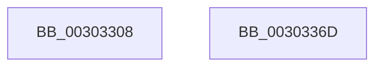

# KeModifySystemAllowedCpuSets

- RVA: `0x00303308`–`0x0030336E` (길이 `102` bytes)
- VA: `0x0000000140303308`
- 실행 섹션: `.text`
- PDB 이름 있음: `예`; PDB Function 태그: `아니요`
- unwind 정보 RVA: `0x000733E4`
- 디코드: `29`개 명령, `102/102` bytes 표시
- 미해석 바이트: `0` (있으면 어셈블리에 `.byte`로 보존)

> 이 문서는 커널 이미지의 기계어와 PDB 기호를 분석해 생성했습니다. 4번과 5번은 함수 원형과 자료형을 바이너리 사용 방식에서 추정한 C 해석이며 원본 소스 복구 결과는 아닙니다.

## 1. Dependencies

- 직접 호출 지점: **3**; 고유 호출 대상: **3**
- 직접 호출자로 확인된 함수: **2**
- RIP 상대 이미지 참조: **1**

### Outgoing calls
- `0x0030332F` → [KiAcquireCpuPartitionLock](KiAcquireCpuPartitionLock_function_00303374.md) (function, `0x00303374`)
- `0x00303344` → [KiModifySystemAllowedCpuSetsWithLock](KiModifySystemAllowedCpuSetsWithLock_function_00304278.md) (function, `0x00304278`)
- `0x00303356` → [KiReleaseCpuPartitionLock](../4F/KiReleaseCpuPartitionLock_function_004F54FC.md) (function, `0x004F54FC`)

### Direct callers
- [NtSetSystemInformation](../../page/AF/NtSetSystemInformation_function_00AF4A60.md) at `0x00AF60FF`
- [KiInitializeReservedCpuSets](../../init/C3/KiInitializeReservedCpuSets_function_00C39DAC.md) at `0x00C39EF3`

### Static image references
- `0x00303325` → RVA `0x00FC6C20` (`ALMOSTRO`; read)

## 2. Other-region calls and transfers

- 다른 실행 섹션으로 향하는 call: **0**
- 별도 외부 분기/꼬리 이동을 확인하지 못했습니다.

## 3. Assembly (complete function range)

```asm
00303308  48 8B C4                        mov rax, rsp
0030330B  48 89 58 08                     mov qword ptr [rax + 8], rbx
0030330F  48 89 70 10                     mov qword ptr [rax + 0x10], rsi
00303313  57                              push rdi
00303314  48 83 EC 30                     sub rsp, 0x30
00303318  48 8B FA                        mov rdi, rdx
0030331B  C6 40 28 00                     mov byte ptr [rax + 0x28], 0
0030331F  8B F1                           mov esi, ecx
00303321  48 8D 50 28                     lea rdx, [rax + 0x28]
00303325  48 8B 0D F4 38 CC 00            mov rcx, qword ptr [rip + 0xcc38f4]
0030332C  41 8B D9                        mov ebx, r9d
0030332F  E8 40 00 00 00                  call 0x140303374
00303334  83 64 24 20 00                  and dword ptr [rsp + 0x20], 0
00303339  44 8B CB                        mov r9d, ebx
0030333C  45 33 C0                        xor r8d, r8d
0030333F  48 8B D7                        mov rdx, rdi
00303342  8B CE                           mov ecx, esi
00303344  E8 2F 0F 00 00                  call 0x140304278
00303349  8A 54 24 60                     mov dl, byte ptr [rsp + 0x60]
0030334D  8B D8                           mov ebx, eax
0030334F  48 8B 0D CA 38 CC 00            mov rcx, qword ptr [rip + 0xcc38ca]
00303356  E8 A1 21 1F 00                  call 0x1404f54fc
0030335B  48 8B 74 24 48                  mov rsi, qword ptr [rsp + 0x48]
00303360  8B C3                           mov eax, ebx
00303362  48 8B 5C 24 40                  mov rbx, qword ptr [rsp + 0x40]
00303367  48 83 C4 30                     add rsp, 0x30
0030336B  5F                              pop rdi
0030336C  C3                              ret
0030336D  CC                              int3
```

## 4. C-style interpretation (structured pseudocode)

```c
__int64 __fastcall KeModifySystemAllowedCpuSets(int a1, __int64 a2, int a3, int a4, unsigned __int8 a5)
{
    __int64 result;
    __int64 v_rsp;
    unsigned int v_stack_m18;
    unsigned __int64 v_stack_p10;
    unsigned __int64 v_stack_p8;

    *(unsigned __int64 *)(v_rsp + 8) = v_rbx;
    *(unsigned __int64 *)(v_rsp + 16) = v_rsi;
    v_rsp = (v_rsp) - (48);
    *(unsigned __int8 *)(v_rsp + 40) = 0;
    result = KiAcquireCpuPartitionLock(*(unsigned __int64 *)(v_rip + 13383924), v_rsp + 40, a3, a4);
    a3 = 0;
    result = KiModifySystemAllowedCpuSetsWithLock((unsigned int)((unsigned int)((unsigned int)(a1))), a2, a3, (unsigned int)((unsigned int)((unsigned int)(a4))));
    result = KiReleaseCpuPartitionLock(*(unsigned __int64 *)(v_rip + 13383882), a5, a3, (unsigned int)((unsigned int)((unsigned int)(a4))));
    v_rsp = (v_rsp) + (48);
    return (unsigned int)((unsigned int)((unsigned int)((unsigned int)(result))));
}
```

## 5. (Beta) C Style

```c
int64_t KeModifySystemAllowedCpuSets(int32_t Arg1, int64_t Arg2, int32_t Arg3, int32_t Arg4, uint8_t Arg5)
{
    int64_t result;
    int64_t local_rsp;
    uint32_t v_stack_m18;
    uint64_t v_stack_p10;
    uint64_t v_stack_p8;

    *(uint64_t *)(local_rsp + 0x8) = local_rbx;
    *(uint64_t *)(local_rsp + 0x10) = local_rsi;
    local_rsp = (local_rsp) - (48);
    *(uint8_t *)(local_rsp + 0x28) = 0;
    result = KiAcquireCpuPartitionLock(*(uint64_t *)(v_rip + 0xCC38F4), local_rsp + 40, Arg3, Arg4);
    Arg3 = 0;
    result = KiModifySystemAllowedCpuSetsWithLock((uint32_t)((uint32_t)((uint32_t)(Arg1))), Arg2, Arg3, (uint32_t)((uint32_t)((uint32_t)(Arg4))));
    result = KiReleaseCpuPartitionLock(*(uint64_t *)(v_rip + 0xCC38CA), Arg5, Arg3, (uint32_t)((uint32_t)((uint32_t)(Arg4))));
    local_rsp = (local_rsp) + (48);
    return (uint32_t)((uint32_t)((uint32_t)((uint32_t)(result))));
}
```

## 6. Execution-region graph

[열기: 2D/3D 그래프와 함수 탐색 컨트롤 패널](../../../control-panel.html?section=text&rva=0x00303308&view=graph)

- 2D 그래프는 위에서 아래로 흐르고, 3D 그래프는 빈 공간을 드래그해 회전합니다. Shift+드래그는 이동, 휠은 확대·축소, 함수 노드 선택은 대상 보고서 이동입니다.

### Static fallback


