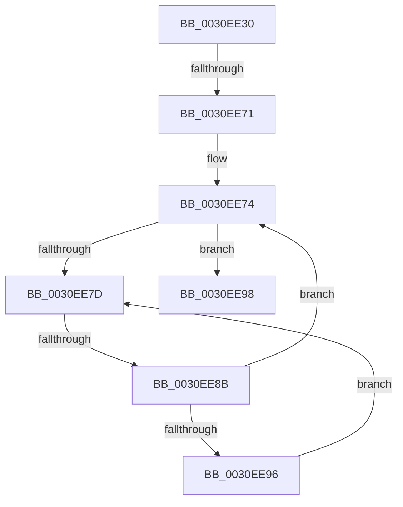

# KeQueryValuesThread

- RVA: `0x0030EE30`–`0x0030EE9F` (길이 `111` bytes)
- VA: `0x000000014030EE30`
- 실행 섹션: `.text`
- PDB 이름 있음: `예`; PDB Function 태그: `예`
- unwind 정보 RVA: `0x00074080`
- 디코드: `32`개 명령, `111/111` bytes 표시
- 미해석 바이트: `0` (있으면 어셈블리에 `.byte`로 보존)

> 이 문서는 커널 이미지의 기계어와 PDB 기호를 분석해 생성했습니다. 4번과 5번은 함수 원형과 자료형을 바이너리 사용 방식에서 추정한 C 해석이며 원본 소스 복구 결과는 아닙니다.

## 1. Dependencies

- 직접 호출 지점: **0**; 고유 호출 대상: **0**
- 직접 호출자로 확인된 함수: **3**
- RIP 상대 이미지 참조: **3**

### Outgoing calls
- 직접 디코드된 call 명령이 없습니다.

### Direct callers
- [PsQueryStatisticsProcess](../../page/91/PsQueryStatisticsProcess_function_00919350.md) at `0x009194A2`
- [ExpGetProcessInformation](../../page/91/ExpGetProcessInformation_function_0091A878.md) at `0x0091AB29`
- [NtQueryInformationThread](../../page/AE/NtQueryInformationThread_function_00AE3760.md) at `0x00AE49B7`

### Static image references
- `0x0030EE64` → RVA `0x00FC6D20` (`ALMOSTRO`; read)
- `0x0030EE7F` → RVA `0x00FC52AC` (`ALMOSTRO`; reference)
- `0x0030EE98` → RVA `0x00FCFF00` (`CACHEALI`; read)

## 2. Other-region calls and transfers

- 다른 실행 섹션으로 향하는 call: **0**
- call이 아닌 외부 분기/꼬리 이동: **2**
  - `0x0030EE6B` → [sub_0030F189](Unknown_function_0030F189.md) (`tail-transfer`)
  - `0x0030EE85` → [sub_0030F244](Unknown_function_0030F244.md) (`tail-transfer`)

## 3. Assembly (complete function range)

```asm
0030EE30  40 55                           push rbp
0030EE32  53                              push rbx
0030EE33  56                              push rsi
0030EE34  57                              push rdi
0030EE35  41 56                           push r14
0030EE37  41 57                           push r15
0030EE39  48 8B EC                        mov rbp, rsp
0030EE3C  48 83 EC 58                     sub rsp, 0x58
0030EE40  45 33 D2                        xor r10d, r10d
0030EE43  4C 8B FA                        mov r15, rdx
0030EE46  4C 89 55 40                     mov qword ptr [rbp + 0x40], r10
0030EE4A  41 8B FA                        mov edi, r10d
0030EE4D  44 89 12                        mov dword ptr [rdx], r10d
0030EE50  4C 8B F1                        mov r14, rcx
0030EE53  44 0F 20 C6                     mov rsi, cr8
0030EE57  48 89 75 48                     mov qword ptr [rbp + 0x48], rsi
0030EE5B  B8 02 00 00 00                  mov eax, 2
0030EE60  44 0F 22 C0                     mov cr8, rax
0030EE64  44 39 15 B5 7E CB 00            cmp dword ptr [rip + 0xcb7eb5], r10d
0030EE6B  0F 85 18 03 00 00               jne 0x14030f189
0030EE71  41 8B DA                        mov ebx, r10d
0030EE74  F0 49 0F BA 6E 40 00            lock bts qword ptr [r14 + 0x40], 0
0030EE7B  73 1B                           jae 0x14030ee98
0030EE7D  FF C3                           inc ebx
0030EE7F  85 1D 27 64 CB 00               test dword ptr [rip + 0xcb6427], ebx
0030EE85  0F 84 B9 03 00 00               je 0x14030f244
0030EE8B  F3 90                           pause
0030EE8D  49 8B 46 40                     mov rax, qword ptr [r14 + 0x40]
0030EE91  48 85 C0                        test rax, rax
0030EE94  74 DE                           je 0x14030ee74
0030EE96  EB E5                           jmp 0x14030ee7d
0030EE98  48 8D 05 61 10 CC 00            lea rax, [rip + 0xcc1061]
```

## 4. C-style interpretation (structured pseudocode)

```c
__int64 __fastcall KeQueryValuesThread(__int64 a1, __int64 a2)
{
    __int64 v_r10;
    __int64 v_rbx;
    __int64 v_rsp;
    unsigned __int64 v_stack_p10;
    unsigned __int64 v_stack_p18;

    v_rsp = (v_rsp) - (88);
    v_r10 = 0;
    v_stack_p10 = 0;
    *(unsigned int *)(a2) = 0;
    v_stack_p18 = v_cr8;
loc_0030EE74:
    if ((*(unsigned int *)(v_rip + 13336245)) >= 0) goto loc_0030EE98;
loc_0030EE7D:
    v_rbx = (unsigned int)((0) + 1);
    if (*(unsigned __int64 *)(a1 + 64) == 0) goto loc_0030EE74;
    goto loc_0030EE7D;
loc_0030EE98:
    return v_rip + 13373537;
}
```

## 5. (Beta) C Style

```c
int64_t KeQueryValuesThread(void *Arg1, void *Arg2)
{
    uint8_t *arg1 = (uint8_t *)Arg1;
    uint8_t *arg2 = (uint8_t *)Arg2;

    int64_t local_r10;
    int64_t local_rbx;
    int64_t local_rsp;
    uint64_t v_stack_p10;
    uint64_t v_stack_p18;

    local_rsp = (local_rsp) - (88);
    local_r10 = 0;
    v_stack_p10 = 0;
    *(uint32_t *)(arg2) = 0;
    v_stack_p18 = v_cr8;
loc_0030EE74:
    if ((*(uint32_t *)(v_rip + 0xCB7EB5)) >= 0) goto loc_0030EE98;
loc_0030EE7D:
    local_rbx = (uint32_t)((0) + 1);
    if (*(uint64_t *)(arg1 + 0x40) == 0) goto loc_0030EE74;
    goto loc_0030EE7D;
loc_0030EE98:
    return v_rip + 13373537;
}
```

### 관측된 메모리 오프셋

구조체 형식이 확인되지 않은 접근은 인자 기준의 오프셋으로만 기록했습니다.

| 기준 인자 | 오프셋 표현 | 폭 (bit) | 접근 |
|---|---:|---:|---|
| `Arg1` | `+ 0x40` | `64` | `R` |
| `Arg1` | `+ 0x40` | `64` | `R/W` |
| `Arg2` | `+ 0x0` | `32` | `W` |

## 6. Execution-region graph

[열기: 2D/3D 그래프와 함수 탐색 컨트롤 패널](../../../control-panel.html?section=text&rva=0x0030EE30&view=graph)

- 2D 그래프는 위에서 아래로 흐르고, 3D 그래프는 빈 공간을 드래그해 회전합니다. Shift+드래그는 이동, 휠은 확대·축소, 함수 노드 선택은 대상 보고서 이동입니다.

### Static fallback


