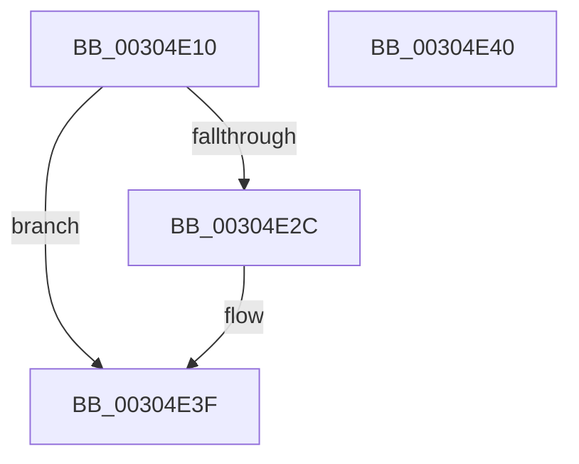

# KeRemoveProcessorAffinityEx

- RVA: `0x00304E10`–`0x00304E41` (길이 `49` bytes)
- VA: `0x0000000140304E10`
- 실행 섹션: `.text`
- PDB 이름 있음: `예`; PDB Function 태그: `아니요`
- unwind 정보 RVA: `0x000DB714`
- 디코드: `16`개 명령, `49/49` bytes 표시
- 미해석 바이트: `0` (있으면 어셈블리에 `.byte`로 보존)

> 이 문서는 커널 이미지의 기계어와 PDB 기호를 분석해 생성했습니다. 4번과 5번은 함수 원형과 자료형을 바이너리 사용 방식에서 추정한 C 해석이며 원본 소스 복구 결과는 아닙니다.

## 1. Dependencies

- 직접 호출 지점: **0**; 고유 호출 대상: **0**
- 직접 호출자로 확인된 함수: **16**
- RIP 상대 이미지 참조: **1**

### Outgoing calls
- 직접 디코드된 call 명령이 없습니다.

### Direct callers
- [PpmUnlockProcessors](../2D/PpmUnlockProcessors_function_002D15B0.md) at `0x002D168C`
- [KeChangeMemoryAttributes](KeChangeMemoryAttributes_function_00304D08.md) at `0x00304D88`
- [KiCheckKeepAlive](KiCheckKeepAlive_function_00305058.md) at `0x003050F6`
- [KiCheckKeepAlive](KiCheckKeepAlive_function_00305058.md) at `0x0030512E`
- [KxFlushEntireTb](KxFlushEntireTb_function_00309094.md) at `0x00309215`
- [KiForwardTick](../39/KiForwardTick_function_0039D40C.md) at `0x0039D53B`
- [PpmParkUnblockIdle](../46/PpmParkUnblockIdle_function_00460270.md) at `0x0046041E`
- [KeFreezeExecution](../4D/KeFreezeExecution_function_004DFA40.md) at `0x004DFC35`
- [HalpNmiReboot](../55/HalpNmiReboot_function_0055B2D4.md) at `0x0055B386`
- [KeBugCheck2](../5B/KeBugCheck2_function_005B27D0.md) at `0x005B3509`
- [KiSendFreeze](../5C/KiSendFreeze_function_005C3364.md) at `0x005C3451`
- [KiBugCheckRecoveryFreezeOtherProcessors](../5C/KiBugCheckRecoveryFreezeOtherProcessors_function_005C7120.md) at `0x005C71EE`
- [KxFlushSingleTb](../5C/KxFlushSingleTb_function_005CAE18.md) at `0x005CAECA`
- [PpmParkComputeUnparkMaskEx](../5E/PpmParkComputeUnparkMaskEx_function_005E05E0.md) at `0x005E0FD7`
- [EtwpGetMicroarchitecturalPmcAffinity](../../page/7B/EtwpGetMicroarchitecturalPmcAffinity_function_007B67CC.md) at `0x007B6844`
- [sub_00B3B096](../../page/B3/Unknown_function_00B3B096.md) at `0x00B3B0E8`
- [PnprQuiesceProcessors](../../pagelk/B6/PnprQuiesceProcessors_function_00B64FB4.md) at `0x00B650E9`

### Static image references
- `0x00304E10` → RVA `0x00F231B0` (`.data`; read)

## 2. Other-region calls and transfers

- 다른 실행 섹션으로 향하는 call: **0**
- 별도 외부 분기/꼬리 이동을 확인하지 못했습니다.

## 3. Assembly (complete function range)

```asm
00304E10  48 8B 05 99 E3 C1 00            mov rax, qword ptr [rip + 0xc1e399]
00304E17  4C 8B C1                        mov r8, rcx
00304E1A  8B D2                           mov edx, edx
00304E1C  8B 0C 90                        mov ecx, dword ptr [rax + rdx*4]
00304E1F  8B C1                           mov eax, ecx
00304E21  41 0F B7 10                     movzx edx, word ptr [r8]
00304E25  C1 E8 06                        shr eax, 6
00304E28  3B D0                           cmp edx, eax
00304E2A  76 13                           jbe 0x140304e3f
00304E2C  8B D0                           mov edx, eax
00304E2E  83 E1 3F                        and ecx, 0x3f
00304E31  49 8B 44 C0 08                  mov rax, qword ptr [r8 + rax*8 + 8]
00304E36  48 0F B3 C8                     btr rax, rcx
00304E3A  49 89 44 D0 08                  mov qword ptr [r8 + rdx*8 + 8], rax
00304E3F  C3                              ret
00304E40  CC                              int3
```

## 4. C-style interpretation (structured pseudocode)

```c
__int64 __fastcall KeRemoveProcessorAffinityEx(__int64 a1, int a2)
{
    __int64 result;

    result = (unsigned int)(((unsigned int)((unsigned int)((unsigned int)(*(unsigned int *)(*(unsigned __int64 *)(v_rip + 12706713) + (unsigned int)(a2) * 4))))) >> (6));
    if (((unsigned int)(*(unsigned __int16 *)(a1))) >= = ((unsigned int)(result))) {
        a2 = (unsigned int)(result);
        a1 = (unsigned int)(((unsigned int)(*(unsigned int *)(*(unsigned __int64 *)(v_rip + 12706713) + (unsigned int)(a2) * 4))) & (63));
        result = *(unsigned __int64 *)(a1 + result * 8 + 8);
        *(unsigned __int64 *)(a1 + a2 * 8 + 8) = result;
    }
    return result;
}
```

## 5. (Beta) C Style

```c
int64_t KeRemoveProcessorAffinityEx(void *Arg1, int32_t Arg2)
{
    uint8_t *arg1 = (uint8_t *)Arg1;

    int64_t result;

    result = (uint32_t)(((uint32_t)((uint32_t)((uint32_t)(*(uint32_t *)(*(uint64_t *)(v_rip + 0xC1E399) + (uint32_t)(Arg2) * 4))))) >> (6));
    if (((uint32_t)(*(uint16_t *)(arg1))) >= = ((uint32_t)(result))) {
        Arg2 = (uint32_t)(result);
        Arg1 = (uint32_t)(((uint32_t)(*(uint32_t *)(*(uint64_t *)(v_rip + 0xC1E399) + (uint32_t)(Arg2) * 4))) & (63));
        result = *(uint64_t *)(arg1 + result * 8 + 0x8);
        *(uint64_t *)(arg1 + Arg2 * 8 + 0x8) = result;
    }
    return result;
}
```

### 관측된 메모리 오프셋

구조체 형식이 확인되지 않은 접근은 인자 기준의 오프셋으로만 기록했습니다.

| 기준 인자 | 오프셋 표현 | 폭 (bit) | 접근 |
|---|---:|---:|---|
| `Arg1` | `+ 0x0` | `16` | `R` |
| `Arg1` | `+ 0x8 + rax*8` | `64` | `R` |
| `Arg1` | `+ 0x8 + rdx*8` | `64` | `W` |

## 6. Execution-region graph

[열기: 2D/3D 그래프와 함수 탐색 컨트롤 패널](../../../control-panel.html?section=text&rva=0x00304E10&view=graph)

- 2D 그래프는 위에서 아래로 흐르고, 3D 그래프는 빈 공간을 드래그해 회전합니다. Shift+드래그는 이동, 휠은 확대·축소, 함수 노드 선택은 대상 보고서 이동입니다.

### Static fallback


