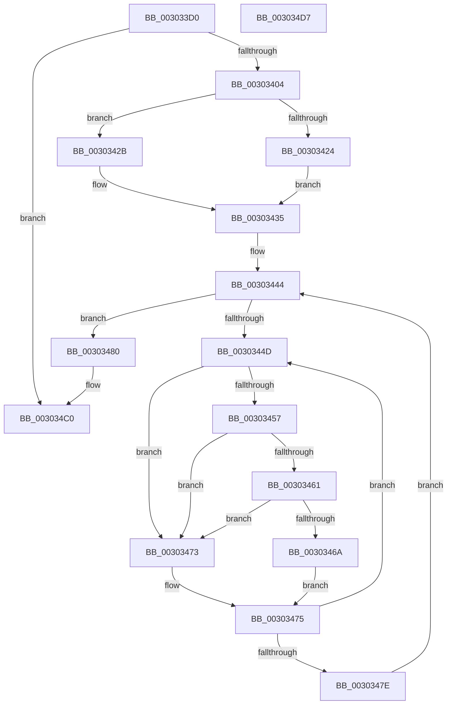

# KeSetSelectedCpuSetsThread

- RVA: `0x003033D0`–`0x003034D8` (길이 `264` bytes)
- VA: `0x00000001403033D0`
- 실행 섹션: `.text`
- PDB 이름 있음: `예`; PDB Function 태그: `아니요`
- unwind 정보 RVA: `0x000733F8`
- 디코드: `73`개 명령, `264/264` bytes 표시
- 미해석 바이트: `0` (있으면 어셈블리에 `.byte`로 보존)

> 이 문서는 커널 이미지의 기계어와 PDB 기호를 분석해 생성했습니다. 4번과 5번은 함수 원형과 자료형을 바이너리 사용 방식에서 추정한 C 해석이며 원본 소스 복구 결과는 아닙니다.

## 1. Dependencies

- 직접 호출 지점: **8**; 고유 호출 대상: **8**
- 직접 호출자로 확인된 함수: **1**
- RIP 상대 이미지 참조: **3**

### Outgoing calls
- `0x003033F7` → [KiValidateCpuSetMasks](KiValidateCpuSetMasks_function_00304238.md) (function, `0x00304238`)
- `0x0030343D` → [KiAcquireProcessLockShared](../2C/KiAcquireProcessLockShared_function_002CF9A0.md) (function, `0x002CF9A0`)
- `0x00303461` → [KiCheckVpBackingLongSpinWaitHypercall](KiCheckVpBackingLongSpinWaitHypercall_function_0030F490.md) (function, `0x0030F490`)
- `0x0030346C` → [HvlNotifyLongSpinWait](HvlNotifyLongSpinWait_function_0030F460.md) (function, `0x0030F460`)
- `0x0030348B` → [KiWriteCpuSetMasks](../4F/KiWriteCpuSetMasks_function_004FA664.md) (function, `0x004FA664`)
- `0x00303498` → [KiUpdateThreadCpuSets](KiUpdateThreadCpuSets_function_0030313C.md) (function, `0x0030313C`)
- `0x003034A1` → [ExReleaseSpinLockSharedFromDpcLevel](../24/ExReleaseSpinLockSharedFromDpcLevel_function_0024A590.md) (function, `0x0024A590`)
- `0x003034B9` → [KiProcessDeferredReadyList](../25/KiProcessDeferredReadyList_function_00250800.md) (function, `0x00250800`)

### Direct callers
- [sub_00B1B2E4](../../page/B1/Unknown_function_00B1B2E4.md) at `0x00B1B55D`

### Static image references
- `0x0030342B` → RVA `0x00FC5014` (`ALMOSTRO`; read)
- `0x0030344F` → RVA `0x00FC52AC` (`ALMOSTRO`; reference)
- `0x00303457` → RVA `0x00FC6AB8` (`ALMOSTRO`; read)

## 2. Other-region calls and transfers

- 다른 실행 섹션으로 향하는 call: **0**
- 별도 외부 분기/꼬리 이동을 확인하지 못했습니다.

## 3. Assembly (complete function range)

```asm
003033D0  48 89 5C 24 08                  mov qword ptr [rsp + 8], rbx
003033D5  48 89 6C 24 10                  mov qword ptr [rsp + 0x10], rbp
003033DA  56                              push rsi
003033DB  57                              push rdi
003033DC  41 54                           push r12
003033DE  41 56                           push r14
003033E0  41 57                           push r15
003033E2  48 83 EC 30                     sub rsp, 0x30
003033E6  48 8B D9                        mov rbx, rcx
003033E9  C6 44 24 78 00                  mov byte ptr [rsp + 0x78], 0
003033EE  49 8B C8                        mov rcx, r8
003033F1  4D 8B F8                        mov r15, r8
003033F4  44 8B E2                        mov r12d, edx
003033F7  E8 3C 0E 00 00                  call 0x140304238
003033FC  85 C0                           test eax, eax
003033FE  0F 88 BC 00 00 00               js 0x1403034c0
00303404  48 83 64 24 20 00               and qword ptr [rsp + 0x20], 0
0030340A  48 8D B3 90 06 00 00            lea rsi, [rbx + 0x690]
00303411  F7 83 A0 05 00 00 00 00 02 00   test dword ptr [rbx + 0x5a0], 0x20000
0030341B  4C 8B B3 20 02 00 00            mov r14, qword ptr [rbx + 0x220]
00303422  75 07                           jne 0x14030342b
00303424  BD 01 00 00 00                  mov ebp, 1
00303429  EB 0A                           jmp 0x140303435
0030342B  0F B7 2D E2 1B CC 00            movzx ebp, word ptr [rip + 0xcc1be2]
00303432  48 8B 36                        mov rsi, qword ptr [rsi]
00303435  48 8D 54 24 78                  lea rdx, [rsp + 0x78]
0030343A  49 8B CE                        mov rcx, r14
0030343D  E8 5E C5 FC FF                  call 0x1402cf9a0
00303442  33 FF                           xor edi, edi
00303444  F0 48 0F BA 6B 40 00            lock bts qword ptr [rbx + 0x40], 0
0030344B  73 33                           jae 0x140303480
0030344D  FF C7                           inc edi
0030344F  85 3D 57 1E CC 00               test dword ptr [rip + 0xcc1e57], edi
00303455  75 1C                           jne 0x140303473
00303457  8B 05 5B 36 CC 00               mov eax, dword ptr [rip + 0xcc365b]
0030345D  A8 40                           test al, 0x40
0030345F  74 12                           je 0x140303473
00303461  E8 2A C0 00 00                  call 0x14030f490
00303466  84 C0                           test al, al
00303468  74 09                           je 0x140303473
0030346A  8B CF                           mov ecx, edi
0030346C  E8 EF BF 00 00                  call 0x14030f460
00303471  EB 02                           jmp 0x140303475
00303473  F3 90                           pause
00303475  48 8B 43 40                     mov rax, qword ptr [rbx + 0x40]
00303479  48 85 C0                        test rax, rax
0030347C  75 CF                           jne 0x14030344d
0030347E  EB C4                           jmp 0x140303444
00303480  45 8B CC                        mov r9d, r12d
00303483  4D 8B C7                        mov r8, r15
00303486  8B D5                           mov edx, ebp
00303488  48 8B CE                        mov rcx, rsi
0030348B  E8 D4 71 1F 00                  call 0x1404fa664
00303490  48 8D 54 24 20                  lea rdx, [rsp + 0x20]
00303495  48 8B CB                        mov rcx, rbx
00303498  E8 9F FC FF FF                  call 0x14030313c
0030349D  49 8D 4E 40                     lea rcx, [r14 + 0x40]
003034A1  E8 EA 70 F4 FF                  call 0x14024a590
003034A6  65 48 8B 0C 25 20 00 00 00      mov rcx, qword ptr gs:[0x20]
003034AF  48 8D 54 24 20                  lea rdx, [rsp + 0x20]
003034B4  44 8A 44 24 78                  mov r8b, byte ptr [rsp + 0x78]
003034B9  E8 42 D3 F4 FF                  call 0x140250800
003034BE  33 C0                           xor eax, eax
003034C0  48 8B 5C 24 60                  mov rbx, qword ptr [rsp + 0x60]
003034C5  48 8B 6C 24 68                  mov rbp, qword ptr [rsp + 0x68]
003034CA  48 83 C4 30                     add rsp, 0x30
003034CE  41 5F                           pop r15
003034D0  41 5E                           pop r14
003034D2  41 5C                           pop r12
003034D4  5F                              pop rdi
003034D5  5E                              pop rsi
003034D6  C3                              ret
003034D7  CC                              int3
```

## 4. C-style interpretation (structured pseudocode)

```c
__int64 __fastcall KeSetSelectedCpuSetsThread(__int64 a1, int a2, __int64 a3)
{
    __int64 result;
    __int64 v_rdi;
    __int64 v_rsp;
    unsigned __int64 v_stack_m38;
    unsigned __int64 v_stack_p10;
    unsigned __int8 v_stack_p20;
    unsigned __int64 v_stack_p8;

    v_stack_p8 = v_rbx;
    v_stack_p10 = v_rbp;
    v_rsp = (v_rsp) - (48);
    v_stack_p20 = 0;
    result = KiValidateCpuSetMasks(a3, a2, a3, a4);
    if (sign_flag) goto loc_003034C0;
    if (((*(unsigned int *)(a1 + 1440)) & (0x20000ULL)) != 0) goto loc_0030342B;
    goto loc_00303435;
loc_0030342B:
loc_00303435:
    result = KiAcquireProcessLockShared(*(unsigned __int64 *)(a1 + 544), v_stack_p20, a3, a4);
    v_rdi = 0;
loc_00303444:
    if (condition_is_above_or_equal) goto loc_00303480;
loc_0030344D:
    v_rdi = (unsigned int)((v_rdi) + 1);
    if (((*(unsigned int *)(v_rip + 13377111)) & ((unsigned int)(v_rdi))) != 0) goto loc_00303473;
    if ((((unsigned __int8)((unsigned int)(*(unsigned int *)(v_rip + 13383259)))) & (64)) == 0) goto loc_00303473;
    result = KiCheckVpBackingLongSpinWaitHypercall(*(unsigned __int64 *)(a1 + 544), v_stack_p20, a3, a4);
    if ((unsigned __int8)(result) == 0) goto loc_00303473;
    result = HvlNotifyLongSpinWait((unsigned int)((unsigned int)(v_rdi)), v_stack_p20, a3, a4);
    goto loc_00303475;
loc_00303473:
loc_00303475:
    if (*(unsigned __int64 *)(a1 + 64) != 0) goto loc_0030344D;
    goto loc_00303444;
loc_00303480:
    result = KiWriteCpuSetMasks(*(unsigned __int64 *)(a1 + 1680), (unsigned int)((unsigned int)(*(unsigned __int16 *)(v_rip + 13376482))), a3, (unsigned int)((unsigned int)((unsigned int)(a2))));
    result = KiUpdateThreadCpuSets(a1, v_stack_m38, a3, (unsigned int)((unsigned int)((unsigned int)(a2))));
    result = ExReleaseSpinLockSharedFromDpcLevel(*(unsigned __int64 *)(a1 + 544) + 64, v_stack_m38, a3, (unsigned int)((unsigned int)((unsigned int)(a2))));
    result = KiProcessDeferredReadyList(*(unsigned __int64 *)(gs_base + (0 + 32)), v_stack_m38, v_stack_p20, (unsigned int)((unsigned int)((unsigned int)(a2))));
    result = 0;
loc_003034C0:
    v_rsp = (v_rsp) + (48);
    return result;
}
```

## 5. (Beta) C Style

```c
int64_t KeSetSelectedCpuSetsThread(void *Arg1, int32_t Arg2, int64_t Arg3)
{
    uint8_t *arg1 = (uint8_t *)Arg1;

    int64_t result;
    int64_t local_rdi;
    int64_t local_rsp;
    uint64_t v_stack_m38;
    uint64_t v_stack_p10;
    uint8_t v_stack_p20;
    uint64_t v_stack_p8;

    v_stack_p8 = local_rbx;
    v_stack_p10 = local_rbp;
    local_rsp = (local_rsp) - (48);
    v_stack_p20 = 0;
    result = KiValidateCpuSetMasks(Arg3, Arg2, Arg3, a4);
    if (sign_flag) goto loc_003034C0;
    if (((*(uint32_t *)(arg1 + 0x5A0)) & (0x20000ULL)) != 0) goto loc_0030342B;
    goto loc_00303435;
loc_0030342B:
loc_00303435:
    result = KiAcquireProcessLockShared(*(uint64_t *)(arg1 + 0x220), v_stack_p20, Arg3, a4);
    local_rdi = 0;
loc_00303444:
    if (condition_is_above_or_equal) goto loc_00303480;
loc_0030344D:
    local_rdi = (uint32_t)((local_rdi) + 1);
    if (((*(uint32_t *)(v_rip + 0xCC1E57)) & ((uint32_t)(local_rdi))) != 0) goto loc_00303473;
    if ((((uint8_t)((uint32_t)(*(uint32_t *)(v_rip + 0xCC365B)))) & (64)) == 0) goto loc_00303473;
    result = KiCheckVpBackingLongSpinWaitHypercall(*(uint64_t *)(arg1 + 0x220), v_stack_p20, Arg3, a4);
    if ((uint8_t)(result) == 0) goto loc_00303473;
    result = HvlNotifyLongSpinWait((uint32_t)((uint32_t)(local_rdi)), v_stack_p20, Arg3, a4);
    goto loc_00303475;
loc_00303473:
loc_00303475:
    if (*(uint64_t *)(arg1 + 0x40) != 0) goto loc_0030344D;
    goto loc_00303444;
loc_00303480:
    result = KiWriteCpuSetMasks(*(uint64_t *)(arg1 + 0x690), (uint32_t)((uint32_t)(*(uint16_t *)(v_rip + 0xCC1BE2))), Arg3, (uint32_t)((uint32_t)((uint32_t)(Arg2))));
    result = KiUpdateThreadCpuSets(Arg1, v_stack_m38, Arg3, (uint32_t)((uint32_t)((uint32_t)(Arg2))));
    result = ExReleaseSpinLockSharedFromDpcLevel(*(uint64_t *)(arg1 + 0x220) + 64, v_stack_m38, Arg3, (uint32_t)((uint32_t)((uint32_t)(Arg2))));
    result = KiProcessDeferredReadyList(*(uint64_t *)(gs_base + (0 + 0x20)), v_stack_m38, v_stack_p20, (uint32_t)((uint32_t)((uint32_t)(Arg2))));
    result = 0;
loc_003034C0:
    local_rsp = (local_rsp) + (48);
    return result;
}
```

### 관측된 메모리 오프셋

구조체 형식이 확인되지 않은 접근은 인자 기준의 오프셋으로만 기록했습니다.

| 기준 인자 | 오프셋 표현 | 폭 (bit) | 접근 |
|---|---:|---:|---|
| `Arg1` | `+ 0x0` | `64` | `R` |
| `Arg1` | `+ 0x40` | `64` | `R` |
| `Arg1` | `+ 0x40` | `64` | `R/W` |
| `Arg1` | `+ 0x220` | `64` | `R` |
| `Arg1` | `+ 0x5A0` | `32` | `R` |
| `Arg1` | `+ 0x690` | `64` | `R` |

## 6. Execution-region graph

[열기: 2D/3D 그래프와 함수 탐색 컨트롤 패널](../../../control-panel.html?section=text&rva=0x003033D0&view=graph)

- 2D 그래프는 위에서 아래로 흐르고, 3D 그래프는 빈 공간을 드래그해 회전합니다. Shift+드래그는 이동, 휠은 확대·축소, 함수 노드 선택은 대상 보고서 이동입니다.

### Static fallback


