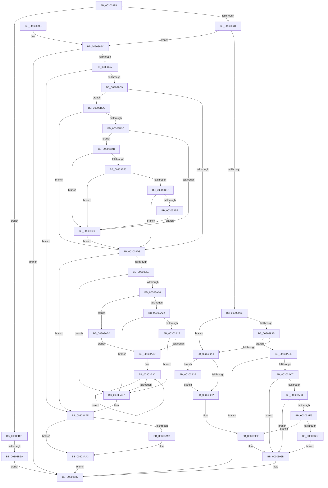

# KeSetThreadSchedulerAssist

- RVA: `0x003038F8`–`0x00303B98` (길이 `672` bytes)
- VA: `0x00000001403038F8`
- 실행 섹션: `.text`
- PDB 이름 있음: `예`; PDB Function 태그: `예`
- unwind 정보 RVA: `0x0007346C`
- 디코드: `170`개 명령, `672/672` bytes 표시
- 미해석 바이트: `0` (있으면 어셈블리에 `.byte`로 보존)

> 이 문서는 커널 이미지의 기계어와 PDB 기호를 분석해 생성했습니다. 4번과 5번은 함수 원형과 자료형을 바이너리 사용 방식에서 추정한 C 해석이며 원본 소스 복구 결과는 아닙니다.

## 1. Dependencies

- 직접 호출 지점: **12**; 고유 호출 대상: **10**
- 직접 호출자로 확인된 함수: **1**
- RIP 상대 이미지 참조: **2**

### Outgoing calls
- `0x00303959` → [KiAcquireThreadLockRaiseToDpc](../39/KiAcquireThreadLockRaiseToDpc_function_00396280.md) (function, `0x00396280`)
- `0x00303968` → [KiUpdateVpBackingThreadPriorityFromTopLevel](KiUpdateVpBackingThreadPriorityFromTopLevel_function_00303BA0.md) (function, `0x00303BA0`)
- `0x00303982` → [KiProcessDeferredReadyList](../25/KiProcessDeferredReadyList_function_00250800.md) (function, `0x00250800`)
- `0x003039AF` → [KiAcquireThreadLockRaiseToDpc](../39/KiAcquireThreadLockRaiseToDpc_function_00396280.md) (function, `0x00396280`)
- `0x003039FE` → [KiAcquirePrcbLocksForIsolationUnit](KiAcquirePrcbLocksForIsolationUnit_function_0030ED60.md) (function, `0x0030ED60`)
- `0x00303A58` → [KiUpdateThreadQosGroupingSummaries](../25/KiUpdateThreadQosGroupingSummaries_function_00257AEC.md) (function, `0x00257AEC`)
- `0x00303A7A` → [KiReleaseThreadStateLock](../21/KiReleaseThreadStateLock_function_00217910.md) (function, `0x00217910`)
- `0x00303A89` → [KeCheckAndApplyBamQos](../39/KeCheckAndApplyBamQos_function_00391910.md) (function, `0x00391910`)
- `0x00303A9E` → [KiLowerIrqlProcessIrqlFlags](../4F/KiLowerIrqlProcessIrqlFlags_function_004F5698.md) (function, `0x004F5698`)
- `0x00303ACE` → [KiAcquireThreadLockRaiseToDpc](../39/KiAcquireThreadLockRaiseToDpc_function_00396280.md) (function, `0x00396280`)
- `0x00303B41` → [EtwTraceXSchedulerPriorityKickReceive](../65/EtwTraceXSchedulerPriorityKickReceive_function_00650794.md) (function, `0x00650794`)
- `0x00303B8E` → [KeSetActualBasePriorityThread](../3C/KeSetActualBasePriorityThread_function_003C4370.md) (function, `0x003C4370`)

### Direct callers
- [VmSetThreadSchedulerAssist](VmSetThreadSchedulerAssist_function_003038E0.md) at `0x003038E4`

### Static image references
- `0x00303944` → RVA `0x00FC6B14` (`ALMOSTRO`; read)
- `0x00303A8E` → RVA `0x00FC6D20` (`ALMOSTRO`; read)

## 2. Other-region calls and transfers

- 다른 실행 섹션으로 향하는 call: **0**
- call이 아닌 외부 분기/꼬리 이동: **1**
  - `0x00303B64` → [sub_006E0538](../6E/Unknown_function_006E0538.md) (`tail-transfer`)

## 3. Assembly (complete function range)

```asm
003038F8  48 89 5C 24 08                  mov qword ptr [rsp + 8], rbx
003038FD  55                              push rbp
003038FE  56                              push rsi
003038FF  57                              push rdi
00303900  41 56                           push r14
00303902  41 57                           push r15
00303904  48 8B EC                        mov rbp, rsp
00303907  48 83 EC 70                     sub rsp, 0x70
0030390B  45 33 FF                        xor r15d, r15d
0030390E  48 8B D9                        mov rbx, rcx
00303911  44 88 7D 40                     mov byte ptr [rbp + 0x40], r15b
00303915  41 8B C8                        mov ecx, r8d
00303918  4C 89 7D C8                     mov qword ptr [rbp - 0x38], r15
0030391C  4C 89 7D 48                     mov qword ptr [rbp + 0x48], r15
00303920  4C 89 7D D0                     mov qword ptr [rbp - 0x30], r15
00303924  4C 89 7D C0                     mov qword ptr [rbp - 0x40], r15
00303928  45 85 C0                        test r8d, r8d
0030392B  0F 84 30 02 00 00               je 0x140303b61
00303931  83 E9 01                        sub ecx, 1
00303934  74 66                           je 0x14030399c
00303936  83 E9 01                        sub ecx, 1
00303939  74 09                           je 0x140303944
0030393B  83 E9 01                        sub ecx, 1
0030393E  0F 85 7A 01 00 00               jne 0x140303abe
00303944  8B 05 CA 31 CC 00               mov eax, dword ptr [rip + 0xcc31ca]
0030394A  A8 20                           test al, 0x20
0030394C  0F 85 E9 01 00 00               jne 0x140303b3b
00303952  48 8D 55 40                     lea rdx, [rbp + 0x40]
00303956  48 8B CB                        mov rcx, rbx
00303959  E8 22 29 09 00                  call 0x140396280
0030395E  45 33 C0                        xor r8d, r8d
00303961  48 8D 55 48                     lea rdx, [rbp + 0x48]
00303965  48 8B CB                        mov rcx, rbx
00303968  E8 33 02 00 00                  call 0x140303ba0
0030396D  4C 89 7B 40                     mov qword ptr [rbx + 0x40], r15
00303971  48 8D 55 48                     lea rdx, [rbp + 0x48]
00303975  65 48 8B 0C 25 20 00 00 00      mov rcx, qword ptr gs:[0x20]
0030397E  44 8A 45 40                     mov r8b, byte ptr [rbp + 0x40]
00303982  E8 79 CE F4 FF                  call 0x140250800
00303987  48 8B 9C 24 A0 00 00 00         mov rbx, qword ptr [rsp + 0xa0]
0030398F  48 83 C4 70                     add rsp, 0x70
00303993  41 5F                           pop r15
00303995  41 5E                           pop r14
00303997  5F                              pop rdi
00303998  5E                              pop rsi
00303999  5D                              pop rbp
0030399A  C3                              ret
0030399B  CC                              int3
0030399C  48 8B BB C8 03 00 00            mov rdi, qword ptr [rbx + 0x3c8]
003039A3  48 85 FF                        test rdi, rdi
003039A6  74 DF                           je 0x140303987
003039A8  48 8D 55 40                     lea rdx, [rbp + 0x40]
003039AC  48 8B CB                        mov rcx, rbx
003039AF  E8 CC 28 09 00                  call 0x140396280
003039B4  65 48 8B 34 25 20 00 00 00      mov rsi, qword ptr gs:[0x20]
003039BD  8B 7F 04                        mov edi, dword ptr [rdi + 4]
003039C0  83 FF 07                        cmp edi, 7
003039C3  0F 8D B6 00 00 00               jge 0x140303a7f
003039C9  40 88 BB 62 04 00 00            mov byte ptr [rbx + 0x462], dil
003039D0  85 FF                           test edi, edi
003039D2  0F 85 34 01 00 00               jne 0x140303b0c
003039D8  0F B6 83 04 02 00 00            movzx eax, byte ptr [rbx + 0x204]
003039DF  3B F8                           cmp edi, eax
003039E1  0F 84 98 00 00 00               je 0x140303a7f
003039E7  0F 57 C0                        xorps xmm0, xmm0
003039EA  0F 11 45 F0                     movups xmmword ptr [rbp - 0x10], xmm0
003039EE  4C 8D 45 C0                     lea r8, [rbp - 0x40]
003039F2  48 89 75 C8                     mov qword ptr [rbp - 0x38], rsi
003039F6  BA 01 00 00 00                  mov edx, 1
003039FB  48 8B CE                        mov rcx, rsi
003039FE  E8 5D B3 00 00                  call 0x14030ed60
00303A03  40 88 BB 04 02 00 00            mov byte ptr [rbx + 0x204], dil
00303A0A  4C 39 7E 10                     cmp qword ptr [rsi + 0x10], r15
00303A0E  75 57                           jne 0x140303a67
00303A10  8B 4B 78                        mov ecx, dword ptr [rbx + 0x78]
00303A13  D1 E9                           shr ecx, 1
00303A15  48 89 75 D8                     mov qword ptr [rbp - 0x28], rsi
00303A19  83 E1 01                        and ecx, 1
00303A1C  0F 84 8E 00 00 00               je 0x140303ab0
00303A22  83 F9 01                        cmp ecx, 1
00303A25  75 40                           jne 0x140303a67
00303A27  48 8B 86 58 8E 00 00            mov rax, qword ptr [rsi + 0x8e58]
00303A2E  0F B6 08                        movzx ecx, byte ptr [rax]
00303A31  48 8D 78 08                     lea rdi, [rax + 8]
00303A35  85 C9                           test ecx, ecx
00303A37  74 2E                           je 0x140303a67
00303A39  44 8B F1                        mov r14d, ecx
00303A3C  48 8B 0F                        mov rcx, qword ptr [rdi]
00303A3F  4C 8B 41 38                     mov r8, qword ptr [rcx + 0x38]
00303A43  41 8A 40 40                     mov al, byte ptr [r8 + 0x40]
00303A47  8A D0                           mov dl, al
00303A49  32 93 04 02 00 00               xor dl, byte ptr [rbx + 0x204]
00303A4F  80 E2 07                        and dl, 7
00303A52  32 D0                           xor dl, al
00303A54  41 88 50 40                     mov byte ptr [r8 + 0x40], dl
00303A58  E8 8F 40 F5 FF                  call 0x140257aec
00303A5D  48 8D 7F 08                     lea rdi, [rdi + 8]
00303A61  49 83 EE 01                     sub r14, 1
00303A65  75 D5                           jne 0x140303a3c
00303A67  48 8D 45 F0                     lea rax, [rbp - 0x10]
00303A6B  45 33 C9                        xor r9d, r9d
00303A6E  4C 8D 45 C0                     lea r8, [rbp - 0x40]
00303A72  48 89 44 24 20                  mov qword ptr [rsp + 0x20], rax
00303A77  48 8B D6                        mov rdx, rsi
00303A7A  E8 91 3E F1 FF                  call 0x140217910
00303A7F  48 8B D3                        mov rdx, rbx
00303A82  4C 89 7B 40                     mov qword ptr [rbx + 0x40], r15
00303A86  48 8B CE                        mov rcx, rsi
00303A89  E8 82 DE 08 00                  call 0x140391910
00303A8E  44 39 3D 8B 32 CC 00            cmp dword ptr [rip + 0xcc328b], r15d
00303A95  74 0C                           je 0x140303aa3
00303A97  44 0F 20 C1                     mov rcx, cr8
00303A9B  8A 55 40                        mov dl, byte ptr [rbp + 0x40]
00303A9E  E8 F5 1B 1F 00                  call 0x1404f5698
00303AA3  0F B6 45 40                     movzx eax, byte ptr [rbp + 0x40]
00303AA7  44 0F 22 C0                     mov cr8, rax
00303AAB  E9 D7 FE FF FF                  jmp 0x140303987
00303AB0  48 8D 7D D8                     lea rdi, [rbp - 0x28]
00303AB4  B9 01 00 00 00                  mov ecx, 1
00303AB9  E9 7B FF FF FF                  jmp 0x140303a39
00303ABE  83 F9 01                        cmp ecx, 1
00303AC1  0F 85 C0 FE FF FF               jne 0x140303987
00303AC7  48 8D 55 40                     lea rdx, [rbp + 0x40]
00303ACB  48 8B CB                        mov rcx, rbx
00303ACE  E8 AD 27 09 00                  call 0x140396280
00303AD3  48 8B 83 C8 03 00 00            mov rax, qword ptr [rbx + 0x3c8]
00303ADA  48 85 C0                        test rax, rax
00303ADD  0F 84 8A FE FF FF               je 0x14030396d
00303AE3  F0 48 FF 40 28                  lock inc qword ptr [rax + 0x28]
00303AE8  48 8B 48 28                     mov rcx, qword ptr [rax + 0x28]
00303AEC  48 8B 40 30                     mov rax, qword ptr [rax + 0x30]
00303AF0  48 3B C8                        cmp rcx, rax
00303AF3  0F 84 74 FE FF FF               je 0x14030396d
00303AF9  8A 83 84 01 00 00               mov al, byte ptr [rbx + 0x184]
00303AFF  3C 01                           cmp al, 1
00303B01  0F 84 57 FE FF FF               je 0x14030395e
00303B07  E9 61 FE FF FF                  jmp 0x14030396d
00303B0C  48 8B 8B C8 03 00 00            mov rcx, qword ptr [rbx + 0x3c8]
00303B13  48 85 C9                        test rcx, rcx
00303B16  0F 84 BC FE FF FF               je 0x1403039d8
00303B1C  8B 41 1C                        mov eax, dword ptr [rcx + 0x1c]
00303B1F  44 8B 41 20                     mov r8d, dword ptr [rcx + 0x20]
00303B23  44 8B 49 14                     mov r9d, dword ptr [rcx + 0x14]
00303B27  8B 11                           mov edx, dword ptr [rcx]
00303B29  81 E2 00 00 20 00               and edx, 0x200000
00303B2F  85 C0                           test eax, eax
00303B31  74 18                           je 0x140303b4b
00303B33  41 8B FF                        mov edi, r15d
00303B36  E9 9D FE FF FF                  jmp 0x1403039d8
00303B3B  41 8B D0                        mov edx, r8d
00303B3E  48 8B CB                        mov rcx, rbx
00303B41  E8 4E CC 34 00                  call 0x140650794
00303B46  E9 07 FE FF FF                  jmp 0x140303952
00303B4B  45 85 C0                        test r8d, r8d
00303B4E  75 E3                           jne 0x140303b33
00303B50  41 0F BA E1 0E                  bt r9d, 0xe
00303B55  72 DC                           jb 0x140303b33
00303B57  85 D2                           test edx, edx
00303B59  0F 84 79 FE FF FF               je 0x1403039d8
00303B5F  EB D2                           jmp 0x140303b33
00303B61  48 85 D2                        test rdx, rdx
00303B64  0F 84 CE C9 3D 00               je 0x1406e0538
00303B6A  48 89 93 C8 03 00 00            mov qword ptr [rbx + 0x3c8], rdx
00303B71  48 8B CB                        mov rcx, rbx
00303B74  C7 83 00 04 00 00 20 00 00 00   mov dword ptr [rbx + 0x400], 0x20
00303B7E  BA 01 00 00 00                  mov edx, 1
00303B83  F0 0F BA 6B 78 16               lock bts dword ptr [rbx + 0x78], 0x16
00303B89  F0 0F BA 2B 16                  lock bts dword ptr [rbx], 0x16
00303B8E  E8 DD 07 0C 00                  call 0x1403c4370
00303B93  E9 EF FD FF FF                  jmp 0x140303987
```

## 4. C-style interpretation (structured pseudocode)

```c
__int64 __fastcall KeSetThreadSchedulerAssist(__int64 a1, __int64 a2, int a3, int a4)
{
    __int64 result;
    __int64 v_r14;
    __int64 v_r15;
    __int64 v_rsp;
    unsigned __int64 v_stack_m38;
    unsigned __int64 v_stack_m50;
    unsigned __int64 v_stack_m58;
    unsigned __int64 v_stack_m60;
    unsigned __int64 v_stack_m68;
    unsigned __int8 v_stack_p18;
    unsigned __int64 v_stack_p20;
    unsigned __int64 v_stack_p8;

    v_stack_p8 = v_rbx;
    v_rsp = (v_rsp) - (112);
    v_r15 = 0;
    v_stack_p18 = 0;
    v_stack_m60 = 0;
    v_stack_p20 = 0;
    v_stack_m58 = 0;
    v_stack_m68 = 0;
    if (a3 == 0) goto loc_00303B61;
    a1 = (unsigned int)(((unsigned int)(a3)) - (1));
    if (condition_is_equal) goto loc_0030399C;
    a1 = (unsigned int)((a1) - (1));
    if (condition_is_equal) goto loc_00303944;
    a1 = (unsigned int)((a1) - (1));
    if (condition_is_not_equal) goto loc_00303ABE;
loc_00303944:
    if ((((unsigned __int8)((unsigned int)(*(unsigned int *)(v_rip + 13382090)))) & (32)) != 0) goto loc_00303B3B;
loc_00303952:
    result = KiAcquireThreadLockRaiseToDpc(a1, v_stack_p18, a3, a4);
loc_0030395E:
    a3 = 0;
    result = KiUpdateVpBackingThreadPriorityFromTopLevel(a1, v_stack_p20, a3, a4);
loc_0030396D:
    *(unsigned __int64 *)(a1 + 64) = 0;
    result = KiProcessDeferredReadyList(*(unsigned __int64 *)(gs_base + (0 + 32)), v_stack_p20, v_stack_p18, a4);
loc_00303987:
    v_rsp = (v_rsp) + (112);
    return result;
loc_0030399C:
    if (*(unsigned __int64 *)(v_stack_p8 + 968) == 0) goto loc_00303987;
    result = KiAcquireThreadLockRaiseToDpc(v_stack_p8, v_stack_p18, v_stack_p18, a4);
    if (((unsigned int)((unsigned int)(*(unsigned int *)(*(unsigned __int64 *)(v_stack_p8 + 968) + 4)))) >= 7) goto loc_00303A7F;
    *(unsigned __int8 *)(v_stack_p8 + 1122) = (unsigned __int8)((unsigned int)(*(unsigned int *)(*(unsigned __int64 *)(v_stack_p8 + 968) + 4)));
    if ((unsigned int)((unsigned int)(*(unsigned int *)(*(unsigned __int64 *)(v_stack_p8 + 968) + 4))) != 0) goto loc_00303B0C;
loc_003039D8:
    if (((unsigned int)((unsigned int)(*(unsigned int *)(*(unsigned __int64 *)(v_stack_p8 + 968) + 4)))) == ((unsigned int)(*(unsigned __int8 *)(v_stack_p8 + 516)))) goto loc_00303A7F;
    v_stack_m38 = v_xmm0;
    v_stack_m60 = *(unsigned __int64 *)(gs_base + (0 + 32));
    result = KiAcquirePrcbLocksForIsolationUnit(*(unsigned __int64 *)(gs_base + (0 + 32)), 1, v_stack_m68, a4);
    *(unsigned __int8 *)(v_stack_p8 + 516) = (unsigned __int8)((unsigned int)(*(unsigned int *)(*(unsigned __int64 *)(v_stack_p8 + 968) + 4)));
    if ((*(unsigned __int64 *)(*(unsigned __int64 *)(gs_base + (0 + 32)) + 16)) != 0) goto loc_00303A67;
    a1 = (unsigned int)(((unsigned int)(*(unsigned int *)(v_stack_p8 + 120))) >> (1));
    v_stack_m50 = *(unsigned __int64 *)(gs_base + (0 + 32));
    a1 = (unsigned int)((a1) & (1));
    if (condition_is_equal) goto loc_00303AB0;
    if (((unsigned int)(a1)) != 1) goto loc_00303A67;
    if ((unsigned int)(*(unsigned __int8 *)(*(unsigned __int64 *)(*(unsigned __int64 *)(gs_base + (0 + 32)) + 36440))) == 0) goto loc_00303A67;
loc_00303A39:
loc_00303A3C:
    a2 = (unsigned __int8)(((unsigned __int8)(*(unsigned __int8 *)(*(unsigned __int64 *)(*(unsigned __int64 *)(*(unsigned __int64 *)(*(unsigned __int64 *)(gs_base + (0 + 32)) + 36440) + 8) + 56) + 64))) ^ (*(unsigned __int8 *)(v_stack_p8 + 516)));
    a2 = (unsigned __int8)((a2) & (7));
    a2 = (unsigned __int8)((a2) ^ ((unsigned __int8)(*(unsigned __int8 *)(*(unsigned __int64 *)(*(unsigned __int64 *)(*(unsigned __int64 *)(*(unsigned __int64 *)(gs_base + (0 + 32)) + 36440) + 8) + 56) + 64))));
    *(unsigned __int8 *)(*(unsigned __int64 *)(*(unsigned __int64 *)(*(unsigned __int64 *)(*(unsigned __int64 *)(gs_base + (0 + 32)) + 36440) + 8) + 56) + 64) = (unsigned __int8)(a2);
    result = KiUpdateThreadQosGroupingSummaries(*(unsigned __int64 *)(*(unsigned __int64 *)(*(unsigned __int64 *)(gs_base + (0 + 32)) + 36440) + 8), a2, *(unsigned __int64 *)(*(unsigned __int64 *)(*(unsigned __int64 *)(*(unsigned __int64 *)(gs_base + (0 + 32)) + 36440) + 8) + 56), a4);
    v_r14 = ((unsigned int)((unsigned int)(*(unsigned __int8 *)(*(unsigned __int64 *)(*(unsigned __int64 *)(gs_base + (0 + 32)) + 36440))))) - (1);
    if (condition_is_not_equal) goto loc_00303A3C;
loc_00303A67:
    a4 = 0;
    v_stack_p20 = v_stack_m38;
    result = KiReleaseThreadStateLock(*(unsigned __int64 *)(*(unsigned __int64 *)(*(unsigned __int64 *)(gs_base + (0 + 32)) + 36440) + 8), *(unsigned __int64 *)(gs_base + (0 + 32)), v_stack_m68, a4);
loc_00303A7F:
    *(unsigned __int64 *)(v_stack_p8 + 64) = 0;
    result = KeCheckAndApplyBamQos(*(unsigned __int64 *)(gs_base + (0 + 32)), v_stack_p8, v_stack_m68, a4);
    if ((*(unsigned int *)(v_rip + 13382283)) != 0) {
        a1 = v_cr8;
        a2 = v_stack_p18;
        result = KiLowerIrqlProcessIrqlFlags(a1, a2, v_stack_m68, a4);
    }
    goto loc_00303987;
loc_00303AB0:
    goto loc_00303A39;
loc_00303ABE:
    if (1 != 1) goto loc_00303987;
    result = KiAcquireThreadLockRaiseToDpc(v_stack_p8, v_stack_p18, v_stack_m68, a4);
    if (*(unsigned __int64 *)(v_stack_p8 + 968) == 0) goto loc_0030396D;
    if ((*(unsigned __int64 *)(*(unsigned __int64 *)(v_stack_p8 + 968) + 40)) == (*(unsigned __int64 *)(*(unsigned __int64 *)(v_stack_p8 + 968) + 48))) goto loc_0030396D;
    if (((unsigned __int8)(*(unsigned __int8 *)(v_stack_p8 + 388))) == 1) goto loc_0030395E;
    goto loc_0030396D;
loc_00303B0C:
    if (*(unsigned __int64 *)(v_stack_p8 + 968) == 0) goto loc_003039D8;
    a2 = (unsigned int)(((unsigned int)(*(unsigned int *)(*(unsigned __int64 *)(v_stack_p8 + 968)))) & (0x200000ULL));
    if ((unsigned int)((unsigned int)(*(unsigned int *)(*(unsigned __int64 *)(v_stack_p8 + 968) + 28))) == 0) goto loc_00303B4B;
loc_00303B33:
    goto loc_003039D8;
loc_00303B3B:
    result = EtwTraceXSchedulerPriorityKickReceive(v_stack_p8, (unsigned int)((unsigned int)((unsigned int)(*(unsigned int *)(*(unsigned __int64 *)(v_stack_p8 + 968) + 32)))), (unsigned int)(*(unsigned int *)(*(unsigned __int64 *)(v_stack_p8 + 968) + 32)), (unsigned int)(*(unsigned int *)(*(unsigned __int64 *)(v_stack_p8 + 968) + 20)));
    goto loc_00303952;
loc_00303B4B:
    if ((unsigned int)((unsigned int)(*(unsigned int *)(*(unsigned __int64 *)(v_stack_p8 + 968) + 32))) != 0) goto loc_00303B33;
    if (condition_is_below) goto loc_00303B33;
    if ((unsigned int)((unsigned int)((unsigned int)((unsigned int)(*(unsigned int *)(*(unsigned __int64 *)(v_stack_p8 + 968) + 32))))) == 0) goto loc_003039D8;
    goto loc_00303B33;
loc_00303B61:
    *(unsigned __int64 *)(v_stack_p8 + 968) = (unsigned int)((unsigned int)((unsigned int)(*(unsigned int *)(*(unsigned __int64 *)(v_stack_p8 + 968) + 32))));
    *(unsigned int *)(v_stack_p8 + 1024) = 32;
    result = KeSetActualBasePriorityThread(v_stack_p8, 1, (unsigned int)(*(unsigned int *)(*(unsigned __int64 *)(v_stack_p8 + 968) + 32)), (unsigned int)(*(unsigned int *)(*(unsigned __int64 *)(v_stack_p8 + 968) + 20)));
    goto loc_00303987;
}
```

## 5. (Beta) C Style

```c
int64_t KeSetThreadSchedulerAssist(void *Arg1, int64_t Arg2, int32_t Arg3, int32_t Arg4)
{
    uint8_t *arg1 = (uint8_t *)Arg1;

    int64_t result;
    int64_t local_r14;
    int64_t local_r15;
    int64_t local_rsp;
    uint64_t v_stack_m38;
    uint64_t v_stack_m50;
    uint64_t v_stack_m58;
    uint64_t v_stack_m60;
    uint64_t v_stack_m68;
    uint8_t v_stack_p18;
    uint64_t v_stack_p20;
    uint64_t v_stack_p8;

    v_stack_p8 = local_rbx;
    local_rsp = (local_rsp) - (112);
    local_r15 = 0;
    v_stack_p18 = 0;
    v_stack_m60 = 0;
    v_stack_p20 = 0;
    v_stack_m58 = 0;
    v_stack_m68 = 0;
    if (Arg3 == 0) goto loc_00303B61;
    Arg1 = (uint32_t)(((uint32_t)(Arg3)) - (1));
    if (condition_is_equal) goto loc_0030399C;
    Arg1 = (uint32_t)((Arg1) - (1));
    if (condition_is_equal) goto loc_00303944;
    Arg1 = (uint32_t)((Arg1) - (1));
    if (condition_is_not_equal) goto loc_00303ABE;
loc_00303944:
    if ((((uint8_t)((uint32_t)(*(uint32_t *)(v_rip + 0xCC31CA)))) & (32)) != 0) goto loc_00303B3B;
loc_00303952:
    result = KiAcquireThreadLockRaiseToDpc(Arg1, v_stack_p18, Arg3, Arg4);
loc_0030395E:
    Arg3 = 0;
    result = KiUpdateVpBackingThreadPriorityFromTopLevel(Arg1, v_stack_p20, Arg3, Arg4);
loc_0030396D:
    *(uint64_t *)(arg1 + 0x40) = 0;
    result = KiProcessDeferredReadyList(*(uint64_t *)(gs_base + (0 + 0x20)), v_stack_p20, v_stack_p18, Arg4);
loc_00303987:
    local_rsp = (local_rsp) + (112);
    return result;
loc_0030399C:
    if (*(uint64_t *)(v_stack_p8 + 0x3C8) == 0) goto loc_00303987;
    result = KiAcquireThreadLockRaiseToDpc(v_stack_p8, v_stack_p18, v_stack_p18, Arg4);
    if (((uint32_t)((uint32_t)(*(uint32_t *)(*(uint64_t *)(v_stack_p8 + 0x3C8) + 0x4)))) >= 7) goto loc_00303A7F;
    *(uint8_t *)(v_stack_p8 + 0x462) = (uint8_t)((uint32_t)(*(uint32_t *)(*(uint64_t *)(v_stack_p8 + 0x3C8) + 0x4)));
    if ((uint32_t)((uint32_t)(*(uint32_t *)(*(uint64_t *)(v_stack_p8 + 0x3C8) + 0x4))) != 0) goto loc_00303B0C;
loc_003039D8:
    if (((uint32_t)((uint32_t)(*(uint32_t *)(*(uint64_t *)(v_stack_p8 + 0x3C8) + 0x4)))) == ((uint32_t)(*(uint8_t *)(v_stack_p8 + 0x204)))) goto loc_00303A7F;
    v_stack_m38 = v_xmm0;
    v_stack_m60 = *(uint64_t *)(gs_base + (0 + 0x20));
    result = KiAcquirePrcbLocksForIsolationUnit(*(uint64_t *)(gs_base + (0 + 0x20)), 1, v_stack_m68, Arg4);
    *(uint8_t *)(v_stack_p8 + 0x204) = (uint8_t)((uint32_t)(*(uint32_t *)(*(uint64_t *)(v_stack_p8 + 0x3C8) + 0x4)));
    if ((*(uint64_t *)(*(uint64_t *)(gs_base + (0 + 0x20)) + 0x10)) != 0) goto loc_00303A67;
    Arg1 = (uint32_t)(((uint32_t)(*(uint32_t *)(v_stack_p8 + 0x78))) >> (1));
    v_stack_m50 = *(uint64_t *)(gs_base + (0 + 0x20));
    Arg1 = (uint32_t)((Arg1) & (1));
    if (condition_is_equal) goto loc_00303AB0;
    if (((uint32_t)(Arg1)) != 1) goto loc_00303A67;
    if ((uint32_t)(*(uint8_t *)(*(uint64_t *)(*(uint64_t *)(gs_base + (0 + 0x20)) + 0x8E58))) == 0) goto loc_00303A67;
loc_00303A39:
loc_00303A3C:
    Arg2 = (uint8_t)(((uint8_t)(*(uint8_t *)(*(uint64_t *)(*(uint64_t *)(*(uint64_t *)(*(uint64_t *)(gs_base + (0 + 0x20)) + 0x8E58) + 0x8) + 0x38) + 0x40))) ^ (*(uint8_t *)(v_stack_p8 + 0x204)));
    Arg2 = (uint8_t)((Arg2) & (7));
    Arg2 = (uint8_t)((Arg2) ^ ((uint8_t)(*(uint8_t *)(*(uint64_t *)(*(uint64_t *)(*(uint64_t *)(*(uint64_t *)(gs_base + (0 + 0x20)) + 0x8E58) + 0x8) + 0x38) + 0x40))));
    *(uint8_t *)(*(uint64_t *)(*(uint64_t *)(*(uint64_t *)(*(uint64_t *)(gs_base + (0 + 0x20)) + 0x8E58) + 0x8) + 0x38) + 0x40) = (uint8_t)(Arg2);
    result = KiUpdateThreadQosGroupingSummaries(*(uint64_t *)(*(uint64_t *)(*(uint64_t *)(gs_base + (0 + 0x20)) + 0x8E58) + 0x8), Arg2, *(uint64_t *)(*(uint64_t *)(*(uint64_t *)(*(uint64_t *)(gs_base + (0 + 0x20)) + 0x8E58) + 0x8) + 0x38), Arg4);
    local_r14 = ((uint32_t)((uint32_t)(*(uint8_t *)(*(uint64_t *)(*(uint64_t *)(gs_base + (0 + 0x20)) + 0x8E58))))) - (1);
    if (condition_is_not_equal) goto loc_00303A3C;
loc_00303A67:
    Arg4 = 0;
    v_stack_p20 = v_stack_m38;
    result = KiReleaseThreadStateLock(*(uint64_t *)(*(uint64_t *)(*(uint64_t *)(gs_base + (0 + 0x20)) + 0x8E58) + 0x8), *(uint64_t *)(gs_base + (0 + 0x20)), v_stack_m68, Arg4);
loc_00303A7F:
    *(uint64_t *)(v_stack_p8 + 0x40) = 0;
    result = KeCheckAndApplyBamQos(*(uint64_t *)(gs_base + (0 + 0x20)), v_stack_p8, v_stack_m68, Arg4);
    if ((*(uint32_t *)(v_rip + 0xCC328B)) != 0) {
        Arg1 = v_cr8;
        Arg2 = v_stack_p18;
        result = KiLowerIrqlProcessIrqlFlags(Arg1, Arg2, v_stack_m68, Arg4);
    }
    goto loc_00303987;
loc_00303AB0:
    goto loc_00303A39;
loc_00303ABE:
    if (1 != 1) goto loc_00303987;
    result = KiAcquireThreadLockRaiseToDpc(v_stack_p8, v_stack_p18, v_stack_m68, Arg4);
    if (*(uint64_t *)(v_stack_p8 + 0x3C8) == 0) goto loc_0030396D;
    if ((*(uint64_t *)(*(uint64_t *)(v_stack_p8 + 0x3C8) + 0x28)) == (*(uint64_t *)(*(uint64_t *)(v_stack_p8 + 0x3C8) + 0x30))) goto loc_0030396D;
    if (((uint8_t)(*(uint8_t *)(v_stack_p8 + 0x184))) == 1) goto loc_0030395E;
    goto loc_0030396D;
loc_00303B0C:
    if (*(uint64_t *)(v_stack_p8 + 0x3C8) == 0) goto loc_003039D8;
    Arg2 = (uint32_t)(((uint32_t)(*(uint32_t *)(*(uint64_t *)(v_stack_p8 + 0x3C8)))) & (0x200000ULL));
    if ((uint32_t)((uint32_t)(*(uint32_t *)(*(uint64_t *)(v_stack_p8 + 0x3C8) + 0x1C))) == 0) goto loc_00303B4B;
loc_00303B33:
    goto loc_003039D8;
loc_00303B3B:
    result = EtwTraceXSchedulerPriorityKickReceive(v_stack_p8, (uint32_t)((uint32_t)((uint32_t)(*(uint32_t *)(*(uint64_t *)(v_stack_p8 + 0x3C8) + 0x20)))), (uint32_t)(*(uint32_t *)(*(uint64_t *)(v_stack_p8 + 0x3C8) + 0x20)), (uint32_t)(*(uint32_t *)(*(uint64_t *)(v_stack_p8 + 0x3C8) + 0x14)));
    goto loc_00303952;
loc_00303B4B:
    if ((uint32_t)((uint32_t)(*(uint32_t *)(*(uint64_t *)(v_stack_p8 + 0x3C8) + 0x20))) != 0) goto loc_00303B33;
    if (condition_is_below) goto loc_00303B33;
    if ((uint32_t)((uint32_t)((uint32_t)((uint32_t)(*(uint32_t *)(*(uint64_t *)(v_stack_p8 + 0x3C8) + 0x20))))) == 0) goto loc_003039D8;
    goto loc_00303B33;
loc_00303B61:
    *(uint64_t *)(v_stack_p8 + 0x3C8) = (uint32_t)((uint32_t)((uint32_t)(*(uint32_t *)(*(uint64_t *)(v_stack_p8 + 0x3C8) + 0x20))));
    *(uint32_t *)(v_stack_p8 + 0x400) = 32;
    result = KeSetActualBasePriorityThread(v_stack_p8, 1, (uint32_t)(*(uint32_t *)(*(uint64_t *)(v_stack_p8 + 0x3C8) + 0x20)), (uint32_t)(*(uint32_t *)(*(uint64_t *)(v_stack_p8 + 0x3C8) + 0x14)));
    goto loc_00303987;
}
```

### 관측된 메모리 오프셋

구조체 형식이 확인되지 않은 접근은 인자 기준의 오프셋으로만 기록했습니다.

| 기준 인자 | 오프셋 표현 | 폭 (bit) | 접근 |
|---|---:|---:|---|
| `Arg1` | `+ 0x0` | `32` | `R/W` |
| `Arg1` | `+ 0x40` | `64` | `W` |
| `Arg1` | `+ 0x78` | `32` | `R` |
| `Arg1` | `+ 0x78` | `32` | `R/W` |
| `Arg1` | `+ 0x184` | `8` | `R` |
| `Arg1` | `+ 0x204` | `8` | `R` |
| `Arg1` | `+ 0x204` | `8` | `W` |
| `Arg1` | `+ 0x3C8` | `64` | `R` |
| `Arg1` | `+ 0x3C8` | `64` | `W` |
| `Arg1` | `+ 0x400` | `32` | `W` |
| `Arg1` | `+ 0x462` | `8` | `W` |

## 6. Execution-region graph

[열기: 2D/3D 그래프와 함수 탐색 컨트롤 패널](../../../control-panel.html?section=text&rva=0x003038F8&view=graph)

- 2D 그래프는 위에서 아래로 흐르고, 3D 그래프는 빈 공간을 드래그해 회전합니다. Shift+드래그는 이동, 휠은 확대·축소, 함수 노드 선택은 대상 보고서 이동입니다.

### Static fallback


