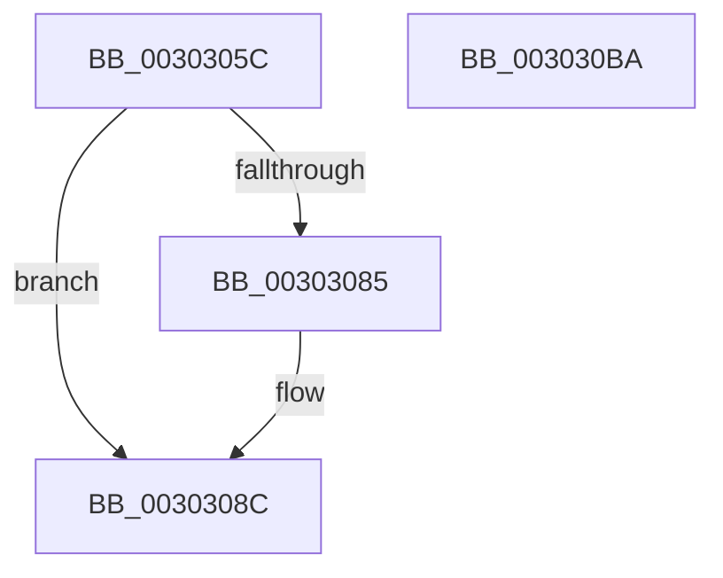

# KeUpdateThreadCpuSets

- RVA: `0x0030305C`–`0x003030BB` (길이 `95` bytes)
- VA: `0x000000014030305C`
- 실행 섹션: `.text`
- PDB 이름 있음: `예`; PDB Function 태그: `아니요`
- unwind 정보 RVA: `0x0005CAAC`
- 디코드: `24`개 명령, `95/95` bytes 표시
- 미해석 바이트: `0` (있으면 어셈블리에 `.byte`로 보존)

> 이 문서는 커널 이미지의 기계어와 PDB 기호를 분석해 생성했습니다. 4번과 5번은 함수 원형과 자료형을 바이너리 사용 방식에서 추정한 C 해석이며 원본 소스 복구 결과는 아닙니다.

## 1. Dependencies

- 직접 호출 지점: **3**; 고유 호출 대상: **3**
- 직접 호출자로 확인된 함수: **1**
- RIP 상대 이미지 참조: **1**

### Outgoing calls
- `0x00303087` → [KiRaiseIrqlProcessIrqlFlags](../4F/KiRaiseIrqlProcessIrqlFlags_function_004F56FC.md) (function, `0x004F56FC`)
- `0x00303094` → [KiUpdateThreadCpuSetAffinitiesFromDpcLevel](KiUpdateThreadCpuSetAffinitiesFromDpcLevel_function_003030C4.md) (function, `0x003030C4`)
- `0x003030AA` → [KiProcessDeferredReadyList](../25/KiProcessDeferredReadyList_function_00250800.md) (function, `0x00250800`)

### Direct callers
- [sub_00B1B2E4](../../page/B1/Unknown_function_00B1B2E4.md) at `0x00B1B71E`

### Static image references
- `0x0030307C` → RVA `0x00FC6D20` (`ALMOSTRO`; read)

## 2. Other-region calls and transfers

- 다른 실행 섹션으로 향하는 call: **0**
- 별도 외부 분기/꼬리 이동을 확인하지 못했습니다.

## 3. Assembly (complete function range)

```asm
0030305C  48 89 5C 24 08                  mov qword ptr [rsp + 8], rbx
00303061  57                              push rdi
00303062  48 83 EC 20                     sub rsp, 0x20
00303066  48 83 64 24 38 00               and qword ptr [rsp + 0x38], 0
0030306C  48 8B F9                        mov rdi, rcx
0030306F  44 0F 20 C3                     mov rbx, cr8
00303073  BA 02 00 00 00                  mov edx, 2
00303078  44 0F 22 C2                     mov cr8, rdx
0030307C  83 3D 9D 3C CC 00 00            cmp dword ptr [rip + 0xcc3c9d], 0
00303083  74 07                           je 0x14030308c
00303085  8A CB                           mov cl, bl
00303087  E8 70 26 1F 00                  call 0x1404f56fc
0030308C  48 8D 54 24 38                  lea rdx, [rsp + 0x38]
00303091  48 8B CF                        mov rcx, rdi
00303094  E8 2B 00 00 00                  call 0x1403030c4
00303099  65 48 8B 0C 25 20 00 00 00      mov rcx, qword ptr gs:[0x20]
003030A2  48 8D 54 24 38                  lea rdx, [rsp + 0x38]
003030A7  44 8A C3                        mov r8b, bl
003030AA  E8 51 D7 F4 FF                  call 0x140250800
003030AF  48 8B 5C 24 30                  mov rbx, qword ptr [rsp + 0x30]
003030B4  48 83 C4 20                     add rsp, 0x20
003030B8  5F                              pop rdi
003030B9  C3                              ret
003030BA  CC                              int3
```

## 4. C-style interpretation (structured pseudocode)

```c
__int64 __fastcall KeUpdateThreadCpuSets(__int64 a1)
{
    __int64 result;
    __int64 v_rsp;
    unsigned __int64 v_stack_p10;
    unsigned __int64 v_stack_p8;

    v_stack_p8 = v_rbx;
    v_rsp = (v_rsp) - (32);
    if ((*(unsigned int *)(v_rip + 13384861)) != 0) {
        a1 = (unsigned __int8)(v_cr8);
        result = KiRaiseIrqlProcessIrqlFlags(a1, 2, a3, a4);
    }
    result = KiUpdateThreadCpuSetAffinitiesFromDpcLevel(a1, v_stack_p10, a3, a4);
    result = KiProcessDeferredReadyList(*(unsigned __int64 *)(gs_base + (0 + 32)), v_stack_p10, (unsigned __int8)(v_cr8), a4);
    v_rsp = (v_rsp) + (32);
    return result;
}
```

## 5. (Beta) C Style

```c
int64_t KeUpdateThreadCpuSets(int64_t Arg1)
{
    int64_t result;
    int64_t local_rsp;
    uint64_t v_stack_p10;
    uint64_t v_stack_p8;

    v_stack_p8 = local_rbx;
    local_rsp = (local_rsp) - (32);
    if ((*(uint32_t *)(v_rip + 0xCC3C9D)) != 0) {
        Arg1 = (uint8_t)(v_cr8);
        result = KiRaiseIrqlProcessIrqlFlags(Arg1, 2, a3, a4);
    }
    result = KiUpdateThreadCpuSetAffinitiesFromDpcLevel(Arg1, v_stack_p10, a3, a4);
    result = KiProcessDeferredReadyList(*(uint64_t *)(gs_base + (0 + 0x20)), v_stack_p10, (uint8_t)(v_cr8), a4);
    local_rsp = (local_rsp) + (32);
    return result;
}
```

## 6. Execution-region graph

[열기: 2D/3D 그래프와 함수 탐색 컨트롤 패널](../../../control-panel.html?section=text&rva=0x0030305C&view=graph)

- 2D 그래프는 위에서 아래로 흐르고, 3D 그래프는 빈 공간을 드래그해 회전합니다. Shift+드래그는 이동, 휠은 확대·축소, 함수 노드 선택은 대상 보고서 이동입니다.

### Static fallback


