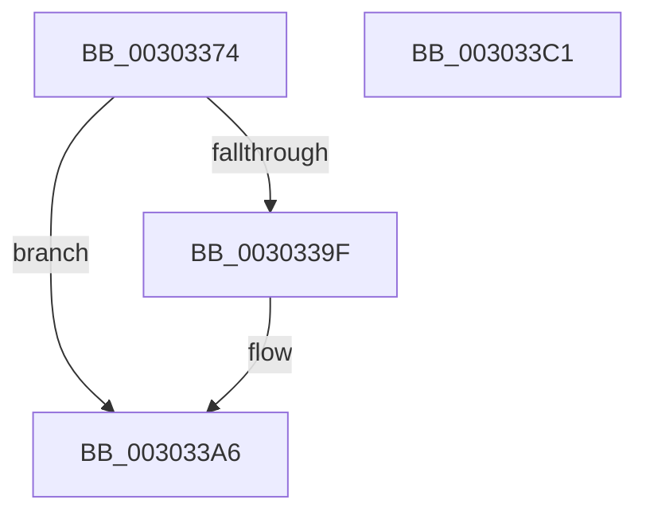

# KiAcquireCpuPartitionLock

- RVA: `0x00303374`–`0x003033C2` (길이 `78` bytes)
- VA: `0x0000000140303374`
- 실행 섹션: `.text`
- PDB 이름 있음: `예`; PDB Function 태그: `아니요`
- unwind 정보 RVA: `0x00060BC4`
- 디코드: `22`개 명령, `78/78` bytes 표시
- 미해석 바이트: `0` (있으면 어셈블리에 `.byte`로 보존)

> 이 문서는 커널 이미지의 기계어와 PDB 기호를 분석해 생성했습니다. 4번과 5번은 함수 원형과 자료형을 바이너리 사용 방식에서 추정한 C 해석이며 원본 소스 복구 결과는 아닙니다.

## 1. Dependencies

- 직접 호출 지점: **2**; 고유 호출 대상: **2**
- 직접 호출자로 확인된 함수: **4**
- RIP 상대 이미지 참조: **1**

### Outgoing calls
- `0x003033A1` → [KiRaiseIrqlProcessIrqlFlags](../4F/KiRaiseIrqlProcessIrqlFlags_function_004F56FC.md) (function, `0x004F56FC`)
- `0x003033AC` → [KeAcquireSpinLockAtDpcLevel](../20/KeAcquireSpinLockAtDpcLevel_function_00208430.md) (function, `0x00208430`)

### Direct callers
- [KeModifySystemAllowedCpuSets](KeModifySystemAllowedCpuSets_function_00303308.md) at `0x0030332F`
- [KiQueryCpuPartitionAffinity](../4F/KiQueryCpuPartitionAffinity_function_004F548C.md) at `0x004F54CA`
- [KeCpuPartitionMoveCpus](../5C/KeCpuPartitionMoveCpus_function_005C0B70.md) at `0x005C0BFB`
- [KeQueryCpuPartitionAffinity](../5C/KeQueryCpuPartitionAffinity_function_005C0EF8.md) at `0x005C0F74`

### Static image references
- `0x00303396` → RVA `0x00FC6D20` (`ALMOSTRO`; read)

## 2. Other-region calls and transfers

- 다른 실행 섹션으로 향하는 call: **0**
- 별도 외부 분기/꼬리 이동을 확인하지 못했습니다.

## 3. Assembly (complete function range)

```asm
00303374  48 89 5C 24 08                  mov qword ptr [rsp + 8], rbx
00303379  48 89 74 24 10                  mov qword ptr [rsp + 0x10], rsi
0030337E  57                              push rdi
0030337F  48 83 EC 20                     sub rsp, 0x20
00303383  48 8B FA                        mov rdi, rdx
00303386  48 8B F1                        mov rsi, rcx
00303389  44 0F 20 C3                     mov rbx, cr8
0030338D  BA 02 00 00 00                  mov edx, 2
00303392  44 0F 22 C2                     mov cr8, rdx
00303396  83 3D 83 39 CC 00 00            cmp dword ptr [rip + 0xcc3983], 0
0030339D  74 07                           je 0x1403033a6
0030339F  8A CB                           mov cl, bl
003033A1  E8 56 23 1F 00                  call 0x1404f56fc
003033A6  48 8D 4E 08                     lea rcx, [rsi + 8]
003033AA  88 1F                           mov byte ptr [rdi], bl
003033AC  E8 7F 50 F0 FF                  call 0x140208430
003033B1  48 8B 5C 24 30                  mov rbx, qword ptr [rsp + 0x30]
003033B6  48 8B 74 24 38                  mov rsi, qword ptr [rsp + 0x38]
003033BB  48 83 C4 20                     add rsp, 0x20
003033BF  5F                              pop rdi
003033C0  C3                              ret
003033C1  CC                              int3
```

## 4. C-style interpretation (structured pseudocode)

```c
__int64 __fastcall KiAcquireCpuPartitionLock(__int64 a1, __int64 a2)
{
    __int64 result;
    __int64 v_rsp;
    unsigned __int64 v_stack_p10;
    unsigned __int64 v_stack_p8;

    v_stack_p8 = v_rbx;
    v_stack_p10 = v_rsi;
    v_rsp = (v_rsp) - (32);
    if ((*(unsigned int *)(v_rip + 13384067)) != 0) {
        a1 = (unsigned __int8)(v_cr8);
        result = KiRaiseIrqlProcessIrqlFlags(a1, 2, a3, a4);
    }
    *(unsigned __int8 *)(a2) = (unsigned __int8)(v_cr8);
    result = KeAcquireSpinLockAtDpcLevel(a1 + 8, 2, a3, a4);
    v_rsp = (v_rsp) + (32);
    return result;
}
```

## 5. (Beta) C Style

```c
int64_t KiAcquireCpuPartitionLock(void *Arg1, void *Arg2)
{
    uint8_t *arg1 = (uint8_t *)Arg1;
    uint8_t *arg2 = (uint8_t *)Arg2;

    int64_t result;
    int64_t local_rsp;
    uint64_t v_stack_p10;
    uint64_t v_stack_p8;

    v_stack_p8 = local_rbx;
    v_stack_p10 = local_rsi;
    local_rsp = (local_rsp) - (32);
    if ((*(uint32_t *)(v_rip + 0xCC3983)) != 0) {
        Arg1 = (uint8_t)(v_cr8);
        result = KiRaiseIrqlProcessIrqlFlags(Arg1, 2, a3, a4);
    }
    *(uint8_t *)(arg2) = (uint8_t)(v_cr8);
    result = KeAcquireSpinLockAtDpcLevel(Arg1 + 8, 2, a3, a4);
    local_rsp = (local_rsp) + (32);
    return result;
}
```

### 관측된 메모리 오프셋

구조체 형식이 확인되지 않은 접근은 인자 기준의 오프셋으로만 기록했습니다.

| 기준 인자 | 오프셋 표현 | 폭 (bit) | 접근 |
|---|---:|---:|---|
| `Arg1` | `+ 0x8` | `64` | `R` |
| `Arg2` | `+ 0x0` | `8` | `W` |

## 6. Execution-region graph

[열기: 2D/3D 그래프와 함수 탐색 컨트롤 패널](../../../control-panel.html?section=text&rva=0x00303374&view=graph)

- 2D 그래프는 위에서 아래로 흐르고, 3D 그래프는 빈 공간을 드래그해 회전합니다. Shift+드래그는 이동, 휠은 확대·축소, 함수 노드 선택은 대상 보고서 이동입니다.

### Static fallback


