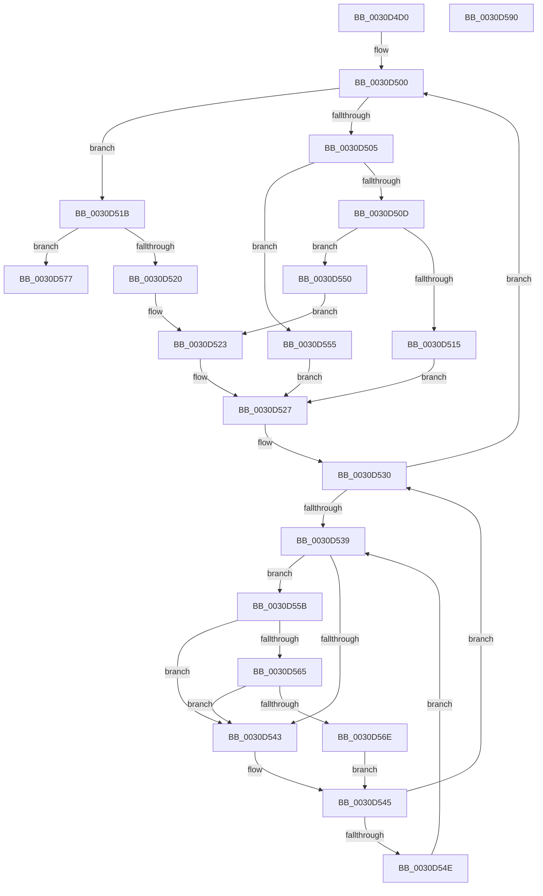

# KiAcquireMultiplePrcbLockArrays

- RVA: `0x0030D4D0`–`0x0030D591` (길이 `193` bytes)
- VA: `0x000000014030D4D0`
- 실행 섹션: `.text`
- PDB 이름 있음: `예`; PDB Function 태그: `아니요`
- unwind 정보 RVA: `0x00060300`
- 디코드: `62`개 명령, `193/193` bytes 표시
- 미해석 바이트: `0` (있으면 어셈블리에 `.byte`로 보존)

> 이 문서는 커널 이미지의 기계어와 PDB 기호를 분석해 생성했습니다. 4번과 5번은 함수 원형과 자료형을 바이너리 사용 방식에서 추정한 C 해석이며 원본 소스 복구 결과는 아닙니다.

## 1. Dependencies

- 직접 호출 지점: **2**; 고유 호출 대상: **2**
- 직접 호출자로 확인된 함수: **1**
- RIP 상대 이미지 참조: **2**

### Outgoing calls
- `0x0030D565` → [KiCheckVpBackingLongSpinWaitHypercall](KiCheckVpBackingLongSpinWaitHypercall_function_0030F490.md) (function, `0x0030F490`)
- `0x0030D570` → [HvlNotifyLongSpinWait](HvlNotifyLongSpinWait_function_0030F460.md) (function, `0x0030F460`)

### Direct callers
- [KiAttemptToStealStandbyThread](KiAttemptToStealStandbyThread_function_0030D790.md) at `0x0030D838`

### Static image references
- `0x0030D53B` → RVA `0x00FC52AC` (`ALMOSTRO`; reference)
- `0x0030D55B` → RVA `0x00FC6AB8` (`ALMOSTRO`; read)

## 2. Other-region calls and transfers

- 다른 실행 섹션으로 향하는 call: **0**
- 별도 외부 분기/꼬리 이동을 확인하지 못했습니다.

## 3. Assembly (complete function range)

```asm
0030D4D0  48 89 5C 24 08                  mov qword ptr [rsp + 8], rbx
0030D4D5  48 89 6C 24 10                  mov qword ptr [rsp + 0x10], rbp
0030D4DA  48 89 74 24 18                  mov qword ptr [rsp + 0x18], rsi
0030D4DF  57                              push rdi
0030D4E0  41 56                           push r14
0030D4E2  41 57                           push r15
0030D4E4  48 83 EC 20                     sub rsp, 0x20
0030D4E8  8B C2                           mov eax, edx
0030D4EA  49 8B F0                        mov rsi, r8
0030D4ED  4C 8B F1                        mov r14, rcx
0030D4F0  48 8D 2C C1                     lea rbp, [rcx + rax*8]
0030D4F4  41 8B C1                        mov eax, r9d
0030D4F7  4D 8D 3C C0                     lea r15, [r8 + rax*8]
0030D4FB  0F 1F 44 00 00                  nop dword ptr [rax + rax]
0030D500  4C 3B F5                        cmp r14, rbp
0030D503  73 16                           jae 0x14030d51b
0030D505  49 8B 1E                        mov rbx, qword ptr [r14]
0030D508  49 3B F7                        cmp rsi, r15
0030D50B  73 48                           jae 0x14030d555
0030D50D  48 8B 06                        mov rax, qword ptr [rsi]
0030D510  48 3B D8                        cmp rbx, rax
0030D513  73 3B                           jae 0x14030d550
0030D515  49 83 C6 08                     add r14, 8
0030D519  EB 0C                           jmp 0x14030d527
0030D51B  49 3B F7                        cmp rsi, r15
0030D51E  73 57                           jae 0x14030d577
0030D520  48 8B 1E                        mov rbx, qword ptr [rsi]
0030D523  48 83 C6 08                     add rsi, 8
0030D527  33 FF                           xor edi, edi
0030D529  0F 1F 80 00 00 00 00            nop dword ptr [rax]
0030D530  F0 48 0F BA 6B 30 00            lock bts qword ptr [rbx + 0x30], 0
0030D537  73 C7                           jae 0x14030d500
0030D539  FF C7                           inc edi
0030D53B  85 3D 6B 7D CB 00               test dword ptr [rip + 0xcb7d6b], edi
0030D541  74 18                           je 0x14030d55b
0030D543  F3 90                           pause
0030D545  48 8B 43 30                     mov rax, qword ptr [rbx + 0x30]
0030D549  48 85 C0                        test rax, rax
0030D54C  74 E2                           je 0x14030d530
0030D54E  EB E9                           jmp 0x14030d539
0030D550  48 8B D8                        mov rbx, rax
0030D553  EB CE                           jmp 0x14030d523
0030D555  49 83 C6 08                     add r14, 8
0030D559  EB CC                           jmp 0x14030d527
0030D55B  8B 05 57 95 CB 00               mov eax, dword ptr [rip + 0xcb9557]
0030D561  A8 40                           test al, 0x40
0030D563  74 DE                           je 0x14030d543
0030D565  E8 26 1F 00 00                  call 0x14030f490
0030D56A  84 C0                           test al, al
0030D56C  74 D5                           je 0x14030d543
0030D56E  8B CF                           mov ecx, edi
0030D570  E8 EB 1E 00 00                  call 0x14030f460
0030D575  EB CE                           jmp 0x14030d545
0030D577  48 8B 5C 24 40                  mov rbx, qword ptr [rsp + 0x40]
0030D57C  48 8B 6C 24 48                  mov rbp, qword ptr [rsp + 0x48]
0030D581  48 8B 74 24 50                  mov rsi, qword ptr [rsp + 0x50]
0030D586  48 83 C4 20                     add rsp, 0x20
0030D58A  41 5F                           pop r15
0030D58C  41 5E                           pop r14
0030D58E  5F                              pop rdi
0030D58F  C3                              ret
0030D590  CC                              int3
```

## 4. C-style interpretation (structured pseudocode)

```c
__int64 __fastcall KiAcquireMultiplePrcbLockArrays(__int64 a1, int a2, __int64 a3, int a4)
{
    __int64 result;
    __int64 v_r14;
    __int64 v_rdi;
    __int64 v_rsi;
    __int64 v_rsp;
    unsigned __int64 v_stack_p10;
    unsigned __int64 v_stack_p18;
    unsigned __int64 v_stack_p8;

    v_stack_p8 = v_rbx;
    v_stack_p10 = v_rbp;
    v_stack_p18 = v_rsi;
    v_rsp = (v_rsp) - (32);
loc_0030D500:
    if (a1 >= (a1 + (unsigned int)(a2) * 8)) goto loc_0030D51B;
    if (a3 >= (a3 + (unsigned int)(a4) * 8)) goto loc_0030D555;
    if ((*(unsigned __int64 *)(a1)) >= (*(unsigned __int64 *)(a3))) goto loc_0030D550;
    v_r14 = (a1) + (8);
    goto loc_0030D527;
loc_0030D51B:
    if (a3 >= (a3 + (unsigned int)(a4) * 8)) goto loc_0030D577;
loc_0030D523:
    v_rsi = (a3) + (8);
loc_0030D527:
    v_rdi = 0;
loc_0030D530:
    if (condition_is_above_or_equal) goto loc_0030D500;
loc_0030D539:
    v_rdi = (unsigned int)((v_rdi) + 1);
    if (((*(unsigned int *)(v_rip + 13335915)) & ((unsigned int)(v_rdi))) == 0) goto loc_0030D55B;
loc_0030D543:
loc_0030D545:
    if (*(unsigned __int64 *)(*(unsigned __int64 *)(a3) + 48) == 0) goto loc_0030D530;
    goto loc_0030D539;
loc_0030D550:
    goto loc_0030D523;
loc_0030D555:
    v_r14 = (v_r14) + (8);
    goto loc_0030D527;
loc_0030D55B:
    if ((((unsigned __int8)((unsigned int)(*(unsigned int *)(v_rip + 13342039)))) & (64)) == 0) goto loc_0030D543;
    result = KiCheckVpBackingLongSpinWaitHypercall(a1, a2, a3, a4);
    if ((unsigned __int8)(result) == 0) goto loc_0030D543;
    result = HvlNotifyLongSpinWait((unsigned int)((unsigned int)(v_rdi)), a2, a3, a4);
    goto loc_0030D545;
loc_0030D577:
    v_rsp = (v_rsp) + (32);
    return result;
}
```

## 5. (Beta) C Style

```c
int64_t KiAcquireMultiplePrcbLockArrays(void *Arg1, int32_t Arg2, void *Arg3, void *Arg4)
{
    uint8_t *arg1 = (uint8_t *)Arg1;
    uint8_t *arg3 = (uint8_t *)Arg3;
    uint8_t *arg4 = (uint8_t *)Arg4;

    int64_t result;
    int64_t local_r14;
    int64_t local_rdi;
    int64_t local_rsi;
    int64_t local_rsp;
    uint64_t v_stack_p10;
    uint64_t v_stack_p18;
    uint64_t v_stack_p8;

    v_stack_p8 = local_rbx;
    v_stack_p10 = local_rbp;
    v_stack_p18 = local_rsi;
    local_rsp = (local_rsp) - (32);
loc_0030D500:
    if (Arg1 >= (Arg1 + (uint32_t)(Arg2) * 8)) goto loc_0030D51B;
    if (Arg3 >= (Arg3 + (uint32_t)(Arg4) * 8)) goto loc_0030D555;
    if ((*(uint64_t *)(arg1)) >= (*(uint64_t *)(arg3))) goto loc_0030D550;
    local_r14 = (Arg1) + (8);
    goto loc_0030D527;
loc_0030D51B:
    if (Arg3 >= (Arg3 + (uint32_t)(Arg4) * 8)) goto loc_0030D577;
loc_0030D523:
    local_rsi = (Arg3) + (8);
loc_0030D527:
    local_rdi = 0;
loc_0030D530:
    if (condition_is_above_or_equal) goto loc_0030D500;
loc_0030D539:
    local_rdi = (uint32_t)((local_rdi) + 1);
    if (((*(uint32_t *)(v_rip + 0xCB7D6B)) & ((uint32_t)(local_rdi))) == 0) goto loc_0030D55B;
loc_0030D543:
loc_0030D545:
    if (*(uint64_t *)(*(uint64_t *)(arg3) + 0x30) == 0) goto loc_0030D530;
    goto loc_0030D539;
loc_0030D550:
    goto loc_0030D523;
loc_0030D555:
    local_r14 = (local_r14) + (8);
    goto loc_0030D527;
loc_0030D55B:
    if ((((uint8_t)((uint32_t)(*(uint32_t *)(v_rip + 0xCB9557)))) & (64)) == 0) goto loc_0030D543;
    result = KiCheckVpBackingLongSpinWaitHypercall(Arg1, Arg2, Arg3, Arg4);
    if ((uint8_t)(result) == 0) goto loc_0030D543;
    result = HvlNotifyLongSpinWait((uint32_t)((uint32_t)(local_rdi)), Arg2, Arg3, Arg4);
    goto loc_0030D545;
loc_0030D577:
    local_rsp = (local_rsp) + (32);
    return result;
}
```

### 관측된 메모리 오프셋

구조체 형식이 확인되지 않은 접근은 인자 기준의 오프셋으로만 기록했습니다.

| 기준 인자 | 오프셋 표현 | 폭 (bit) | 접근 |
|---|---:|---:|---|
| `Arg1` | `+ 0x0 + rax*8` | `64` | `R` |
| `Arg3` | `+ 0x0 + rax*8` | `64` | `R` |
| `Arg4` | `+ 0x0 + rax*1` | `32` | `R` |

## 6. Execution-region graph

[열기: 2D/3D 그래프와 함수 탐색 컨트롤 패널](../../../control-panel.html?section=text&rva=0x0030D4D0&view=graph)

- 2D 그래프는 위에서 아래로 흐르고, 3D 그래프는 빈 공간을 드래그해 회전합니다. Shift+드래그는 이동, 휠은 확대·축소, 함수 노드 선택은 대상 보고서 이동입니다.

### Static fallback


