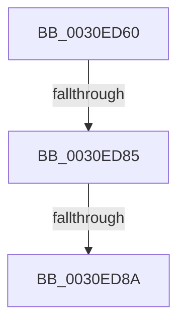

# KiAcquirePrcbLocksForIsolationUnit

- RVA: `0x0030ED60`–`0x0030ED9C` (길이 `60` bytes)
- VA: `0x000000014030ED60`
- 실행 섹션: `.text`
- PDB 이름 있음: `예`; PDB Function 태그: `아니요`
- unwind 정보 RVA: `0x0007401C`
- 디코드: `18`개 명령, `60/60` bytes 표시
- 미해석 바이트: `0` (있으면 어셈블리에 `.byte`로 보존)

> 이 문서는 커널 이미지의 기계어와 PDB 기호를 분석해 생성했습니다. 4번과 5번은 함수 원형과 자료형을 바이너리 사용 방식에서 추정한 C 해석이며 원본 소스 복구 결과는 아닙니다.

## 1. Dependencies

- 직접 호출 지점: **0**; 고유 호출 대상: **0**
- 직접 호출자로 확인된 함수: **41**
- RIP 상대 이미지 참조: **0**

### Outgoing calls
- 직접 디코드된 call 명령이 없습니다.

### Direct callers
- [KiHandleDeferredPreemption](../20/KiHandleDeferredPreemption_function_00202ECC.md) at `0x00202F30`
- [KiHandleDeferredPreemption](../20/KiHandleDeferredPreemption_function_00202ECC.md) at `0x002031C4`
- [KeYieldExecution](../20/KeYieldExecution_function_00209FA0.md) at `0x0020A08F`
- [KeYieldExecution](../20/KeYieldExecution_function_00209FA0.md) at `0x0020A3C7`
- [KiRemoveBoostThread](../21/KiRemoveBoostThread_function_00219128.md) at `0x002191BB`
- [KiNormalPriorityReadyScan](../21/KiNormalPriorityReadyScan_function_0021B400.md) at `0x0021B458`
- [KiNormalPriorityReadyScan](../21/KiNormalPriorityReadyScan_function_0021B400.md) at `0x0021B66F`
- [sub_0021BAB9](../21/Unknown_function_0021BAB9.md) at `0x0021BC8F`
- [sub_0021C4AD](../21/Unknown_function_0021C4AD.md) at `0x0021C4CF`
- [sub_0021C69D](../21/Unknown_function_0021C69D.md) at `0x0021C6FA`
- [KiSetPriorityThread](../22/KiSetPriorityThread_function_00220E78.md) at `0x002211FC`
- [KiCheckForThreadDispatch](../25/KiCheckForThreadDispatch_function_00250648.md) at `0x0025070B`
- [KiChooseTargetProcessor](../25/KiChooseTargetProcessor_function_002556D8.md) at `0x0025579A`
- [KeSetThreadSchedulerAssist](KeSetThreadSchedulerAssist_function_003038F8.md) at `0x003039FE`
- [KiUpdateGlobalCpuSetConfiguration](KiUpdateGlobalCpuSetConfiguration_function_00305AB8.md) at `0x00305B41`
- [KiUpdateGlobalCpuSetConfiguration](KiUpdateGlobalCpuSetConfiguration_function_00305AB8.md) at `0x00305C8D`
- [KiGroupSchedulingGenerationEnd](KiGroupSchedulingGenerationEnd_function_0030A9B4.md) at `0x0030ADBF`
- [KiGroupSchedulingQuantumEnd](KiGroupSchedulingQuantumEnd_function_0030B220.md) at `0x0030B272`
- [KiGroupSchedulingQuantumEnd](KiGroupSchedulingQuantumEnd_function_0030B220.md) at `0x0030B434`
- [KiAttemptToStealStandbyThread](KiAttemptToStealStandbyThread_function_0030D790.md) at `0x0030DC73`
- [sub_0030E8E0](Unknown_function_0030E8E0.md) at `0x0030EB47`
- [sub_0030F26B](Unknown_function_0030F26B.md) at `0x0030F416`
- [KeTransitionProcessorParkState](../35/KeTransitionProcessorParkState_function_003527EC.md) at `0x0035285C`
- [KiExitThreadWaitReschedule](../35/KiExitThreadWaitReschedule_function_00352EC8.md) at `0x00352F20`
- [KiSearchForNewThreadsWithinSearchContext](../35/KiSearchForNewThreadsWithinSearchContext_function_00353B30.md) at `0x00353C67`
- [KiSearchForNewThreadsWithinSearchContext](../35/KiSearchForNewThreadsWithinSearchContext_function_00353B30.md) at `0x00353CB0`
- [KiSendHeteroRescheduleIntRequestHelper](../35/KiSendHeteroRescheduleIntRequestHelper_function_0035420C.md) at `0x003544AF`
- [KiSendHeteroRescheduleIntRequestHelper](../35/KiSendHeteroRescheduleIntRequestHelper_function_0035420C.md) at `0x00354519`
- [KiSendHeteroRescheduleIntRequestHelper](../35/KiSendHeteroRescheduleIntRequestHelper_function_0035420C.md) at `0x003546B4`
- [KiSwapThread](../35/KiSwapThread_function_00355640.md) at `0x0035599B`
- [KiSwapThread](../35/KiSwapThread_function_00355640.md) at `0x00355BD6`
- [KiSearchForNewThread](../35/KiSearchForNewThread_function_00355C98.md) at `0x00355DDE`
- [KiSearchForNewThread](../35/KiSearchForNewThread_function_00355C98.md) at `0x00355F0D`
- [KiRemoveThreadFromSchedulingGroup](../35/KiRemoveThreadFromSchedulingGroup_function_00356514.md) at `0x00356639`
- [KeQueryTotalCycleTimeThread](../37/KeQueryTotalCycleTimeThread_function_0037EF20.md) at `0x0037F783`
- [KeQueryTotalCycleTimeThread](../37/KeQueryTotalCycleTimeThread_function_0037EF20.md) at `0x0037F888`
- [KeQueryTotalCycleTimeThread](../37/KeQueryTotalCycleTimeThread_function_0037EF20.md) at `0x0037FA00`
- [KeQueryEffectivePriorityThread](../3C/KeQueryEffectivePriorityThread_function_003C7CA0.md) at `0x003C7D8A`
- [KeQueryEffectivePriorityThread](../3C/KeQueryEffectivePriorityThread_function_003C7CA0.md) at `0x003C7E2C`
- [KeQueryEffectivePriorityThread](../3C/KeQueryEffectivePriorityThread_function_003C7CA0.md) at `0x003C7E7E`
- [KiAcquirePrcbLocksForPreemptionAttemptSlowPath](../43/KiAcquirePrcbLocksForPreemptionAttemptSlowPath_function_00434910.md) at `0x00434973`
- [KiUpdateCpuTargetByRate](../46/KiUpdateCpuTargetByRate_function_0046D7E4.md) at `0x0046D8CA`
- [KiUpdateCpuTargetByRate](../46/KiUpdateCpuTargetByRate_function_0046D7E4.md) at `0x0046D9F4`
- [KeSetSchedulingGroupRankBias](../46/KeSetSchedulingGroupRankBias_function_0046DB74.md) at `0x0046DC0B`
- [KiUpdateCpuTargetByWeight](../46/KiUpdateCpuTargetByWeight_function_0046E0E0.md) at `0x0046E1B1`
- [KiUpdateCpuTargetByWeight](../46/KiUpdateCpuTargetByWeight_function_0046E0E0.md) at `0x0046E28E`
- [KeUpdateThreadTag](../47/KeUpdateThreadTag_function_00475770.md) at `0x0047588F`
- [KeTryToFreezeThreadStack](../4B/KeTryToFreezeThreadStack_function_004B5038.md) at `0x004B50FD`
- [KeTryToFreezeThreadStack](../4B/KeTryToFreezeThreadStack_function_004B5038.md) at `0x004B51B5`
- [KeTryToFreezeThreadStack](../4B/KeTryToFreezeThreadStack_function_004B5038.md) at `0x004B5232`
- [KiFinalizeCoreControlBlockAssignment](../5B/KiFinalizeCoreControlBlockAssignment_function_005B7D0C.md) at `0x005B7DA0`
- [KiAdjustUserIsolationDomainThread](../5C/KiAdjustUserIsolationDomainThread_function_005C3B54.md) at `0x005C3C91`
- [KiAdjustUserIsolationDomainThread](../5C/KiAdjustUserIsolationDomainThread_function_005C3B54.md) at `0x005C3CE2`
- [KiAdjustUserIsolationDomainThread](../5C/KiAdjustUserIsolationDomainThread_function_005C3B54.md) at `0x005C3E50`
- [KeAbCrossThreadDelete](../5C/KeAbCrossThreadDelete_function_005C517C.md) at `0x005C52D1`
- [KeAbCrossThreadDelete](../5C/KeAbCrossThreadDelete_function_005C517C.md) at `0x005C5321`
- [KeAbCrossThreadDelete](../5C/KeAbCrossThreadDelete_function_005C517C.md) at `0x005C5465`
- [KeTraceParkingRundown](../5C/KeTraceParkingRundown_function_005C95F4.md) at `0x005C963E`
- [KiForceParkDutyCycleDpcCallback](../5C/KiForceParkDutyCycleDpcCallback_function_005C97D0.md) at `0x005C97FD`
- [KiStartForceParkSingleDutyCycleTimerCallback](../5C/KiStartForceParkSingleDutyCycleTimerCallback_function_005C99F0.md) at `0x005C9A0D`
- [KiStopForceParkSingleDutyCycleTimerCallback](../5C/KiStopForceParkSingleDutyCycleTimerCallback_function_005C9A70.md) at `0x005C9A8D`
- [sub_006E2870](../6E/Unknown_function_006E2870.md) at `0x006E28AC`
- [KiCompleteKernelInit](../../pagelk/B6/KiCompleteKernelInit_function_00B66090.md) at `0x00B66367`

### Static image references
- 디코드된 RIP-relative 메모리 참조가 없습니다.

## 2. Other-region calls and transfers

- 다른 실행 섹션으로 향하는 call: **0**
- call이 아닌 외부 분기/꼬리 이동: **3**
  - `0x0030ED7F` → [sub_0030EE13](Unknown_function_0030EE13.md) (`tail-transfer`)
  - `0x0030ED88` → [sub_0030EDD7](Unknown_function_0030EDD7.md) (`tail-transfer`)
  - `0x0030ED9A` → [sub_0030EDD7](Unknown_function_0030EDD7.md) (`tail-transfer`)

## 3. Assembly (complete function range)

```asm
0030ED60  48 89 4C 24 08                  mov qword ptr [rsp + 8], rcx
0030ED65  56                              push rsi
0030ED66  48 83 EC 20                     sub rsp, 0x20
0030ED6A  48 63 C2                        movsxd rax, edx
0030ED6D  4C 8B C8                        mov r9, rax
0030ED70  4C 33 C9                        xor r9, rcx
0030ED73  49 83 E1 FE                     and r9, 0xfffffffffffffffe
0030ED77  4C 33 C8                        xor r9, rax
0030ED7A  4D 89 08                        mov qword ptr [r8], r9
0030ED7D  85 D2                           test edx, edx
0030ED7F  0F 84 8E 00 00 00               je 0x14030ee13
0030ED85  83 FA 01                        cmp edx, 1
0030ED88  75 4D                           jne 0x14030edd7
0030ED8A  48 8B 81 58 8E 00 00            mov rax, qword ptr [rcx + 0x8e58]
0030ED91  0F B6 08                        movzx ecx, byte ptr [rax]
0030ED94  48 8D 70 08                     lea rsi, [rax + 8]
0030ED98  85 C9                           test ecx, ecx
0030ED9A  74 3B                           je 0x14030edd7
```

## 4. C-style interpretation (structured pseudocode)

```c
__int64 __fastcall KiAcquirePrcbLocksForIsolationUnit(__int64 a1, int a2, __int64 a3)
{
    __int64 v_rsp;
    unsigned __int64 v_stack_p8;

    v_stack_p8 = a1;
    v_rsp = (v_rsp) - (32);
    a4 = ((int)(a2)) ^ (a1);
    a4 = (a4) & (-2);
    a4 = (a4) ^ ((int)(a2));
    *(unsigned __int64 *)(a3) = a4;
}
```

## 5. (Beta) C Style

```c
int64_t KiAcquirePrcbLocksForIsolationUnit(void *Arg1, int32_t Arg2, void *Arg3)
{
    uint8_t *arg1 = (uint8_t *)Arg1;
    uint8_t *arg3 = (uint8_t *)Arg3;

    int64_t local_rsp;
    uint64_t v_stack_p8;

    v_stack_p8 = Arg1;
    local_rsp = (local_rsp) - (32);
    a4 = ((int32_t)(Arg2)) ^ (Arg1);
    a4 = (a4) & (-2);
    a4 = (a4) ^ ((int32_t)(Arg2));
    *(uint64_t *)(arg3) = a4;
}
```

### 관측된 메모리 오프셋

구조체 형식이 확인되지 않은 접근은 인자 기준의 오프셋으로만 기록했습니다.

| 기준 인자 | 오프셋 표현 | 폭 (bit) | 접근 |
|---|---:|---:|---|
| `Arg1` | `+ 0x8E58` | `64` | `R` |
| `Arg3` | `+ 0x0` | `64` | `W` |

## 6. Execution-region graph

[열기: 2D/3D 그래프와 함수 탐색 컨트롤 패널](../../../control-panel.html?section=text&rva=0x0030ED60&view=graph)

- 2D 그래프는 위에서 아래로 흐르고, 3D 그래프는 빈 공간을 드래그해 회전합니다. Shift+드래그는 이동, 휠은 확대·축소, 함수 노드 선택은 대상 보고서 이동입니다.

### Static fallback


