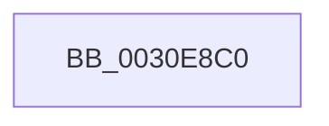

# KiAcquireThreadStateLockForWrite

- RVA: `0x0030E8C0`–`0x0030E8E0` (길이 `32` bytes)
- VA: `0x000000014030E8C0`
- 실행 섹션: `.text`
- PDB 이름 있음: `예`; PDB Function 태그: `예`
- unwind 정보 RVA: `0x00073F2C`
- 디코드: `12`개 명령, `32/32` bytes 표시
- 미해석 바이트: `0` (있으면 어셈블리에 `.byte`로 보존)

> 이 문서는 커널 이미지의 기계어와 PDB 기호를 분석해 생성했습니다. 4번과 5번은 함수 원형과 자료형을 바이너리 사용 방식에서 추정한 C 해석이며 원본 소스 복구 결과는 아닙니다.

## 1. Dependencies

- 직접 호출 지점: **0**; 고유 호출 대상: **0**
- 직접 호출자로 확인된 함수: **13**
- RIP 상대 이미지 참조: **0**

### Outgoing calls
- 직접 디코드된 call 명령이 없습니다.

### Direct callers
- [sub_0021BAB9](../21/Unknown_function_0021BAB9.md) at `0x0021BB42`
- [KiSetAffinityThread](../2C/KiSetAffinityThread_function_002CE010.md) at `0x002CE134`
- [KiSetIdealProcessorThread](../2D/KiSetIdealProcessorThread_function_002DCFE0.md) at `0x002DD087`
- [KiUpdateThreadCpuSets](KiUpdateThreadCpuSets_function_0030313C.md) at `0x00303192`
- [KiUpdateVpBackingThreadPriorityFromTopLevel](KiUpdateVpBackingThreadPriorityFromTopLevel_function_00303BA0.md) at `0x00303D56`
- [KiRemoveThreadFromSchedulingGroup](../35/KiRemoveThreadFromSchedulingGroup_function_00356514.md) at `0x00356592`
- [KeSetProcessPpmPolicy](../3C/KeSetProcessPpmPolicy_function_003C1CCC.md) at `0x003C1DB8`
- [KeSetThreadPpmPolicy](../3C/KeSetThreadPpmPolicy_function_003C6C30.md) at `0x003C6C9D`
- [KiSetThreadSchedulingGroup](../46/KiSetThreadSchedulingGroup_function_0046E458.md) at `0x0046E4F4`
- [KeUpdateThreadTag](../47/KeUpdateThreadTag_function_00475770.md) at `0x004759BA`
- [KiApplyForegroundBoostThread](../4F/KiApplyForegroundBoostThread_function_004F7DC0.md) at `0x004F7E05`
- [KiAdjustCoreIsolationReasonThread](../5C/KiAdjustCoreIsolationReasonThread_function_005C3818.md) at `0x005C38D6`
- [sub_006E0538](../6E/Unknown_function_006E0538.md) at `0x006E059A`

### Static image references
- 디코드된 RIP-relative 메모리 참조가 없습니다.

## 2. Other-region calls and transfers

- 다른 실행 섹션으로 향하는 call: **0**
- 별도 외부 분기/꼬리 이동을 확인하지 못했습니다.

## 3. Assembly (complete function range)

```asm
0030E8C0  4C 89 4C 24 20                  mov qword ptr [rsp + 0x20], r9
0030E8C5  4C 89 44 24 18                  mov qword ptr [rsp + 0x18], r8
0030E8CA  48 89 54 24 10                  mov qword ptr [rsp + 0x10], rdx
0030E8CF  53                              push rbx
0030E8D0  55                              push rbp
0030E8D1  56                              push rsi
0030E8D2  57                              push rdi
0030E8D3  41 54                           push r12
0030E8D5  41 55                           push r13
0030E8D7  41 57                           push r15
0030E8D9  48 83 EC 40                     sub rsp, 0x40
0030E8DD  49 8B E8                        mov rbp, r8
```

## 4. C-style interpretation (structured pseudocode)

```c
void __fastcall KiAcquireThreadStateLockForWrite(__int64 a1, __int64 a2, __int64 a3, __int64 a4)
{
    __int64 v_rsp;
    unsigned __int64 v_stack_p10;
    unsigned __int64 v_stack_p18;
    unsigned __int64 v_stack_p20;

    v_stack_p20 = a4;
    v_stack_p18 = a3;
    v_stack_p10 = a2;
    v_rsp = (v_rsp) - (64);
    return;
}
```

## 5. (Beta) C Style

```c
void KiAcquireThreadStateLockForWrite(int64_t Arg1, int64_t Arg2, int64_t Arg3, int64_t Arg4)
{
    int64_t local_rsp;
    uint64_t v_stack_p10;
    uint64_t v_stack_p18;
    uint64_t v_stack_p20;

    v_stack_p20 = Arg4;
    v_stack_p18 = Arg3;
    v_stack_p10 = Arg2;
    local_rsp = (local_rsp) - (64);
    return;
}
```

## 6. Execution-region graph

[열기: 2D/3D 그래프와 함수 탐색 컨트롤 패널](../../../control-panel.html?section=text&rva=0x0030E8C0&view=graph)

- 2D 그래프는 위에서 아래로 흐르고, 3D 그래프는 빈 공간을 드래그해 회전합니다. Shift+드래그는 이동, 휠은 확대·축소, 함수 노드 선택은 대상 보고서 이동입니다.

### Static fallback


