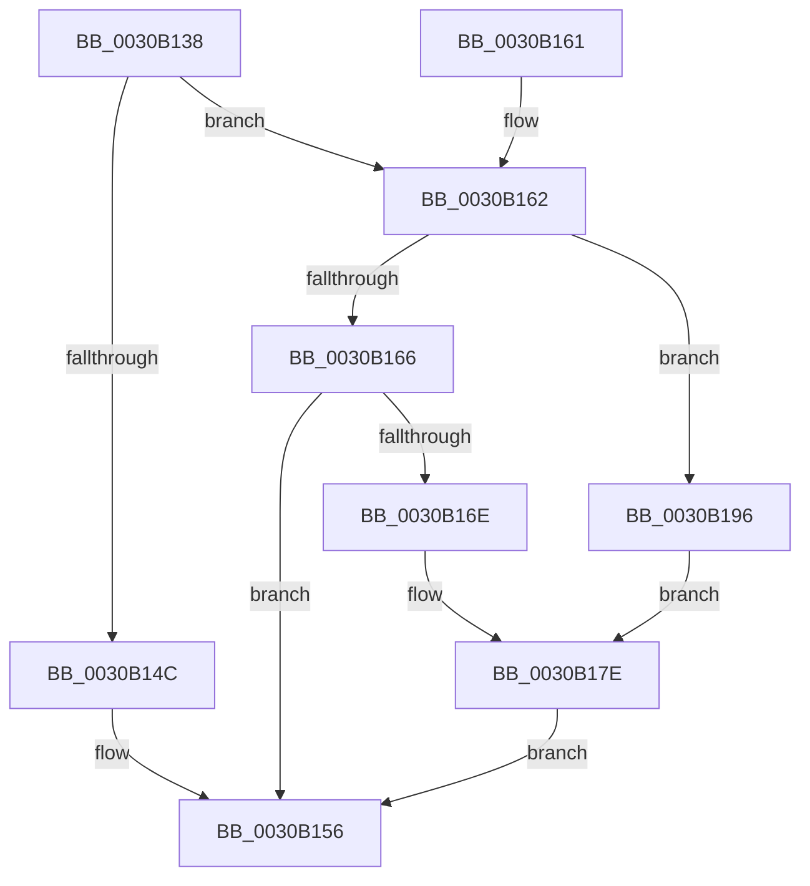

# KiAddProcessorToSoftwareInterruptBatch

- RVA: `0x0030B138`–`0x0030B19C` (길이 `100` bytes)
- VA: `0x000000014030B138`
- 실행 섹션: `.text`
- PDB 이름 있음: `예`; PDB Function 태그: `아니요`
- unwind 정보 RVA: `0x00073C7C`
- 디코드: `31`개 명령, `100/100` bytes 표시
- 미해석 바이트: `0` (있으면 어셈블리에 `.byte`로 보존)

> 이 문서는 커널 이미지의 기계어와 PDB 기호를 분석해 생성했습니다. 4번과 5번은 함수 원형과 자료형을 바이너리 사용 방식에서 추정한 C 해석이며 원본 소스 복구 결과는 아닙니다.

## 1. Dependencies

- 직접 호출 지점: **2**; 고유 호출 대상: **2**
- 직접 호출자로 확인된 함수: **1**
- RIP 상대 이미지 참조: **0**

### Outgoing calls
- `0x0030B179` → [KeAddProcessorAffinityEx](../25/KeAddProcessorAffinityEx_function_0025B6F0.md) (function, `0x0025B6F0`)
- `0x0030B18F` → [KeAddGroupAffinityEx](../25/KeAddGroupAffinityEx_function_0025B6C0.md) (function, `0x0025B6C0`)

### Direct callers
- [KiGroupSchedulingGenerationEnd](KiGroupSchedulingGenerationEnd_function_0030A9B4.md) at `0x0030ADD3`

### Static image references
- 디코드된 RIP-relative 메모리 참조가 없습니다.

## 2. Other-region calls and transfers

- 다른 실행 섹션으로 향하는 call: **0**
- 별도 외부 분기/꼬리 이동을 확인하지 못했습니다.

## 3. Assembly (complete function range)

```asm
0030B138  48 89 5C 24 08                  mov qword ptr [rsp + 8], rbx
0030B13D  57                              push rdi
0030B13E  48 83 EC 20                     sub rsp, 0x20
0030B142  8A 41 01                        mov al, byte ptr [rcx + 1]
0030B145  48 8B DA                        mov rbx, rdx
0030B148  84 C0                           test al, al
0030B14A  75 16                           jne 0x14030b162
0030B14C  C6 41 01 01                     mov byte ptr [rcx + 1], 1
0030B150  8B 42 24                        mov eax, dword ptr [rdx + 0x24]
0030B153  89 41 04                        mov dword ptr [rcx + 4], eax
0030B156  48 8B 5C 24 30                  mov rbx, qword ptr [rsp + 0x30]
0030B15B  48 83 C4 20                     add rsp, 0x20
0030B15F  5F                              pop rdi
0030B160  C3                              ret
0030B161  CC                              int3
0030B162  3C 01                           cmp al, 1
0030B164  75 30                           jne 0x14030b196
0030B166  8B 51 04                        mov edx, dword ptr [rcx + 4]
0030B169  3B 53 24                        cmp edx, dword ptr [rbx + 0x24]
0030B16C  74 E8                           je 0x14030b156
0030B16E  48 8D 79 08                     lea rdi, [rcx + 8]
0030B172  C6 41 01 02                     mov byte ptr [rcx + 1], 2
0030B176  48 8B CF                        mov rcx, rdi
0030B179  E8 72 05 F5 FF                  call 0x14025b6f0
0030B17E  0F B6 93 D0 00 00 00            movzx edx, byte ptr [rbx + 0xd0]
0030B185  48 8B CF                        mov rcx, rdi
0030B188  4C 8B 83 C8 00 00 00            mov r8, qword ptr [rbx + 0xc8]
0030B18F  E8 2C 05 F5 FF                  call 0x14025b6c0
0030B194  EB C0                           jmp 0x14030b156
0030B196  48 8D 79 08                     lea rdi, [rcx + 8]
0030B19A  EB E2                           jmp 0x14030b17e
```

## 4. C-style interpretation (structured pseudocode)

```c
__int64 __fastcall KiAddProcessorToSoftwareInterruptBatch(__int64 a1, __int64 a2)
{
    __int64 result;
    __int64 v_rsp;
    unsigned __int64 v_stack_p8;

    v_stack_p8 = v_rbx;
    v_rsp = (v_rsp) - (32);
    if ((unsigned __int8)(*(unsigned __int8 *)(a1 + 1)) != 0) goto loc_0030B162;
    *(unsigned __int8 *)(a1 + 1) = 1;
    *(unsigned int *)(a1 + 4) = (unsigned int)((unsigned int)(*(unsigned int *)(a2 + 36)));
loc_0030B156:
    v_rsp = (v_rsp) + (32);
    return (unsigned int)(*(unsigned int *)(a2 + 36));
loc_0030B162:
    if (((unsigned __int8)((unsigned int)(*(unsigned int *)(a2 + 36)))) != 1) goto loc_0030B196;
    if (((unsigned int)((unsigned int)(*(unsigned int *)(a1 + 4)))) == (*(unsigned int *)(v_stack_p8 + 36))) goto loc_0030B156;
    *(unsigned __int8 *)(a1 + 1) = 2;
    result = KeAddProcessorAffinityEx(a1 + 8, (unsigned int)(*(unsigned int *)(a1 + 4)), a3, a4);
loc_0030B17E:
    result = KeAddGroupAffinityEx(a1 + 8, *(unsigned __int8 *)(v_stack_p8 + 208), *(unsigned __int64 *)(v_stack_p8 + 200), a4);
    goto loc_0030B156;
loc_0030B196:
    goto loc_0030B17E;
}
```

## 5. (Beta) C Style

```c
int64_t KiAddProcessorToSoftwareInterruptBatch(void *Arg1, void *Arg2)
{
    uint8_t *arg1 = (uint8_t *)Arg1;
    uint8_t *arg2 = (uint8_t *)Arg2;

    int64_t result;
    int64_t local_rsp;
    uint64_t v_stack_p8;

    v_stack_p8 = local_rbx;
    local_rsp = (local_rsp) - (32);
    if ((uint8_t)(*(uint8_t *)(arg1 + 0x1)) != 0) goto loc_0030B162;
    *(uint8_t *)(arg1 + 0x1) = 1;
    *(uint32_t *)(arg1 + 0x4) = (uint32_t)((uint32_t)(*(uint32_t *)(arg2 + 0x24)));
loc_0030B156:
    local_rsp = (local_rsp) + (32);
    return (uint32_t)(*(uint32_t *)(arg2 + 0x24));
loc_0030B162:
    if (((uint8_t)((uint32_t)(*(uint32_t *)(arg2 + 0x24)))) != 1) goto loc_0030B196;
    if (((uint32_t)((uint32_t)(*(uint32_t *)(arg1 + 0x4)))) == (*(uint32_t *)(v_stack_p8 + 0x24))) goto loc_0030B156;
    *(uint8_t *)(arg1 + 0x1) = 2;
    result = KeAddProcessorAffinityEx(Arg1 + 8, (uint32_t)(*(uint32_t *)(arg1 + 0x4)), a3, a4);
loc_0030B17E:
    result = KeAddGroupAffinityEx(Arg1 + 8, *(uint8_t *)(v_stack_p8 + 0xD0), *(uint64_t *)(v_stack_p8 + 0xC8), a4);
    goto loc_0030B156;
loc_0030B196:
    goto loc_0030B17E;
}
```

### 관측된 메모리 오프셋

구조체 형식이 확인되지 않은 접근은 인자 기준의 오프셋으로만 기록했습니다.

| 기준 인자 | 오프셋 표현 | 폭 (bit) | 접근 |
|---|---:|---:|---|
| `Arg1` | `+ 0x1` | `8` | `R` |
| `Arg1` | `+ 0x1` | `8` | `W` |
| `Arg1` | `+ 0x4` | `32` | `R` |
| `Arg1` | `+ 0x4` | `32` | `W` |
| `Arg1` | `+ 0x8` | `64` | `R` |
| `Arg2` | `+ 0x24` | `32` | `R` |
| `Arg2` | `+ 0xC8` | `64` | `R` |
| `Arg2` | `+ 0xD0` | `8` | `R` |

## 6. Execution-region graph

[열기: 2D/3D 그래프와 함수 탐색 컨트롤 패널](../../../control-panel.html?section=text&rva=0x0030B138&view=graph)

- 2D 그래프는 위에서 아래로 흐르고, 3D 그래프는 빈 공간을 드래그해 회전합니다. Shift+드래그는 이동, 휠은 확대·축소, 함수 노드 선택은 대상 보고서 이동입니다.

### Static fallback


