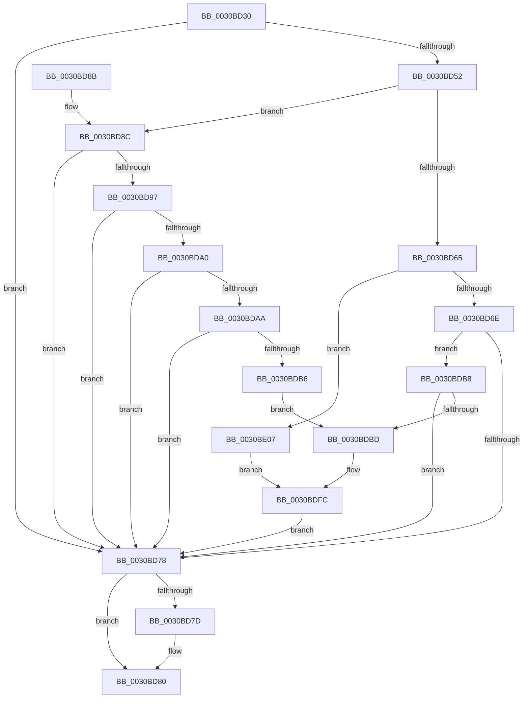

# KiAdjustReadyQueueScanOwnerOnParkingChange

- RVA: `0x0030BD30`–`0x0030BE4D` (길이 `285` bytes)
- VA: `0x000000014030BD30`
- 실행 섹션: `.text`
- PDB 이름 있음: `예`; PDB Function 태그: `아니요`
- unwind 정보 RVA: `0x00073CE8`
- 디코드: `67`개 명령, `285/285` bytes 표시
- 미해석 바이트: `0` (있으면 어셈블리에 `.byte`로 보존)

> 이 문서는 커널 이미지의 기계어와 PDB 기호를 분석해 생성했습니다. 4번과 5번은 함수 원형과 자료형을 바이너리 사용 방식에서 추정한 C 해석이며 원본 소스 복구 결과는 아닙니다.

## 1. Dependencies

- 직접 호출 지점: **1**; 고유 호출 대상: **1**
- 직접 호출자로 확인된 함수: **3**
- RIP 상대 이미지 참조: **2**

### Outgoing calls
- `0x0030BD8E` → [KeIsForceParkingEnabled](../21/KeIsForceParkingEnabled_function_00218F20.md) (function, `0x00218F20`)

### Direct callers
- [KiSoftParkElectionUnparkProcessor](KiSoftParkElectionUnparkProcessor_function_0030B818.md) at `0x0030BC91`
- [KiUnparkCurrentProcessor](../35/KiUnparkCurrentProcessor_function_00352214.md) at `0x0035225E`
- [KiParkCurrentProcessor](../35/KiParkCurrentProcessor_function_003533A4.md) at `0x003533FB`

### Static image references
- `0x0030BDD7` → RVA `0x00F231B8` (`.data`; read)
- `0x0030BDE1` → RVA `0x00FC8C40` (`ALMOSTRO`; read)

## 2. Other-region calls and transfers

- 다른 실행 섹션으로 향하는 call: **0**
- 별도 외부 분기/꼬리 이동을 확인하지 못했습니다.

## 3. Assembly (complete function range)

```asm
0030BD30  48 89 5C 24 10                  mov qword ptr [rsp + 0x10], rbx
0030BD35  57                              push rdi
0030BD36  48 83 EC 20                     sub rsp, 0x20
0030BD3A  4C 8B C9                        mov r9, rcx
0030BD3D  32 DB                           xor bl, bl
0030BD3F  48 8B 89 C8 00 00 00            mov rcx, qword ptr [rcx + 0xc8]
0030BD46  4D 8B 91 40 8E 00 00            mov r10, qword ptr [r9 + 0x8e40]
0030BD4D  4D 85 D2                        test r10, r10
0030BD50  74 26                           je 0x14030bd78
0030BD52  4C 8B 5A 50                     mov r11, qword ptr [rdx + 0x50]
0030BD56  49 8B B9 48 8E 00 00            mov rdi, qword ptr [r9 + 0x8e48]
0030BD5D  49 8B C3                        mov rax, r11
0030BD60  49 23 C2                        and rax, r10
0030BD63  74 27                           je 0x14030bd8c
0030BD65  48 3B C1                        cmp rax, rcx
0030BD68  0F 84 99 00 00 00               je 0x14030be07
0030BD6E  41 83 B9 50 8E 00 00 00         cmp dword ptr [r9 + 0x8e50], 0
0030BD76  75 40                           jne 0x14030bdb8
0030BD78  4D 85 C0                        test r8, r8
0030BD7B  74 03                           je 0x14030bd80
0030BD7D  41 88 18                        mov byte ptr [r8], bl
0030BD80  48 8B 5C 24 38                  mov rbx, qword ptr [rsp + 0x38]
0030BD85  48 83 C4 20                     add rsp, 0x20
0030BD89  5F                              pop rdi
0030BD8A  C3                              ret
0030BD8B  CC                              int3
0030BD8C  B3 01                           mov bl, 1
0030BD8E  E8 8D D1 F0 FF                  call 0x140218f20
0030BD93  84 C0                           test al, al
0030BD95  74 E1                           je 0x14030bd78
0030BD97  48 8B 42 68                     mov rax, qword ptr [rdx + 0x68]
0030BD9B  48 85 C1                        test rcx, rax
0030BD9E  74 D8                           je 0x14030bd78
0030BDA0  41 83 B9 50 8E 00 00 00         cmp dword ptr [r9 + 0x8e50], 0
0030BDA8  74 CE                           je 0x14030bd78
0030BDAA  48 F7 D0                        not rax
0030BDAD  49 23 81 40 8E 00 00            and rax, qword ptr [r9 + 0x8e40]
0030BDB4  74 C2                           je 0x14030bd78
0030BDB6  EB 05                           jmp 0x14030bdbd
0030BDB8  4C 85 D9                        test rcx, r11
0030BDBB  75 BB                           jne 0x14030bd78
0030BDBD  33 C9                           xor ecx, ecx
0030BDBF  41 89 89 50 8E 00 00            mov dword ptr [r9 + 0x8e50], ecx
0030BDC6  41 0F B6 89 D0 00 00 00         movzx ecx, byte ptr [r9 + 0xd0]
0030BDCE  48 0F BD C0                     bsr rax, rax
0030BDD2  C1 E1 06                        shl ecx, 6
0030BDD5  03 C8                           add ecx, eax
0030BDD7  48 8B 05 DA 73 C1 00            mov rax, qword ptr [rip + 0xc173da]
0030BDDE  8B 04 88                        mov eax, dword ptr [rax + rcx*4]
0030BDE1  48 8D 0D 58 CE CB 00            lea rcx, [rip + 0xcbce58]
0030BDE8  48 8B 04 C1                     mov rax, qword ptr [rcx + rax*8]
0030BDEC  C7 80 50 8E 00 00 01 00 00 00   mov dword ptr [rax + 0x8e50], 1
0030BDF6  8A 80 D1 00 00 00               mov al, byte ptr [rax + 0xd1]
0030BDFC  88 87 C5 02 00 00               mov byte ptr [rdi + 0x2c5], al
0030BE02  E9 71 FF FF FF                  jmp 0x14030bd78
0030BE07  0F B6 87 C5 02 00 00            movzx eax, byte ptr [rdi + 0x2c5]
0030BE0E  41 0F B6 89 D0 00 00 00         movzx ecx, byte ptr [r9 + 0xd0]
0030BE16  48 C1 E1 06                     shl rcx, 6
0030BE1A  48 03 C8                        add rcx, rax
0030BE1D  48 8B 05 94 73 C1 00            mov rax, qword ptr [rip + 0xc17394]
0030BE24  8B 04 88                        mov eax, dword ptr [rax + rcx*4]
0030BE27  48 8D 0D 12 CE CB 00            lea rcx, [rip + 0xcbce12]
0030BE2E  48 8B 04 C1                     mov rax, qword ptr [rcx + rax*8]
0030BE32  83 A0 50 8E 00 00 00            and dword ptr [rax + 0x8e50], 0
0030BE39  41 8A 81 D1 00 00 00            mov al, byte ptr [r9 + 0xd1]
0030BE40  41 C7 81 50 8E 00 00 01 00 00 00  mov dword ptr [r9 + 0x8e50], 1
0030BE4B  EB AF                           jmp 0x14030bdfc
```

## 4. C-style interpretation (structured pseudocode)

```c
__int64 __fastcall KiAdjustReadyQueueScanOwnerOnParkingChange(__int64 a1, __int64 a2, __int64 a3)
{
    __int64 result;
    __int64 v_rbx;
    __int64 v_rsp;
    unsigned __int64 v_stack_p10;

    v_stack_p10 = v_rbx;
    v_rsp = (v_rsp) - (32);
    v_rbx = 0;
    if (*(unsigned __int64 *)(a1 + 36416) == 0) goto loc_0030BD78;
    result = (*(unsigned __int64 *)(a2 + 80)) & (*(unsigned __int64 *)(a1 + 36416));
    if (condition_is_equal) goto loc_0030BD8C;
    if (result == (*(unsigned __int64 *)(a1 + 200))) goto loc_0030BE07;
    if ((*(unsigned int *)(a1 + 36432)) != 0) goto loc_0030BDB8;
loc_0030BD78:
    if (a3 != 0) {
        *(unsigned __int8 *)(a3) = 0;
    }
    v_rsp = (v_rsp) + (32);
    return result;
loc_0030BD8C:
    result = KeIsForceParkingEnabled(*(unsigned __int64 *)(a1 + 200), a2, a3, a1);
    if ((unsigned __int8)(result) == 0) goto loc_0030BD78;
    if (((*(unsigned __int64 *)(a1 + 200)) & (*(unsigned __int64 *)(a2 + 104))) == 0) goto loc_0030BD78;
    if ((*(unsigned int *)(a1 + 36432)) == 0) goto loc_0030BD78;
    result = ~(*(unsigned __int64 *)(a2 + 104));
    result = (result) & (*(unsigned __int64 *)(a1 + 36416));
    if (condition_is_equal) goto loc_0030BD78;
    goto loc_0030BDBD;
loc_0030BDB8:
    if (((*(unsigned __int64 *)(a1 + 200)) & (*(unsigned __int64 *)(a2 + 80))) != 0) goto loc_0030BD78;
loc_0030BDBD:
    a1 = 0;
    *(unsigned int *)(a1 + 36432) = 0;
    a1 = (unsigned int)((*(unsigned __int8 *)(a1 + 208)) << (6));
    a1 = (unsigned int)((a1) + ((unsigned int)(result)));
    *(unsigned int *)(*(unsigned __int64 *)(v_rip + 13356632 + (unsigned int)(*(unsigned int *)(*(unsigned __int64 *)(v_rip + 12678106) + a1 * 4)) * 8) + 36432) = 1;
loc_0030BDFC:
    *(unsigned __int8 *)(*(unsigned __int64 *)(a1 + 36424) + 709) = (unsigned __int8)(*(unsigned __int8 *)(*(unsigned __int64 *)(v_rip + 13356632 + (unsigned int)(*(unsigned int *)(*(unsigned __int64 *)(v_rip + 12678106) + a1 * 4)) * 8) + 209));
    goto loc_0030BD78;
loc_0030BE07:
    a1 = (*(unsigned __int8 *)(a1 + 208)) << (6);
    a1 = (a1) + (*(unsigned __int8 *)(*(unsigned __int64 *)(a1 + 36424) + 709));
    *(unsigned int *)(a1 + 36432) = 1;
    goto loc_0030BDFC;
}
```

## 5. (Beta) C Style

```c
int64_t KiAdjustReadyQueueScanOwnerOnParkingChange(void *Arg1, void *Arg2, int64_t Arg3)
{
    uint8_t *arg1 = (uint8_t *)Arg1;
    uint8_t *arg2 = (uint8_t *)Arg2;

    int64_t result;
    int64_t local_rbx;
    int64_t local_rsp;
    uint64_t v_stack_p10;

    v_stack_p10 = local_rbx;
    local_rsp = (local_rsp) - (32);
    local_rbx = 0;
    if (*(uint64_t *)(arg1 + 0x8E40) == 0) goto loc_0030BD78;
    result = (*(uint64_t *)(arg2 + 0x50)) & (*(uint64_t *)(arg1 + 0x8E40));
    if (condition_is_equal) goto loc_0030BD8C;
    if (result == (*(uint64_t *)(arg1 + 0xC8))) goto loc_0030BE07;
    if ((*(uint32_t *)(arg1 + 0x8E50)) != 0) goto loc_0030BDB8;
loc_0030BD78:
    if (Arg3 != 0) {
        *(uint8_t *)(Arg3) = 0;
    }
    local_rsp = (local_rsp) + (32);
    return result;
loc_0030BD8C:
    result = KeIsForceParkingEnabled(*(uint64_t *)(arg1 + 0xC8), Arg2, Arg3, Arg1);
    if ((uint8_t)(result) == 0) goto loc_0030BD78;
    if (((*(uint64_t *)(arg1 + 0xC8)) & (*(uint64_t *)(arg2 + 0x68))) == 0) goto loc_0030BD78;
    if ((*(uint32_t *)(arg1 + 0x8E50)) == 0) goto loc_0030BD78;
    result = ~(*(uint64_t *)(arg2 + 0x68));
    result = (result) & (*(uint64_t *)(arg1 + 0x8E40));
    if (condition_is_equal) goto loc_0030BD78;
    goto loc_0030BDBD;
loc_0030BDB8:
    if (((*(uint64_t *)(arg1 + 0xC8)) & (*(uint64_t *)(arg2 + 0x50))) != 0) goto loc_0030BD78;
loc_0030BDBD:
    Arg1 = 0;
    *(uint32_t *)(arg1 + 0x8E50) = 0;
    Arg1 = (uint32_t)((*(uint8_t *)(arg1 + 0xD0)) << (6));
    Arg1 = (uint32_t)((Arg1) + ((uint32_t)(result)));
    *(uint32_t *)(*(uint64_t *)(v_rip + 0xCBCE58 + (uint32_t)(*(uint32_t *)(*(uint64_t *)(v_rip + 0xC173DA) + arg1 * 4)) * 8) + 0x8E50) = 1;
loc_0030BDFC:
    *(uint8_t *)(*(uint64_t *)(arg1 + 0x8E48) + 0x2C5) = (uint8_t)(*(uint8_t *)(*(uint64_t *)(v_rip + 0xCBCE58 + (uint32_t)(*(uint32_t *)(*(uint64_t *)(v_rip + 0xC173DA) + arg1 * 4)) * 8) + 0xD1));
    goto loc_0030BD78;
loc_0030BE07:
    Arg1 = (*(uint8_t *)(arg1 + 0xD0)) << (6);
    Arg1 = (Arg1) + (*(uint8_t *)(*(uint64_t *)(arg1 + 0x8E48) + 0x2C5));
    *(uint32_t *)(arg1 + 0x8E50) = 1;
    goto loc_0030BDFC;
}
```

### 관측된 메모리 오프셋

구조체 형식이 확인되지 않은 접근은 인자 기준의 오프셋으로만 기록했습니다.

| 기준 인자 | 오프셋 표현 | 폭 (bit) | 접근 |
|---|---:|---:|---|
| `Arg1` | `+ 0xC8` | `64` | `R` |
| `Arg1` | `+ 0xD0` | `8` | `R` |
| `Arg1` | `+ 0xD1` | `8` | `R` |
| `Arg1` | `+ 0x8E40` | `64` | `R` |
| `Arg1` | `+ 0x8E48` | `64` | `R` |
| `Arg1` | `+ 0x8E50` | `32` | `R` |
| `Arg1` | `+ 0x8E50` | `32` | `W` |
| `Arg2` | `+ 0x50` | `64` | `R` |

## 6. Execution-region graph

[열기: 2D/3D 그래프와 함수 탐색 컨트롤 패널](../../../control-panel.html?section=text&rva=0x0030BD30&view=graph)

- 2D 그래프는 위에서 아래로 흐르고, 3D 그래프는 빈 공간을 드래그해 회전합니다. Shift+드래그는 이동, 휠은 확대·축소, 함수 노드 선택은 대상 보고서 이동입니다.

### Static fallback


