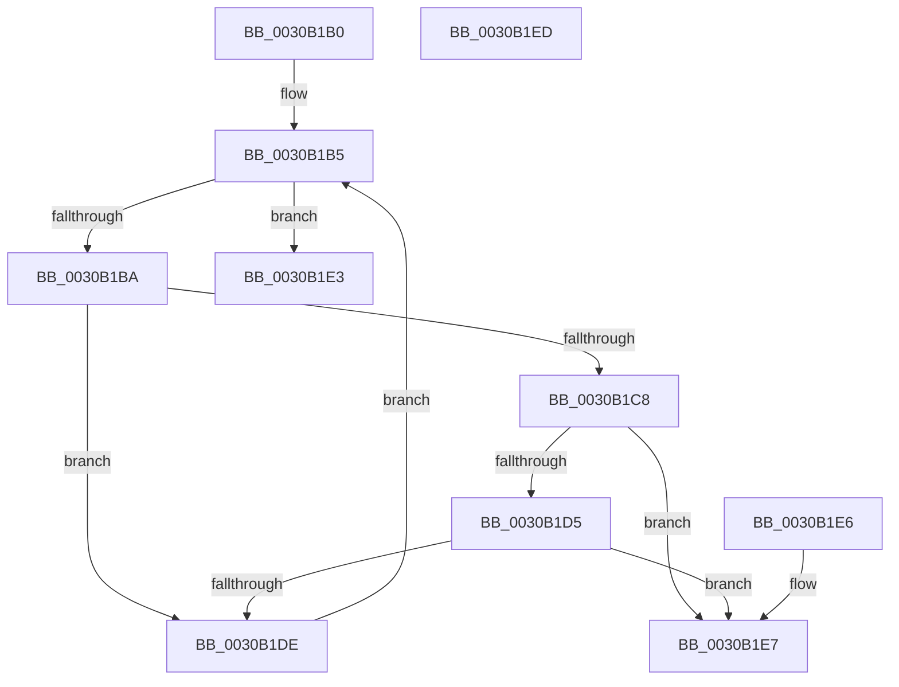

# KiAffinityContainsProcessorsOtherThanSelf

- RVA: `0x0030B1B0`–`0x0030B1EE` (길이 `62` bytes)
- VA: `0x000000014030B1B0`
- 실행 섹션: `.text`
- PDB 이름 있음: `예`; PDB Function 태그: `아니요`
- unwind 정보 RVA: `0x000DB714`
- 디코드: `21`개 명령, `62/62` bytes 표시
- 미해석 바이트: `0` (있으면 어셈블리에 `.byte`로 보존)

> 이 문서는 커널 이미지의 기계어와 PDB 기호를 분석해 생성했습니다. 4번과 5번은 함수 원형과 자료형을 바이너리 사용 방식에서 추정한 C 해석이며 원본 소스 복구 결과는 아닙니다.

## 1. Dependencies

- 직접 호출 지점: **0**; 고유 호출 대상: **0**
- 직접 호출자로 확인된 함수: **3**
- RIP 상대 이미지 참조: **0**

### Outgoing calls
- 직접 디코드된 call 명령이 없습니다.

### Direct callers
- [KxFlushEntireTb](KxFlushEntireTb_function_00309094.md) at `0x00309220`
- [KiEnterLongDpcProcessing](KiEnterLongDpcProcessing_function_0030BE54.md) at `0x0030C1D7`
- [KxFlushNonGlobalTb](../31/KxFlushNonGlobalTb_function_00314E50.md) at `0x00314F0A`

### Static image references
- 디코드된 RIP-relative 메모리 참조가 없습니다.

## 2. Other-region calls and transfers

- 다른 실행 섹션으로 향하는 call: **0**
- 별도 외부 분기/꼬리 이동을 확인하지 못했습니다.

## 3. Assembly (complete function range)

```asm
0030B1B0  4C 8B D1                        mov r10, rcx
0030B1B3  33 C0                           xor eax, eax
0030B1B5  66 3B 02                        cmp ax, word ptr [rdx]
0030B1B8  73 29                           jae 0x14030b1e3
0030B1BA  44 0F B7 C0                     movzx r8d, ax
0030B1BE  4E 8B 4C C2 08                  mov r9, qword ptr [rdx + r8*8 + 8]
0030B1C3  4D 85 C9                        test r9, r9
0030B1C6  74 16                           je 0x14030b1de
0030B1C8  41 0F B6 8A D0 00 00 00         movzx ecx, byte ptr [r10 + 0xd0]
0030B1D0  66 3B C1                        cmp ax, cx
0030B1D3  75 12                           jne 0x14030b1e7
0030B1D5  4D 3B 8A C8 00 00 00            cmp r9, qword ptr [r10 + 0xc8]
0030B1DC  75 09                           jne 0x14030b1e7
0030B1DE  66 FF C0                        inc ax
0030B1E1  EB D2                           jmp 0x14030b1b5
0030B1E3  33 C0                           xor eax, eax
0030B1E5  C3                              ret
0030B1E6  CC                              int3
0030B1E7  B8 01 00 00 00                  mov eax, 1
0030B1EC  C3                              ret
0030B1ED  CC                              int3
```

## 4. C-style interpretation (structured pseudocode)

```c
__int64 __fastcall KiAffinityContainsProcessorsOtherThanSelf(__int64 a1, __int64 a2)
{
    __int64 result;

    result = 0;
loc_0030B1B5:
    if (0 >= (*(unsigned __int16 *)(a2))) goto loc_0030B1E3;
    if (*(unsigned __int64 *)(a2 + 0 * 8 + 8) == 0) goto loc_0030B1DE;
    if (0 != ((unsigned __int16)(*(unsigned __int8 *)(a1 + 208)))) goto loc_0030B1E7;
    if ((*(unsigned __int64 *)(a2 + 0 * 8 + 8)) != (*(unsigned __int64 *)(a1 + 200))) goto loc_0030B1E7;
loc_0030B1DE:
    result = (unsigned __int16)((result) + 1);
    goto loc_0030B1B5;
loc_0030B1E3:
    result = 0;
    return result;
loc_0030B1E7:
    return 1;
}
```

## 5. (Beta) C Style

```c
int64_t KiAffinityContainsProcessorsOtherThanSelf(void *Arg1, void *Arg2)
{
    uint8_t *arg1 = (uint8_t *)Arg1;
    uint8_t *arg2 = (uint8_t *)Arg2;

    int64_t result;

    result = 0;
loc_0030B1B5:
    if (0 >= (*(uint16_t *)(arg2))) goto loc_0030B1E3;
    if (*(uint64_t *)(arg2 + 0x0 * 8 + 0x8) == 0) goto loc_0030B1DE;
    if (0 != ((uint16_t)(*(uint8_t *)(arg1 + 0xD0)))) goto loc_0030B1E7;
    if ((*(uint64_t *)(arg2 + 0x0 * 8 + 0x8)) != (*(uint64_t *)(arg1 + 0xC8))) goto loc_0030B1E7;
loc_0030B1DE:
    result = (uint16_t)((result) + 1);
    goto loc_0030B1B5;
loc_0030B1E3:
    result = 0;
    return result;
loc_0030B1E7:
    return 1;
}
```

### 관측된 메모리 오프셋

구조체 형식이 확인되지 않은 접근은 인자 기준의 오프셋으로만 기록했습니다.

| 기준 인자 | 오프셋 표현 | 폭 (bit) | 접근 |
|---|---:|---:|---|
| `Arg1` | `+ 0xC8` | `64` | `R` |
| `Arg1` | `+ 0xD0` | `8` | `R` |
| `Arg2` | `+ 0x0` | `16` | `R` |
| `Arg2` | `+ 0x8 + r8*8` | `64` | `R` |

## 6. Execution-region graph

[열기: 2D/3D 그래프와 함수 탐색 컨트롤 패널](../../../control-panel.html?section=text&rva=0x0030B1B0&view=graph)

- 2D 그래프는 위에서 아래로 흐르고, 3D 그래프는 빈 공간을 드래그해 회전합니다. Shift+드래그는 이동, 휠은 확대·축소, 함수 노드 선택은 대상 보고서 이동입니다.

### Static fallback


