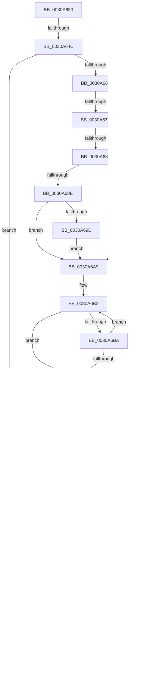

# KiBeginThreadAccountingPeriod

- RVA: `0x0030A630`–`0x0030A73B` (길이 `267` bytes)
- VA: `0x000000014030A630`
- 실행 섹션: `.text`
- PDB 이름 있음: `예`; PDB Function 태그: `아니요`
- unwind 정보 RVA: `0x00073BE8`
- 디코드: `67`개 명령, `267/267` bytes 표시
- 미해석 바이트: `0` (있으면 어셈블리에 `.byte`로 보존)

> 이 문서는 커널 이미지의 기계어와 PDB 기호를 분석해 생성했습니다. 4번과 5번은 함수 원형과 자료형을 바이너리 사용 방식에서 추정한 C 해석이며 원본 소스 복구 결과는 아닙니다.

## 1. Dependencies

- 직접 호출 지점: **0**; 고유 호출 대상: **0**
- 직접 호출자로 확인된 함수: **0**
- RIP 상대 이미지 참조: **1**

### Outgoing calls
- 직접 디코드된 call 명령이 없습니다.

### Direct callers
- 이 함수 시작 RVA로 연결되는 직접 call은 확인되지 않았습니다. 간접 호출은 완전히 역산할 수 없습니다.

### Static image references
- `0x0030A72B` → RVA `0x00E66908` (`.data`; read)

## 2. Other-region calls and transfers

- 다른 실행 섹션으로 향하는 call: **0**
- call이 아닌 외부 분기/꼬리 이동: **8**
  - `0x0030A646` → [sub_0030A776 + 0x5C](Unknown_function_0030A776.md) (`tail-transfer`)
  - `0x0030A678` → [sub_0030A776 + 0x131](Unknown_function_0030A776.md) (`tail-transfer`)
  - `0x0030A681` → [sub_0030A776 + 0x131](Unknown_function_0030A776.md) (`tail-transfer`)
  - `0x0030A706` → [sub_0030A776 + 0xA8](Unknown_function_0030A776.md) (`tail-transfer`)
  - `0x0030A710` → [sub_0030A776 + 0xF5](Unknown_function_0030A776.md) (`tail-transfer`)
  - `0x0030A720` → [sub_0030A776 + 0xC](Unknown_function_0030A776.md) (`tail-transfer`)
  - `0x0030A729` → [sub_0030A776](Unknown_function_0030A776.md) (`tail-transfer`)
  - `0x0030A739` → [sub_0030A776](Unknown_function_0030A776.md) (`tail-transfer`)

## 3. Assembly (complete function range)

```asm
0030A630  48 89 5C 24 18                  mov qword ptr [rsp + 0x18], rbx
0030A635  57                              push rdi
0030A636  48 83 EC 20                     sub rsp, 0x20
0030A63A  4D 8B D0                        mov r10, r8
0030A63D  48 8B DA                        mov rbx, rdx
0030A640  48 8B F9                        mov rdi, rcx
0030A643  48 85 D2                        test rdx, rdx
0030A646  0F 85 86 01 00 00               jne 0x14030a7d2
0030A64C  65 48 8B 1C 25 88 01 00 00      mov rbx, qword ptr gs:[0x188]
0030A655  45 32 DB                        xor r11b, r11b
0030A658  44 0F B6 4B 02                  movzx r9d, byte ptr [rbx + 2]
0030A65D  41 F6 C1 20                     test r9b, 0x20
0030A661  0F 84 82 00 00 00               je 0x14030a6e9
0030A667  48 8B 81 B0 89 00 00            mov rax, qword ptr [rcx + 0x89b0]
0030A66E  4C 8B 81 B8 89 00 00            mov r8, qword ptr [rcx + 0x89b8]
0030A675  48 85 C0                        test rax, rax
0030A678  0F 84 29 02 00 00               je 0x14030a8a7
0030A67E  4D 85 C0                        test r8, r8
0030A681  0F 84 20 02 00 00               je 0x14030a8a7
0030A687  41 80 78 70 00                  cmp byte ptr [r8 + 0x70], 0
0030A68C  75 14                           jne 0x14030a6a2
0030A68E  45 8B 40 50                     mov r8d, dword ptr [r8 + 0x50]
0030A692  8B 88 10 02 00 00               mov ecx, dword ptr [rax + 0x210]
0030A698  44 3B C1                        cmp r8d, ecx
0030A69B  72 0C                           jb 0x14030a6a9
0030A69D  44 8B C1                        mov r8d, ecx
0030A6A0  EB 07                           jmp 0x14030a6a9
0030A6A2  45 8B 80 84 00 00 00            mov r8d, dword ptr [r8 + 0x84]
0030A6A9  33 D2                           xor edx, edx
0030A6AB  48 8D 8F 6A 8A 00 00            lea rcx, [rdi + 0x8a6a]
0030A6B2  0F B7 01                        movzx eax, word ptr [rcx]
0030A6B5  44 3B C0                        cmp r8d, eax
0030A6B8  76 0B                           jbe 0x14030a6c5
0030A6BA  FF C2                           inc edx
0030A6BC  48 83 C1 02                     add rcx, 2
0030A6C0  83 FA 03                        cmp edx, 3
0030A6C3  72 ED                           jb 0x14030a6b2
0030A6C5  33 C9                           xor ecx, ecx
0030A6C7  38 8F 08 8A 00 00               cmp byte ptr [rdi + 0x8a08], cl
0030A6CD  0F 95 C1                        setne cl
0030A6D0  48 8D 0C 51                     lea rcx, [rcx + rdx*2]
0030A6D4  48 8D 89 F0 10 00 00            lea rcx, [rcx + 0x10f0]
0030A6DB  48 8D 14 CF                     lea rdx, [rdi + rcx*8]
0030A6DF  48 8B 0C CF                     mov rcx, qword ptr [rdi + rcx*8]
0030A6E3  49 03 CA                        add rcx, r10
0030A6E6  48 89 0A                        mov qword ptr [rdx], rcx
0030A6E9  41 F6 C1 40                     test r9b, 0x40
0030A6ED  74 10                           je 0x14030a6ff
0030A6EF  48 8B 83 C8 03 00 00            mov rax, qword ptr [rbx + 0x3c8]
0030A6F6  48 85 C0                        test rax, rax
0030A6F9  74 04                           je 0x14030a6ff
0030A6FB  C6 40 40 01                     mov byte ptr [rax + 0x40], 1
0030A6FF  C6 47 20 00                     mov byte ptr [rdi + 0x20], 0
0030A703  45 84 DB                        test r11b, r11b
0030A706  0F 84 12 01 00 00               je 0x14030a81e
0030A70C  41 F6 C1 B6                     test r9b, 0xb6
0030A710  0F 84 55 01 00 00               je 0x14030a86b
0030A716  4C 8B 83 68 01 00 00            mov r8, qword ptr [rbx + 0x168]
0030A71D  4D 85 C0                        test r8, r8
0030A720  74 60                           je 0x14030a782
0030A722  4D 8B 50 20                     mov r10, qword ptr [r8 + 0x20]
0030A726  4D 85 D2                        test r10, r10
0030A729  74 4B                           je 0x14030a776
0030A72B  8B 05 D7 C1 B5 00               mov eax, dword ptr [rip + 0xb5c1d7]
0030A731  41 B9 01 00 00 00               mov r9d, 1
0030A737  85 C0                           test eax, eax
0030A739  74 3B                           je 0x14030a776
```

## 4. C-style interpretation (structured pseudocode)

```c
__int64 __fastcall KiBeginThreadAccountingPeriod(__int64 a1, __int64 a2, __int64 a3)
{
    __int64 v_r11;
    __int64 v_rsp;
    unsigned __int64 v_stack_p18;

    v_stack_p18 = v_rbx;
    v_rsp = (v_rsp) - (32);
    v_r11 = 0;
    if ((((unsigned __int8)(*(unsigned __int8 *)(*(unsigned __int64 *)(gs_base + (0 + 392)) + 2))) & (32)) == 0) goto loc_0030A6E9;
    if ((*(unsigned __int8 *)(*(unsigned __int64 *)(a1 + 35256) + 112)) != 0) goto loc_0030A6A2;
    if (((unsigned int)((unsigned int)(*(unsigned int *)(*(unsigned __int64 *)(a1 + 35256) + 80)))) < ((unsigned int)((unsigned int)(*(unsigned int *)(*(unsigned __int64 *)(a1 + 35248) + 528))))) goto loc_0030A6A9;
    goto loc_0030A6A9;
loc_0030A6A2:
loc_0030A6A9:
    a2 = 0;
loc_0030A6B2:
    if (((unsigned int)((unsigned int)(*(unsigned int *)((unsigned int)((unsigned int)((unsigned int)(*(unsigned int *)(*(unsigned __int64 *)(a1 + 35248) + 528)))) + 132)))) <= ((unsigned int)(*(unsigned __int16 *)(a1 + 35434)))) goto loc_0030A6C5;
    a2 = (unsigned int)((a2) + 1);
    a1 = (a1 + 35434) + (2);
    if (((unsigned int)(a2)) < 3) goto loc_0030A6B2;
loc_0030A6C5:
    a1 = 0;
    a1 = ((*(unsigned __int8 *)(a1 + 35336)) != 0) ? 1 : 0;
    a1 = (*(unsigned __int64 *)(a1 + a1 + a2 * 2 + 4336 * 8)) + (a3);
    *(unsigned __int64 *)(a1 + a1 + a2 * 2 + 4336 * 8) = a1;
loc_0030A6E9:
    if ((((unsigned __int8)(*(unsigned __int8 *)(*(unsigned __int64 *)(gs_base + (0 + 392)) + 2))) & (64)) == 0) goto loc_0030A6FF;
    if (*(unsigned __int64 *)(*(unsigned __int64 *)(gs_base + (0 + 392)) + 968) != 0) {
        *(unsigned __int8 *)(*(unsigned __int64 *)(*(unsigned __int64 *)(gs_base + (0 + 392)) + 968) + 64) = 1;
    }
    *(unsigned __int8 *)(a1 + 32) = 0;
}
```

## 5. (Beta) C Style

```c
int64_t KiBeginThreadAccountingPeriod(void *Arg1, int64_t Arg2, int64_t Arg3)
{
    uint8_t *arg1 = (uint8_t *)Arg1;

    int64_t local_r11;
    int64_t local_rsp;
    uint64_t v_stack_p18;

    v_stack_p18 = local_rbx;
    local_rsp = (local_rsp) - (32);
    local_r11 = 0;
    if ((((uint8_t)(*(uint8_t *)(*(uint64_t *)(gs_base + (0 + 0x188)) + 0x2))) & (32)) == 0) goto loc_0030A6E9;
    if ((*(uint8_t *)(*(uint64_t *)(arg1 + 0x89B8) + 0x70)) != 0) goto loc_0030A6A2;
    if (((uint32_t)((uint32_t)(*(uint32_t *)(*(uint64_t *)(arg1 + 0x89B8) + 0x50)))) < ((uint32_t)((uint32_t)(*(uint32_t *)(*(uint64_t *)(arg1 + 0x89B0) + 0x210))))) goto loc_0030A6A9;
    goto loc_0030A6A9;
loc_0030A6A2:
loc_0030A6A9:
    Arg2 = 0;
loc_0030A6B2:
    if (((uint32_t)((uint32_t)(*(uint32_t *)((uint32_t)((uint32_t)((uint32_t)(*(uint32_t *)(*(uint64_t *)(arg1 + 0x89B0) + 0x210)))) + 0x84)))) <= ((uint32_t)(*(uint16_t *)(arg1 + 0x8A6A)))) goto loc_0030A6C5;
    Arg2 = (uint32_t)((Arg2) + 1);
    Arg1 = (Arg1 + 35434) + (2);
    if (((uint32_t)(Arg2)) < 3) goto loc_0030A6B2;
loc_0030A6C5:
    Arg1 = 0;
    Arg1 = ((*(uint8_t *)(arg1 + 0x8A08)) != 0) ? 1 : 0;
    Arg1 = (*(uint64_t *)(arg1 + arg1 + Arg2 * 2 + 0x10F0 * 8)) + (Arg3);
    *(void **)(arg1 + arg1 + Arg2 * 2 + 0x10F0 * 8) = Arg1;
loc_0030A6E9:
    if ((((uint8_t)(*(uint8_t *)(*(uint64_t *)(gs_base + (0 + 0x188)) + 0x2))) & (64)) == 0) goto loc_0030A6FF;
    if (*(uint64_t *)(*(uint64_t *)(gs_base + (0 + 0x188)) + 0x3C8) != 0) {
        *(uint8_t *)(*(uint64_t *)(*(uint64_t *)(gs_base + (0 + 0x188)) + 0x3C8) + 0x40) = 1;
    }
    *(uint8_t *)(arg1 + 0x20) = 0;
}
```

### 관측된 메모리 오프셋

구조체 형식이 확인되지 않은 접근은 인자 기준의 오프셋으로만 기록했습니다.

| 기준 인자 | 오프셋 표현 | 폭 (bit) | 접근 |
|---|---:|---:|---|
| `Arg1` | `+ 0x0` | `16` | `R` |
| `Arg1` | `+ 0x0` | `64` | `W` |
| `Arg1` | `+ 0x0 + rcx*8` | `64` | `R` |
| `Arg1` | `+ 0x20` | `8` | `W` |
| `Arg1` | `+ 0x89B0` | `64` | `R` |
| `Arg1` | `+ 0x89B8` | `64` | `R` |
| `Arg1` | `+ 0x8A08` | `8` | `R` |
| `Arg1` | `+ 0x8A6A` | `64` | `R` |

## 6. Execution-region graph

[열기: 2D/3D 그래프와 함수 탐색 컨트롤 패널](../../../control-panel.html?section=text&rva=0x0030A630&view=graph)

- 2D 그래프는 위에서 아래로 흐르고, 3D 그래프는 빈 공간을 드래그해 회전합니다. Shift+드래그는 이동, 휠은 확대·축소, 함수 노드 선택은 대상 보고서 이동입니다.

### Static fallback


