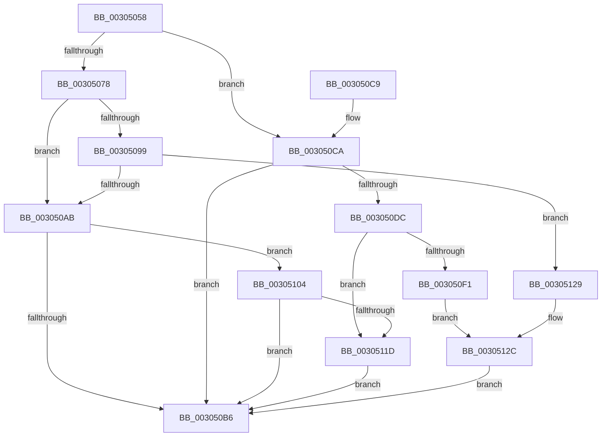

# KiCheckKeepAlive

- RVA: `0x00305058`–`0x0030513B` (길이 `227` bytes)
- VA: `0x0000000140305058`
- 실행 섹션: `.text`
- PDB 이름 있음: `예`; PDB Function 태그: `아니요`
- unwind 정보 RVA: `0x00073618`
- 디코드: `62`개 명령, `227/227` bytes 표시
- 미해석 바이트: `0` (있으면 어셈블리에 `.byte`로 보존)

> 이 문서는 커널 이미지의 기계어와 PDB 기호를 분석해 생성했습니다. 4번과 5번은 함수 원형과 자료형을 바이너리 사용 방식에서 추정한 C 해석이며 원본 소스 복구 결과는 아닙니다.

## 1. Dependencies

- 직접 호출 지점: **5**; 고유 호출 대상: **3**
- 직접 호출자로 확인된 함수: **1**
- RIP 상대 이미지 참조: **4**

### Outgoing calls
- `0x003050D3` → [KeCheckProcessorAffinityEx](KeCheckProcessorAffinityEx_function_00305150.md) (function, `0x00305150`)
- `0x003050E8` → [KeCheckProcessorAffinityEx](KeCheckProcessorAffinityEx_function_00305150.md) (function, `0x00305150`)
- `0x003050F6` → [KeRemoveProcessorAffinityEx](KeRemoveProcessorAffinityEx_function_00304E10.md) (function, `0x00304E10`)
- `0x00305122` → [KeAddProcessorAffinityEx](../25/KeAddProcessorAffinityEx_function_0025B6F0.md) (function, `0x0025B6F0`)
- `0x0030512E` → [KeRemoveProcessorAffinityEx](KeRemoveProcessorAffinityEx_function_00304E10.md) (function, `0x00304E10`)

### Direct callers
- [KeAccumulateTicks](../39/KeAccumulateTicks_function_0039C140.md) at `0x0039C629`

### Static image references
- `0x0030506C` → RVA `0x00FC6A85` (`ALMOSTRO`; read)
- `0x00305078` → RVA `0x00F231B0` (`.data`; read)
- `0x0030507F` → RVA `0x00E0AC80` (`.data`; read)
- `0x003050CC` → RVA `0x00E0AB70` (`.data`; read)

## 2. Other-region calls and transfers

- 다른 실행 섹션으로 향하는 call: **0**
- 별도 외부 분기/꼬리 이동을 확인하지 못했습니다.

## 3. Assembly (complete function range)

```asm
00305058  48 89 5C 24 10                  mov qword ptr [rsp + 0x10], rbx
0030505D  48 89 74 24 18                  mov qword ptr [rsp + 0x18], rsi
00305062  57                              push rdi
00305063  48 83 EC 20                     sub rsp, 0x20
00305067  8B 59 24                        mov ebx, dword ptr [rcx + 0x24]
0030506A  33 FF                           xor edi, edi
0030506C  40 38 3D 12 1A CC 00            cmp byte ptr [rip + 0xcc1a12], dil
00305073  4C 8B C9                        mov r9, rcx
00305076  74 52                           je 0x1403050ca
00305078  48 8B 05 31 E1 C1 00            mov rax, qword ptr [rip + 0xc1e131]
0030507F  48 8D 35 FA 5B B0 00            lea rsi, [rip + 0xb05bfa]
00305086  8B 0C 98                        mov ecx, dword ptr [rax + rbx*4]
00305089  8B D1                           mov edx, ecx
0030508B  0F B7 05 EE 5B B0 00            movzx eax, word ptr [rip + 0xb05bee]
00305092  C1 EA 06                        shr edx, 6
00305095  3B D0                           cmp edx, eax
00305097  73 12                           jae 0x1403050ab
00305099  4C 8B 44 D6 08                  mov r8, qword ptr [rsi + rdx*8 + 8]
0030509E  83 E1 3F                        and ecx, 0x3f
003050A1  49 D3 E8                        shr r8, cl
003050A4  41 0F BA E0 00                  bt r8d, 0
003050A9  72 7E                           jb 0x140305129
003050AB  41 8A 81 08 96 00 00            mov al, byte ptr [r9 + 0x9608]
003050B2  84 C0                           test al, al
003050B4  75 4E                           jne 0x140305104
003050B6  48 8B 5C 24 38                  mov rbx, qword ptr [rsp + 0x38]
003050BB  40 8A C7                        mov al, dil
003050BE  48 8B 74 24 40                  mov rsi, qword ptr [rsp + 0x40]
003050C3  48 83 C4 20                     add rsp, 0x20
003050C7  5F                              pop rdi
003050C8  C3                              ret
003050C9  CC                              int3
003050CA  8B D3                           mov edx, ebx
003050CC  48 8D 0D 9D 5A B0 00            lea rcx, [rip + 0xb05a9d]
003050D3  E8 78 00 00 00                  call 0x140305150
003050D8  85 C0                           test eax, eax
003050DA  74 DA                           je 0x1403050b6
003050DC  48 8D 35 9D 5B B0 00            lea rsi, [rip + 0xb05b9d]
003050E3  8B D3                           mov edx, ebx
003050E5  48 8B CE                        mov rcx, rsi
003050E8  E8 63 00 00 00                  call 0x140305150
003050ED  85 C0                           test eax, eax
003050EF  74 2C                           je 0x14030511d
003050F1  8B D3                           mov edx, ebx
003050F3  48 8B CE                        mov rcx, rsi
003050F6  E8 15 FD FF FF                  call 0x140304e10
003050FB  48 8D 0D 6E 5A B0 00            lea rcx, [rip + 0xb05a6e]
00305102  EB 28                           jmp 0x14030512c
00305104  48 B9 08 00 00 00 80 F7 FF FF   movabs rcx, 0xfffff78000000008
0030510E  48 8B 09                        mov rcx, qword ptr [rcx]
00305111  49 8B 81 80 95 00 00            mov rax, qword ptr [r9 + 0x9580]
00305118  48 3B C8                        cmp rcx, rax
0030511B  76 99                           jbe 0x1403050b6
0030511D  8B D3                           mov edx, ebx
0030511F  48 8B CE                        mov rcx, rsi
00305122  E8 C9 65 F5 FF                  call 0x14025b6f0
00305127  EB 8D                           jmp 0x1403050b6
00305129  48 8B CE                        mov rcx, rsi
0030512C  8B D3                           mov edx, ebx
0030512E  E8 DD FC FF FF                  call 0x140304e10
00305133  40 B7 01                        mov dil, 1
00305136  E9 7B FF FF FF                  jmp 0x1403050b6
```

## 4. C-style interpretation (structured pseudocode)

```c
__int64 __fastcall KiCheckKeepAlive(__int64 a1)
{
    __int64 result;
    __int64 v_rdi;
    __int64 v_rsp;
    unsigned __int64 v_stack_p10;
    unsigned __int64 v_stack_p18;

    v_stack_p10 = v_rbx;
    v_stack_p18 = v_rsi;
    v_rsp = (v_rsp) - (32);
    v_rdi = 0;
    if ((*(unsigned __int8 *)(v_rip + 13376018)) == 0) goto loc_003050CA;
    a2 = (unsigned int)(((unsigned int)((unsigned int)((unsigned int)(*(unsigned int *)(*(unsigned __int64 *)(v_rip + 12706097) + (unsigned int)(*(unsigned int *)(a1 + 36)) * 4))))) >> (6));
    if (((unsigned int)(a2)) >= ((unsigned int)(*(unsigned __int16 *)(v_rip + 11557870)))) goto loc_003050AB;
    a1 = (unsigned int)(((unsigned int)(*(unsigned int *)(*(unsigned __int64 *)(v_rip + 12706097) + (unsigned int)(*(unsigned int *)(a1 + 36)) * 4))) & (63));
    a3 = (*(unsigned __int64 *)(v_rip + 11557882 + a2 * 8 + 8)) >> ((unsigned __int8)(a1));
    if (condition_is_below) goto loc_00305129;
loc_003050AB:
    if ((unsigned __int8)(*(unsigned __int8 *)(a1 + 38408)) != 0) goto loc_00305104;
loc_003050B6:
    v_rsp = (v_rsp) + (32);
    return 0;
loc_003050CA:
    result = KeCheckProcessorAffinityEx(v_rip + 11557533, (unsigned int)((unsigned int)(v_stack_p10)), a3, a1);
    if ((unsigned int)(result) == 0) goto loc_003050B6;
    result = KeCheckProcessorAffinityEx(v_rip + 11557789, (unsigned int)((unsigned int)(v_stack_p10)), a3, a1);
    if ((unsigned int)(result) == 0) goto loc_0030511D;
    result = KeRemoveProcessorAffinityEx(v_rip + 11557789, (unsigned int)((unsigned int)(v_stack_p10)), a3, a1);
    goto loc_0030512C;
loc_00305104:
    if ((*(unsigned __int64 *)(v_rip + 11557486)) <= (*(unsigned __int64 *)(a1 + 38272))) goto loc_003050B6;
loc_0030511D:
    result = KeAddProcessorAffinityEx(v_rip + 11557789, (unsigned int)((unsigned int)(v_stack_p10)), a3, a1);
    goto loc_003050B6;
loc_00305129:
loc_0030512C:
    result = KeRemoveProcessorAffinityEx(v_rip + 11557789, (unsigned int)((unsigned int)(v_stack_p10)), a3, a1);
    goto loc_003050B6;
}
```

## 5. (Beta) C Style

```c
int64_t KiCheckKeepAlive(void *Arg1)
{
    uint8_t *arg1 = (uint8_t *)Arg1;

    int64_t result;
    int64_t local_rdi;
    int64_t local_rsp;
    uint64_t v_stack_p10;
    uint64_t v_stack_p18;

    v_stack_p10 = local_rbx;
    v_stack_p18 = local_rsi;
    local_rsp = (local_rsp) - (32);
    local_rdi = 0;
    if ((*(uint8_t *)(v_rip + 0xCC1A12)) == 0) goto loc_003050CA;
    a2 = (uint32_t)(((uint32_t)((uint32_t)((uint32_t)(*(uint32_t *)(*(uint64_t *)(v_rip + 0xC1E131) + (uint32_t)(*(uint32_t *)(arg1 + 0x24)) * 4))))) >> (6));
    if (((uint32_t)(a2)) >= ((uint32_t)(*(uint16_t *)(v_rip + 0xB05BEE)))) goto loc_003050AB;
    Arg1 = (uint32_t)(((uint32_t)(*(uint32_t *)(*(uint64_t *)(v_rip + 0xC1E131) + (uint32_t)(*(uint32_t *)(arg1 + 0x24)) * 4))) & (63));
    a3 = (*(uint64_t *)(v_rip + 0xB05BFA + a2 * 8 + 0x8)) >> ((uint8_t)(Arg1));
    if (condition_is_below) goto loc_00305129;
loc_003050AB:
    if ((uint8_t)(*(uint8_t *)(arg1 + 0x9608)) != 0) goto loc_00305104;
loc_003050B6:
    local_rsp = (local_rsp) + (32);
    return 0;
loc_003050CA:
    result = KeCheckProcessorAffinityEx(v_rip + 11557533, (uint32_t)((uint32_t)(v_stack_p10)), a3, Arg1);
    if ((uint32_t)(result) == 0) goto loc_003050B6;
    result = KeCheckProcessorAffinityEx(v_rip + 11557789, (uint32_t)((uint32_t)(v_stack_p10)), a3, Arg1);
    if ((uint32_t)(result) == 0) goto loc_0030511D;
    result = KeRemoveProcessorAffinityEx(v_rip + 11557789, (uint32_t)((uint32_t)(v_stack_p10)), a3, Arg1);
    goto loc_0030512C;
loc_00305104:
    if ((*(uint64_t *)(v_rip + 0xB05A6E)) <= (*(uint64_t *)(arg1 + 0x9580))) goto loc_003050B6;
loc_0030511D:
    result = KeAddProcessorAffinityEx(v_rip + 11557789, (uint32_t)((uint32_t)(v_stack_p10)), a3, Arg1);
    goto loc_003050B6;
loc_00305129:
loc_0030512C:
    result = KeRemoveProcessorAffinityEx(v_rip + 11557789, (uint32_t)((uint32_t)(v_stack_p10)), a3, Arg1);
    goto loc_003050B6;
}
```

### 관측된 메모리 오프셋

구조체 형식이 확인되지 않은 접근은 인자 기준의 오프셋으로만 기록했습니다.

| 기준 인자 | 오프셋 표현 | 폭 (bit) | 접근 |
|---|---:|---:|---|
| `Arg1` | `+ 0x24` | `32` | `R` |
| `Arg1` | `+ 0x9580` | `64` | `R` |
| `Arg1` | `+ 0x9608` | `8` | `R` |

## 6. Execution-region graph

[열기: 2D/3D 그래프와 함수 탐색 컨트롤 패널](../../../control-panel.html?section=text&rva=0x00305058&view=graph)

- 2D 그래프는 위에서 아래로 흐르고, 3D 그래프는 빈 공간을 드래그해 회전합니다. Shift+드래그는 이동, 휠은 확대·축소, 함수 노드 선택은 대상 보고서 이동입니다.

### Static fallback


