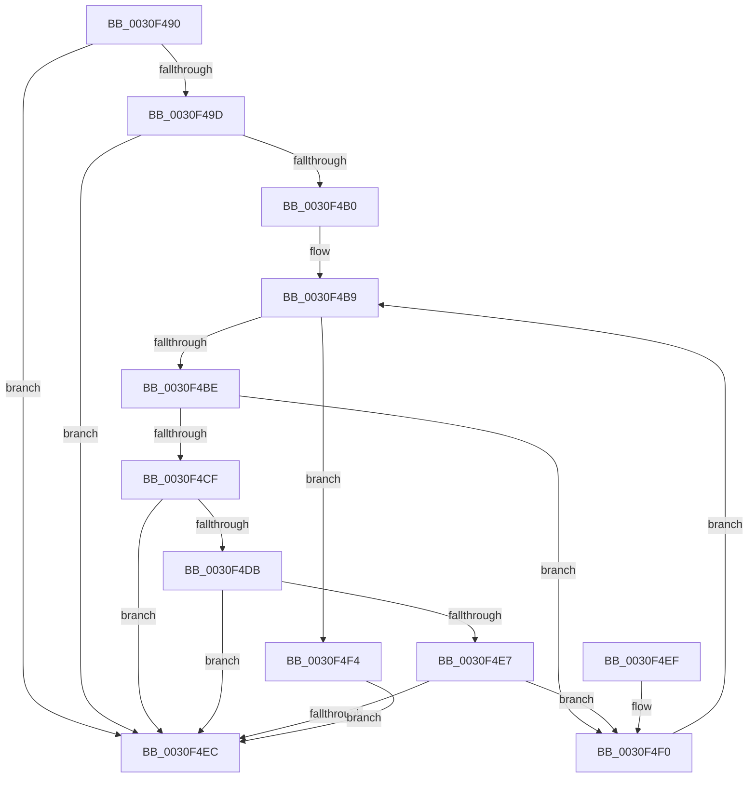

# KiCheckVpBackingLongSpinWaitHypercall

- RVA: `0x0030F490`–`0x0030F4F8` (길이 `104` bytes)
- VA: `0x000000014030F490`
- 실행 섹션: `.text`
- PDB 이름 있음: `예`; PDB Function 태그: `아니요`
- unwind 정보 RVA: `0x000DB714`
- 디코드: `31`개 명령, `104/104` bytes 표시
- 미해석 바이트: `0` (있으면 어셈블리에 `.byte`로 보존)

> 이 문서는 커널 이미지의 기계어와 PDB 기호를 분석해 생성했습니다. 4번과 5번은 함수 원형과 자료형을 바이너리 사용 방식에서 추정한 C 해석이며 원본 소스 복구 결과는 아닙니다.

## 1. Dependencies

- 직접 호출 지점: **0**; 고유 호출 대상: **0**
- 직접 호출자로 확인된 함수: **494**
- RIP 상대 이미지 참조: **2**

### Outgoing calls
- 직접 디코드된 call 명령이 없습니다.

### Direct callers
- [KiDeferGroupSchedulingPreemption](../20/KiDeferGroupSchedulingPreemption_function_0020076C.md) at `0x00200924`
- [KiFlushReadyLists](../20/KiFlushReadyLists_function_002011E8.md) at `0x0020127A`
- [sub_00201B22](../20/Unknown_function_00201B22.md) at `0x00201B4A`
- [KiSchedulerApc](../20/KiSchedulerApc_function_00202BC0.md) at `0x00202E06`
- [KiResumeThread](../20/KiResumeThread_function_00203644.md) at `0x0020390A`
- [KiResumeThread](../20/KiResumeThread_function_00203644.md) at `0x002039C6`
- [KeInsertQueueApc](../20/KeInsertQueueApc_function_00203F10.md) at `0x00204121`
- [KxWaitForSpinLockAndAcquire](../20/KxWaitForSpinLockAndAcquire_function_002085C0.md) at `0x00208604`
- [sub_002092A9](../20/Unknown_function_002092A9.md) at `0x00209455`
- [sub_002098FF](../20/Unknown_function_002098FF.md) at `0x002099C8`
- [sub_002099FA](../20/Unknown_function_002099FA.md) at `0x00209AD6`
- [sub_002099FA](../20/Unknown_function_002099FA.md) at `0x00209C3F`
- [KeYieldExecution](../20/KeYieldExecution_function_00209FA0.md) at `0x0020A37D`
- [KeYieldExecution](../20/KeYieldExecution_function_00209FA0.md) at `0x0020A424`
- [sub_0020C2D4](../20/Unknown_function_0020C2D4.md) at `0x0020C325`
- [sub_0020C2D4](../20/Unknown_function_0020C2D4.md) at `0x0020C49D`
- [sub_0020C2D4](../20/Unknown_function_0020C2D4.md) at `0x0020C99A`
- [sub_0020C2D4](../20/Unknown_function_0020C2D4.md) at `0x0020C9C1`
- [sub_0020C2D4](../20/Unknown_function_0020C2D4.md) at `0x0020C9E8`
- [sub_0020C2D4](../20/Unknown_function_0020C2D4.md) at `0x0020CB20`
- [KiActivateWaiterQueueWithNoLocks](../20/KiActivateWaiterQueueWithNoLocks_function_0020CEB0.md) at `0x0020D0F4`
- [sub_0020D1EC](../20/Unknown_function_0020D1EC.md) at `0x0020D560`
- [sub_0020D8DF](../20/Unknown_function_0020D8DF.md) at `0x0020D984`
- [sub_0020D8DF](../20/Unknown_function_0020D8DF.md) at `0x0020DA57`
- [sub_0020D8DF](../20/Unknown_function_0020D8DF.md) at `0x0020DA7E`
- [sub_0020D8DF](../20/Unknown_function_0020D8DF.md) at `0x0020DAA6`
- [sub_0020D8DF](../20/Unknown_function_0020D8DF.md) at `0x0020DAEF`
- [KiCommitThreadWait](../20/KiCommitThreadWait_function_0020DFE0.md) at `0x0020E322`
- [KiCommitThreadWait](../20/KiCommitThreadWait_function_0020DFE0.md) at `0x0020E492`
- [KeWaitForSingleObject](../20/KeWaitForSingleObject_function_0020E6B0.md) at `0x0020ECDC`
- [KeWaitForSingleObject](../20/KeWaitForSingleObject_function_0020E6B0.md) at `0x0020EE14`
- [KeWaitForSingleObject](../20/KeWaitForSingleObject_function_0020E6B0.md) at `0x0020EE3B`
- [KeWaitForSingleObject](../20/KeWaitForSingleObject_function_0020E6B0.md) at `0x0020EF7B`
- [KeWaitForSingleObject](../20/KeWaitForSingleObject_function_0020E6B0.md) at `0x0020F0A8`
- [KeWaitForSingleObject](../20/KeWaitForSingleObject_function_0020E6B0.md) at `0x0020F49A`
- [sub_00210E15](../21/Unknown_function_00210E15.md) at `0x00210E94`
- [sub_002142F9](../21/Unknown_function_002142F9.md) at `0x00214940`
- [sub_002142F9](../21/Unknown_function_002142F9.md) at `0x002149C2`
- [sub_00216B16](../21/Unknown_function_00216B16.md) at `0x00216B36`
- [sub_00216B4F](../21/Unknown_function_00216B4F.md) at `0x00216DB0`
- [sub_00216E70](../21/Unknown_function_00216E70.md) at `0x00216E7A`
- [sub_002175E7](../21/Unknown_function_002175E7.md) at `0x00217606`
- [KxWaitForLockChainValid](../21/KxWaitForLockChainValid_function_00217AA0.md) at `0x00217AD9`
- [sub_002180B5](../21/Unknown_function_002180B5.md) at `0x002180D4`
- [KiAttachProcess](../21/KiAttachProcess_function_002182D0.md) at `0x0021856A`
- [sub_002188FB](../21/Unknown_function_002188FB.md) at `0x0021891B`
- [KiUpdateSoftParkElectionStatisticsOnInsertion](../21/KiUpdateSoftParkElectionStatisticsOnInsertion_function_00218F40.md) at `0x00219101`
- [KiRemoveBoostThread](../21/KiRemoveBoostThread_function_00219128.md) at `0x00219380`
- [KiInsertQueueInternal](../21/KiInsertQueueInternal_function_00219B30.md) at `0x00219D74`
- [KiInsertQueueInternal](../21/KiInsertQueueInternal_function_00219B30.md) at `0x00219E10`
- [KiRetireDpcList](../21/KiRetireDpcList_function_0021A0B0.md) at `0x0021AF34`
- [KiNormalPriorityReadyScan](../21/KiNormalPriorityReadyScan_function_0021B400.md) at `0x0021B693`
- [sub_0021B985](../21/Unknown_function_0021B985.md) at `0x0021B993`
- [sub_0021BDD6](../21/Unknown_function_0021BDD6.md) at `0x0021BFE1`
- [sub_0021C284](../21/Unknown_function_0021C284.md) at `0x0021C292`
- [sub_0021C284](../21/Unknown_function_0021C284.md) at `0x0021C45E`
- [KiQueueReadyThread](../21/KiQueueReadyThread_function_0021C7B0.md) at `0x0021D223`
- [KiQueueReadyThread](../21/KiQueueReadyThread_function_0021C7B0.md) at `0x0021D246`
- [sub_0021D7F8](../21/Unknown_function_0021D7F8.md) at `0x0021DBF3`
- [sub_0021D7F8](../21/Unknown_function_0021D7F8.md) at `0x0021E35A`
- [KiAbThreadInsertList](../21/KiAbThreadInsertList_function_0021F0E0.md) at `0x0021F177`
- [sub_0021F31C](../21/Unknown_function_0021F31C.md) at `0x0021F32A`
- [sub_0021F36F](../21/Unknown_function_0021F36F.md) at `0x0021F600`
- [KiWakePriQueueWaiter](../21/KiWakePriQueueWaiter_function_0021F720.md) at `0x0021F98F`
- [sub_0021FB57](../21/Unknown_function_0021FB57.md) at `0x0021FB65`
- [sub_0021FD23](../21/Unknown_function_0021FD23.md) at `0x0021FE7F`
- [sub_002203C4](../22/Unknown_function_002203C4.md) at `0x002203D2`
- [sub_00220639](../22/Unknown_function_00220639.md) at `0x00220647`
- [sub_002208AD](../22/Unknown_function_002208AD.md) at `0x002208BB`
- [KiFastExitThreadWait](../22/KiFastExitThreadWait_function_00220BB0.md) at `0x00220CD1`
- [KiFastExitThreadWait](../22/KiFastExitThreadWait_function_00220BB0.md) at `0x00220DE9`
- [KiSetPriorityThread](../22/KiSetPriorityThread_function_00220E78.md) at `0x00220F92`
- [KiSwapDirectoryTableBaseTarget](../22/KiSwapDirectoryTableBaseTarget_function_00227FF0.md) at `0x0022808A`
- [KiSwapDirectoryTableBaseTarget](../22/KiSwapDirectoryTableBaseTarget_function_00227FF0.md) at `0x002280EE`
- [MiTranslatePageForCopy](../22/MiTranslatePageForCopy_function_00228960.md) at `0x00228D54`
- [MiTranslatePageForCopy](../22/MiTranslatePageForCopy_function_00228960.md) at `0x00228D71`
- [MiReplacePageTablePage](../22/MiReplacePageTablePage_function_00229184.md) at `0x0022982C`
- [MiReplacePageTablePage](../22/MiReplacePageTablePage_function_00229184.md) at `0x002299AA`
- [MiReplacePageTablePage](../22/MiReplacePageTablePage_function_00229184.md) at `0x002299D2`
- [MiReplacePageTablePage](../22/MiReplacePageTablePage_function_00229184.md) at `0x00229ABE`
- [MiReplacePageTablePage](../22/MiReplacePageTablePage_function_00229184.md) at `0x00229AE6`
- [MiReplacePageTablePage](../22/MiReplacePageTablePage_function_00229184.md) at `0x00229B0E`
- [MiDemoteCombinedPte](../22/MiDemoteCombinedPte_function_0022ABAC.md) at `0x0022AEFD`
- [MiDemoteCombinedPte](../22/MiDemoteCombinedPte_function_0022ABAC.md) at `0x0022AF65`
- [MiCombineWithExisting](../22/MiCombineWithExisting_function_0022B4B8.md) at `0x0022B8A1`
- [MiCombineWithExisting](../22/MiCombineWithExisting_function_0022B4B8.md) at `0x0022B8BD`
- [MiCombineInitialInstance](../22/MiCombineInitialInstance_function_0022BC0C.md) at `0x0022C8D2`
- [MiCombineInitialInstance](../22/MiCombineInitialInstance_function_0022BC0C.md) at `0x0022C901`
- [MiCombineInitialInstance](../22/MiCombineInitialInstance_function_0022BC0C.md) at `0x0022C955`
- [MiCombineInitialInstance](../22/MiCombineInitialInstance_function_0022BC0C.md) at `0x0022C98B`
- [MiResolveProtoCombine](../22/MiResolveProtoCombine_function_0022CD00.md) at `0x0022CF2F`
- [MiHandleForkTransitionPte](../22/MiHandleForkTransitionPte_function_0022D34C.md) at `0x0022DAC3`
- [MiHandleForkTransitionPte](../22/MiHandleForkTransitionPte_function_0022D34C.md) at `0x0022DAEB`
- [MiHandleForkTransitionPte](../22/MiHandleForkTransitionPte_function_0022D34C.md) at `0x0022DB12`
- [MiHandleForkTransitionPte](../22/MiHandleForkTransitionPte_function_0022D34C.md) at `0x0022DB48`
- [MiBuildForkPte](../22/MiBuildForkPte_function_0022E32C.md) at `0x0022EFCD`
- [MiBuildForkPte](../22/MiBuildForkPte_function_0022E32C.md) at `0x0022EFF8`
- [MiBuildForkPte](../22/MiBuildForkPte_function_0022E32C.md) at `0x0022F028`
- [MiBuildForkPte](../22/MiBuildForkPte_function_0022E32C.md) at `0x0022F07F`
- [MiBuildForkPte](../22/MiBuildForkPte_function_0022E32C.md) at `0x0022F0A7`
- [MiBuildForkPte](../22/MiBuildForkPte_function_0022E32C.md) at `0x0022F0CE`
- [MiBuildForkPte](../22/MiBuildForkPte_function_0022E32C.md) at `0x0022F0F5`
- [MiBuildForkPte](../22/MiBuildForkPte_function_0022E32C.md) at `0x0022F11C`
- [ExpSetTimerObject](../23/ExpSetTimerObject_function_00231730.md) at `0x00232099`
- [ExpSetTimerObject](../23/ExpSetTimerObject_function_00231730.md) at `0x0023216E`
- [ExpSetTimerObject](../23/ExpSetTimerObject_function_00231730.md) at `0x0023218E`
- [ExpSetTimerObject](../23/ExpSetTimerObject_function_00231730.md) at `0x002321BF`
- [ExpSetTimerObject](../23/ExpSetTimerObject_function_00231730.md) at `0x00232250`
- [ExpSetTimerObject](../23/ExpSetTimerObject_function_00231730.md) at `0x00232277`
- [sub_002329B4](../23/Unknown_function_002329B4.md) at `0x00232B15`
- [sub_002329B4](../23/Unknown_function_002329B4.md) at `0x00232BA4`
- [sub_002329B4](../23/Unknown_function_002329B4.md) at `0x00232BC4`
- [sub_002329B4](../23/Unknown_function_002329B4.md) at `0x00232BEB`
- [sub_002329B4](../23/Unknown_function_002329B4.md) at `0x00232C12`
- [sub_002329B4](../23/Unknown_function_002329B4.md) at `0x00232C39`
- [KiSetTimerEx](../23/KiSetTimerEx_function_00232CB0.md) at `0x00233126`
- [KiSetTimerEx](../23/KiSetTimerEx_function_00232CB0.md) at `0x002331C8`
- [KiSetTimerEx](../23/KiSetTimerEx_function_00232CB0.md) at `0x002331E8`
- [KiSetTimerEx](../23/KiSetTimerEx_function_00232CB0.md) at `0x00233210`
- [KiSetTimerEx](../23/KiSetTimerEx_function_00232CB0.md) at `0x00233237`
- [KiSetTimerEx](../23/KiSetTimerEx_function_00232CB0.md) at `0x0023325E`
- [KiInsertTimerTable](../23/KiInsertTimerTable_function_00233400.md) at `0x002335C9`
- [KeSetTimer](../23/KeSetTimer_function_00233BE0.md) at `0x00234036`
- [KeSetTimer](../23/KeSetTimer_function_00233BE0.md) at `0x002340D8`
- [KeSetTimer](../23/KeSetTimer_function_00233BE0.md) at `0x002340F8`
- [KeSetTimer](../23/KeSetTimer_function_00233BE0.md) at `0x00234120`
- [KeSetTimer](../23/KeSetTimer_function_00233BE0.md) at `0x00234147`
- [KeSetTimer](../23/KeSetTimer_function_00233BE0.md) at `0x0023416E`
- [KiProcessExpiredTimerList](../23/KiProcessExpiredTimerList_function_00234200.md) at `0x00234637`
- [sub_00234FE8](../23/Unknown_function_00234FE8.md) at `0x00234FF6`
- [sub_00234FE8](../23/Unknown_function_00234FE8.md) at `0x0023501E`
- [sub_00234FE8](../23/Unknown_function_00234FE8.md) at `0x0023522F`
- [sub_00234FE8](../23/Unknown_function_00234FE8.md) at `0x0023525C`
- [sub_00234FE8](../23/Unknown_function_00234FE8.md) at `0x00235284`
- [sub_00234FE8](../23/Unknown_function_00234FE8.md) at `0x002352AF`
- [sub_00234FE8](../23/Unknown_function_00234FE8.md) at `0x002352D7`
- [sub_00234FE8](../23/Unknown_function_00234FE8.md) at `0x002352FF`
- [MmSetAddressRangeModifiedEx](../23/MmSetAddressRangeModifiedEx_function_00236F20.md) at `0x00237451`
- [sub_00238C83](../23/Unknown_function_00238C83.md) at `0x00238CB8`
- [MiLockWorkingSetOptimal](../23/MiLockWorkingSetOptimal_function_00238FC0.md) at `0x002393D7`
- [MiLockWorkingSetOptimal](../23/MiLockWorkingSetOptimal_function_00238FC0.md) at `0x002394AA`
- [sub_0023C6BE](../23/Unknown_function_0023C6BE.md) at `0x0023C6CC`
- [sub_0023C6E5](../23/Unknown_function_0023C6E5.md) at `0x0023C789`
- [sub_0023E278](../23/Unknown_function_0023E278.md) at `0x0023E4C4`
- [sub_0023E278](../23/Unknown_function_0023E278.md) at `0x0023E4F9`
- [MmStoreProbeAndLockPages](../23/MmStoreProbeAndLockPages_function_0023E570.md) at `0x0023E7C5`
- [sub_0023EBEE](../23/Unknown_function_0023EBEE.md) at `0x0023EBFC`
- [sub_0023ECA0](../23/Unknown_function_0023ECA0.md) at `0x0023ECC8`
- [sub_0023F124](../23/Unknown_function_0023F124.md) at `0x0023F320`
- [MiWsleFlush](../23/MiWsleFlush_function_0023FB30.md) at `0x0023FF23`
- [MiDecommitHandleTransitionPte](../24/MiDecommitHandleTransitionPte_function_0024037C.md) at `0x00240695`
- [MiDecommitAddToList](../24/MiDecommitAddToList_function_00242264.md) at `0x00242951`
- [MiDecommitAddToList](../24/MiDecommitAddToList_function_00242264.md) at `0x0024297F`
- [MiDecommitAddToList](../24/MiDecommitAddToList_function_00242264.md) at `0x002429AD`
- [sub_00243804](../24/Unknown_function_00243804.md) at `0x00243812`
- [MiProbeUnlockPage](../24/MiProbeUnlockPage_function_00243860.md) at `0x00243B2E`
- [MiWalkVaRange](../24/MiWalkVaRange_function_00243BF0.md) at `0x002447F7`
- [MiWalkVaRange](../24/MiWalkVaRange_function_00243BF0.md) at `0x00244BFB`
- [MiActOnPte](../24/MiActOnPte_function_00244C90.md) at `0x00245495`
- [MiActOnPte](../24/MiActOnPte_function_00244C90.md) at `0x00245900`
- [sub_002461C2](../24/Unknown_function_002461C2.md) at `0x002461D0`
- [sub_0024682F](../24/Unknown_function_0024682F.md) at `0x0024683D`
- [KeResetEvent](../24/KeResetEvent_function_00248350.md) at `0x002483F6`
- [sub_00248760](../24/Unknown_function_00248760.md) at `0x0024876A`
- [sub_00248F05](../24/Unknown_function_00248F05.md) at `0x00248F0F`
- [sub_00249649](../24/Unknown_function_00249649.md) at `0x00249657`
- [sub_00249B6A](../24/Unknown_function_00249B6A.md) at `0x00249C0B`
- [MiAddPageToInsertList](../24/MiAddPageToInsertList_function_0024A950.md) at `0x0024AD04`
- [PopPepProcessEvent](../24/PopPepProcessEvent_function_0024B930.md) at `0x0024CB1B`
- [PopPepProcessEvent](../24/PopPepProcessEvent_function_0024B930.md) at `0x0024CB42`
- [IoSetIoCompletionEx3](../24/IoSetIoCompletionEx3_function_0024EEE0.md) at `0x0024F27D`
- [IopCompleteIrpInFileObjectList](../24/IopCompleteIrpInFileObjectList_function_0024F330.md) at `0x0024F8B6`
- [IoSetIoCompletionEx](../24/IoSetIoCompletionEx_function_0024FA80.md) at `0x0024FD9B`
- [sub_00250195](../25/Unknown_function_00250195.md) at `0x002501BA`
- [sub_0025036E](../25/Unknown_function_0025036E.md) at `0x00250378`
- [IopReleaseFileObjectLock](../25/IopReleaseFileObjectLock_function_00250A90.md) at `0x00250E2E`
- [sub_002514A5](../25/Unknown_function_002514A5.md) at `0x002514B3`
- [sub_002514A5](../25/Unknown_function_002514A5.md) at `0x00251612`
- [KiAcquireKobjectLockSafe](../25/KiAcquireKobjectLockSafe_function_00251C90.md) at `0x00251CD7`
- [KiProcessThreadWaitList](../25/KiProcessThreadWaitList_function_00252CC0.md) at `0x00252F84`
- [sub_0025308F](../25/Unknown_function_0025308F.md) at `0x002538B6`
- [sub_0025308F](../25/Unknown_function_0025308F.md) at `0x00253D15`
- [sub_0025308F](../25/Unknown_function_0025308F.md) at `0x002542DA`
- [sub_002546C5](../25/Unknown_function_002546C5.md) at `0x002546D3`
- [KiHeteroSelectProcessorToPreempt](../25/KiHeteroSelectProcessorToPreempt_function_002560D0.md) at `0x00256409`
- [KxWaitForLockOwnerShip](../25/KxWaitForLockOwnerShip_function_00257EB0.md) at `0x00257F42`
- [KiAbEntryRemoveFromTree](../26/KiAbEntryRemoveFromTree_function_00262410.md) at `0x00262B0F`
- [sub_00264063](../26/Unknown_function_00264063.md) at `0x00264190`
- [sub_00264063](../26/Unknown_function_00264063.md) at `0x002641B4`
- [sub_002647A9](../26/Unknown_function_002647A9.md) at `0x002648C1`
- [MmProtectPool](../26/MmProtectPool_function_002697AC.md) at `0x00269E7E`
- [sub_0026F901](../26/Unknown_function_0026F901.md) at `0x0026F920`
- [sub_002760C1](../27/Unknown_function_002760C1.md) at `0x00276171`
- [sub_002762D6](../27/Unknown_function_002762D6.md) at `0x0027630F`
- [MiFastLockLeafPageTable](../27/MiFastLockLeafPageTable_function_00276340.md) at `0x00276F55`
- [MiFastLockLeafPageTable](../27/MiFastLockLeafPageTable_function_00276340.md) at `0x00276FCD`
- [MiFastLockLeafPageTable](../27/MiFastLockLeafPageTable_function_00276340.md) at `0x002771A1`
- [MiFastLockLeafPageTable](../27/MiFastLockLeafPageTable_function_00276340.md) at `0x002771CA`
- [MiWalkPageTablesRecursively](../27/MiWalkPageTablesRecursively_function_002796C0.md) at `0x0027B4BC`
- [MiWalkPageTablesRecursively](../27/MiWalkPageTablesRecursively_function_002796C0.md) at `0x0027B78E`
- [sub_0027C37D](../27/Unknown_function_0027C37D.md) at `0x0027C38B`
- [sub_0027C3A4](../27/Unknown_function_0027C3A4.md) at `0x0027C3B2`
- [MiAcquirePageListLock](../27/MiAcquirePageListLock_function_0027C450.md) at `0x0027CB5A`
- [MiMakeSystemAddressValid](../27/MiMakeSystemAddressValid_function_0027FF70.md) at `0x00280B07`
- [MiMakeSystemAddressValid](../27/MiMakeSystemAddressValid_function_0027FF70.md) at `0x00280C90`
- [MiLockLowestValidPageTableEx](../28/MiLockLowestValidPageTableEx_function_00280D10.md) at `0x002815D4`
- [MiLockLowestValidPageTableEx](../28/MiLockLowestValidPageTableEx_function_00280D10.md) at `0x00281751`
- [sub_00282570](../28/Unknown_function_00282570.md) at `0x00282623`
- [sub_0028271E](../28/Unknown_function_0028271E.md) at `0x00282803`
- [MiResolveTransitionFault](../28/MiResolveTransitionFault_function_00282940.md) at `0x00283519`
- [MiResolveTransitionFault](../28/MiResolveTransitionFault_function_00282940.md) at `0x0028358B`
- [MiReleasePageFileInfo](../28/MiReleasePageFileInfo_function_00283FD0.md) at `0x0028447C`
- [MiWsleFree](../28/MiWsleFree_function_00284600.md) at `0x002852A7`
- [MiWsleFree](../28/MiWsleFree_function_00284600.md) at `0x002852E2`
- [MiWsleFree](../28/MiWsleFree_function_00284600.md) at `0x0028531A`
- [MiLockPageAndSetDirty](../28/MiLockPageAndSetDirty_function_002857A0.md) at `0x002858E6`
- [sub_002860AF](../28/Unknown_function_002860AF.md) at `0x002860C9`
- [sub_00286720](../28/Unknown_function_00286720.md) at `0x00286779`
- [MiAddPageToFlushMdl](../28/MiAddPageToFlushMdl_function_00286930.md) at `0x00286BC7`
- [MiGetPage](../28/MiGetPage_function_002884C0.md) at `0x002896A6`
- [MiGetPerfectColorHeadPage](../28/MiGetPerfectColorHeadPage_function_00289CA8.md) at `0x0028A02A`
- [MiFindContiguousPagesEx](../28/MiFindContiguousPagesEx_function_0028BDE0.md) at `0x0028CA32`
- [MiMigratePfn](../28/MiMigratePfn_function_0028DBB0.md) at `0x0028E186`
- [MiMigratePfn](../28/MiMigratePfn_function_0028DBB0.md) at `0x0028E1AD`
- [MiMigratePfn](../28/MiMigratePfn_function_0028DBB0.md) at `0x0028E1D4`
- [MiMigratePfn](../28/MiMigratePfn_function_0028DBB0.md) at `0x0028E1FB`
- [MiMigratePfn](../28/MiMigratePfn_function_0028DBB0.md) at `0x0028E222`
- [sub_0028F316](../28/Unknown_function_0028F316.md) at `0x0028F335`
- [sub_0028F553](../28/Unknown_function_0028F553.md) at `0x0028F561`
- [sub_002901B8](../29/Unknown_function_002901B8.md) at `0x002904FD`
- [MiClearPteAccessed](../29/MiClearPteAccessed_function_00290630.md) at `0x00290980`
- [MiRevertPfnActivePageTable](../29/MiRevertPfnActivePageTable_function_002938F4.md) at `0x002939C0`
- [sub_0029430C](../29/Unknown_function_0029430C.md) at `0x0029435E`
- [MiLockSetPfnPriority](../29/MiLockSetPfnPriority_function_00294E10.md) at `0x00294E91`
- [MiLockVadCore](../29/MiLockVadCore_function_00297170.md) at `0x0029720C`
- [sub_0029D673](../29/Unknown_function_0029D673.md) at `0x0029D6AE`
- [KiOutSwapKernelStacks](../29/KiOutSwapKernelStacks_function_0029F628.md) at `0x0029F84F`
- [MiSwapStackPage](../29/MiSwapStackPage_function_0029FDE0.md) at `0x002A01C5`
- [MiSwapStackPageNoDpc](../2A/MiSwapStackPageNoDpc_function_002A0270.md) at `0x002A047A`
- [MiChangePageAttributeBatch](../2A/MiChangePageAttributeBatch_function_002A06E0.md) at `0x002A0A47`
- [KiWaitForContextSwap](../2A/KiWaitForContextSwap_function_002A172C.md) at `0x002A1769`
- [MiOutPageSingleKernelStack](../2A/MiOutPageSingleKernelStack_function_002A1790.md) at `0x002A1B6D`
- [MiOutPageSingleKernelStack](../2A/MiOutPageSingleKernelStack_function_002A1790.md) at `0x002A1B89`
- [MiAllocateKernelStackPages](../2A/MiAllocateKernelStackPages_function_002A1BEC.md) at `0x002A223F`
- [MiAddSystemPageTableToList](../2A/MiAddSystemPageTableToList_function_002A23A4.md) at `0x002A24D4`
- [MmFreeIndependentPages](../2A/MmFreeIndependentPages_function_002A2510.md) at `0x002A277A`
- [MiLockAndDecrementShareCount](../2A/MiLockAndDecrementShareCount_function_002A2854.md) at `0x002A2930`
- [MiUnlockCodePage](../2A/MiUnlockCodePage_function_002A2AB8.md) at `0x002A2C5E`
- [MiMakeSystemCachePteValid](../2A/MiMakeSystemCachePteValid_function_002A35D8.md) at `0x002A3815`
- [MiReleaseInPageRefs](../2A/MiReleaseInPageRefs_function_002A4214.md) at `0x002A4338`
- [MiMarkMdlComplete](../2A/MiMarkMdlComplete_function_002A75D0.md) at `0x002A777D`
- [MiReplaceRotateWithDemandZeroNoCopy](../2A/MiReplaceRotateWithDemandZeroNoCopy_function_002AAB04.md) at `0x002AAEA0`
- [MiGetSystemPage](../2A/MiGetSystemPage_function_002AB7E8.md) at `0x002AB8EC`
- [MiInitializeNewImageSectionProtos](../2A/MiInitializeNewImageSectionProtos_function_002ABB80.md) at `0x002ABD78`
- [MiInitializeImageProtos](../2A/MiInitializeImageProtos_function_002ABDAC.md) at `0x002AC0DE`
- [MiGetPageForHeader](../2A/MiGetPageForHeader_function_002AC120.md) at `0x002AC2CE`
- [MiInitializeTransitionPfn](../2A/MiInitializeTransitionPfn_function_002AC2E8.md) at `0x002AC476`
- [MiFinishMdlForMappedFileFault](../2A/MiFinishMdlForMappedFileFault_function_002AC974.md) at `0x002ACC1A`
- [sub_002ADE02](../2A/Unknown_function_002ADE02.md) at `0x002ADE10`
- [sub_002ADE82](../2A/Unknown_function_002ADE82.md) at `0x002ADF1E`
- [MiInsertPhysicalPteMapping](../2A/MiInsertPhysicalPteMapping_function_002AE26C.md) at `0x002AE4E3`
- [MiCopyDataPageToImagePage](../2A/MiCopyDataPageToImagePage_function_002AE818.md) at `0x002AEDFC`
- [MiGetWorkingSetInfoList](../2A/MiGetWorkingSetInfoList_function_002AF770.md) at `0x002B0CF8`
- [sub_002B0F0E](../2B/Unknown_function_002B0F0E.md) at `0x002B0F18`
- [MiReplaceTransitionPage](../2B/MiReplaceTransitionPage_function_002B1120.md) at `0x002B196E`
- [sub_002B1D4E](../2B/Unknown_function_002B1D4E.md) at `0x002B2015`
- [MiStealPage](../2B/MiStealPage_function_002B28D0.md) at `0x002B3817`
- [MiStealPage](../2B/MiStealPage_function_002B28D0.md) at `0x002B383E`
- [MiStealPage](../2B/MiStealPage_function_002B28D0.md) at `0x002B3905`
- [MiStealPage](../2B/MiStealPage_function_002B28D0.md) at `0x002B392D`
- [MiStealPage](../2B/MiStealPage_function_002B28D0.md) at `0x002B39AE`
- [MiStealPage](../2B/MiStealPage_function_002B28D0.md) at `0x002B3A6D`
- [MiStealPage](../2B/MiStealPage_function_002B28D0.md) at `0x002B3C30`
- [MiStealPage](../2B/MiStealPage_function_002B28D0.md) at `0x002B3C57`
- [MiStealPage](../2B/MiStealPage_function_002B28D0.md) at `0x002B3C82`
- [MiStealPage](../2B/MiStealPage_function_002B28D0.md) at `0x002B3CA9`
- [MiGetTopLevelPfn](../2B/MiGetTopLevelPfn_function_002B44E0.md) at `0x002B4630`
- [MiStoreWriteModifiedPages](../2B/MiStoreWriteModifiedPages_function_002B46C4.md) at `0x002B52C3`
- [MiInitializeReadInProgressPfn](../2B/MiInitializeReadInProgressPfn_function_002B6990.md) at `0x002B6E20`
- [MiInitializeReadInProgressPfn](../2B/MiInitializeReadInProgressPfn_function_002B6990.md) at `0x002B6E47`
- [MiFinishHardFault](../2B/MiFinishHardFault_function_002B6F10.md) at `0x002B7693`
- [MiFinishHardFault](../2B/MiFinishHardFault_function_002B6F10.md) at `0x002B76BA`
- [MiFinishHardFault](../2B/MiFinishHardFault_function_002B6F10.md) at `0x002B7728`
- [MiMakePageAvoidRead](../2B/MiMakePageAvoidRead_function_002B7DE0.md) at `0x002B840E`
- [MiCreateDecayPfn](../2B/MiCreateDecayPfn_function_002B8764.md) at `0x002B8A79`
- [MiCreateDecayPfn](../2B/MiCreateDecayPfn_function_002B8764.md) at `0x002B8A95`
- [MiLockProtoPoolPage](../2B/MiLockProtoPoolPage_function_002B8B80.md) at `0x002B9093`
- [MiLockProtoPoolPage](../2B/MiLockProtoPoolPage_function_002B8B80.md) at `0x002B90BA`
- [MiLockProtoPoolPage](../2B/MiLockProtoPoolPage_function_002B8B80.md) at `0x002B91D9`
- [MiLockSectionControlArea](../2B/MiLockSectionControlArea_function_002BC930.md) at `0x002BCB29`
- [PopPepUpdateIdleStateRefCount](../2B/PopPepUpdateIdleStateRefCount_function_002BF930.md) at `0x002BFBF9`
- [MiLockWorkingSetCoreExclusive](../2C/MiLockWorkingSetCoreExclusive_function_002C0CFC.md) at `0x002C0D9F`
- [sub_002C1E2F](../2C/Unknown_function_002C1E2F.md) at `0x002C1E3D`
- [MiDeleteNonPagedPoolTail](../2C/MiDeleteNonPagedPoolTail_function_002C20F0.md) at `0x002C21BC`
- [MiComputeAgingAmount](../2C/MiComputeAgingAmount_function_002C2520.md) at `0x002C26A8`
- [MiProtectPrivateMemory](../2C/MiProtectPrivateMemory_function_002C45B0.md) at `0x002C4F8E`
- [MiSetProtectionOnTransitionPte](../2C/MiSetProtectionOnTransitionPte_function_002C586C.md) at `0x002C5AA1`
- [MiUpdatePfnProtection](../2C/MiUpdatePfnProtection_function_002C5AD0.md) at `0x002C5BF9`
- [MiCompleteRestrictedImageFault](../2C/MiCompleteRestrictedImageFault_function_002C60D4.md) at `0x002C642A`
- [KeSetPriorityThread](../2C/KeSetPriorityThread_function_002C76E0.md) at `0x002C78CD`
- [MiDeleteRotateVa](../2C/MiDeleteRotateVa_function_002C79D4.md) at `0x002C7AF0`
- [MmAllocateNonChargedSecurePages](../2C/MmAllocateNonChargedSecurePages_function_002C886C.md) at `0x002C8A44`
- [MiInitializeMdlLeafPfns](../2C/MiInitializeMdlLeafPfns_function_002C8FDC.md) at `0x002C90CB`
- [MiInitializeMdlBatchPages](../2C/MiInitializeMdlBatchPages_function_002C90E4.md) at `0x002C934E`
- [KiInitiateGenericCallDpc](../2C/KiInitiateGenericCallDpc_function_002C9C40.md) at `0x002C9D06`
- [KiBeginThreadWait](../2C/KiBeginThreadWait_function_002CA8E0.md) at `0x002CAA58`
- [KiSetAffinityThread](../2C/KiSetAffinityThread_function_002CE010.md) at `0x002CE302`
- [KiIpiStallOnPacketTargetsPrcb](../2C/KiIpiStallOnPacketTargetsPrcb_function_002CE670.md) at `0x002CE6BC`
- [MiFreePageFileHashPfns](../2D/MiFreePageFileHashPfns_function_002DBEF8.md) at `0x002DC015`
- [MiFreeSlabEntry](../2D/MiFreeSlabEntry_function_002DC650.md) at `0x002DC916`
- [sub_002E0B15](../2E/Unknown_function_002E0B15.md) at `0x002E0FF5`
- [ExTryConvertSharedSpinLockExclusive](../2E/ExTryConvertSharedSpinLockExclusive_function_002EF4C0.md) at `0x002EF54C`
- [ExpAddTagForBigPages](../2E/ExpAddTagForBigPages_function_002EF570.md) at `0x002EF918`
- [ExpTryConvertSharedSpinLockExclusiveInstrumented](../2E/ExpTryConvertSharedSpinLockExclusiveInstrumented_function_002EF988.md) at `0x002EFA4D`
- [sub_002F6E32](../2F/Unknown_function_002F6E32.md) at `0x002F75D9`
- [KiUpdateThreadCpuSetAffinitiesFromDpcLevel](KiUpdateThreadCpuSetAffinitiesFromDpcLevel_function_003030C4.md) at `0x003030F8`
- [KeSetSelectedCpuSetsThread](KeSetSelectedCpuSetsThread_function_003033D0.md) at `0x00303461`
- [KiUpdateVpBackingThreadPriorityDpcRoutine](KiUpdateVpBackingThreadPriorityDpcRoutine_function_00303790.md) at `0x003038C1`
- [KiUpdateGlobalCpuSetConfiguration](KiUpdateGlobalCpuSetConfiguration_function_00305AB8.md) at `0x00305DBF`
- [KiInsertDeferredPreemptionApc](KiInsertDeferredPreemptionApc_function_0030A8E8.md) at `0x0030A99B`
- [KiSoftParkElectionUnparkProcessor](KiSoftParkElectionUnparkProcessor_function_0030B818.md) at `0x0030B8EC`
- [KiEnterLongDpcProcessing](KiEnterLongDpcProcessing_function_0030BE54.md) at `0x0030C188`
- [KiAcquireMultiplePrcbLockArrays](KiAcquireMultiplePrcbLockArrays_function_0030D4D0.md) at `0x0030D565`
- [sub_0030E8E0](Unknown_function_0030E8E0.md) at `0x0030E9C1`
- [sub_0030E8E0](Unknown_function_0030E8E0.md) at `0x0030EAE2`
- [sub_0030ED05](Unknown_function_0030ED05.md) at `0x0030ED26`
- [sub_0030EDE0](Unknown_function_0030EDE0.md) at `0x0030EE01`
- [sub_0030EE9F](Unknown_function_0030EE9F.md) at `0x0030EFBA`
- [sub_0030F19D](Unknown_function_0030F19D.md) at `0x0030F22A`
- [sub_0030F244](Unknown_function_0030F244.md) at `0x0030F252`
- [KiSearchForNewThreadsOnTarget](KiSearchForNewThreadsOnTarget_function_0030F500.md) at `0x0030F8CE`
- [KiIpiSendRequestEx](../31/KiIpiSendRequestEx_function_003112D0.md) at `0x0031134E`
- [KiIpiWaitForRequestBarrier](../31/KiIpiWaitForRequestBarrier_function_003133C0.md) at `0x0031340C`
- [MiLinkPoolCommitChain](../31/MiLinkPoolCommitChain_function_00313D20.md) at `0x003140C4`
- [KxSetTimeStampBusy](../31/KxSetTimeStampBusy_function_00314CC0.md) at `0x00314D2A`
- [MiFreeDeferredCrcPages](../31/MiFreeDeferredCrcPages_function_00315018.md) at `0x003150F0`
- [MiSharePages](../31/MiSharePages_function_00315110.md) at `0x00315FB9`
- [MiSharePages](../31/MiSharePages_function_00315110.md) at `0x00315FF4`
- [MiSharePages](../31/MiSharePages_function_00315110.md) at `0x00316093`
- [MiCrcStillIntact](../31/MiCrcStillIntact_function_00317028.md) at `0x0031726F`
- [MiObtainProtoReference](../31/MiObtainProtoReference_function_00318178.md) at `0x00318238`
- [MiObtainProtoReference](../31/MiObtainProtoReference_function_00318178.md) at `0x00318254`
- [MiRelockProtoPoolPage](../31/MiRelockProtoPoolPage_function_0031826C.md) at `0x00318309`
- [MiLockPageInline](../31/MiLockPageInline_function_0031A340.md) at `0x0031A3BF`
- [MiCompareTbFlushTimeStamp](../31/MiCompareTbFlushTimeStamp_function_0031ADE4.md) at `0x0031AE41`
- [MiSafeLockPageAtDpc](../31/MiSafeLockPageAtDpc_function_0031C67C.md) at `0x0031C6F6`
- [MiGetBaseResidentPage](../31/MiGetBaseResidentPage_function_0031C750.md) at `0x0031C89F`
- [sub_0031CA77](../31/Unknown_function_0031CA77.md) at `0x0031CA85`
- [MiConvertLargeActivePageToChain](../31/MiConvertLargeActivePageToChain_function_0031D980.md) at `0x0031DC2B`
- [MiGetLargePage](../31/MiGetLargePage_function_0031E210.md) at `0x0031E575`
- [MiLockProtoPoolPageForce](../32/MiLockProtoPoolPageForce_function_00320E10.md) at `0x00321153`
- [sub_0032171B](../32/Unknown_function_0032171B.md) at `0x00321729`
- [MiResolveProtoPteFault](../32/MiResolveProtoPteFault_function_00321750.md) at `0x003222A8`
- [MiResolveProtoPteFault](../32/MiResolveProtoPteFault_function_00321750.md) at `0x003222D0`
- [MiLockOwnedProtoPage](../32/MiLockOwnedProtoPage_function_00322560.md) at `0x003226AE`
- [MiGetUltraMapping](../32/MiGetUltraMapping_function_00323270.md) at `0x003236A1`
- [MiGetUltraMapping](../32/MiGetUltraMapping_function_00323270.md) at `0x0032379A`
- [MiLockWorkingSetExclusive](../32/MiLockWorkingSetExclusive_function_003238A0.md) at `0x0032397C`
- [ExpWaitForSpinLockExclusiveAndAcquire](../32/ExpWaitForSpinLockExclusiveAndAcquire_function_003239A0.md) at `0x00323A55`
- [sub_00323B23](../32/Unknown_function_00323B23.md) at `0x00323B3B`
- [sub_003247A5](../32/Unknown_function_003247A5.md) at `0x003247F3`
- [sub_00324954](../32/Unknown_function_00324954.md) at `0x00324962`
- [MiAddViewsForSection](../32/MiAddViewsForSection_function_00324990.md) at `0x00324E06`
- [MiReferenceActiveSubsection](../32/MiReferenceActiveSubsection_function_00325060.md) at `0x003255A7`
- [MiDeleteSubsectionPages](../32/MiDeleteSubsectionPages_function_00326340.md) at `0x00326469`
- [MiReturnPhysicalPoolPages](../32/MiReturnPhysicalPoolPages_function_00328568.md) at `0x0032879D`
- [MiReducePteUseCount](../32/MiReducePteUseCount_function_0032A160.md) at `0x0032A32F`
- [sub_0032BD21](../32/Unknown_function_0032BD21.md) at `0x0032C1DE`
- [MiCheckVadSequential](../32/MiCheckVadSequential_function_0032EBE0.md) at `0x0032EEFA`
- [MiResolveSharedZeroFault](../32/MiResolveSharedZeroFault_function_0032EF20.md) at `0x0032F66B`
- [MiResolveSharedZeroFault](../32/MiResolveSharedZeroFault_function_0032EF20.md) at `0x0032F6FE`
- [MiCompletePrivateZeroFault](../33/MiCompletePrivateZeroFault_function_00330CC0.md) at `0x00331B79`
- [MiCompletePrivateZeroFault](../33/MiCompletePrivateZeroFault_function_00330CC0.md) at `0x00331BA0`
- [MiCompletePrivateZeroFault](../33/MiCompletePrivateZeroFault_function_00330CC0.md) at `0x00331CD2`
- [MiCompletePrivateZeroFault](../33/MiCompletePrivateZeroFault_function_00330CC0.md) at `0x00331DA4`
- [MiInitializePfn](../33/MiInitializePfn_function_00331E60.md) at `0x00332462`
- [MiInitializePfn](../33/MiInitializePfn_function_00331E60.md) at `0x003324AE`
- [MiChangePageAttribute](../33/MiChangePageAttribute_function_00332ECC.md) at `0x0033328E`
- [MiAllocateWsle](../33/MiAllocateWsle_function_003332C0.md) at `0x00333C38`
- [MiAllocateWsle](../33/MiAllocateWsle_function_003332C0.md) at `0x00333C60`
- [MiAllocateWsle](../33/MiAllocateWsle_function_003332C0.md) at `0x00333D45`
- [MiAllocateWsle](../33/MiAllocateWsle_function_003332C0.md) at `0x00333F39`
- [MiPurgePartitionStandby](../33/MiPurgePartitionStandby_function_00334460.md) at `0x0033459D`
- [MiReleaseFreshPageAtDpc](../33/MiReleaseFreshPageAtDpc_function_00334B50.md) at `0x00334BB1`
- [sub_003354FB](../33/Unknown_function_003354FB.md) at `0x00335E6F`
- [MiUnlinkFreeOrZeroedPage](../33/MiUnlinkFreeOrZeroedPage_function_00336C40.md) at `0x0033753D`
- [sub_0033827F](../33/Unknown_function_0033827F.md) at `0x003385F8`
- [MiAddKernelStackToPrcbCache](../33/MiAddKernelStackToPrcbCache_function_00338710.md) at `0x00338BE3`
- [MiAddKernelStackToPrcbCache](../33/MiAddKernelStackToPrcbCache_function_00338710.md) at `0x00338C12`
- [sub_00338E63](../33/Unknown_function_00338E63.md) at `0x003396F8`
- [MiRestoreTransitionPte](../33/MiRestoreTransitionPte_function_0033DD90.md) at `0x0033E125`
- [sub_0033F84B](../33/Unknown_function_0033F84B.md) at `0x0033F8C8`
- [sub_0033F84B](../33/Unknown_function_0033F84B.md) at `0x0033F914`
- [sub_0033F84B](../33/Unknown_function_0033F84B.md) at `0x0033F93C`
- [sub_0033F84B](../33/Unknown_function_0033F84B.md) at `0x0033F963`
- [sub_0033F97C](../33/Unknown_function_0033F97C.md) at `0x0033F98A`
- [KiWakeQueueWaiter](../34/KiWakeQueueWaiter_function_00344C10.md) at `0x00344E51`
- [KiWakeQueueWaiter](../34/KiWakeQueueWaiter_function_00344C10.md) at `0x00344E81`
- [sub_0034569C](../34/Unknown_function_0034569C.md) at `0x003456AA`
- [sub_003456C4](../34/Unknown_function_003456C4.md) at `0x003456D2`
- [MiCompleteProtoPteFault](../34/MiCompleteProtoPteFault_function_00345710.md) at `0x00346521`
- [MiCompleteProtoPteFault](../34/MiCompleteProtoPteFault_function_00345710.md) at `0x0034677A`
- [KeReleaseSemaphoreEx](../34/KeReleaseSemaphoreEx_function_003468C0.md) at `0x00346B63`
- [MiDeleteClusterPage](../34/MiDeleteClusterPage_function_00346CB0.md) at `0x0034703A`
- [MiDeleteClusterPage](../34/MiDeleteClusterPage_function_00346CB0.md) at `0x00347067`
- [sub_003478B2](../34/Unknown_function_003478B2.md) at `0x003478BC`
- [sub_003478D0](../34/Unknown_function_003478D0.md) at `0x003478F5`
- [MiConvertSmallPageRangeToLarge](../34/MiConvertSmallPageRangeToLarge_function_003484DC.md) at `0x003486AB`
- [MiConvertSmallPageRangeToLarge](../34/MiConvertSmallPageRangeToLarge_function_003484DC.md) at `0x003486CE`
- [MiReturnWsToExpansionList](../35/MiReturnWsToExpansionList_function_003504E0.md) at `0x00350679`
- [KiTryUnwaitThread](../35/KiTryUnwaitThread_function_003506D0.md) at `0x003508BE`
- [KiTryUnwaitThread](../35/KiTryUnwaitThread_function_003506D0.md) at `0x003508EE`
- [KeRundownQueueCommon](../35/KeRundownQueueCommon_function_003515F4.md) at `0x00351725`
- [KeDeleteMutant](../35/KeDeleteMutant_function_00351788.md) at `0x00351977`
- [KiForceIdleParkUnparkProcessor](../35/KiForceIdleParkUnparkProcessor_function_003523B8.md) at `0x00352485`
- [sub_00352D10](../35/Unknown_function_00352D10.md) at `0x00352E0F`
- [sub_00352D10](../35/Unknown_function_00352D10.md) at `0x00352E36`
- [sub_00353356](../35/Unknown_function_00353356.md) at `0x00353360`
- [KiSendHeteroRescheduleIntRequestHelper](../35/KiSendHeteroRescheduleIntRequestHelper_function_0035420C.md) at `0x003543D2`
- [KiSendHeteroRescheduleIntRequestHelper](../35/KiSendHeteroRescheduleIntRequestHelper_function_0035420C.md) at `0x00354755`
- [KiIdleSchedule](../35/KiIdleSchedule_function_00355000.md) at `0x003550CB`
- [KeTerminateThread](../35/KeTerminateThread_function_00355138.md) at `0x00355410`
- [KiInSwapSingleProcess](../35/KiInSwapSingleProcess_function_00355474.md) at `0x00355529`
- [KiSwapThread](../35/KiSwapThread_function_00355640.md) at `0x00355795`
- [KiRemoveThreadFromSchedulingGroup](../35/KiRemoveThreadFromSchedulingGroup_function_00356514.md) at `0x00356716`
- [KiRemoveThreadFromSchedulingGroup](../35/KiRemoveThreadFromSchedulingGroup_function_00356514.md) at `0x00356739`
- [MiProcessWsInSwapFault](../36/MiProcessWsInSwapFault_function_00361EFC.md) at `0x00361FF4`
- [ExpWaitForSpinLockSharedAndAcquire](../36/ExpWaitForSpinLockSharedAndAcquire_function_00362380.md) at `0x0036243F`
- [MiCopyOnWrite](../36/MiCopyOnWrite_function_00362A0C.md) at `0x00363424`
- [MiCopyOnWrite](../36/MiCopyOnWrite_function_00362A0C.md) at `0x0036344C`
- [MiInitializeHardFaultPfn](../36/MiInitializeHardFaultPfn_function_00363DD8.md) at `0x00363F4E`
- [MiReturnPfnReferenceCountAtDpc](../36/MiReturnPfnReferenceCountAtDpc_function_00364010.md) at `0x0036406C`
- [MiPfPutPagesInTransition](../36/MiPfPutPagesInTransition_function_003640EC.md) at `0x00364B57`
- [MiReplacePageOfProtoPool](../36/MiReplacePageOfProtoPool_function_00364BB8.md) at `0x003652EB`
- [MiReplacePageOfProtoPool](../36/MiReplacePageOfProtoPool_function_00364BB8.md) at `0x00365312`
- [MiReplacePageOfProtoPool](../36/MiReplacePageOfProtoPool_function_00364BB8.md) at `0x00365339`
- [MiLockLeafPage](../36/MiLockLeafPage_function_003658C0.md) at `0x00365A97`
- [MiLockLeafPage](../36/MiLockLeafPage_function_003658C0.md) at `0x00365ABB`
- [MiZeroCfgSystemWideBitmapWorker](../36/MiZeroCfgSystemWideBitmapWorker_function_00367060.md) at `0x0036772A`
- [MiFreeUnmappedPageTables](../36/MiFreeUnmappedPageTables_function_003678E0.md) at `0x00367995`
- [MiInitializeEnclavePfn](../36/MiInitializeEnclavePfn_function_003682A8.md) at `0x00368320`
- [MiUpdateAwePageTable](../36/MiUpdateAwePageTable_function_00368730.md) at `0x003687AE`
- [MiDeleteEnclavePage](../36/MiDeleteEnclavePage_function_00368CCC.md) at `0x00368D6D`
- [MiPrivateFixup](../36/MiPrivateFixup_function_003693E8.md) at `0x0036997C`
- [MiHandleCollidedFault](../36/MiHandleCollidedFault_function_00369B48.md) at `0x00369CCD`
- [MiWaitForCollidedFaultComplete](../36/MiWaitForCollidedFaultComplete_function_00369EDC.md) at `0x0036A197`
- [MiWaitForCollidedFaultComplete](../36/MiWaitForCollidedFaultComplete_function_00369EDC.md) at `0x0036A1C0`
- [MiCopyFileOnlyGlobalSubsectionPage](../36/MiCopyFileOnlyGlobalSubsectionPage_function_0036A9EC.md) at `0x0036AA59`
- [MiCopyFileOnlyGlobalSubsectionPage](../36/MiCopyFileOnlyGlobalSubsectionPage_function_0036A9EC.md) at `0x0036ADBF`
- [MiDecommitPrivatePageTail](../36/MiDecommitPrivatePageTail_function_0036F564.md) at `0x0036F7F2`
- [MiLockCode](../36/MiLockCode_function_0036F91C.md) at `0x0036FDA6`
- [MiLockCode](../36/MiLockCode_function_0036F91C.md) at `0x0036FFE2`
- [MiDecommitSharedPageTail](../37/MiDecommitSharedPageTail_function_00370240.md) at `0x003706D1`
- [MiLockCloneBlockAtDpc](../37/MiLockCloneBlockAtDpc_function_00370FD8.md) at `0x00371026`
- [MiTryDeleteTransitionPte](../37/MiTryDeleteTransitionPte_function_003710DC.md) at `0x003712CC`
- [MiPurgeSubsection](../37/MiPurgeSubsection_function_003712F0.md) at `0x0037193A`
- [sub_00371F2D](../37/Unknown_function_00371F2D.md) at `0x00371F3B`
- [MiOutSwapWorkingSetPte](../37/MiOutSwapWorkingSetPte_function_00372190.md) at `0x003727D4`
- [MiOutSwapWorkingSetPte](../37/MiOutSwapWorkingSetPte_function_00372190.md) at `0x003727FB`
- [MiUnlockStoreLockedPages](../37/MiUnlockStoreLockedPages_function_003735C0.md) at `0x00373778`
- [MiDeleteSectionCluster](../37/MiDeleteSectionCluster_function_00373DF0.md) at `0x0037433B`
- [MiTradeActivePage](../37/MiTradeActivePage_function_00374424.md) at `0x0037472E`
- [MiTradeActivePage](../37/MiTradeActivePage_function_00374424.md) at `0x00374755`
- [MiZeroAndReleasePages](../37/MiZeroAndReleasePages_function_003748D0.md) at `0x00374D36`
- [MiCreateSlabEntry](../37/MiCreateSlabEntry_function_00374DEC.md) at `0x00375367`
- [MiLockPageListAndFirstPage](../37/MiLockPageListAndFirstPage_function_0037573C.md) at `0x003758A3`
- [MiFreeMdlPageRun](../37/MiFreeMdlPageRun_function_00375A4C.md) at `0x00375D30`
- [MiFreeSmallPageFromMdl](../37/MiFreeSmallPageFromMdl_function_00375D58.md) at `0x00375FD6`
- [MiGetPageFromSlabAllocator](../37/MiGetPageFromSlabAllocator_function_00377294.md) at `0x0037767E`
- [MiFinishLargePageFree](../37/MiFinishLargePageFree_function_00377B94.md) at `0x00377D3E`
- [MiDecreaseUsedPtes](../37/MiDecreaseUsedPtes_function_00378080.md) at `0x00378242`
- [MiRewriteTrimPteAsDemandZero](../38/MiRewriteTrimPteAsDemandZero_function_003823F4.md) at `0x003825C8`
- [MiDuplicateCloneLeaf](../38/MiDuplicateCloneLeaf_function_003825F0.md) at `0x0038297A`
- [MiDuplicateCloneLeaf](../38/MiDuplicateCloneLeaf_function_003825F0.md) at `0x003829A6`
- [MiDuplicateCloneLeaf](../38/MiDuplicateCloneLeaf_function_003825F0.md) at `0x003829D1`
- [MiInitializePfnForOtherProcess](../38/MiInitializePfnForOtherProcess_function_00382A20.md) at `0x00382CBB`
- [MiInitializePfnForOtherProcess](../38/MiInitializePfnForOtherProcess_function_00382A20.md) at `0x00382CDE`
- [MiWriteUselessChildPte](../38/MiWriteUselessChildPte_function_00382CFC.md) at `0x00382D77`
- [MiMarkPfnVerified](../38/MiMarkPfnVerified_function_003833C4.md) at `0x003834AB`
- [MiReservePageFileSpaceForPage](../38/MiReservePageFileSpaceForPage_function_0038377C.md) at `0x00383D77`
- [MiReservePageFileSpaceForPage](../38/MiReservePageFileSpaceForPage_function_0038377C.md) at `0x00383E07`
- [MiSetSystemCodeProtection](../38/MiSetSystemCodeProtection_function_00384420.md) at `0x003848A4`
- [MiSetSystemCodeProtection](../38/MiSetSystemCodeProtection_function_00384420.md) at `0x00384B12`
- [MiLockLowestPrioritySecondaryStandbyPage](../38/MiLockLowestPrioritySecondaryStandbyPage_function_00385A2C.md) at `0x00385C68`
- [MiSwapHardFaultPage](../38/MiSwapHardFaultPage_function_00385F34.md) at `0x003860B8`
- [ExpAcquireSpinLockDisabled](../38/ExpAcquireSpinLockDisabled_function_00386858.md) at `0x003868EF`
- [sub_0038BBFB](../38/Unknown_function_0038BBFB.md) at `0x0038BC78`
- [sub_00393045](../39/Unknown_function_00393045.md) at `0x00393064`
- [sub_003931B0](../39/Unknown_function_003931B0.md) at `0x003931D1`
- [KeAdjustWobPriority](../39/KeAdjustWobPriority_function_00393570.md) at `0x00393654`
- [KeApplyWobBamQos](../39/KeApplyWobBamQos_function_003937AC.md) at `0x003938CC`
- [sub_003954A1](../39/Unknown_function_003954A1.md) at `0x003954AF`
- [sub_003954C8](../39/Unknown_function_003954C8.md) at `0x003954E8`
- [AlpcpSignal](../39/AlpcpSignal_function_003955E0.md) at `0x00395C8F`
- [AlpcpSignal](../39/AlpcpSignal_function_003955E0.md) at `0x00395FB5`
- [AlpcpSignal](../39/AlpcpSignal_function_003955E0.md) at `0x0039605B`
- [KiAcquireThreadLockRaiseToDpc](../39/KiAcquireThreadLockRaiseToDpc_function_00396280.md) at `0x003962F9`
- [KiClearPriorityFloor](../39/KiClearPriorityFloor_function_00396314.md) at `0x003964A6`
- [KiWakeOtherQueueWaiters](../39/KiWakeOtherQueueWaiters_function_003964D0.md) at `0x0039667A`
- [KeReleaseMutantEx](../39/KeReleaseMutantEx_function_00396850.md) at `0x00396C41`
- [KeReleaseMutantEx](../39/KeReleaseMutantEx_function_00396850.md) at `0x00396C69`
- [KeReleaseMutantEx](../39/KeReleaseMutantEx_function_00396850.md) at `0x00396C90`
- [KiReadyOutSwappedThreads](../39/KiReadyOutSwappedThreads_function_00396E30.md) at `0x00396FB2`
- [sub_00397301](../39/Unknown_function_00397301.md) at `0x0039730F`
- [sub_00397328](../39/Unknown_function_00397328.md) at `0x00397363`
- [AlpcpQueueIoCompletion](../39/AlpcpQueueIoCompletion_function_00397480.md) at `0x0039782E`
- [sub_00397C00](../39/Unknown_function_00397C00.md) at `0x00397C21`
- [KiAlertSingleThreadByThreadId](../39/KiAlertSingleThreadByThreadId_function_00397D8C.md) at `0x00397EF6`
- [KiRequestProcessInSwap](../39/KiRequestProcessInSwap_function_003981D4.md) at `0x00398266`
- [KiFastReadyThread](../39/KiFastReadyThread_function_00398548.md) at `0x0039861E`
- [sub_00398A1B](../39/Unknown_function_00398A1B.md) at `0x00398A25`
- [KeRevertToUserGroupAffinityThread](../39/KeRevertToUserGroupAffinityThread_function_00398EC0.md) at `0x00399084`
- [sub_00399302](../39/Unknown_function_00399302.md) at `0x00399376`
- [KiSetSystemAffinityThread](../39/KiSetSystemAffinityThread_function_003993E0.md) at `0x00399602`
- [KeClockInterruptNotify](../39/KeClockInterruptNotify_function_0039A970.md) at `0x0039AD53`
- [KiUpdateTime](../39/KiUpdateTime_function_0039B530.md) at `0x0039BA5F`
- [KiAcquireTimer2LockUnlessDisabled](../3A/KiAcquireTimer2LockUnlessDisabled_function_003A10D8.md) at `0x003A112D`
- [KiCheckAndRearmForceIdle](../3A/KiCheckAndRearmForceIdle_function_003A1C58.md) at `0x003A1CFA`
- [KiIpiGenericCallTarget](../3A/KiIpiGenericCallTarget_function_003A4000.md) at `0x003A40A9`
- [MiGetLargePageDemoteAsNeeded](../3B/MiGetLargePageDemoteAsNeeded_function_003B8440.md) at `0x003B8715`
- [MiWaitForPageMoveComplete](../3B/MiWaitForPageMoveComplete_function_003B8C30.md) at `0x003B8C98`
- [MiRebuildLargePage](../3B/MiRebuildLargePage_function_003BBAEC.md) at `0x003BBED2`
- [MiAllocateEnclavePages](../3B/MiAllocateEnclavePages_function_003BC43C.md) at `0x003BC709`
- [MiUpdatePageThresholdsDpc](../3B/MiUpdatePageThresholdsDpc_function_003BD050.md) at `0x003BD0F2`
- [MiUpdatePageThresholdsDpc](../3B/MiUpdatePageThresholdsDpc_function_003BD050.md) at `0x003BD1DF`
- [KiSetDisableBoostThread](../3C/KiSetDisableBoostThread_function_003C1A5C.md) at `0x003C1B24`
- [KeSetProcessPpmPolicy](../3C/KeSetProcessPpmPolicy_function_003C1CCC.md) at `0x003C1E69`
- [KeSetPriorityAndQuantumProcess](../3C/KeSetPriorityAndQuantumProcess_function_003C2EC0.md) at `0x003C3204`
- [KeSetPriorityAndQuantumProcess](../3C/KeSetPriorityAndQuantumProcess_function_003C2EC0.md) at `0x003C3393`
- [KeAdjustPriorityFloor](../3C/KeAdjustPriorityFloor_function_003C3574.md) at `0x003C3619`
- [KeSetActualBasePriorityThread](../3C/KeSetActualBasePriorityThread_function_003C4370.md) at `0x003C45AC`
- [KeWaitForAlertByThreadId](../3C/KeWaitForAlertByThreadId_function_003C4B14.md) at `0x003C4E42`
- [KeRemovePriQueue](../3C/KeRemovePriQueue_function_003C5090.md) at `0x003C539F`
- [KeRemovePriQueue](../3C/KeRemovePriQueue_function_003C5090.md) at `0x003C53C6`
- [KeRemovePriQueue](../3C/KeRemovePriQueue_function_003C5090.md) at `0x003C56F5`
- [KeRemovePriQueue](../3C/KeRemovePriQueue_function_003C5090.md) at `0x003C5744`
- [KiWaitForAllObjects](../3C/KiWaitForAllObjects_function_003C5800.md) at `0x003C5D39`
- [KiWaitForAllObjects](../3C/KiWaitForAllObjects_function_003C5800.md) at `0x003C5ECD`
- [KiSwitchPriQueue](../3C/KiSwitchPriQueue_function_003C6DC0.md) at `0x003C6E5D`
- [KeSetBasePriorityThread](../3C/KeSetBasePriorityThread_function_003C6EB0.md) at `0x003C7160`
- [sub_003C763E](../3C/Unknown_function_003C763E.md) at `0x003C765D`
- [sub_003C7B1E](../3C/Unknown_function_003C7B1E.md) at `0x003C7B3D`
- [sub_003D36B4](../3D/Unknown_function_003D36B4.md) at `0x003D36C2`
- [KiCancelTimer](../3D/KiCancelTimer_function_003D3A80.md) at `0x003D3D67`
- [KiCancelTimer](../3D/KiCancelTimer_function_003D3A80.md) at `0x003D3E04`
- [KiCancelTimer](../3D/KiCancelTimer_function_003D3A80.md) at `0x003D3E24`
- [KiCancelTimer](../3D/KiCancelTimer_function_003D3A80.md) at `0x003D3E4B`
- [KiCancelTimer](../3D/KiCancelTimer_function_003D3A80.md) at `0x003D3E72`
- [KiCancelTimer](../3D/KiCancelTimer_function_003D3A80.md) at `0x003D3E99`
- [MiLockStandbyOldestPage](../3D/MiLockStandbyOldestPage_function_003D4EA4.md) at `0x003D50BD`
- [sub_003E67E6](../3E/Unknown_function_003E67E6.md) at `0x003E68F3`
- [MiFreeSecureKernelPage](../3E/MiFreeSecureKernelPage_function_003E9394.md) at `0x003E9544`
- [MiFreeSecureKernelPage](../3E/MiFreeSecureKernelPage_function_003E9394.md) at `0x003E9560`
- [MiAllocateContiguousMemory](../3E/MiAllocateContiguousMemory_function_003E9FDC.md) at `0x003EA5C3`
- [sub_003EC202](../3E/Unknown_function_003EC202.md) at `0x003EC267`
- [MiFreeContiguousPages](../3F/MiFreeContiguousPages_function_003F7178.md) at `0x003F73D8`
- [KeYieldProcessorEx](../3F/KeYieldProcessorEx_function_003FBD00.md) at `0x003FBD2D`
- [AlpcpQueueIoCompletionPort](../3F/AlpcpQueueIoCompletionPort_function_003FF760.md) at `0x003FFD0E`
- [KiInsertPrcbWaitEntry](../40/KiInsertPrcbWaitEntry_function_004015D0.md) at `0x0040163E`
- [sub_00401923](../40/Unknown_function_00401923.md) at `0x00401931`
- [sub_0040194A](../40/Unknown_function_0040194A.md) at `0x00401958`
- [sub_0040194A](../40/Unknown_function_0040194A.md) at `0x0040197B`
- [MiUpdatePrefetchPriority](../40/MiUpdatePrefetchPriority_function_00402CB0.md) at `0x00402FA2`
- [MiUpdatePrefetchPriority](../40/MiUpdatePrefetchPriority_function_00402CB0.md) at `0x00403038`
- [MiFlushSection](../40/MiFlushSection_function_004036B0.md) at `0x00403F61`
- [MiLockTransitionLeafPageEx](../40/MiLockTransitionLeafPageEx_function_00405884.md) at `0x00405AFC`
- [MiBuildMappedCluster](../40/MiBuildMappedCluster_function_00405F1C.md) at `0x004066FA`
- [MiBuildMappedCluster](../40/MiBuildMappedCluster_function_00405F1C.md) at `0x00406873`
- [sub_0040710D](../40/Unknown_function_0040710D.md) at `0x00407159`
- [MiBuildReservationCluster](../40/MiBuildReservationCluster_function_004071A0.md) at `0x004078FA`
- [sub_004084AE](../40/Unknown_function_004084AE.md) at `0x004084BC`
- [NtLockVirtualMemory](../40/NtLockVirtualMemory_function_004088A0.md) at `0x00409194`
- [MiLockNestedPageAtDpcInline](../40/MiLockNestedPageAtDpcInline_function_0040DCB0.md) at `0x0040DCF5`
- [MiLockPageListAndLastPage](../41/MiLockPageListAndLastPage_function_00411BA0.md) at `0x00411DDD`
- [KxWaitForLockOwnerShipWithIrql](../41/KxWaitForLockOwnerShipWithIrql_function_00414E30.md) at `0x00414ECE`
- [KiAcquirePrcbLock](../41/KiAcquirePrcbLock_function_004168F0.md) at `0x00416936`
- [sub_0041881C](../41/Unknown_function_0041881C.md) at `0x0041882A`
- [KeTestAlertThread](../41/KeTestAlertThread_function_0041C590.md) at `0x0041C683`
- [KeQueryBasePriorityThread](../41/KeQueryBasePriorityThread_function_0041E500.md) at `0x0041E658`
- [MiDecommitFreePagesTail](../41/MiDecommitFreePagesTail_function_0041ECE0.md) at `0x0041F03C`
- [MiDoubleUnlockMdlPage](../41/MiDoubleUnlockMdlPage_function_0041F43C.md) at `0x0041F4DB`
- [MiConvertLargeFreePageToActive](../42/MiConvertLargeFreePageToActive_function_00420974.md) at `0x00420ADE`
- [MiConvertActiveLargePageToSmall](../42/MiConvertActiveLargePageToSmall_function_00420AF8.md) at `0x00420C72`
- [MiDeprioritizeVirtualAddresses](../42/MiDeprioritizeVirtualAddresses_function_0042AD1C.md) at `0x0042B007`
- [MiMakeOutswappedPageResident](../43/MiMakeOutswappedPageResident_function_00431AD0.md) at `0x00431EE3`
- [MiSpinForProtoPoolLock](../43/MiSpinForProtoPoolLock_function_00434540.md) at `0x004345C5`
- [sub_0043487C](../43/Unknown_function_0043487C.md) at `0x00434886`
- [MiInsertDemotedPages](../43/MiInsertDemotedPages_function_004354B8.md) at `0x004357D0`
- [sub_00435912](../43/Unknown_function_00435912.md) at `0x00435935`
- [sub_00439107](../43/Unknown_function_00439107.md) at `0x00439111`
- [KeSignalCallDpcSynchronize](../43/KeSignalCallDpcSynchronize_function_0043DFA0.md) at `0x0043E023`
- [ExpGetPoolTagInfoTarget](../44/ExpGetPoolTagInfoTarget_function_004407D0.md) at `0x00440861`
- [ExpGetPoolTagInfoTarget](../44/ExpGetPoolTagInfoTarget_function_004407D0.md) at `0x004408C0`
- [MiLockNonPagedPoolPte](../44/MiLockNonPagedPoolPte_function_004450EC.md) at `0x00445199`
- [sub_00445850](../44/Unknown_function_00445850.md) at `0x00445877`
- [MiDecayPfnFullyInitialized](../44/MiDecayPfnFullyInitialized_function_00447748.md) at `0x00447972`
- [MiUpdateImportRelocationsOnDriverPrivatePages](../44/MiUpdateImportRelocationsOnDriverPrivatePages_function_00449BCC.md) at `0x00449E1A`
- [MiDemoteSlabEntriesDpc](../44/MiDemoteSlabEntriesDpc_function_0044C3C0.md) at `0x0044C472`
- [MiDemoteSlabEntriesDpc](../44/MiDemoteSlabEntriesDpc_function_0044C3C0.md) at `0x0044C4D3`
- [MiDemoteSlabEntry](../44/MiDemoteSlabEntry_function_0044CB0C.md) at `0x0044CD07`
- [MiUnlinkTransitionSlabPages](../44/MiUnlinkTransitionSlabPages_function_0044D140.md) at `0x0044D2B0`
- [MiUnlinkTransitionSlabPages](../44/MiUnlinkTransitionSlabPages_function_0044D140.md) at `0x0044D2EA`
- [MiDrainZeroLookasides](../44/MiDrainZeroLookasides_function_0044D818.md) at `0x0044DB58`
- [KeInitializeMutantEx](../44/KeInitializeMutantEx_function_0044DBA4.md) at `0x0044DCA2`
- [KiSoftParkElectionDpcRoutine](../45/KiSoftParkElectionDpcRoutine_function_004508F0.md) at `0x00450A8F`
- [KiInitializeMutant](../45/KiInitializeMutant_function_00456E9C.md) at `0x00456F9A`
- [KiProcessScbTracingList](../45/KiProcessScbTracingList_function_0045A500.md) at `0x0045A5BA`
- [MiMirrorPerformBrownWrites](../45/MiMirrorPerformBrownWrites_function_0045C560.md) at `0x0045CD40`
- [MiMirrorPerformBrownWrites](../45/MiMirrorPerformBrownWrites_function_0045C560.md) at `0x0045CD6D`
- [MiCaptureProtectionFromLockedProto](../46/MiCaptureProtectionFromLockedProto_function_00460744.md) at `0x00460822`
- [MiSetPfnOwnedAndActive](../46/MiSetPfnOwnedAndActive_function_004652AC.md) at `0x004653D8`
- [MiDeleteTopLevelPage](../46/MiDeleteTopLevelPage_function_00465E7C.md) at `0x00465F69`
- [MiCompleteSecureProcessFault](../46/MiCompleteSecureProcessFault_function_0046710C.md) at `0x0046735C`
- [MiCompleteSecureProcessFault](../46/MiCompleteSecureProcessFault_function_0046710C.md) at `0x00467390`
- [KiAcquireReleaseThreadLock](../46/KiAcquireReleaseThreadLock_function_0046B658.md) at `0x0046B6FA`
- [KeInsertSchedulingGroup](../46/KeInsertSchedulingGroup_function_0046D324.md) at `0x0046D5FE`
- [KiSetThreadSchedulingGroup](../46/KiSetThreadSchedulingGroup_function_0046E458.md) at `0x0046E568`
- [KiScanSharedReadyThreads](../46/KiScanSharedReadyThreads_function_0046F120.md) at `0x0046F4CE`
- [MiLockAndInsertPageInFreeList](../47/MiLockAndInsertPageInFreeList_function_00470FA8.md) at `0x00471069`
- [KeIpiGenericCall](../47/KeIpiGenericCall_function_00471720.md) at `0x0047189F`
- [IopLiveDumpProcessCorralStateChange](../47/IopLiveDumpProcessCorralStateChange_function_00471C7C.md) at `0x00471D0B`
- [KeQuerySchedulingGroupReadyTime](../47/KeQuerySchedulingGroupReadyTime_function_0047A9E4.md) at `0x0047AAD3`
- [MiLockPagedAddress](../48/MiLockPagedAddress_function_00484CDC.md) at `0x00484EB5`
- [KiSetSystemTimeDpc](../48/KiSetSystemTimeDpc_function_00486130.md) at `0x0048621D`
- [KiSetSystemTimeDpc](../48/KiSetSystemTimeDpc_function_00486130.md) at `0x004862FF`
- [KiSetSystemTimeDpc](../48/KiSetSystemTimeDpc_function_00486130.md) at `0x00486378`
- [KeAlertThread](../48/KeAlertThread_function_00489B40.md) at `0x00489C68`
- [MiRemoveSystemImagePage](../48/MiRemoveSystemImagePage_function_0048B398.md) at `0x0048B468`
- [MiJumpStackTarget](../48/MiJumpStackTarget_function_0048BC10.md) at `0x0048BCB0`
- [MiJumpStackTarget](../48/MiJumpStackTarget_function_0048BC10.md) at `0x0048BD09`
- [MiPurgeSlabEntry](../48/MiPurgeSlabEntry_function_0048D444.md) at `0x0048D58E`
- [KeSetForceIdle](../48/KeSetForceIdle_function_0048D5A8.md) at `0x0048D61F`
- [KeClearForceIdle](../48/KeClearForceIdle_function_0048D69C.md) at `0x0048D704`
- [KiForceIdleStopDpcRoutine](../48/KiForceIdleStopDpcRoutine_function_0048D7B0.md) at `0x0048D839`
- [MiMapPageFileHash](../49/MiMapPageFileHash_function_004921E0.md) at `0x00492689`
- [MmUpdateUserShadowStackValue](../49/MmUpdateUserShadowStackValue_function_004935D8.md) at `0x0049376B`
- [MiDeleteShadowStackPtes](../49/MiDeleteShadowStackPtes_function_00493AE4.md) at `0x00493D9F`
- [KeQueryUserAffinityThread](../49/KeQueryUserAffinityThread_function_00496234.md) at `0x004962E8`
- [MiLockAndIncrementShareCount](../49/MiLockAndIncrementShareCount_function_0049BE04.md) at `0x0049BE8C`
- [MiSetPagesModified](../49/MiSetPagesModified_function_0049DC2C.md) at `0x0049E051`
- [MiSetPageTablePfnBuddy](../4A/MiSetPageTablePfnBuddy_function_004A3394.md) at `0x004A34AB`
- [MiWriteSharedDemandZeroPte](../4A/MiWriteSharedDemandZeroPte_function_004A8DDC.md) at `0x004A8EA9`
- [MiBuildForkPageTable](../4A/MiBuildForkPageTable_function_004ACF5C.md) at `0x004AD2DE`
- [MiBuildForkPageTable](../4A/MiBuildForkPageTable_function_004ACF5C.md) at `0x004AD2FB`
- [KeRemoveSchedulingGroup](../4A/KeRemoveSchedulingGroup_function_004AD328.md) at `0x004AD518`
- [KiAdaptThreadIdealProcessorForProcessIdealSetChange](../4A/KiAdaptThreadIdealProcessorForProcessIdealSetChange_function_004AF434.md) at `0x004AF599`
- [MiTrimSystemImagePages](../4B/MiTrimSystemImagePages_function_004B18FC.md) at `0x004B1B17`
- [MiTrimSystemImagePages](../4B/MiTrimSystemImagePages_function_004B18FC.md) at `0x004B1B30`
- [KeTryToFreezeThreadStack](../4B/KeTryToFreezeThreadStack_function_004B5038.md) at `0x004B51EE`
- [MiInitializeLargeNonPagedPoolLeafFrames](../4B/MiInitializeLargeNonPagedPoolLeafFrames_function_004B7CE4.md) at `0x004B7DD3`
- [MiSwitchToTransition](../4C/MiSwitchToTransition_function_004C0F5C.md) at `0x004C1467`
- [MiWritePteHighLevelIsr](../4C/MiWritePteHighLevelIsr_function_004C2FC0.md) at `0x004C31A4`
- [MiWritePteHighLevelIsr](../4C/MiWritePteHighLevelIsr_function_004C2FC0.md) at `0x004C3261`
- [MiWritePteHighLevelIsr](../4C/MiWritePteHighLevelIsr_function_004C2FC0.md) at `0x004C335E`
- [MiWritePteHighLevelIsr](../4C/MiWritePteHighLevelIsr_function_004C2FC0.md) at `0x004C349B`
- [MiWritePteHighLevelIsr](../4C/MiWritePteHighLevelIsr_function_004C2FC0.md) at `0x004C3565`
- [MiWritePteHighLevelIsr](../4C/MiWritePteHighLevelIsr_function_004C2FC0.md) at `0x004C363D`
- [KiForceIdleStartDpcRoutine](../4C/KiForceIdleStartDpcRoutine_function_004C3F40.md) at `0x004C3F70`
- [KiProcessPendingForegroundBoosts](../4C/KiProcessPendingForegroundBoosts_function_004C5A80.md) at `0x004C5BA0`
- [MiZeroAndFlushGoodCitizen](../4D/MiZeroAndFlushGoodCitizen_function_004D0828.md) at `0x004D089D`
- [KeSetSystemMultipleGroupAffinityThread](../4D/KeSetSystemMultipleGroupAffinityThread_function_004D0C88.md) at `0x004D0DC9`
- [KeBoostPriorityThread](../4D/KeBoostPriorityThread_function_004D37F8.md) at `0x004D387C`
- [MiFinishPageTableForLargePage](../4D/MiFinishPageTableForLargePage_function_004D3D4C.md) at `0x004D3DE3`
- [MiLockDownWorkingSet](../4D/MiLockDownWorkingSet_function_004D4950.md) at `0x004D49F5`
- [MiInitializeLargeUserBasePfn](../4F/MiInitializeLargeUserBasePfn_function_004F6268.md) at `0x004F62A4`
- [KiOptimizeSpecCtrlSettingsWorker](../5B/KiOptimizeSpecCtrlSettingsWorker_function_005BF5A0.md) at `0x005BF848`
- [KiOptimizeSpecCtrlSettingsWorker](../5B/KiOptimizeSpecCtrlSettingsWorker_function_005BF5A0.md) at `0x005BFCCF`
- [KiOptimizeSpecCtrlSettingsWorker](../5B/KiOptimizeSpecCtrlSettingsWorker_function_005BF5A0.md) at `0x005C0275`
- [ExpLimitInsertDpc](../65/ExpLimitInsertDpc_function_00656BF0.md) at `0x00656CC2`
- [ExpLimitInsertDpc](../65/ExpLimitInsertDpc_function_00656BF0.md) at `0x00656D85`
- [ExpLimitInsertDpc](../65/ExpLimitInsertDpc_function_00656BF0.md) at `0x00656E60`
- [ExpAeThresholdInitWorker](../65/ExpAeThresholdInitWorker_function_0065D680.md) at `0x0065D713`
- [MiFreeUnusedPfnPagesDpc](../67/MiFreeUnusedPfnPagesDpc_function_00672150.md) at `0x006721D6`
- [MiFreeUnusedPfnPagesDpc](../67/MiFreeUnusedPfnPagesDpc_function_00672150.md) at `0x006722C3`
- [MiMakeIoRangePermanentDpc](../67/MiMakeIoRangePermanentDpc_function_0067C540.md) at `0x0067C5CF`
- [MiMakeIoRangePermanentDpc](../67/MiMakeIoRangePermanentDpc_function_0067C540.md) at `0x0067C6BC`
- [MiReapplyImportOptimizationWorker](../68/MiReapplyImportOptimizationWorker_function_00682720.md) at `0x0068293A`
- [MiDbgCopyMemoryTarget](../68/MiDbgCopyMemoryTarget_function_00684E70.md) at `0x00684FED`
- [MiDbgCopyMemoryTarget](../68/MiDbgCopyMemoryTarget_function_00684E70.md) at `0x006850E0`
- [MiChangeSlabIdentitiesDpc](../68/MiChangeSlabIdentitiesDpc_function_0068CF10.md) at `0x0068CFB6`
- [MiChangeSlabIdentitiesDpc](../68/MiChangeSlabIdentitiesDpc_function_0068CF10.md) at `0x0068D0A9`
- [MiSpecialPurposeMemoryCacheUpdateDpc](../69/MiSpecialPurposeMemoryCacheUpdateDpc_function_00695240.md) at `0x0069531D`
- [MiSpecialPurposeMemoryCacheUpdateDpc](../69/MiSpecialPurposeMemoryCacheUpdateDpc_function_00695240.md) at `0x00695419`
- [MiDpcGangTarget](../69/MiDpcGangTarget_function_00697E60.md) at `0x00697FA6`
- [MiDpcGangTarget](../69/MiDpcGangTarget_function_00697E60.md) at `0x006980C8`
- [SwapContext](../6B/SwapContext_function_006B9820.md) at `0x006B9E96`
- [sub_006E2870](../6E/Unknown_function_006E2870.md) at `0x006E2927`
- [KiInitializeKernel](../../pagelk/B6/KiInitializeKernel_function_00B68D20.md) at `0x00B695A5`
- [PopIssueNextState](../../pagelk/B7/PopIssueNextState_function_00B772EC.md) at `0x00B77338`
- [PopHandleNextState](../../pagelk/B7/PopHandleNextState_function_00B77350.md) at `0x00B77403`
- [MiInsertRegistryPageInModifiedList](../../init/C7/MiInsertRegistryPageInModifiedList_function_00C76010.md) at `0x00C76074`

### Static image references
- `0x0030F4B0` → RVA `0x00FC6A80` (`ALMOSTRO`; read)
- `0x0030F4BE` → RVA `0x00FC8C40` (`ALMOSTRO`; read)

## 2. Other-region calls and transfers

- 다른 실행 섹션으로 향하는 call: **0**
- 별도 외부 분기/꼬리 이동을 확인하지 못했습니다.

## 3. Assembly (complete function range)

```asm
0030F490  BA 01 00 00 00                  mov edx, 1
0030F495  44 0F 20 C0                     mov rax, cr8
0030F499  3C 02                           cmp al, 2
0030F49B  72 4F                           jb 0x14030f4ec
0030F49D  65 48 8B 04 25 20 00 00 00      mov rax, qword ptr gs:[0x20]
0030F4A6  48 83 B8 B8 8E 00 00 00         cmp qword ptr [rax + 0x8eb8], 0
0030F4AE  74 3C                           je 0x14030f4ec
0030F4B0  44 8B 0D C9 75 CB 00            mov r9d, dword ptr [rip + 0xcb75c9]
0030F4B7  33 C9                           xor ecx, ecx
0030F4B9  41 3B C9                        cmp ecx, r9d
0030F4BC  73 36                           jae 0x14030f4f4
0030F4BE  4C 8D 05 7B 97 CB 00            lea r8, [rip + 0xcb977b]
0030F4C5  4D 8B 04 C8                     mov r8, qword ptr [r8 + rcx*8]
0030F4C9  41 84 50 23                     test byte ptr [r8 + 0x23], dl
0030F4CD  74 21                           je 0x14030f4f0
0030F4CF  4D 8B 80 B8 8E 00 00            mov r8, qword ptr [r8 + 0x8eb8]
0030F4D6  4D 85 C0                        test r8, r8
0030F4D9  74 11                           je 0x14030f4ec
0030F4DB  41 8A 40 41                     mov al, byte ptr [r8 + 0x41]
0030F4DF  45 8A 50 40                     mov r10b, byte ptr [r8 + 0x40]
0030F4E3  84 C0                           test al, al
0030F4E5  74 05                           je 0x14030f4ec
0030F4E7  45 84 D2                        test r10b, r10b
0030F4EA  75 04                           jne 0x14030f4f0
0030F4EC  8A C2                           mov al, dl
0030F4EE  C3                              ret
0030F4EF  CC                              int3
0030F4F0  03 CA                           add ecx, edx
0030F4F2  EB C5                           jmp 0x14030f4b9
0030F4F4  32 D2                           xor dl, dl
0030F4F6  EB F4                           jmp 0x14030f4ec
```

## 4. C-style interpretation (structured pseudocode)

```c
__int64 __fastcall KiCheckVpBackingLongSpinWaitHypercall(int a1)
{
    if (((unsigned __int8)(v_cr8)) < 2) goto loc_0030F4EC;
    if ((*(unsigned __int64 *)(*(unsigned __int64 *)(gs_base + (0 + 32)) + 36536)) == 0) goto loc_0030F4EC;
    a1 = 0;
loc_0030F4B9:
    if (0 >= ((unsigned int)((unsigned int)(*(unsigned int *)(v_rip + 13333961))))) goto loc_0030F4F4;
    if (((*(unsigned __int8 *)(*(unsigned __int64 *)(v_rip + 13342587 + a1 * 8) + 35)) & (1)) == 0) goto loc_0030F4F0;
    if (*(unsigned __int64 *)(*(unsigned __int64 *)(v_rip + 13342587 + a1 * 8) + 36536) == 0) goto loc_0030F4EC;
    if ((unsigned __int8)(*(unsigned __int8 *)(*(unsigned __int64 *)(*(unsigned __int64 *)(v_rip + 13342587 + a1 * 8) + 36536) + 65)) == 0) goto loc_0030F4EC;
    if ((unsigned __int8)(*(unsigned __int8 *)(*(unsigned __int64 *)(*(unsigned __int64 *)(v_rip + 13342587 + a1 * 8) + 36536) + 64)) != 0) goto loc_0030F4F0;
loc_0030F4EC:
    return 1;
loc_0030F4F0:
    a1 = (unsigned int)((a1) + (1));
    goto loc_0030F4B9;
loc_0030F4F4:
    a2 = 0;
    goto loc_0030F4EC;
}
```

## 5. (Beta) C Style

```c
int64_t KiCheckVpBackingLongSpinWaitHypercall(int32_t Arg1)
{
    if (((uint8_t)(v_cr8)) < 2) goto loc_0030F4EC;
    if ((*(uint64_t *)(*(uint64_t *)(gs_base + (0 + 0x20)) + 0x8EB8)) == 0) goto loc_0030F4EC;
    Arg1 = 0;
loc_0030F4B9:
    if (0 >= ((uint32_t)((uint32_t)(*(uint32_t *)(v_rip + 0xCB75C9))))) goto loc_0030F4F4;
    if (((*(uint8_t *)(*(uint64_t *)(v_rip + 0xCB977B + Arg1 * 8) + 0x23)) & (1)) == 0) goto loc_0030F4F0;
    if (*(uint64_t *)(*(uint64_t *)(v_rip + 0xCB977B + Arg1 * 8) + 0x8EB8) == 0) goto loc_0030F4EC;
    if ((uint8_t)(*(uint8_t *)(*(uint64_t *)(*(uint64_t *)(v_rip + 0xCB977B + Arg1 * 8) + 0x8EB8) + 0x41)) == 0) goto loc_0030F4EC;
    if ((uint8_t)(*(uint8_t *)(*(uint64_t *)(*(uint64_t *)(v_rip + 0xCB977B + Arg1 * 8) + 0x8EB8) + 0x40)) != 0) goto loc_0030F4F0;
loc_0030F4EC:
    return 1;
loc_0030F4F0:
    Arg1 = (uint32_t)((Arg1) + (1));
    goto loc_0030F4B9;
loc_0030F4F4:
    a2 = 0;
    goto loc_0030F4EC;
}
```

## 6. Execution-region graph

[열기: 2D/3D 그래프와 함수 탐색 컨트롤 패널](../../../control-panel.html?section=text&rva=0x0030F490&view=graph)

- 2D 그래프는 위에서 아래로 흐르고, 3D 그래프는 빈 공간을 드래그해 회전합니다. Shift+드래그는 이동, 휠은 확대·축소, 함수 노드 선택은 대상 보고서 이동입니다.

### Static fallback


