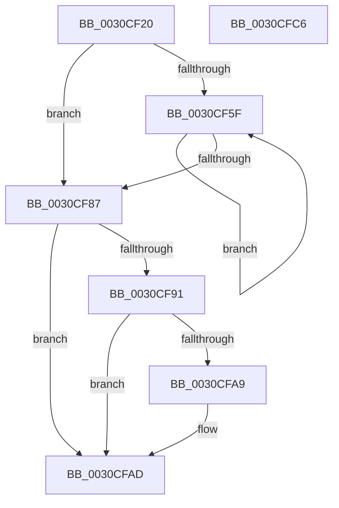

# KiCommitRescheduleContext

- RVA: `0x0030CF20`–`0x0030CFC7` (길이 `167` bytes)
- VA: `0x000000014030CF20`
- 실행 섹션: `.text`
- PDB 이름 있음: `예`; PDB Function 태그: `아니요`
- unwind 정보 RVA: `0x00060300`
- 디코드: `51`개 명령, `167/167` bytes 표시
- 미해석 바이트: `0` (있으면 어셈블리에 `.byte`로 보존)

> 이 문서는 커널 이미지의 기계어와 PDB 기호를 분석해 생성했습니다. 4번과 5번은 함수 원형과 자료형을 바이너리 사용 방식에서 추정한 C 해석이며 원본 소스 복구 결과는 아닙니다.

## 1. Dependencies

- 직접 호출 지점: **1**; 고유 호출 대상: **1**
- 직접 호출자로 확인된 함수: **17**
- RIP 상대 이미지 참조: **1**

### Outgoing calls
- `0x0030CF76` → [KiCommitRescheduleContextEntry](KiCommitRescheduleContextEntry_function_0030CFD0.md) (function, `0x0030CFD0`)

### Direct callers
- [KiDeferGroupSchedulingPreemption](../20/KiDeferGroupSchedulingPreemption_function_0020076C.md) at `0x00200BD7`
- [KiHandleDeferredPreemption](../20/KiHandleDeferredPreemption_function_00202ECC.md) at `0x00203045`
- [KeYieldExecution](../20/KeYieldExecution_function_00209FA0.md) at `0x0020A2BD`
- [KiRemoveBoostThread](../21/KiRemoveBoostThread_function_00219128.md) at `0x0021928B`
- [sub_0021C00A](../21/Unknown_function_0021C00A.md) at `0x0021C0B3`
- [KiSetPriorityThread](../22/KiSetPriorityThread_function_00220E78.md) at `0x00221066`
- [KiUpdateGlobalCpuSetConfiguration](KiUpdateGlobalCpuSetConfiguration_function_00305AB8.md) at `0x00305DA4`
- [KiGroupSchedulingQuantumEnd](KiGroupSchedulingQuantumEnd_function_0030B220.md) at `0x0030B3B3`
- [KiSearchForNewThreadsOnTarget](KiSearchForNewThreadsOnTarget_function_0030F500.md) at `0x00310BFE`
- [KiExitThreadWaitReschedule](../35/KiExitThreadWaitReschedule_function_00352EC8.md) at `0x00352F92`
- [KiParkCurrentProcessor](../35/KiParkCurrentProcessor_function_003533A4.md) at `0x003534B6`
- [KiSearchForNewThread](../35/KiSearchForNewThread_function_00355C98.md) at `0x00355D17`
- [KiSetSystemAffinityThread](../39/KiSetSystemAffinityThread_function_003993E0.md) at `0x003997B8`
- [KiApplyForegroundBoostThread](../4F/KiApplyForegroundBoostThread_function_004F7DC0.md) at `0x004F7F7C`
- [KiFinalizeCoreControlBlockAssignment](../5B/KiFinalizeCoreControlBlockAssignment_function_005B7D0C.md) at `0x005B7E0F`
- [KiAdjustCoreIsolationReasonThread](../5C/KiAdjustCoreIsolationReasonThread_function_005C3818.md) at `0x005C3A0E`
- [KiForceParkDutyCycleDpcCallback](../5C/KiForceParkDutyCycleDpcCallback_function_005C97D0.md) at `0x005C98D2`

### Static image references
- `0x0030CF44` → RVA `0x00FC6B14` (`ALMOSTRO`; read)

## 2. Other-region calls and transfers

- 다른 실행 섹션으로 향하는 call: **0**
- 별도 외부 분기/꼬리 이동을 확인하지 못했습니다.

## 3. Assembly (complete function range)

```asm
0030CF20  48 89 5C 24 08                  mov qword ptr [rsp + 8], rbx
0030CF25  48 89 6C 24 10                  mov qword ptr [rsp + 0x10], rbp
0030CF2A  48 89 74 24 18                  mov qword ptr [rsp + 0x18], rsi
0030CF2F  57                              push rdi
0030CF30  41 56                           push r14
0030CF32  41 57                           push r15
0030CF34  48 83 EC 20                     sub rsp, 0x20
0030CF38  40 32 FF                        xor dil, dil
0030CF3B  41 8B F0                        mov esi, r8d
0030CF3E  83 CE 02                        or esi, 2
0030CF41  4D 8B F1                        mov r14, r9
0030CF44  F7 05 C6 9B CB 00 00 04 00 00   test dword ptr [rip + 0xcb9bc6], 0x400
0030CF4E  4C 8B FA                        mov r15, rdx
0030CF51  48 8B D9                        mov rbx, rcx
0030CF54  41 0F 44 F0                     cmove esi, r8d
0030CF58  33 ED                           xor ebp, ebp
0030CF5A  40 38 39                        cmp byte ptr [rcx], dil
0030CF5D  76 28                           jbe 0x14030cf87
0030CF5F  8B CD                           mov ecx, ebp
0030CF61  4D 8B CE                        mov r9, r14
0030CF64  48 83 C1 02                     add rcx, 2
0030CF68  44 8B C6                        mov r8d, esi
0030CF6B  49 8B D7                        mov rdx, r15
0030CF6E  48 8D 0C A9                     lea rcx, [rcx + rbp*4]
0030CF72  48 8D 0C CB                     lea rcx, [rbx + rcx*8]
0030CF76  E8 55 00 00 00                  call 0x14030cfd0
0030CF7B  40 0A F8                        or dil, al
0030CF7E  FF C5                           inc ebp
0030CF80  0F B6 03                        movzx eax, byte ptr [rbx]
0030CF83  3B E8                           cmp ebp, eax
0030CF85  72 D8                           jb 0x14030cf5f
0030CF87  83 7B 08 01                     cmp dword ptr [rbx + 8], 1
0030CF8B  40 0F B6 C7                     movzx eax, dil
0030CF8F  75 1C                           jne 0x14030cfad
0030CF91  48 8B 4B 10                     mov rcx, qword ptr [rbx + 0x10]
0030CF95  48 8B 89 58 8E 00 00            mov rcx, qword ptr [rcx + 0x8e58]
0030CF9C  0F B6 51 01                     movzx edx, byte ptr [rcx + 1]
0030CFA0  FE C2                           inc dl
0030CFA2  88 51 01                        mov byte ptr [rcx + 1], dl
0030CFA5  3A 11                           cmp dl, byte ptr [rcx]
0030CFA7  72 04                           jb 0x14030cfad
0030CFA9  C6 41 01 00                     mov byte ptr [rcx + 1], 0
0030CFAD  48 8B 5C 24 40                  mov rbx, qword ptr [rsp + 0x40]
0030CFB2  48 8B 6C 24 48                  mov rbp, qword ptr [rsp + 0x48]
0030CFB7  48 8B 74 24 50                  mov rsi, qword ptr [rsp + 0x50]
0030CFBC  48 83 C4 20                     add rsp, 0x20
0030CFC0  41 5F                           pop r15
0030CFC2  41 5E                           pop r14
0030CFC4  5F                              pop rdi
0030CFC5  C3                              ret
0030CFC6  CC                              int3
```

## 4. C-style interpretation (structured pseudocode)

```c
__int64 __fastcall KiCommitRescheduleContext(__int64 a1, __int64 a2, int a3, __int64 a4)
{
    __int64 result;
    __int64 v_rbp;
    __int64 v_rdi;
    __int64 v_rsi;
    __int64 v_rsp;
    unsigned __int64 v_stack_p10;
    unsigned __int64 v_stack_p18;
    unsigned __int64 v_stack_p8;

    v_stack_p8 = v_rbx;
    v_stack_p10 = v_rbp;
    v_stack_p18 = v_rsi;
    v_rsp = (v_rsp) - (32);
    v_rdi = 0;
    v_rsi = (unsigned int)(((unsigned int)(a3)) | (2));
    if (((*(unsigned int *)(v_rip + 13343686)) & (0x400ULL)) == 0) { v_rsi = a3; }
    v_rbp = 0;
    if ((*(unsigned __int8 *)(a1)) <= 0) goto loc_0030CF87;
loc_0030CF5F:
    a1 = (0) + (2);
    result = KiCommitRescheduleContextEntry(a1 + a1 + v_rbp * 4 * 8, a2, (unsigned int)((unsigned int)(v_rsi)), a4);
    v_rdi = (unsigned __int8)((v_rdi) | ((unsigned __int8)(result)));
    v_rbp = (unsigned int)((v_rbp) + 1);
    if (((unsigned int)(v_rbp)) < ((unsigned int)(*(unsigned __int8 *)(a1)))) goto loc_0030CF5F;
loc_0030CF87:
    if ((*(unsigned int *)(a1 + 8)) != 1) goto loc_0030CFAD;
    a2 = (unsigned __int8)((*(unsigned __int8 *)(*(unsigned __int64 *)(*(unsigned __int64 *)(a1 + 16) + 36440) + 1)) + 1);
    *(unsigned __int8 *)(*(unsigned __int64 *)(*(unsigned __int64 *)(a1 + 16) + 36440) + 1) = (unsigned __int8)(a2);
    if (((unsigned __int8)(a2)) >= (*(unsigned __int8 *)(*(unsigned __int64 *)(*(unsigned __int64 *)(a1 + 16) + 36440)))) {
        *(unsigned __int8 *)(*(unsigned __int64 *)(*(unsigned __int64 *)(a1 + 16) + 36440) + 1) = 0;
    }
    v_rsp = (v_rsp) + (32);
    return (unsigned __int8)(v_rdi);
}
```

## 5. (Beta) C Style

```c
int64_t KiCommitRescheduleContext(void *Arg1, int64_t Arg2, int32_t Arg3, int64_t Arg4)
{
    uint8_t *arg1 = (uint8_t *)Arg1;

    int64_t result;
    int64_t local_rbp;
    int64_t local_rdi;
    int64_t local_rsi;
    int64_t local_rsp;
    uint64_t v_stack_p10;
    uint64_t v_stack_p18;
    uint64_t v_stack_p8;

    v_stack_p8 = local_rbx;
    v_stack_p10 = local_rbp;
    v_stack_p18 = local_rsi;
    local_rsp = (local_rsp) - (32);
    local_rdi = 0;
    local_rsi = (uint32_t)(((uint32_t)(Arg3)) | (2));
    if (((*(uint32_t *)(v_rip + 0xCB9BC6)) & (0x400ULL)) == 0) { local_rsi = Arg3; }
    local_rbp = 0;
    if ((*(uint8_t *)(arg1)) <= 0) goto loc_0030CF87;
loc_0030CF5F:
    Arg1 = (0) + (2);
    result = KiCommitRescheduleContextEntry(Arg1 + Arg1 + local_rbp * 4 * 8, Arg2, (uint32_t)((uint32_t)(local_rsi)), Arg4);
    local_rdi = (uint8_t)((local_rdi) | ((uint8_t)(result)));
    local_rbp = (uint32_t)((local_rbp) + 1);
    if (((uint32_t)(local_rbp)) < ((uint32_t)(*(uint8_t *)(arg1)))) goto loc_0030CF5F;
loc_0030CF87:
    if ((*(uint32_t *)(arg1 + 0x8)) != 1) goto loc_0030CFAD;
    Arg2 = (uint8_t)((*(uint8_t *)(*(uint64_t *)(*(uint64_t *)(arg1 + 0x10) + 0x8E58) + 0x1)) + 1);
    *(uint8_t *)(*(uint64_t *)(*(uint64_t *)(arg1 + 0x10) + 0x8E58) + 0x1) = (uint8_t)(Arg2);
    if (((uint8_t)(Arg2)) >= (*(uint8_t *)(*(uint64_t *)(*(uint64_t *)(arg1 + 0x10) + 0x8E58)))) {
        *(uint8_t *)(*(uint64_t *)(*(uint64_t *)(arg1 + 0x10) + 0x8E58) + 0x1) = 0;
    }
    local_rsp = (local_rsp) + (32);
    return (uint8_t)(local_rdi);
}
```

### 관측된 메모리 오프셋

구조체 형식이 확인되지 않은 접근은 인자 기준의 오프셋으로만 기록했습니다.

| 기준 인자 | 오프셋 표현 | 폭 (bit) | 접근 |
|---|---:|---:|---|
| `Arg1` | `+ 0x0` | `8` | `R` |
| `Arg1` | `+ 0x0 + rcx*8` | `64` | `R` |
| `Arg1` | `+ 0x8` | `32` | `R` |
| `Arg1` | `+ 0x10` | `64` | `R` |

## 6. Execution-region graph

[열기: 2D/3D 그래프와 함수 탐색 컨트롤 패널](../../../control-panel.html?section=text&rva=0x0030CF20&view=graph)

- 2D 그래프는 위에서 아래로 흐르고, 3D 그래프는 빈 공간을 드래그해 회전합니다. Shift+드래그는 이동, 휠은 확대·축소, 함수 노드 선택은 대상 보고서 이동입니다.

### Static fallback


