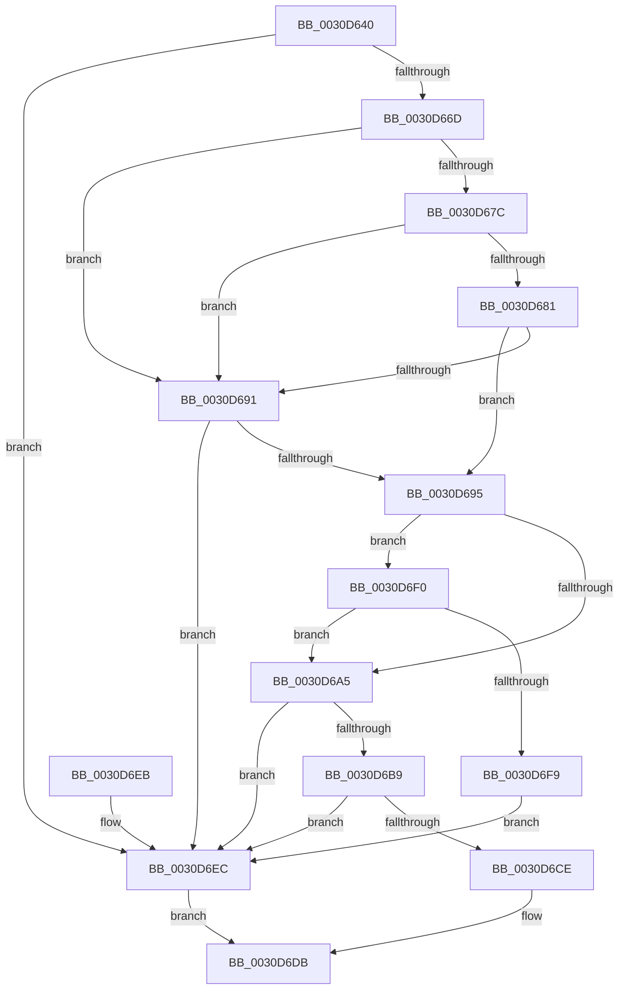

# KiFindStandbyThreadForSteal

- RVA: `0x0030D640`–`0x0030D6FB` (길이 `187` bytes)
- VA: `0x000000014030D640`
- 실행 섹션: `.text`
- PDB 이름 있음: `예`; PDB Function 태그: `아니요`
- unwind 정보 RVA: `0x00073EA0`
- 디코드: `52`개 명령, `187/187` bytes 표시
- 미해석 바이트: `0` (있으면 어셈블리에 `.byte`로 보존)

> 이 문서는 커널 이미지의 기계어와 PDB 기호를 분석해 생성했습니다. 4번과 5번은 함수 원형과 자료형을 바이너리 사용 방식에서 추정한 C 해석이며 원본 소스 복구 결과는 아닙니다.

## 1. Dependencies

- 직접 호출 지점: **1**; 고유 호출 대상: **1**
- 직접 호출자로 확인된 함수: **1**
- RIP 상대 이미지 참조: **1**

### Outgoing calls
- `0x0030D664` → [KiMayStealStandbyThread](KiMayStealStandbyThread_function_0030D704.md) (function, `0x0030D704`)

### Direct callers
- [KiAttemptToStealStandbyThread](KiAttemptToStealStandbyThread_function_0030D790.md) at `0x0030D929`

### Static image references
- `0x0030D695` → RVA `0x00FC6BF8` (`ALMOSTRO`; read)

## 2. Other-region calls and transfers

- 다른 실행 섹션으로 향하는 call: **0**
- 별도 외부 분기/꼬리 이동을 확인하지 못했습니다.

## 3. Assembly (complete function range)

```asm
0030D640  48 89 5C 24 08                  mov qword ptr [rsp + 8], rbx
0030D645  48 89 74 24 10                  mov qword ptr [rsp + 0x10], rsi
0030D64A  57                              push rdi
0030D64B  48 83 EC 20                     sub rsp, 0x20
0030D64F  48 8B FA                        mov rdi, rdx
0030D652  41 8B F0                        mov esi, r8d
0030D655  48 8B D1                        mov rdx, rcx
0030D658  48 8B D9                        mov rbx, rcx
0030D65B  48 8B CF                        mov rcx, rdi
0030D65E  41 B8 01 00 00 00               mov r8d, 1
0030D664  E8 9B 00 00 00                  call 0x14030d704
0030D669  84 C0                           test al, al
0030D66B  74 7F                           je 0x14030d6ec
0030D66D  4C 8B 4F 10                     mov r9, qword ptr [rdi + 0x10]
0030D671  41 8B 49 78                     mov ecx, dword ptr [r9 + 0x78]
0030D675  D1 E9                           shr ecx, 1
0030D677  83 E1 01                        and ecx, 1
0030D67A  74 15                           je 0x14030d691
0030D67C  83 F9 01                        cmp ecx, 1
0030D67F  75 10                           jne 0x14030d691
0030D681  48 8B 87 58 8E 00 00            mov rax, qword ptr [rdi + 0x8e58]
0030D688  48 39 83 58 8E 00 00            cmp qword ptr [rbx + 0x8e58], rax
0030D68F  74 04                           je 0x14030d695
0030D691  3B CE                           cmp ecx, esi
0030D693  7F 57                           jg 0x14030d6ec
0030D695  48 8B 0D 5C 95 CB 00            mov rcx, qword ptr [rip + 0xcb955c]
0030D69C  49 39 89 38 02 00 00            cmp qword ptr [r9 + 0x238], rcx
0030D6A3  75 4B                           jne 0x14030d6f0
0030D6A5  4D 8B 81 40 02 00 00            mov r8, qword ptr [r9 + 0x240]
0030D6AC  0F B6 83 D0 00 00 00            movzx eax, byte ptr [rbx + 0xd0]
0030D6B3  66 41 3B 00                     cmp ax, word ptr [r8]
0030D6B7  73 33                           jae 0x14030d6ec
0030D6B9  0F B6 8B D1 00 00 00            movzx ecx, byte ptr [rbx + 0xd1]
0030D6C0  4D 8B 44 C0 08                  mov r8, qword ptr [r8 + rax*8 + 8]
0030D6C5  49 D3 E8                        shr r8, cl
0030D6C8  41 F6 C0 01                     test r8b, 1
0030D6CC  74 1E                           je 0x14030d6ec
0030D6CE  8B 4B 24                        mov ecx, dword ptr [rbx + 0x24]
0030D6D1  49 8B C1                        mov rax, r9
0030D6D4  41 89 89 18 02 00 00            mov dword ptr [r9 + 0x218], ecx
0030D6DB  48 8B 5C 24 30                  mov rbx, qword ptr [rsp + 0x30]
0030D6E0  48 8B 74 24 38                  mov rsi, qword ptr [rsp + 0x38]
0030D6E5  48 83 C4 20                     add rsp, 0x20
0030D6E9  5F                              pop rdi
0030D6EA  C3                              ret
0030D6EB  CC                              int3
0030D6EC  33 C0                           xor eax, eax
0030D6EE  EB EB                           jmp 0x14030d6db
0030D6F0  41 8B 49 74                     mov ecx, dword ptr [r9 + 0x74]
0030D6F4  F6 C1 08                        test cl, 8
0030D6F7  75 AC                           jne 0x14030d6a5
0030D6F9  EB F1                           jmp 0x14030d6ec
```

## 4. C-style interpretation (structured pseudocode)

```c
__int64 __fastcall KiFindStandbyThreadForSteal(__int64 a1, __int64 a2, int a3)
{
    __int64 result;
    __int64 v_rsp;
    unsigned __int64 v_stack_p10;
    unsigned __int64 v_stack_p8;

    v_stack_p8 = v_rbx;
    v_stack_p10 = v_rsi;
    v_rsp = (v_rsp) - (32);
    result = KiMayStealStandbyThread(a2, a1, 1, a4);
    if ((unsigned __int8)(result) == 0) goto loc_0030D6EC;
    a1 = (unsigned int)(((unsigned int)(*(unsigned int *)(*(unsigned __int64 *)(a2 + 16) + 120))) >> (1));
    a1 = (unsigned int)((a1) & (1));
    if (condition_is_equal) goto loc_0030D691;
    if (((unsigned int)(a1)) != 1) goto loc_0030D691;
    if ((*(unsigned __int64 *)(a1 + 36440)) == (*(unsigned __int64 *)(a2 + 36440))) goto loc_0030D695;
loc_0030D691:
    if (((unsigned int)(a1)) > ((unsigned int)((unsigned int)(a3)))) goto loc_0030D6EC;
loc_0030D695:
    if ((*(unsigned __int64 *)(*(unsigned __int64 *)(a2 + 16) + 568)) != (*(unsigned __int64 *)(v_rip + 13342044))) goto loc_0030D6F0;
loc_0030D6A5:
    if (((unsigned __int16)(*(unsigned __int8 *)(a1 + 208))) >= (*(unsigned __int16 *)(*(unsigned __int64 *)(*(unsigned __int64 *)(a2 + 16) + 576)))) goto loc_0030D6EC;
    a3 = (*(unsigned __int64 *)(*(unsigned __int64 *)(*(unsigned __int64 *)(a2 + 16) + 576) + *(unsigned __int8 *)(a1 + 208) * 8 + 8)) >> ((unsigned __int8)(*(unsigned __int8 *)(a1 + 209)));
    if ((((unsigned __int8)(a3)) & (1)) == 0) goto loc_0030D6EC;
    *(unsigned int *)(*(unsigned __int64 *)(a2 + 16) + 536) = (unsigned int)((unsigned int)(*(unsigned int *)(a1 + 36)));
loc_0030D6DB:
    v_rsp = (v_rsp) + (32);
    return *(unsigned __int64 *)(a2 + 16);
loc_0030D6EC:
    result = 0;
    goto loc_0030D6DB;
loc_0030D6F0:
    if ((((unsigned __int8)((unsigned int)(*(unsigned int *)(*(unsigned __int64 *)(a2 + 16) + 116)))) & (8)) != 0) goto loc_0030D6A5;
    goto loc_0030D6EC;
}
```

## 5. (Beta) C Style

```c
int64_t KiFindStandbyThreadForSteal(void *Arg1, void *Arg2, int32_t Arg3)
{
    uint8_t *arg1 = (uint8_t *)Arg1;
    uint8_t *arg2 = (uint8_t *)Arg2;

    int64_t result;
    int64_t local_rsp;
    uint64_t v_stack_p10;
    uint64_t v_stack_p8;

    v_stack_p8 = local_rbx;
    v_stack_p10 = local_rsi;
    local_rsp = (local_rsp) - (32);
    result = KiMayStealStandbyThread(Arg2, Arg1, 1, a4);
    if ((uint8_t)(result) == 0) goto loc_0030D6EC;
    Arg1 = (uint32_t)(((uint32_t)(*(uint32_t *)(*(uint64_t *)(arg2 + 0x10) + 0x78))) >> (1));
    Arg1 = (uint32_t)((Arg1) & (1));
    if (condition_is_equal) goto loc_0030D691;
    if (((uint32_t)(Arg1)) != 1) goto loc_0030D691;
    if ((*(uint64_t *)(arg1 + 0x8E58)) == (*(uint64_t *)(arg2 + 0x8E58))) goto loc_0030D695;
loc_0030D691:
    if (((uint32_t)(Arg1)) > ((uint32_t)((uint32_t)(Arg3)))) goto loc_0030D6EC;
loc_0030D695:
    if ((*(uint64_t *)(*(uint64_t *)(arg2 + 0x10) + 0x238)) != (*(uint64_t *)(v_rip + 0xCB955C))) goto loc_0030D6F0;
loc_0030D6A5:
    if (((uint16_t)(*(uint8_t *)(arg1 + 0xD0))) >= (*(uint16_t *)(*(uint64_t *)(*(uint64_t *)(arg2 + 0x10) + 0x240)))) goto loc_0030D6EC;
    Arg3 = (*(uint64_t *)(*(uint64_t *)(*(uint64_t *)(arg2 + 0x10) + 0x240) + *(uint8_t *)(arg1 + 0xD0) * 8 + 0x8)) >> ((uint8_t)(*(uint8_t *)(arg1 + 0xD1)));
    if ((((uint8_t)(Arg3)) & (1)) == 0) goto loc_0030D6EC;
    *(uint32_t *)(*(uint64_t *)(arg2 + 0x10) + 0x218) = (uint32_t)((uint32_t)(*(uint32_t *)(arg1 + 0x24)));
loc_0030D6DB:
    local_rsp = (local_rsp) + (32);
    return *(uint64_t *)(arg2 + 0x10);
loc_0030D6EC:
    result = 0;
    goto loc_0030D6DB;
loc_0030D6F0:
    if ((((uint8_t)((uint32_t)(*(uint32_t *)(*(uint64_t *)(arg2 + 0x10) + 0x74)))) & (8)) != 0) goto loc_0030D6A5;
    goto loc_0030D6EC;
}
```

### 관측된 메모리 오프셋

구조체 형식이 확인되지 않은 접근은 인자 기준의 오프셋으로만 기록했습니다.

| 기준 인자 | 오프셋 표현 | 폭 (bit) | 접근 |
|---|---:|---:|---|
| `Arg1` | `+ 0x24` | `32` | `R` |
| `Arg1` | `+ 0xD0` | `8` | `R` |
| `Arg1` | `+ 0xD1` | `8` | `R` |
| `Arg1` | `+ 0x8E58` | `64` | `R` |
| `Arg2` | `+ 0x10` | `64` | `R` |
| `Arg2` | `+ 0x8E58` | `64` | `R` |

## 6. Execution-region graph

[열기: 2D/3D 그래프와 함수 탐색 컨트롤 패널](../../../control-panel.html?section=text&rva=0x0030D640&view=graph)

- 2D 그래프는 위에서 아래로 흐르고, 3D 그래프는 빈 공간을 드래그해 회전합니다. Shift+드래그는 이동, 휠은 확대·축소, 함수 노드 선택은 대상 보고서 이동입니다.

### Static fallback


