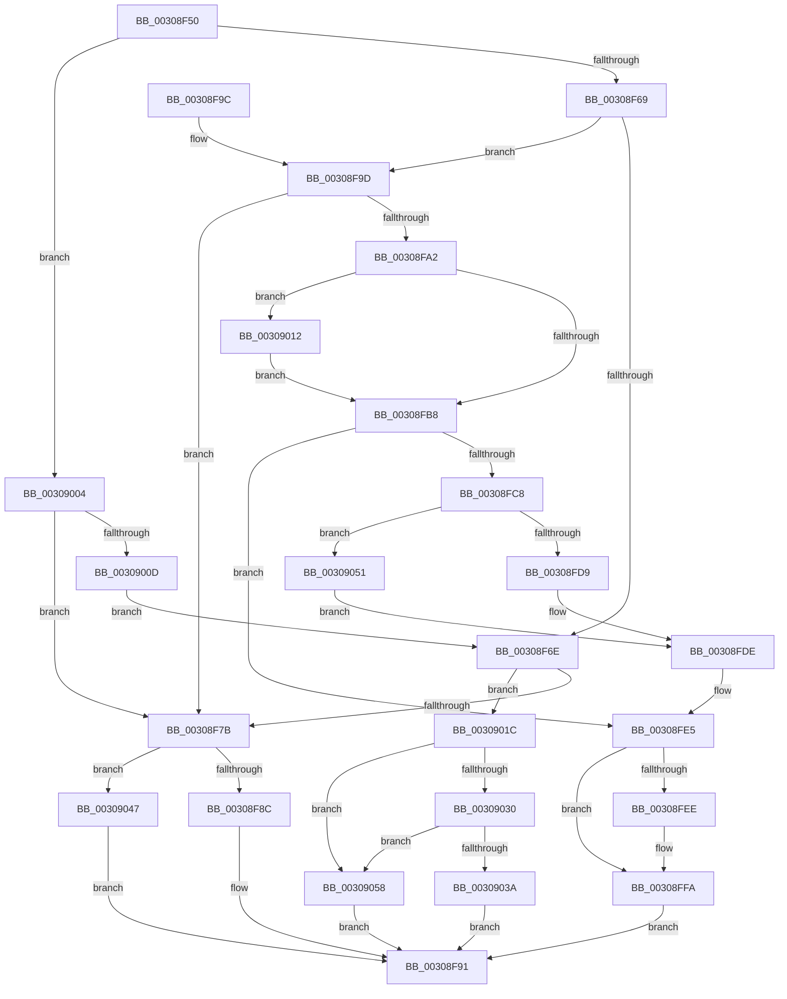

# KiFlushAddressSpaceTb

- RVA: `0x00308F50`–`0x00309065` (길이 `277` bytes)
- VA: `0x0000000140308F50`
- 실행 섹션: `.text`
- PDB 이름 있음: `예`; PDB Function 태그: `아니요`
- unwind 정보 RVA: `0x00073B1C`
- 디코드: `74`개 명령, `277/277` bytes 표시
- 미해석 바이트: `0` (있으면 어셈블리에 `.byte`로 보존)

> 이 문서는 커널 이미지의 기계어와 PDB 기호를 분석해 생성했습니다. 4번과 5번은 함수 원형과 자료형을 바이너리 사용 방식에서 추정한 C 해석이며 원본 소스 복구 결과는 아닙니다.

## 1. Dependencies

- 직접 호출 지점: **10**; 고유 호출 대상: **8**
- 직접 호출자로 확인된 함수: **4**
- RIP 상대 이미지 참조: **5**

### Outgoing calls
- `0x00308F6E` → [HvlpUseExtendedProcessorSetHypercalls](HvlpUseExtendedProcessorSetHypercalls_function_0030906C.md) (function, `0x0030906C`)
- `0x00308F8C` → [HvlpFastFlushAddressSpaceTb](../31/HvlpFastFlushAddressSpaceTb_function_00314AF4.md) (function, `0x00314AF4`)
- `0x00308FBF` → [KxSetTimeStampBusy](../31/KxSetTimeStampBusy_function_00314CC0.md) (function, `0x00314CC0`)
- `0x00308FD9` → [HvlpFastFlushAddressSpaceTb](../31/HvlpFastFlushAddressSpaceTb_function_00314AF4.md) (function, `0x00314AF4`)
- `0x00308FF5` → [KiLowerIrqlProcessIrqlFlags](../4F/KiLowerIrqlProcessIrqlFlags_function_004F5698.md) (function, `0x004F5698`)
- `0x00309015` → [KiRaiseIrqlProcessIrqlFlags](../4F/KiRaiseIrqlProcessIrqlFlags_function_004F56FC.md) (function, `0x004F56FC`)
- `0x0030903D` → [HvlpFastFlushAddressSpaceTbEx](HvlpFastFlushAddressSpaceTbEx_function_003065B4.md) (function, `0x003065B4`)
- `0x00309047` → [HvlpSlowFlushAddressSpaceTb](../44/HvlpSlowFlushAddressSpaceTb_function_004402C4.md) (function, `0x004402C4`)
- `0x00309051` → [HvlpSlowFlushAddressSpaceTb](../44/HvlpSlowFlushAddressSpaceTb_function_004402C4.md) (function, `0x004402C4`)
- `0x0030905B` → [HvlpSlowFlushAddressSpaceTbEx](../6A/HvlpSlowFlushAddressSpaceTbEx_function_006A7D48.md) (function, `0x006A7D48`)

### Direct callers
- [MiManageUltraSpacePageTable](../2D/MiManageUltraSpacePageTable_function_002DCAF0.md) at `0x002DCD01`
- [MiFlushEntireTbDueToAttributeChange](MiFlushEntireTbDueToAttributeChange_function_00308AE0.md) at `0x00308B9A`
- [KeFlushProcessTb](../46/KeFlushProcessTb_function_00465BC8.md) at `0x00465BEB`
- [KeFlushEntireTb](../5B/KeFlushEntireTb_function_005BDBF0.md) at `0x005BDC2F`

### Static image references
- `0x00308F7B` → RVA `0x00FC6AB8` (`ALMOSTRO`; read)
- `0x00308FAF` → RVA `0x00FC6D20` (`ALMOSTRO`; read)
- `0x00308FB8` → RVA `0x00FCF080` (`CACHEALI`; read)
- `0x00308FDE` → RVA `0x00FCF080` (`CACHEALI`; read/write)
- `0x0030901C` → RVA `0x00FC6A90` (`ALMOSTRO`; read)

## 2. Other-region calls and transfers

- 다른 실행 섹션으로 향하는 call: **0**
- 별도 외부 분기/꼬리 이동을 확인하지 못했습니다.

## 3. Assembly (complete function range)

```asm
00308F50  48 89 5C 24 08                  mov qword ptr [rsp + 8], rbx
00308F55  57                              push rdi
00308F56  48 83 EC 20                     sub rsp, 0x20
00308F5A  41 8A D8                        mov bl, r8b
00308F5D  4C 8B D1                        mov r10, rcx
00308F60  48 85 C9                        test rcx, rcx
00308F63  0F 85 9B 00 00 00               jne 0x140309004
00308F69  48 85 D2                        test rdx, rdx
00308F6C  74 2F                           je 0x140308f9d
00308F6E  E8 F9 00 00 00                  call 0x14030906c
00308F73  84 C0                           test al, al
00308F75  0F 85 A1 00 00 00               jne 0x14030901c
00308F7B  8B 05 37 DB CB 00               mov eax, dword ptr [rip + 0xcbdb37]
00308F81  49 8B CA                        mov rcx, r10
00308F84  84 C0                           test al, al
00308F86  0F 89 BB 00 00 00               jns 0x140309047
00308F8C  E8 63 BB 00 00                  call 0x140314af4
00308F91  48 8B 5C 24 30                  mov rbx, qword ptr [rsp + 0x30]
00308F96  48 83 C4 20                     add rsp, 0x20
00308F9A  5F                              pop rdi
00308F9B  C3                              ret
00308F9C  CC                              int3
00308F9D  45 84 C9                        test r9b, r9b
00308FA0  74 D9                           je 0x140308f7b
00308FA2  44 0F 20 C7                     mov rdi, cr8
00308FA6  BA 0C 00 00 00                  mov edx, 0xc
00308FAB  44 0F 22 C2                     mov cr8, rdx
00308FAF  83 3D 6A DD CB 00 00            cmp dword ptr [rip + 0xcbdd6a], 0
00308FB6  75 5A                           jne 0x140309012
00308FB8  48 8D 0D C1 60 CC 00            lea rcx, [rip + 0xcc60c1]
00308FBF  E8 FC BC 00 00                  call 0x140314cc0
00308FC4  84 C0                           test al, al
00308FC6  74 1D                           je 0x140308fe5
00308FC8  8B 05 EA DA CB 00               mov eax, dword ptr [rip + 0xcbdaea]
00308FCE  33 D2                           xor edx, edx
00308FD0  33 C9                           xor ecx, ecx
00308FD2  44 8A C3                        mov r8b, bl
00308FD5  84 C0                           test al, al
00308FD7  79 78                           jns 0x140309051
00308FD9  E8 16 BB 00 00                  call 0x140314af4
00308FDE  F0 FF 05 9B 60 CC 00            lock inc dword ptr [rip + 0xcc609b]
00308FE5  83 3D 34 DD CB 00 00            cmp dword ptr [rip + 0xcbdd34], 0
00308FEC  74 0C                           je 0x140308ffa
00308FEE  44 0F 20 C1                     mov rcx, cr8
00308FF2  40 8A D7                        mov dl, dil
00308FF5  E8 9E C6 1E 00                  call 0x1404f5698
00308FFA  40 0F B6 C7                     movzx eax, dil
00308FFE  44 0F 22 C0                     mov cr8, rax
00309002  EB 8D                           jmp 0x140308f91
00309004  48 85 D2                        test rdx, rdx
00309007  0F 84 6E FF FF FF               je 0x140308f7b
0030900D  E9 5C FF FF FF                  jmp 0x140308f6e
00309012  40 8A CF                        mov cl, dil
00309015  E8 E2 C6 1E 00                  call 0x1404f56fc
0030901A  EB 9C                           jmp 0x140308fb8
0030901C  8B 05 6E DA CB 00               mov eax, dword ptr [rip + 0xcbda6e]
00309022  C1 E8 08                        shr eax, 8
00309025  83 E0 0F                        and eax, 0xf
00309028  83 C0 05                        add eax, 5
0030902B  83 F8 0E                        cmp eax, 0xe
0030902E  77 28                           ja 0x140309058
00309030  8B 05 82 DA CB 00               mov eax, dword ptr [rip + 0xcbda82]
00309036  84 C0                           test al, al
00309038  79 1E                           jns 0x140309058
0030903A  49 8B CA                        mov rcx, r10
0030903D  E8 72 D5 FF FF                  call 0x1403065b4
00309042  E9 4A FF FF FF                  jmp 0x140308f91
00309047  E8 78 72 13 00                  call 0x1404402c4
0030904C  E9 40 FF FF FF                  jmp 0x140308f91
00309051  E8 6E 72 13 00                  call 0x1404402c4
00309056  EB 86                           jmp 0x140308fde
00309058  49 8B CA                        mov rcx, r10
0030905B  E8 E8 EC 39 00                  call 0x1406a7d48
00309060  E9 2C FF FF FF                  jmp 0x140308f91
```

## 4. C-style interpretation (structured pseudocode)

```c
__int64 __fastcall KiFlushAddressSpaceTb(__int64 a1, __int64 a2, unsigned __int8 a3, unsigned __int8 a4)
{
    __int64 result;
    __int64 v_rsp;
    unsigned __int64 v_stack_p8;

    v_stack_p8 = v_rbx;
    v_rsp = (v_rsp) - (32);
    if (a1 != 0) goto loc_00309004;
    if (a2 == 0) goto loc_00308F9D;
loc_00308F6E:
    result = HvlpUseExtendedProcessorSetHypercalls(a1, a2, a3, a4);
    if ((unsigned __int8)(result) != 0) goto loc_0030901C;
loc_00308F7B:
    if (!sign_flag) goto loc_00309047;
    result = HvlpFastFlushAddressSpaceTb(a1, a2, a3, a4);
loc_00308F91:
    v_rsp = (v_rsp) + (32);
    return result;
loc_00308F9D:
    if (a4 == 0) goto loc_00308F7B;
    if ((*(unsigned int *)(v_rip + 13360490)) != 0) goto loc_00309012;
loc_00308FB8:
    result = KxSetTimeStampBusy(v_rip + 13394113, 12, a3, a4);
    if ((unsigned __int8)(result) == 0) goto loc_00308FE5;
    a2 = 0;
    a1 = 0;
    if (!sign_flag) goto loc_00309051;
    result = HvlpFastFlushAddressSpaceTb(a1, a2, (unsigned __int8)(v_stack_p8), a4);
loc_00308FDE:
loc_00308FE5:
    if ((*(unsigned int *)(v_rip + 13360436)) != 0) {
        a1 = 12;
        a2 = (unsigned __int8)(v_cr8);
        result = KiLowerIrqlProcessIrqlFlags(a1, a2, (unsigned __int8)(v_stack_p8), a4);
    }
    goto loc_00308F91;
loc_00309004:
    if (a2 == 0) goto loc_00308F7B;
    goto loc_00308F6E;
loc_00309012:
    result = KiRaiseIrqlProcessIrqlFlags((unsigned __int8)(v_cr8), a2, (unsigned __int8)(v_stack_p8), a4);
    goto loc_00308FB8;
loc_0030901C:
    result = (unsigned int)(((unsigned int)(*(unsigned int *)(v_rip + 13359726))) >> (8));
    result = (unsigned int)((result) & (15));
    result = (unsigned int)((result) + (5));
    if (((unsigned int)(result)) > 14) goto loc_00309058;
    if (!sign_flag) goto loc_00309058;
    result = HvlpFastFlushAddressSpaceTbEx(a1, a2, (unsigned __int8)(v_stack_p8), a4);
    goto loc_00308F91;
loc_00309047:
    result = HvlpSlowFlushAddressSpaceTb(a1, a2, (unsigned __int8)(v_stack_p8), a4);
    goto loc_00308F91;
loc_00309051:
    result = HvlpSlowFlushAddressSpaceTb(a1, a2, (unsigned __int8)(v_stack_p8), a4);
    goto loc_00308FDE;
loc_00309058:
    result = HvlpSlowFlushAddressSpaceTbEx(a1, a2, (unsigned __int8)(v_stack_p8), a4);
    goto loc_00308F91;
}
```

## 5. (Beta) C Style

```c
int64_t KiFlushAddressSpaceTb(int64_t Arg1, int64_t Arg2, uint8_t Arg3, uint8_t Arg4)
{
    int64_t result;
    int64_t local_rsp;
    uint64_t v_stack_p8;

    v_stack_p8 = local_rbx;
    local_rsp = (local_rsp) - (32);
    if (Arg1 != 0) goto loc_00309004;
    if (Arg2 == 0) goto loc_00308F9D;
loc_00308F6E:
    result = HvlpUseExtendedProcessorSetHypercalls(Arg1, Arg2, Arg3, Arg4);
    if ((uint8_t)(result) != 0) goto loc_0030901C;
loc_00308F7B:
    if (!sign_flag) goto loc_00309047;
    result = HvlpFastFlushAddressSpaceTb(Arg1, Arg2, Arg3, Arg4);
loc_00308F91:
    local_rsp = (local_rsp) + (32);
    return result;
loc_00308F9D:
    if (Arg4 == 0) goto loc_00308F7B;
    if ((*(uint32_t *)(v_rip + 0xCBDD6A)) != 0) goto loc_00309012;
loc_00308FB8:
    result = KxSetTimeStampBusy(v_rip + 13394113, 12, Arg3, Arg4);
    if ((uint8_t)(result) == 0) goto loc_00308FE5;
    Arg2 = 0;
    Arg1 = 0;
    if (!sign_flag) goto loc_00309051;
    result = HvlpFastFlushAddressSpaceTb(Arg1, Arg2, (uint8_t)(v_stack_p8), Arg4);
loc_00308FDE:
loc_00308FE5:
    if ((*(uint32_t *)(v_rip + 0xCBDD34)) != 0) {
        Arg1 = 12;
        Arg2 = (uint8_t)(v_cr8);
        result = KiLowerIrqlProcessIrqlFlags(Arg1, Arg2, (uint8_t)(v_stack_p8), Arg4);
    }
    goto loc_00308F91;
loc_00309004:
    if (Arg2 == 0) goto loc_00308F7B;
    goto loc_00308F6E;
loc_00309012:
    result = KiRaiseIrqlProcessIrqlFlags((uint8_t)(v_cr8), Arg2, (uint8_t)(v_stack_p8), Arg4);
    goto loc_00308FB8;
loc_0030901C:
    result = (uint32_t)(((uint32_t)(*(uint32_t *)(v_rip + 0xCBDA6E))) >> (8));
    result = (uint32_t)((result) & (15));
    result = (uint32_t)((result) + (5));
    if (((uint32_t)(result)) > 14) goto loc_00309058;
    if (!sign_flag) goto loc_00309058;
    result = HvlpFastFlushAddressSpaceTbEx(Arg1, Arg2, (uint8_t)(v_stack_p8), Arg4);
    goto loc_00308F91;
loc_00309047:
    result = HvlpSlowFlushAddressSpaceTb(Arg1, Arg2, (uint8_t)(v_stack_p8), Arg4);
    goto loc_00308F91;
loc_00309051:
    result = HvlpSlowFlushAddressSpaceTb(Arg1, Arg2, (uint8_t)(v_stack_p8), Arg4);
    goto loc_00308FDE;
loc_00309058:
    result = HvlpSlowFlushAddressSpaceTbEx(Arg1, Arg2, (uint8_t)(v_stack_p8), Arg4);
    goto loc_00308F91;
}
```

## 6. Execution-region graph

[열기: 2D/3D 그래프와 함수 탐색 컨트롤 패널](../../../control-panel.html?section=text&rva=0x00308F50&view=graph)

- 2D 그래프는 위에서 아래로 흐르고, 3D 그래프는 빈 공간을 드래그해 회전합니다. Shift+드래그는 이동, 휠은 확대·축소, 함수 노드 선택은 대상 보고서 이동입니다.

### Static fallback


