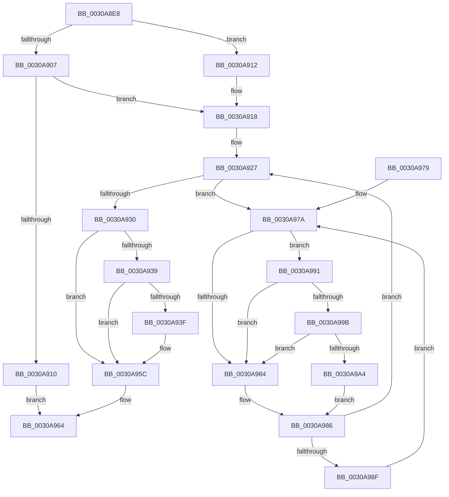

# KiInsertDeferredPreemptionApc

- RVA: `0x0030A8E8`–`0x0030A9AD` (길이 `197` bytes)
- VA: `0x000000014030A8E8`
- 실행 섹션: `.text`
- PDB 이름 있음: `예`; PDB Function 태그: `아니요`
- unwind 정보 RVA: `0x00073C48`
- 디코드: `55`개 명령, `197/197` bytes 표시
- 미해석 바이트: `0` (있으면 어셈블리에 `.byte`로 보존)

> 이 문서는 커널 이미지의 기계어와 PDB 기호를 분석해 생성했습니다. 4번과 5번은 함수 원형과 자료형을 바이너리 사용 방식에서 추정한 C 해석이며 원본 소스 복구 결과는 아닙니다.

## 1. Dependencies

- 직접 호출 지점: **4**; 고유 호출 대상: **4**
- 직접 호출자로 확인된 함수: **5**
- RIP 상대 이미지 참조: **2**

### Outgoing calls
- `0x0030A946` → [KiInsertQueueApc](../20/KiInsertQueueApc_function_002041F0.md) (function, `0x002041F0`)
- `0x0030A957` → [KiSignalThreadForApc](../20/KiSignalThreadForApc_function_00204360.md) (function, `0x00204360`)
- `0x0030A99B` → [KiCheckVpBackingLongSpinWaitHypercall](KiCheckVpBackingLongSpinWaitHypercall_function_0030F490.md) (function, `0x0030F490`)
- `0x0030A9A6` → [HvlNotifyLongSpinWait](HvlNotifyLongSpinWait_function_0030F460.md) (function, `0x0030F460`)

### Direct callers
- [KiDeferGroupSchedulingPreemption](../20/KiDeferGroupSchedulingPreemption_function_0020076C.md) at `0x00200CD5`
- [KiStartThreadCycleAccumulationContextSwap](KiStartThreadCycleAccumulationContextSwap_function_00309C10.md) at `0x0030A0E6`
- [sub_0030A776](Unknown_function_0030A776.md) at `0x0030A861`
- [KiGroupSchedulingQuantumEnd](KiGroupSchedulingQuantumEnd_function_0030B220.md) at `0x0030B424`
- [KiSwapThread](../35/KiSwapThread_function_00355640.md) at `0x00355C0D`

### Static image references
- `0x0030A97C` → RVA `0x00FC52AC` (`ALMOSTRO`; reference)
- `0x0030A991` → RVA `0x00FC6AB8` (`ALMOSTRO`; read)

## 2. Other-region calls and transfers

- 다른 실행 섹션으로 향하는 call: **0**
- 별도 외부 분기/꼬리 이동을 확인하지 못했습니다.

## 3. Assembly (complete function range)

```asm
0030A8E8  48 89 5C 24 08                  mov qword ptr [rsp + 8], rbx
0030A8ED  48 89 6C 24 10                  mov qword ptr [rsp + 0x10], rbp
0030A8F2  48 89 74 24 18                  mov qword ptr [rsp + 0x18], rsi
0030A8F7  57                              push rdi
0030A8F8  48 83 EC 20                     sub rsp, 0x20
0030A8FC  48 8B DA                        mov rbx, rdx
0030A8FF  48 8B E9                        mov rbp, rcx
0030A902  45 84 C0                        test r8b, r8b
0030A905  75 0B                           jne 0x14030a912
0030A907  F7 42 78 00 04 00 00            test dword ptr [rdx + 0x78], 0x400
0030A90E  74 08                           je 0x14030a918
0030A910  EB 52                           jmp 0x14030a964
0030A912  F0 0F BA 72 78 0B               lock btr dword ptr [rdx + 0x78], 0xb
0030A918  F0 0F BA 6A 78 0A               lock bts dword ptr [rdx + 0x78], 0xa
0030A91E  33 FF                           xor edi, edi
0030A920  48 8D B2 88 02 00 00            lea rsi, [rdx + 0x288]
0030A927  F0 48 0F BA 6B 40 00            lock bts qword ptr [rbx + 0x40], 0
0030A92E  72 4A                           jb 0x14030a97a
0030A930  F7 43 74 00 40 00 00            test dword ptr [rbx + 0x74], 0x4000
0030A937  74 23                           je 0x14030a95c
0030A939  80 7E 52 00                     cmp byte ptr [rsi + 0x52], 0
0030A93D  75 1D                           jne 0x14030a95c
0030A93F  48 8B CE                        mov rcx, rsi
0030A942  C6 46 52 01                     mov byte ptr [rsi + 0x52], 1
0030A946  E8 A5 98 EF FF                  call 0x1402041f0
0030A94B  45 33 C9                        xor r9d, r9d
0030A94E  41 B0 02                        mov r8b, 2
0030A951  48 8B D6                        mov rdx, rsi
0030A954  48 8B CD                        mov rcx, rbp
0030A957  E8 04 9A EF FF                  call 0x140204360
0030A95C  48 C7 43 40 00 00 00 00         mov qword ptr [rbx + 0x40], 0
0030A964  48 8B 5C 24 30                  mov rbx, qword ptr [rsp + 0x30]
0030A969  48 8B 6C 24 38                  mov rbp, qword ptr [rsp + 0x38]
0030A96E  48 8B 74 24 40                  mov rsi, qword ptr [rsp + 0x40]
0030A973  48 83 C4 20                     add rsp, 0x20
0030A977  5F                              pop rdi
0030A978  C3                              ret
0030A979  CC                              int3
0030A97A  FF C7                           inc edi
0030A97C  85 3D 2A A9 CB 00               test dword ptr [rip + 0xcba92a], edi
0030A982  74 0D                           je 0x14030a991
0030A984  F3 90                           pause
0030A986  48 8B 43 40                     mov rax, qword ptr [rbx + 0x40]
0030A98A  48 85 C0                        test rax, rax
0030A98D  74 98                           je 0x14030a927
0030A98F  EB E9                           jmp 0x14030a97a
0030A991  8B 05 21 C1 CB 00               mov eax, dword ptr [rip + 0xcbc121]
0030A997  A8 40                           test al, 0x40
0030A999  74 E9                           je 0x14030a984
0030A99B  E8 F0 4A 00 00                  call 0x14030f490
0030A9A0  84 C0                           test al, al
0030A9A2  74 E0                           je 0x14030a984
0030A9A4  8B CF                           mov ecx, edi
0030A9A6  E8 B5 4A 00 00                  call 0x14030f460
0030A9AB  EB D9                           jmp 0x14030a986
```

## 4. C-style interpretation (structured pseudocode)

```c
__int64 __fastcall KiInsertDeferredPreemptionApc(__int64 a1, __int64 a2, unsigned __int8 a3, int a4)
{
    __int64 result;
    __int64 v_rdi;
    __int64 v_rsp;
    unsigned __int64 v_stack_p10;
    unsigned __int64 v_stack_p18;
    unsigned __int64 v_stack_p8;

    v_stack_p8 = v_rbx;
    v_stack_p10 = v_rbp;
    v_stack_p18 = v_rsi;
    v_rsp = (v_rsp) - (32);
    if (a3 != 0) goto loc_0030A912;
    if (((*(unsigned int *)(a2 + 120)) & (0x400ULL)) == 0) goto loc_0030A918;
    goto loc_0030A964;
loc_0030A912:
loc_0030A918:
    v_rdi = 0;
loc_0030A927:
    if (condition_is_below) goto loc_0030A97A;
    if (((*(unsigned int *)(a2 + 116)) & (0x4000ULL)) == 0) goto loc_0030A95C;
    if ((*(unsigned __int8 *)(a2 + 648 + 82)) == 0) {
        a1 = a2 + 648;
        *(unsigned __int8 *)(a2 + 648 + 82) = 1;
        result = KiInsertQueueApc(a1, a2, a3, a4);
        a4 = 0;
        a3 = 2;
        a2 = a2 + 648;
        a1 = a1;
        result = KiSignalThreadForApc(a1, a2, a3, a4);
    }
    *(unsigned __int64 *)(a2 + 64) = 0;
loc_0030A964:
    v_rsp = (v_rsp) + (32);
    return result;
loc_0030A97A:
    v_rdi = (unsigned int)((v_rdi) + 1);
    if (((*(unsigned int *)(v_rip + 13347114)) & ((unsigned int)(v_rdi))) == 0) goto loc_0030A991;
loc_0030A984:
loc_0030A986:
    if (*(unsigned __int64 *)(v_stack_p8 + 64) == 0) goto loc_0030A927;
    goto loc_0030A97A;
loc_0030A991:
    if ((((unsigned __int8)((unsigned int)(*(unsigned int *)(v_rip + 13353249)))) & (64)) == 0) goto loc_0030A984;
    result = KiCheckVpBackingLongSpinWaitHypercall(a1, a2, a3, a4);
    if ((unsigned __int8)(result) == 0) goto loc_0030A984;
    result = HvlNotifyLongSpinWait((unsigned int)((unsigned int)(v_rdi)), a2, a3, a4);
    goto loc_0030A986;
}
```

## 5. (Beta) C Style

```c
int64_t KiInsertDeferredPreemptionApc(int64_t Arg1, void *Arg2, uint8_t Arg3, int32_t Arg4)
{
    uint8_t *arg2 = (uint8_t *)Arg2;

    int64_t result;
    int64_t local_rdi;
    int64_t local_rsp;
    uint64_t v_stack_p10;
    uint64_t v_stack_p18;
    uint64_t v_stack_p8;

    v_stack_p8 = local_rbx;
    v_stack_p10 = local_rbp;
    v_stack_p18 = local_rsi;
    local_rsp = (local_rsp) - (32);
    if (Arg3 != 0) goto loc_0030A912;
    if (((*(uint32_t *)(arg2 + 0x78)) & (0x400ULL)) == 0) goto loc_0030A918;
    goto loc_0030A964;
loc_0030A912:
loc_0030A918:
    local_rdi = 0;
loc_0030A927:
    if (condition_is_below) goto loc_0030A97A;
    if (((*(uint32_t *)(arg2 + 0x74)) & (0x4000ULL)) == 0) goto loc_0030A95C;
    if ((*(uint8_t *)(arg2 + 0x288 + 0x52)) == 0) {
        Arg1 = Arg2 + 648;
        *(uint8_t *)(arg2 + 0x288 + 0x52) = 1;
        result = KiInsertQueueApc(Arg1, Arg2, Arg3, Arg4);
        Arg4 = 0;
        Arg3 = 2;
        Arg2 = Arg2 + 648;
        Arg1 = Arg1;
        result = KiSignalThreadForApc(Arg1, Arg2, Arg3, Arg4);
    }
    *(uint64_t *)(arg2 + 0x40) = 0;
loc_0030A964:
    local_rsp = (local_rsp) + (32);
    return result;
loc_0030A97A:
    local_rdi = (uint32_t)((local_rdi) + 1);
    if (((*(uint32_t *)(v_rip + 0xCBA92A)) & ((uint32_t)(local_rdi))) == 0) goto loc_0030A991;
loc_0030A984:
loc_0030A986:
    if (*(uint64_t *)(v_stack_p8 + 0x40) == 0) goto loc_0030A927;
    goto loc_0030A97A;
loc_0030A991:
    if ((((uint8_t)((uint32_t)(*(uint32_t *)(v_rip + 0xCBC121)))) & (64)) == 0) goto loc_0030A984;
    result = KiCheckVpBackingLongSpinWaitHypercall(Arg1, Arg2, Arg3, Arg4);
    if ((uint8_t)(result) == 0) goto loc_0030A984;
    result = HvlNotifyLongSpinWait((uint32_t)((uint32_t)(local_rdi)), Arg2, Arg3, Arg4);
    goto loc_0030A986;
}
```

### 관측된 메모리 오프셋

구조체 형식이 확인되지 않은 접근은 인자 기준의 오프셋으로만 기록했습니다.

| 기준 인자 | 오프셋 표현 | 폭 (bit) | 접근 |
|---|---:|---:|---|
| `Arg2` | `+ 0x40` | `64` | `R` |
| `Arg2` | `+ 0x40` | `64` | `R/W` |
| `Arg2` | `+ 0x40` | `64` | `W` |
| `Arg2` | `+ 0x52` | `8` | `R` |
| `Arg2` | `+ 0x52` | `8` | `W` |
| `Arg2` | `+ 0x74` | `32` | `R` |
| `Arg2` | `+ 0x78` | `32` | `R` |
| `Arg2` | `+ 0x78` | `32` | `R/W` |
| `Arg2` | `+ 0x288` | `64` | `R` |

## 6. Execution-region graph

[열기: 2D/3D 그래프와 함수 탐색 컨트롤 패널](../../../control-panel.html?section=text&rva=0x0030A8E8&view=graph)

- 2D 그래프는 위에서 아래로 흐르고, 3D 그래프는 빈 공간을 드래그해 회전합니다. Shift+드래그는 이동, 휠은 확대·축소, 함수 노드 선택은 대상 보고서 이동입니다.

### Static fallback


