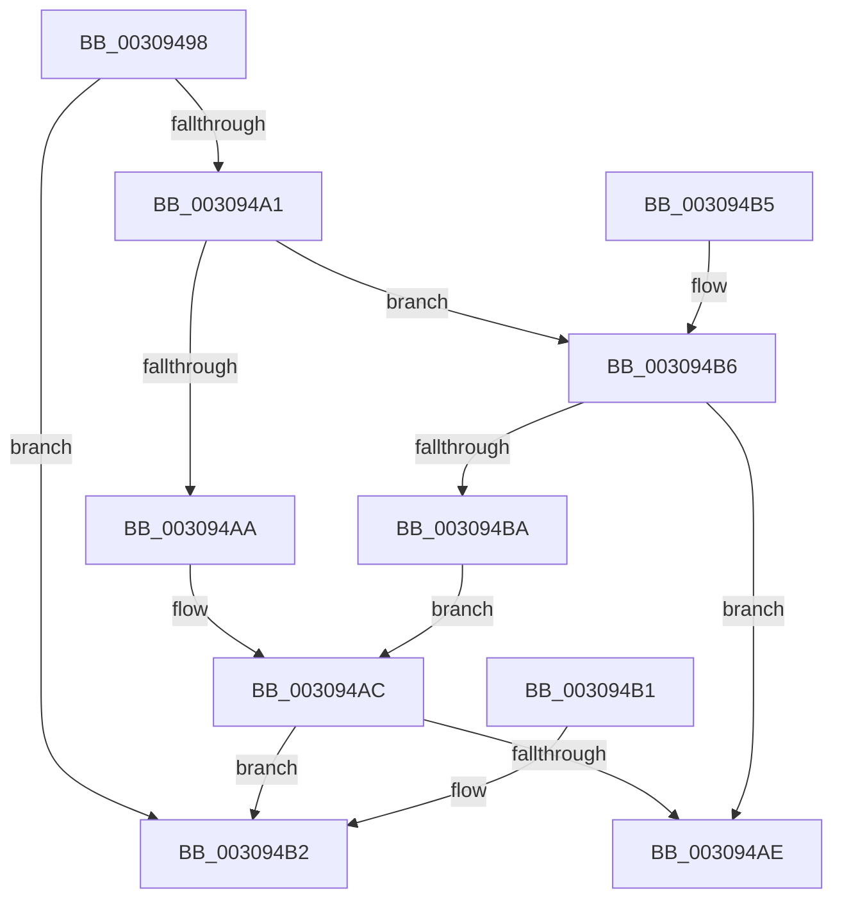

# KiIsFlushEntire

- RVA: `0x00309498`–`0x003094BF` (길이 `39` bytes)
- VA: `0x0000000140309498`
- 실행 섹션: `.text`
- PDB 이름 있음: `예`; PDB Function 태그: `아니요`
- unwind 정보 RVA: `0x000DB714`
- 디코드: `16`개 명령, `39/39` bytes 표시
- 미해석 바이트: `0` (있으면 어셈블리에 `.byte`로 보존)

> 이 문서는 커널 이미지의 기계어와 PDB 기호를 분석해 생성했습니다. 4번과 5번은 함수 원형과 자료형을 바이너리 사용 방식에서 추정한 C 해석이며 원본 소스 복구 결과는 아닙니다.

## 1. Dependencies

- 직접 호출 지점: **0**; 고유 호출 대상: **0**
- 직접 호출자로 확인된 함수: **3**
- RIP 상대 이미지 참조: **2**

### Outgoing calls
- 직접 디코드된 call 명령이 없습니다.

### Direct callers
- [sub_00308F24](Unknown_function_00308F24.md) at `0x00308F30`
- [KeFlushCurrentTbOnly](../31/KeFlushCurrentTbOnly_function_003134EC.md) at `0x00313535`
- [sub_00314667](../31/Unknown_function_00314667.md) at `0x0031469E`

### Static image references
- `0x00309498` → RVA `0x00FC6A87` (`ALMOSTRO`; read)
- `0x003094A1` → RVA `0x01201840` (`CFGRO`; read)

## 2. Other-region calls and transfers

- 다른 실행 섹션으로 향하는 call: **0**
- 별도 외부 분기/꼬리 이동을 확인하지 못했습니다.

## 3. Assembly (complete function range)

```asm
00309498  80 3D E8 D5 CB 00 00            cmp byte ptr [rip + 0xcbd5e8], 0
0030949F  75 11                           jne 0x1403094b2
003094A1  80 3D 98 83 EF 00 00            cmp byte ptr [rip + 0xef8398], 0
003094A8  74 0C                           je 0x1403094b6
003094AA  85 C9                           test ecx, ecx
003094AC  74 04                           je 0x1403094b2
003094AE  B0 01                           mov al, 1
003094B0  C3                              ret
003094B1  CC                              int3
003094B2  32 C0                           xor al, al
003094B4  C3                              ret
003094B5  CC                              int3
003094B6  85 C9                           test ecx, ecx
003094B8  74 F4                           je 0x1403094ae
003094BA  83 F9 01                        cmp ecx, 1
003094BD  EB ED                           jmp 0x1403094ac
```

## 4. C-style interpretation (structured pseudocode)

```c
__int64 __fastcall KiIsFlushEntire(int a1)
{
    __int64 result;

    if ((*(unsigned __int8 *)(v_rip + 13358568)) != 0) goto loc_003094B2;
    if ((*(unsigned __int8 *)(v_rip + 15696792)) == 0) goto loc_003094B6;
loc_003094AC:
    if (a1 == 0) goto loc_003094B2;
loc_003094AE:
    return 1;
loc_003094B2:
    result = 0;
    return result;
loc_003094B6:
    if (a1 == 0) goto loc_003094AE;
    goto loc_003094AC;
}
```

## 5. (Beta) C Style

```c
int64_t KiIsFlushEntire(int32_t Arg1)
{
    int64_t result;

    if ((*(uint8_t *)(v_rip + 0xCBD5E8)) != 0) goto loc_003094B2;
    if ((*(uint8_t *)(v_rip + 0xEF8398)) == 0) goto loc_003094B6;
loc_003094AC:
    if (Arg1 == 0) goto loc_003094B2;
loc_003094AE:
    return 1;
loc_003094B2:
    result = 0;
    return result;
loc_003094B6:
    if (Arg1 == 0) goto loc_003094AE;
    goto loc_003094AC;
}
```

## 6. Execution-region graph

[열기: 2D/3D 그래프와 함수 탐색 컨트롤 패널](../../../control-panel.html?section=text&rva=0x00309498&view=graph)

- 2D 그래프는 위에서 아래로 흐르고, 3D 그래프는 빈 공간을 드래그해 회전합니다. Shift+드래그는 이동, 휠은 확대·축소, 함수 노드 선택은 대상 보고서 이동입니다.

### Static fallback


