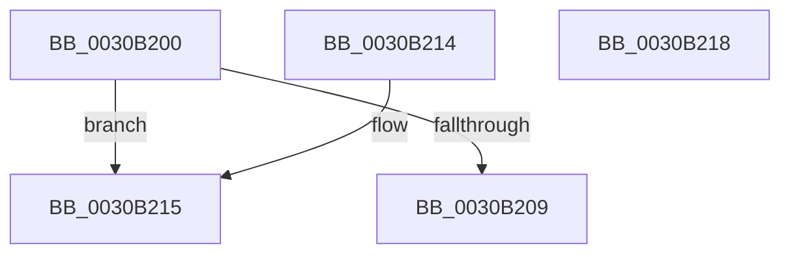

# KiIsThreadConstrainedBySchedulingGroup

- RVA: `0x0030B200`–`0x0030B219` (길이 `25` bytes)
- VA: `0x000000014030B200`
- 실행 섹션: `.text`
- PDB 이름 있음: `예`; PDB Function 태그: `아니요`
- unwind 정보 RVA: `0x000DB714`
- 디코드: `11`개 명령, `25/25` bytes 표시
- 미해석 바이트: `0` (있으면 어셈블리에 `.byte`로 보존)

> 이 문서는 커널 이미지의 기계어와 PDB 기호를 분석해 생성했습니다. 4번과 5번은 함수 원형과 자료형을 바이너리 사용 방식에서 추정한 C 해석이며 원본 소스 복구 결과는 아닙니다.

## 1. Dependencies

- 직접 호출 지점: **0**; 고유 호출 대상: **0**
- 직접 호출자로 확인된 함수: **13**
- RIP 상대 이미지 참조: **0**

### Outgoing calls
- 직접 디코드된 call 명령이 없습니다.

### Direct callers
- [KiDeferGroupSchedulingPreemption](../20/KiDeferGroupSchedulingPreemption_function_0020076C.md) at `0x00200957`
- [KiDeferGroupSchedulingPreemption](../20/KiDeferGroupSchedulingPreemption_function_0020076C.md) at `0x00200DE8`
- [KiHandleDeferredPreemption](../20/KiHandleDeferredPreemption_function_00202ECC.md) at `0x0020300F`
- [KiQueueReadyThread](../21/KiQueueReadyThread_function_0021C7B0.md) at `0x0021CDF2`
- [sub_0021D7F8](../21/Unknown_function_0021D7F8.md) at `0x0021E21B`
- [sub_0021D7F8](../21/Unknown_function_0021D7F8.md) at `0x0021E4E8`
- [sub_00254461](../25/Unknown_function_00254461.md) at `0x00254644`
- [sub_00257DDC](../25/Unknown_function_00257DDC.md) at `0x00257E0F`
- [sub_0025852E](../25/Unknown_function_0025852E.md) at `0x00258531`
- [KiSearchForNewThreadsForRescheduleContext](../25/KiSearchForNewThreadsForRescheduleContext_function_00258620.md) at `0x00258F75`
- [KiAttemptToScheduleThreadToBusyIsolationUnit](../25/KiAttemptToScheduleThreadToBusyIsolationUnit_function_00259B00.md) at `0x0025AB81`
- [KiMoveScbThreadsToNewReadylist](KiMoveScbThreadsToNewReadylist_function_003099AC.md) at `0x00309AE3`
- [KiGroupSchedulingQuantumEnd](KiGroupSchedulingQuantumEnd_function_0030B220.md) at `0x0030B3C2`
- [KiGroupSchedulingQuantumEnd](KiGroupSchedulingQuantumEnd_function_0030B220.md) at `0x0030B530`
- [KiSearchForNewThreadsOnTarget](KiSearchForNewThreadsOnTarget_function_0030F500.md) at `0x0030FFF5`
- [KiSearchForNewThreadsOnTarget](KiSearchForNewThreadsOnTarget_function_0030F500.md) at `0x003103E0`
- [KiSearchForNewThreadsOnTarget](KiSearchForNewThreadsOnTarget_function_0030F500.md) at `0x003106D5`
- [KiSearchForNewThreadsOnTarget](KiSearchForNewThreadsOnTarget_function_0030F500.md) at `0x0031073E`
- [KiSearchForNewThreadsOnTarget](KiSearchForNewThreadsOnTarget_function_0030F500.md) at `0x00310B6F`
- [KiSearchForNewThreadsOnTarget](KiSearchForNewThreadsOnTarget_function_0030F500.md) at `0x0031101A`
- [KiQueryEffectivePriorityThreadWithStateLock](../5C/KiQueryEffectivePriorityThreadWithStateLock_function_005C6604.md) at `0x005C6616`

### Static image references
- 디코드된 RIP-relative 메모리 참조가 없습니다.

## 2. Other-region calls and transfers

- 다른 실행 섹션으로 향하는 call: **0**
- 별도 외부 분기/꼬리 이동을 확인하지 못했습니다.

## 3. Assembly (complete function range)

```asm
0030B200  80 B9 C3 00 00 00 10            cmp byte ptr [rcx + 0xc3], 0x10
0030B207  7D 0C                           jge 0x14030b215
0030B209  8B 41 78                        mov eax, dword ptr [rcx + 0x78]
0030B20C  C1 E8 09                        shr eax, 9
0030B20F  F6 D0                           not al
0030B211  24 01                           and al, 1
0030B213  C3                              ret
0030B214  CC                              int3
0030B215  32 C0                           xor al, al
0030B217  C3                              ret
0030B218  CC                              int3
```

## 4. C-style interpretation (structured pseudocode)

```c
__int64 __fastcall KiIsThreadConstrainedBySchedulingGroup(__int64 a1)
{
    __int64 result;

    if ((*(unsigned __int8 *)(a1 + 195)) >= 16) goto loc_0030B215;
    result = (unsigned int)(((unsigned int)(*(unsigned int *)(a1 + 120))) >> (9));
    result = (unsigned __int8)(~(result));
    result = (unsigned __int8)((result) & (1));
    return result;
loc_0030B215:
    result = 0;
    return result;
}
```

## 5. (Beta) C Style

```c
int64_t KiIsThreadConstrainedBySchedulingGroup(void *Arg1)
{
    uint8_t *arg1 = (uint8_t *)Arg1;

    int64_t result;

    if ((*(uint8_t *)(arg1 + 0xC3)) >= 16) goto loc_0030B215;
    result = (uint32_t)(((uint32_t)(*(uint32_t *)(arg1 + 0x78))) >> (9));
    result = (uint8_t)(~(result));
    result = (uint8_t)((result) & (1));
    return result;
loc_0030B215:
    result = 0;
    return result;
}
```

### 관측된 메모리 오프셋

구조체 형식이 확인되지 않은 접근은 인자 기준의 오프셋으로만 기록했습니다.

| 기준 인자 | 오프셋 표현 | 폭 (bit) | 접근 |
|---|---:|---:|---|
| `Arg1` | `+ 0x78` | `32` | `R` |
| `Arg1` | `+ 0xC3` | `8` | `R` |

## 6. Execution-region graph

[열기: 2D/3D 그래프와 함수 탐색 컨트롤 패널](../../../control-panel.html?section=text&rva=0x0030B200&view=graph)

- 2D 그래프는 위에서 아래로 흐르고, 3D 그래프는 빈 공간을 드래그해 회전합니다. Shift+드래그는 이동, 휠은 확대·축소, 함수 노드 선택은 대상 보고서 이동입니다.

### Static fallback


