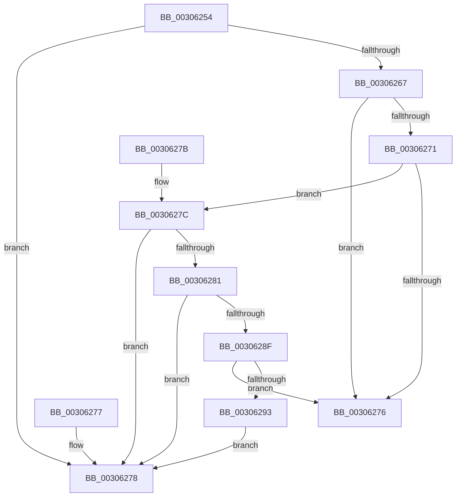

# KiIsThreadStateControlledByProcessor

- RVA: `0x00306254`–`0x00306295` (길이 `65` bytes)
- VA: `0x0000000140306254`
- 실행 섹션: `.text`
- PDB 이름 있음: `예`; PDB Function 태그: `아니요`
- unwind 정보 RVA: `0x000DB714`
- 디코드: `25`개 명령, `65/65` bytes 표시
- 미해석 바이트: `0` (있으면 어셈블리에 `.byte`로 보존)

> 이 문서는 커널 이미지의 기계어와 PDB 기호를 분석해 생성했습니다. 4번과 5번은 함수 원형과 자료형을 바이너리 사용 방식에서 추정한 C 해석이며 원본 소스 복구 결과는 아닙니다.

## 1. Dependencies

- 직접 호출 지점: **0**; 고유 호출 대상: **0**
- 직접 호출자로 확인된 함수: **5**
- RIP 상대 이미지 참조: **0**

### Outgoing calls
- 직접 디코드된 call 명령이 없습니다.

### Direct callers
- [sub_002546EC](../25/Unknown_function_002546EC.md) at `0x0025519E`
- [KiAttemptToScheduleThreadToBusyIsolationUnit](../25/KiAttemptToScheduleThreadToBusyIsolationUnit_function_00259B00.md) at `0x0025B61E`
- [KiUpdateGlobalCpuSetConfiguration](KiUpdateGlobalCpuSetConfiguration_function_00305AB8.md) at `0x00305B85`
- [KiStartRescheduleContextEntry](KiStartRescheduleContextEntry_function_00305ED0.md) at `0x00305FFB`
- [sub_0030C95E](Unknown_function_0030C95E.md) at `0x0030C983`

### Static image references
- 디코드된 RIP-relative 메모리 참조가 없습니다.

## 2. Other-region calls and transfers

- 다른 실행 섹션으로 향하는 call: **0**
- 별도 외부 분기/꼬리 이동을 확인하지 못했습니다.

## 3. Assembly (complete function range)

```asm
00306254  44 0F B6 81 84 01 00 00         movzx r8d, byte ptr [rcx + 0x184]
0030625C  8B 81 18 02 00 00               mov eax, dword ptr [rcx + 0x218]
00306262  3B 42 24                        cmp eax, dword ptr [rdx + 0x24]
00306265  75 11                           jne 0x140306278
00306267  41 8B D0                        mov edx, r8d
0030626A  B0 01                           mov al, 1
0030626C  83 EA 02                        sub edx, 2
0030626F  74 05                           je 0x140306276
00306271  83 EA 01                        sub edx, 1
00306274  75 06                           jne 0x14030627c
00306276  C3                              ret
00306277  CC                              int3
00306278  32 C0                           xor al, al
0030627A  C3                              ret
0030627B  CC                              int3
0030627C  83 FA 02                        cmp edx, 2
0030627F  75 F7                           jne 0x140306278
00306281  8A 51 70                        mov dl, byte ptr [rcx + 0x70]
00306284  80 E2 07                        and dl, 7
00306287  8D 4A FD                        lea ecx, [rdx - 3]
0030628A  80 F9 03                        cmp cl, 3
0030628D  76 E9                           jbe 0x140306278
0030628F  3A D0                           cmp dl, al
00306291  75 E3                           jne 0x140306276
00306293  EB E3                           jmp 0x140306278
```

## 4. C-style interpretation (structured pseudocode)

```c
__int64 __fastcall KiIsThreadStateControlledByProcessor(__int64 a1, __int64 a2)
{
    __int64 result;

    if (((unsigned int)((unsigned int)(*(unsigned int *)(a1 + 536)))) != (*(unsigned int *)(a2 + 36))) goto loc_00306278;
    a2 = (unsigned int)(((unsigned int)((unsigned int)(*(unsigned __int8 *)(a1 + 388)))) - (2));
    if (condition_is_equal) goto loc_00306276;
    a2 = (unsigned int)((a2) - (1));
    if (condition_is_not_equal) goto loc_0030627C;
loc_00306276:
    return 1;
loc_00306278:
    result = 0;
    return result;
loc_0030627C:
    if (((unsigned int)(a2)) != 2) goto loc_00306278;
    a2 = (unsigned __int8)((*(unsigned __int8 *)(a1 + 112)) & (7));
    if (((unsigned __int8)(a2 - 3)) <= 3) goto loc_00306278;
    if (((unsigned __int8)(a2)) != 0) goto loc_00306276;
    goto loc_00306278;
}
```

## 5. (Beta) C Style

```c
int64_t KiIsThreadStateControlledByProcessor(void *Arg1, void *Arg2)
{
    uint8_t *arg1 = (uint8_t *)Arg1;
    uint8_t *arg2 = (uint8_t *)Arg2;

    int64_t result;

    if (((uint32_t)((uint32_t)(*(uint32_t *)(arg1 + 0x218)))) != (*(uint32_t *)(arg2 + 0x24))) goto loc_00306278;
    Arg2 = (uint32_t)(((uint32_t)((uint32_t)(*(uint8_t *)(arg1 + 0x184)))) - (2));
    if (condition_is_equal) goto loc_00306276;
    Arg2 = (uint32_t)((Arg2) - (1));
    if (condition_is_not_equal) goto loc_0030627C;
loc_00306276:
    return 1;
loc_00306278:
    result = 0;
    return result;
loc_0030627C:
    if (((uint32_t)(Arg2)) != 2) goto loc_00306278;
    Arg2 = (uint8_t)((*(uint8_t *)(arg1 + 0x70)) & (7));
    if (((uint8_t)(Arg2 - 3)) <= 3) goto loc_00306278;
    if (((uint8_t)(Arg2)) != 0) goto loc_00306276;
    goto loc_00306278;
}
```

### 관측된 메모리 오프셋

구조체 형식이 확인되지 않은 접근은 인자 기준의 오프셋으로만 기록했습니다.

| 기준 인자 | 오프셋 표현 | 폭 (bit) | 접근 |
|---|---:|---:|---|
| `Arg1` | `+ 0x70` | `8` | `R` |
| `Arg1` | `+ 0x184` | `8` | `R` |
| `Arg1` | `+ 0x218` | `32` | `R` |
| `Arg2` | `+ 0x24` | `32` | `R` |

## 6. Execution-region graph

[열기: 2D/3D 그래프와 함수 탐색 컨트롤 패널](../../../control-panel.html?section=text&rva=0x00306254&view=graph)

- 2D 그래프는 위에서 아래로 흐르고, 3D 그래프는 빈 공간을 드래그해 회전합니다. Shift+드래그는 이동, 휠은 확대·축소, 함수 노드 선택은 대상 보고서 이동입니다.

### Static fallback


