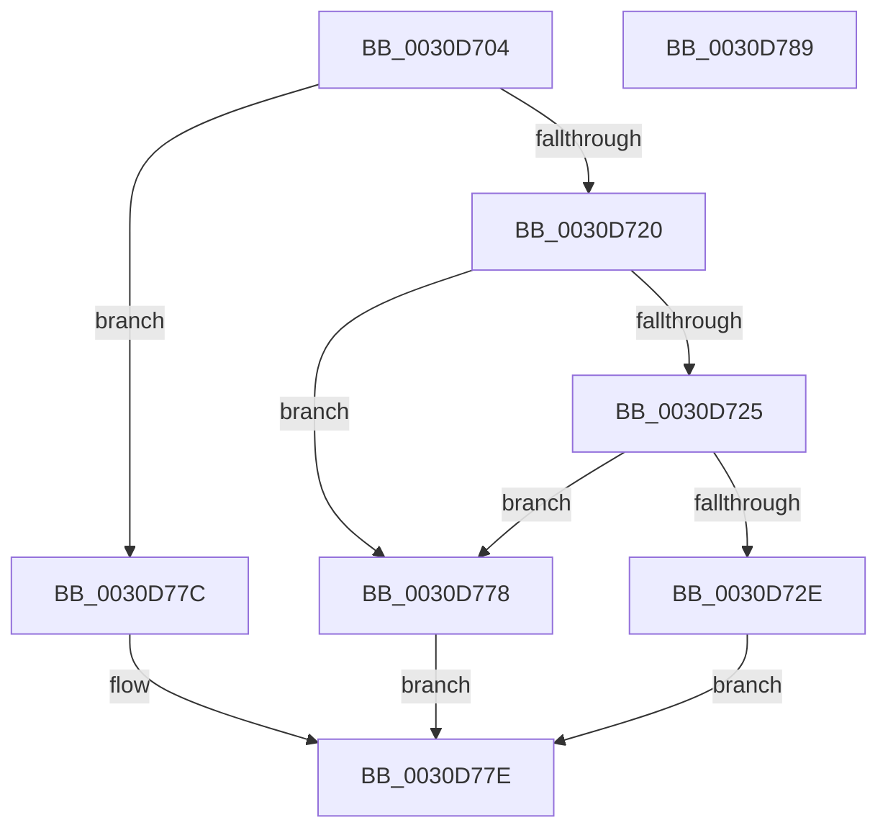

# KiMayStealStandbyThread

- RVA: `0x0030D704`–`0x0030D78A` (길이 `134` bytes)
- VA: `0x000000014030D704`
- 실행 섹션: `.text`
- PDB 이름 있음: `예`; PDB Function 태그: `아니요`
- unwind 정보 RVA: `0x0005CAAC`
- 디코드: `41`개 명령, `134/134` bytes 표시
- 미해석 바이트: `0` (있으면 어셈블리에 `.byte`로 보존)

> 이 문서는 커널 이미지의 기계어와 PDB 기호를 분석해 생성했습니다. 4번과 5번은 함수 원형과 자료형을 바이너리 사용 방식에서 추정한 C 해석이며 원본 소스 복구 결과는 아닙니다.

## 1. Dependencies

- 직접 호출 지점: **3**; 고유 호출 대상: **2**
- 직접 호출자로 확인된 함수: **3**
- RIP 상대 이미지 참조: **2**

### Outgoing calls
- `0x0030D717` → [KiIsStandbyThreadStealCandidate](../4E/KiIsStandbyThreadStealCandidate_function_004EF264.md) (function, `0x004EF264`)
- `0x0030D760` → [KiGetProcessorClassForPolicy](../48/KiGetProcessorClassForPolicy_function_004801E4.md) (function, `0x004801E4`)
- `0x0030D76B` → [KiGetProcessorClassForPolicy](../48/KiGetProcessorClassForPolicy_function_004801E4.md) (function, `0x004801E4`)

### Direct callers
- [KiUpdateStandbyStealSummaryForStandbyChange](../25/KiUpdateStandbyStealSummaryForStandbyChange_function_00257A80.md) at `0x00257AAA`
- [KiFindStandbyThreadForSteal](KiFindStandbyThreadForSteal_function_0030D640.md) at `0x0030D664`
- [KiSearchForNewThreadsOnTarget](KiSearchForNewThreadsOnTarget_function_0030F500.md) at `0x0030F55D`
- [KiSearchForNewThreadsOnTarget](KiSearchForNewThreadsOnTarget_function_0030F500.md) at `0x0030FA30`

### Static image references
- `0x0030D725` → RVA `0x00FC6B78` (`ALMOSTRO`; read)
- `0x0030D732` → RVA `0x00FC5460` (`ALMOSTRO`; read)

## 2. Other-region calls and transfers

- 다른 실행 섹션으로 향하는 call: **0**
- 별도 외부 분기/꼬리 이동을 확인하지 못했습니다.

## 3. Assembly (complete function range)

```asm
0030D704  48 89 5C 24 08                  mov qword ptr [rsp + 8], rbx
0030D709  57                              push rdi
0030D70A  48 83 EC 20                     sub rsp, 0x20
0030D70E  48 8B DA                        mov rbx, rdx
0030D711  48 8B F9                        mov rdi, rcx
0030D714  41 8B D0                        mov edx, r8d
0030D717  E8 48 1B 1E 00                  call 0x1404ef264
0030D71C  84 C0                           test al, al
0030D71E  74 5C                           je 0x14030d77c
0030D720  48 85 DB                        test rbx, rbx
0030D723  74 53                           je 0x14030d778
0030D725  83 3D 4C 94 CB 00 00            cmp dword ptr [rip + 0xcb944c], 0
0030D72C  74 4A                           je 0x14030d778
0030D72E  4C 8B 47 38                     mov r8, qword ptr [rdi + 0x38]
0030D732  48 8D 15 27 7D CB 00            lea rdx, [rip + 0xcb7d27]
0030D739  45 0F B6 40 40                  movzx r8d, byte ptr [r8 + 0x40]
0030D73E  41 8B C8                        mov ecx, r8d
0030D741  41 8B C0                        mov eax, r8d
0030D744  48 C1 E8 06                     shr rax, 6
0030D748  83 E1 07                        and ecx, 7
0030D74B  83 E0 01                        and eax, 1
0030D74E  41 C0 E8 03                     shr r8b, 3
0030D752  41 80 E0 07                     and r8b, 7
0030D756  48 8D 04 48                     lea rax, [rax + rcx*2]
0030D75A  48 8B CF                        mov rcx, rdi
0030D75D  8B 14 82                        mov edx, dword ptr [rdx + rax*4]
0030D760  E8 7F 2A 17 00                  call 0x1404801e4
0030D765  48 8B CB                        mov rcx, rbx
0030D768  44 8A D0                        mov r10b, al
0030D76B  E8 74 2A 17 00                  call 0x1404801e4
0030D770  44 3A D0                        cmp r10b, al
0030D773  0F 96 C0                        setbe al
0030D776  EB 06                           jmp 0x14030d77e
0030D778  B0 01                           mov al, 1
0030D77A  EB 02                           jmp 0x14030d77e
0030D77C  32 C0                           xor al, al
0030D77E  48 8B 5C 24 30                  mov rbx, qword ptr [rsp + 0x30]
0030D783  48 83 C4 20                     add rsp, 0x20
0030D787  5F                              pop rdi
0030D788  C3                              ret
0030D789  CC                              int3
```

## 4. C-style interpretation (structured pseudocode)

```c
__int64 __fastcall KiMayStealStandbyThread(__int64 a1, __int64 a2, int a3)
{
    __int64 result;
    __int64 v_rsp;
    unsigned __int64 v_stack_p8;

    v_stack_p8 = v_rbx;
    v_rsp = (v_rsp) - (32);
    result = KiIsStandbyThreadStealCandidate(a1, (unsigned int)(a3), a3, a4);
    if ((unsigned __int8)(result) == 0) goto loc_0030D77C;
    if (a2 == 0) goto loc_0030D778;
    if ((*(unsigned int *)(v_rip + 13341772)) == 0) goto loc_0030D778;
    result = ((unsigned int)((unsigned int)(*(unsigned __int8 *)(*(unsigned __int64 *)(a1 + 56) + 64)))) >> (6);
    a1 = (unsigned int)(((unsigned int)((unsigned int)(*(unsigned __int8 *)(*(unsigned __int64 *)(a1 + 56) + 64)))) & (7));
    result = (unsigned int)((result) & (1));
    a3 = (unsigned __int8)((*(unsigned __int8 *)(*(unsigned __int64 *)(a1 + 56) + 64)) >> (3));
    a3 = (unsigned __int8)((a3) & (7));
    result = KiGetProcessorClassForPolicy(a1, (unsigned int)(*(unsigned int *)(v_rip + 13335847 + result + a1 * 2 * 4)), a3, a4);
    result = KiGetProcessorClassForPolicy(a2, (unsigned int)(*(unsigned int *)(v_rip + 13335847 + result + a1 * 2 * 4)), a3, a4);
    result = (((unsigned __int8)((unsigned __int8)(result))) <= ((unsigned __int8)(result))) ? 1 : 0;
    goto loc_0030D77E;
loc_0030D778:
    goto loc_0030D77E;
loc_0030D77C:
    result = 0;
loc_0030D77E:
    v_rsp = (v_rsp) + (32);
    return result;
}
```

## 5. (Beta) C Style

```c
int64_t KiMayStealStandbyThread(void *Arg1, int64_t Arg2, int32_t Arg3)
{
    uint8_t *arg1 = (uint8_t *)Arg1;

    int64_t result;
    int64_t local_rsp;
    uint64_t v_stack_p8;

    v_stack_p8 = local_rbx;
    local_rsp = (local_rsp) - (32);
    result = KiIsStandbyThreadStealCandidate(Arg1, (uint32_t)(Arg3), Arg3, a4);
    if ((uint8_t)(result) == 0) goto loc_0030D77C;
    if (Arg2 == 0) goto loc_0030D778;
    if ((*(uint32_t *)(v_rip + 0xCB944C)) == 0) goto loc_0030D778;
    result = ((uint32_t)((uint32_t)(*(uint8_t *)(*(uint64_t *)(arg1 + 0x38) + 0x40)))) >> (6);
    Arg1 = (uint32_t)(((uint32_t)((uint32_t)(*(uint8_t *)(*(uint64_t *)(arg1 + 0x38) + 0x40)))) & (7));
    result = (uint32_t)((result) & (1));
    Arg3 = (uint8_t)((*(uint8_t *)(*(uint64_t *)(arg1 + 0x38) + 0x40)) >> (3));
    Arg3 = (uint8_t)((Arg3) & (7));
    result = KiGetProcessorClassForPolicy(Arg1, (uint32_t)(*(uint32_t *)(v_rip + 0xCB7D27 + result + arg1 * 2 * 4)), Arg3, a4);
    result = KiGetProcessorClassForPolicy(Arg2, (uint32_t)(*(uint32_t *)(v_rip + 0xCB7D27 + result + arg1 * 2 * 4)), Arg3, a4);
    result = (((uint8_t)((uint8_t)(result))) <= ((uint8_t)(result))) ? 1 : 0;
    goto loc_0030D77E;
loc_0030D778:
    goto loc_0030D77E;
loc_0030D77C:
    result = 0;
loc_0030D77E:
    local_rsp = (local_rsp) + (32);
    return result;
}
```

### 관측된 메모리 오프셋

구조체 형식이 확인되지 않은 접근은 인자 기준의 오프셋으로만 기록했습니다.

| 기준 인자 | 오프셋 표현 | 폭 (bit) | 접근 |
|---|---:|---:|---|
| `Arg1` | `+ 0x38` | `64` | `R` |

## 6. Execution-region graph

[열기: 2D/3D 그래프와 함수 탐색 컨트롤 패널](../../../control-panel.html?section=text&rva=0x0030D704&view=graph)

- 2D 그래프는 위에서 아래로 흐르고, 3D 그래프는 빈 공간을 드래그해 회전합니다. Shift+드래그는 이동, 휠은 확대·축소, 함수 노드 선택은 대상 보고서 이동입니다.

### Static fallback


