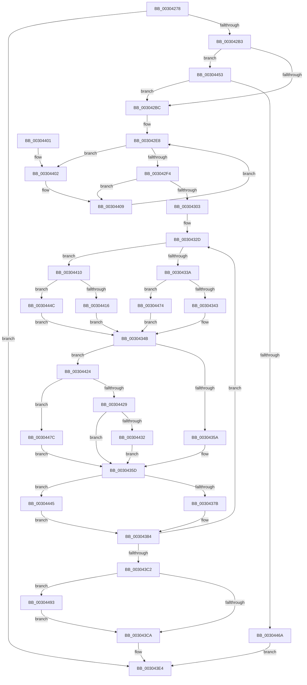

# KiModifySystemAllowedCpuSetsWithLock

- RVA: `0x00304278`–`0x0030449E` (길이 `550` bytes)
- VA: `0x0000000140304278`
- 실행 섹션: `.text`
- PDB 이름 있음: `예`; PDB Function 태그: `아니요`
- unwind 정보 RVA: `0x000734F4`
- 디코드: `136`개 명령, `550/550` bytes 표시
- 미해석 바이트: `0` (있으면 어셈블리에 `.byte`로 보존)

> 이 문서는 커널 이미지의 기계어와 PDB 기호를 분석해 생성했습니다. 4번과 5번은 함수 원형과 자료형을 바이너리 사용 방식에서 추정한 C 해석이며 원본 소스 복구 결과는 아닙니다.

## 1. Dependencies

- 직접 호출 지점: **4**; 고유 호출 대상: **4**
- 직접 호출자로 확인된 함수: **2**
- RIP 상대 이미지 참조: **9**

### Outgoing calls
- `0x003042A6` → [KiValidateCpuSetMasks](KiValidateCpuSetMasks_function_00304238.md) (function, `0x00304238`)
- `0x003042D2` → [KeAcquireSpinLockAtDpcLevel](../20/KeAcquireSpinLockAtDpcLevel_function_00208430.md) (function, `0x00208430`)
- `0x003043DD` → [KeCpuSetReportParkedProcessors](KeCpuSetReportParkedProcessors_function_003052B0.md) (function, `0x003052B0`)
- `0x0030445D` → [KeIsSubsetAffinityEx](../2C/KeIsSubsetAffinityEx_function_002CDC80.md) (function, `0x002CDC80`)

### Direct callers
- [KeModifySystemAllowedCpuSets](KeModifySystemAllowedCpuSets_function_00303308.md) at `0x00303344`
- [KeCpuPartitionMoveCpus](../5C/KeCpuPartitionMoveCpus_function_005C0B70.md) at `0x005C0C60`
- [KeCpuPartitionMoveCpus](../5C/KeCpuPartitionMoveCpus_function_005C0B70.md) at `0x005C0CAD`

### Static image references
- `0x003042C2` → RVA `0x00F23440` (`.data`; read)
- `0x003042D7` → RVA `0x00FC6BF8` (`ALMOSTRO`; read)
- `0x00304303` → RVA `0x00FC8320` (`ALMOSTRO`; read)
- `0x0030430D` → RVA `0x00FC7128` (`ALMOSTRO`; read)
- `0x0030431E` → RVA `0x00FC8720` (`ALMOSTRO`; read)
- `0x00304367` → RVA `0x00FC6C20` (`ALMOSTRO`; read)
- `0x003043D6` → RVA `0x00FC6BF8` (`ALMOSTRO`; write)
- `0x00304453` → RVA `0x00FC7120` (`ALMOSTRO`; read)
- `0x00304493` → RVA `0x00FC6E68` (`ALMOSTRO`; write)

## 2. Other-region calls and transfers

- 다른 실행 섹션으로 향하는 call: **0**
- 별도 외부 분기/꼬리 이동을 확인하지 못했습니다.

## 3. Assembly (complete function range)

```asm
00304278  48 89 5C 24 08                  mov qword ptr [rsp + 8], rbx
0030427D  48 89 6C 24 10                  mov qword ptr [rsp + 0x10], rbp
00304282  48 89 74 24 18                  mov qword ptr [rsp + 0x18], rsi
00304287  57                              push rdi
00304288  41 54                           push r12
0030428A  41 55                           push r13
0030428C  41 56                           push r14
0030428E  41 57                           push r15
00304290  48 83 EC 30                     sub rsp, 0x30
00304294  4C 8B F2                        mov r14, rdx
00304297  49 63 E9                        movsxd rbp, r9d
0030429A  8B D1                           mov edx, ecx
0030429C  8B F9                           mov edi, ecx
0030429E  49 8B CE                        mov rcx, r14
003042A1  49 8B F0                        mov rsi, r8
003042A4  33 DB                           xor ebx, ebx
003042A6  E8 8D FF FF FF                  call 0x140304238
003042AB  85 C0                           test eax, eax
003042AD  0F 88 31 01 00 00               js 0x1403043e4
003042B3  48 85 F6                        test rsi, rsi
003042B6  0F 85 97 01 00 00               jne 0x140304453
003042BC  41 BF 20 00 00 00               mov r15d, 0x20
003042C2  48 8D 0D 77 F1 C1 00            lea rcx, [rip + 0xc1f177]
003042C9  41 3B FF                        cmp edi, r15d
003042CC  44 0F 42 FF                     cmovb r15d, edi
003042D0  33 FF                           xor edi, edi
003042D2  E8 59 41 F0 FF                  call 0x140208430
003042D7  0F 0D 0D 1A 29 CC 00            prefetchw byte ptr [rip + 0xcc291a]
003042DE  48 8B 05 13 29 CC 00            mov rax, qword ptr [rip + 0xcc2913]
003042E5  8D 57 01                        lea edx, [rdi + 1]
003042E8  48 8D 48 01                     lea rcx, [rax + 1]
003042EC  84 C2                           test dl, al
003042EE  0F 85 0E 01 00 00               jne 0x140304402
003042F4  F0 48 0F B1 0D FB 28 CC 00      lock cmpxchg qword ptr [rip + 0xcc28fb], rcx
003042FD  0F 85 06 01 00 00               jne 0x140304409
00304303  48 8D 05 16 40 CC 00            lea rax, [rip + 0xcc4016]
0030430A  45 33 C0                        xor r8d, r8d
0030430D  4C 8D 15 14 2E CC 00            lea r10, [rip + 0xcc2e14]
00304314  45 33 DB                        xor r11d, r11d
00304317  48 8D 04 E8                     lea rax, [rax + rbp*8]
0030431B  4D 2B D6                        sub r10, r14
0030431E  4C 8D 2D FB 43 CC 00            lea r13, [rip + 0xcc43fb]
00304325  48 89 44 24 20                  mov qword ptr [rsp + 0x20], rax
0030432A  4D 2B EE                        sub r13, r14
0030432D  4F 8B 0C 32                     mov r9, qword ptr [r10 + r14]
00304331  48 85 F6                        test rsi, rsi
00304334  0F 85 D6 00 00 00               jne 0x140304410
0030433A  45 3B C7                        cmp r8d, r15d
0030433D  0F 82 31 01 00 00               jb 0x140304474
00304343  33 C9                           xor ecx, ecx
00304345  85 ED                           test ebp, ebp
00304347  49 0F 44 C9                     cmove rcx, r9
0030434B  8B 94 24 80 00 00 00            mov edx, dword ptr [rsp + 0x80]
00304352  85 D2                           test edx, edx
00304354  0F 85 CA 00 00 00               jne 0x140304424
0030435A  48 8B D9                        mov rbx, rcx
0030435D  4B 8B 04 2E                     mov rax, qword ptr [r14 + r13]
00304361  48 F7 D0                        not rax
00304364  48 23 D8                        and rbx, rax
00304367  48 8B 05 B2 28 CC 00            mov rax, qword ptr [rip + 0xcc28b2]
0030436E  48 8B 08                        mov rcx, qword ptr [rax]
00304371  66 44 3B 01                     cmp r8w, word ptr [rcx]
00304375  0F 83 CA 00 00 00               jae 0x140304445
0030437B  41 0F B7 C0                     movzx eax, r8w
0030437F  48 8B 54 C1 08                  mov rdx, qword ptr [rcx + rax*8 + 8]
00304384  48 23 DA                        and rbx, rdx
00304387  49 8D 04 2B                     lea rax, [r11 + rbp]
0030438B  BA 01 00 00 00                  mov edx, 1
00304390  48 8D 0D 89 3F CC 00            lea rcx, [rip + 0xcc3f89]
00304397  48 89 1C C1                     mov qword ptr [rcx + rax*8], rbx
0030439B  48 8B C3                        mov rax, rbx
0030439E  49 23 C1                        and rax, r9
003043A1  49 3B C1                        cmp rax, r9
003043A4  0F 45 FA                        cmovne edi, edx
003043A7  48 83 44 24 20 10               add qword ptr [rsp + 0x20], 0x10
003043AD  44 03 C2                        add r8d, edx
003043B0  49 83 C6 08                     add r14, 8
003043B4  49 83 C3 02                     add r11, 2
003043B8  41 83 F8 20                     cmp r8d, 0x20
003043BC  0F 82 6B FF FF FF               jb 0x14030432d
003043C2  85 ED                           test ebp, ebp
003043C4  0F 84 C9 00 00 00               je 0x140304493
003043CA  48 8B 05 27 28 CC 00            mov rax, qword ptr [rip + 0xcc2827]
003043D1  33 C9                           xor ecx, ecx
003043D3  48 FF C0                        inc rax
003043D6  48 89 05 1B 28 CC 00            mov qword ptr [rip + 0xcc281b], rax
003043DD  E8 CE 0E 00 00                  call 0x1403052b0
003043E2  33 C0                           xor eax, eax
003043E4  48 8B 5C 24 60                  mov rbx, qword ptr [rsp + 0x60]
003043E9  48 8B 6C 24 68                  mov rbp, qword ptr [rsp + 0x68]
003043EE  48 8B 74 24 70                  mov rsi, qword ptr [rsp + 0x70]
003043F3  48 83 C4 30                     add rsp, 0x30
003043F7  41 5F                           pop r15
003043F9  41 5E                           pop r14
003043FB  41 5D                           pop r13
003043FD  41 5C                           pop r12
003043FF  5F                              pop rdi
00304400  C3                              ret
00304401  CC                              int3
00304402  48 8B 05 EF 27 CC 00            mov rax, qword ptr [rip + 0xcc27ef]
00304409  F3 90                           pause
0030440B  E9 D8 FE FF FF                  jmp 0x1403042e8
00304410  66 44 3B 06                     cmp r8w, word ptr [rsi]
00304414  73 36                           jae 0x14030444c
00304416  41 0F B7 C0                     movzx eax, r8w
0030441A  48 8B 4C C6 08                  mov rcx, qword ptr [rsi + rax*8 + 8]
0030441F  E9 27 FF FF FF                  jmp 0x14030434b
00304424  83 EA 01                        sub edx, 1
00304427  74 53                           je 0x14030447c
00304429  83 FA 01                        cmp edx, 1
0030442C  0F 85 2B FF FF FF               jne 0x14030435d
00304432  48 8B 44 24 20                  mov rax, qword ptr [rsp + 0x20]
00304437  48 8B D9                        mov rbx, rcx
0030443A  48 F7 D3                        not rbx
0030443D  48 23 18                        and rbx, qword ptr [rax]
00304440  E9 18 FF FF FF                  jmp 0x14030435d
00304445  33 D2                           xor edx, edx
00304447  E9 38 FF FF FF                  jmp 0x140304384
0030444C  33 C9                           xor ecx, ecx
0030444E  E9 F8 FE FF FF                  jmp 0x14030434b
00304453  48 8D 15 C6 2C CC 00            lea rdx, [rip + 0xcc2cc6]
0030445A  48 8B CE                        mov rcx, rsi
0030445D  E8 1E 98 FC FF                  call 0x1402cdc80
00304462  85 C0                           test eax, eax
00304464  0F 85 52 FE FF FF               jne 0x1403042bc
0030446A  B8 0D 00 00 C0                  mov eax, 0xc000000d
0030446F  E9 70 FF FF FF                  jmp 0x1403043e4
00304474  49 8B 0E                        mov rcx, qword ptr [r14]
00304477  E9 CF FE FF FF                  jmp 0x14030434b
0030447C  48 8B D9                        mov rbx, rcx
0030447F  49 8D 04 2B                     lea rax, [r11 + rbp]
00304483  48 8D 0D 96 3E CC 00            lea rcx, [rip + 0xcc3e96]
0030448A  48 0B 1C C1                     or rbx, qword ptr [rcx + rax*8]
0030448E  E9 CA FE FF FF                  jmp 0x14030435d
00304493  89 3D CF 29 CC 00               mov dword ptr [rip + 0xcc29cf], edi
00304499  E9 2C FF FF FF                  jmp 0x1403043ca
```

## 4. C-style interpretation (structured pseudocode)

```c
__int64 __fastcall KiModifySystemAllowedCpuSetsWithLock(int a1, __int64 a2, __int64 a3, int a4, unsigned int a5)
{
    __int64 result;
    __int64 v_r10;
    __int64 v_r11;
    __int64 v_r13;
    __int64 v_r14;
    __int64 v_r15;
    __int64 v_rbx;
    __int64 v_rdi;
    __int64 v_rsp;
    unsigned __int64 v_stack_m38;
    unsigned __int64 v_stack_p10;
    unsigned __int64 v_stack_p18;
    unsigned __int64 v_stack_p20;
    unsigned __int64 v_stack_p8;

    v_stack_p8 = v_rbx;
    v_stack_p10 = v_rbp;
    v_stack_p18 = v_rsi;
    v_rsp = (v_rsp) - (48);
    v_rbx = 0;
    result = KiValidateCpuSetMasks(a2, (unsigned int)(a1), a3, a4);
    if (sign_flag) goto loc_003043E4;
    if (a3 != 0) goto loc_00304453;
loc_003042BC:
    v_r15 = 32;
    if (((unsigned int)((unsigned int)(a1))) < 32) { v_r15 = (unsigned int)((unsigned int)(a1)); }
    v_rdi = 0;
    result = KeAcquireSpinLockAtDpcLevel(v_rip + 12710263, (unsigned int)(a1), a3, a4);
loc_003042E8:
    if ((((unsigned __int8)(v_rdi + 1)) & ((unsigned __int8)(*(unsigned __int64 *)(v_rip + 13379859)))) != 0) goto loc_00304402;
    if ((((unsigned __int8)(v_rdi + 1)) & ((unsigned __int8)(*(unsigned __int64 *)(v_rip + 13379859)))) != 0) goto loc_00304409;
    a3 = 0;
    v_r11 = 0;
    v_r10 = (v_rip + 13381140) - (a2);
    v_stack_m38 = v_rip + 13385750 + (int)(a4) * 8;
    v_r13 = (v_rip + 13386747) - (a2);
loc_0030432D:
    if (0 != 0) goto loc_00304410;
    if (0 < ((unsigned int)(v_r15))) goto loc_00304474;
    a1 = 0;
    if ((unsigned int)((int)(a4)) == 0) { a1 = *(unsigned __int64 *)(v_r10 + a2 * 1); }
loc_0030434B:
    if ((unsigned int)((unsigned int)(a5)) != 0) goto loc_00304424;
loc_0030435D:
    result = ~(*(unsigned __int64 *)(a2 + v_r13 * 1));
    v_rbx = (a1) & (result);
    if (0 >= (*(unsigned __int16 *)(*(unsigned __int64 *)(*(unsigned __int64 *)(v_rip + 13379762))))) goto loc_00304445;
loc_00304384:
    v_rbx = (v_rbx) & (*(unsigned __int64 *)(*(unsigned __int64 *)(*(unsigned __int64 *)(v_rip + 13379762)) + 0 * 8 + 8));
    *(unsigned __int64 *)(v_rip + 13385609 + v_r11 + (int)(a4) * 1 * 8) = v_rbx;
    result = (v_rbx) & (*(unsigned __int64 *)(v_r10 + a2 * 1));
    if (result != (*(unsigned __int64 *)(v_r10 + a2 * 1))) { v_rdi = 1; }
    a3 = (unsigned int)((a3) + (1));
    v_r14 = (a2) + (8);
    v_r11 = (v_r11) + (2);
    if (((unsigned int)(a3)) < 32) goto loc_0030432D;
    if ((unsigned int)((int)(a4)) == 0) goto loc_00304493;
loc_003043CA:
    a1 = 0;
    result = (*(unsigned __int64 *)(v_rip + 13379623)) + 1;
    *(unsigned __int64 *)(v_rip + 13379611) = result;
    result = KeCpuSetReportParkedProcessors(a1, 1, a3, *(unsigned __int64 *)(v_r10 + a2 * 1));
    result = 0;
loc_003043E4:
    v_rsp = (v_rsp) + (48);
    return result;
loc_00304402:
loc_00304409:
    goto loc_003042E8;
loc_00304410:
    if (((unsigned __int16)(a3)) >= (*(unsigned __int16 *)(v_stack_p18))) goto loc_0030444C;
    goto loc_0030434B;
loc_00304424:
    a2 = (unsigned int)((1) - (1));
    if (condition_is_equal) goto loc_0030447C;
    if (((unsigned int)(a2)) != 1) goto loc_0030435D;
    v_rbx = ~(*(unsigned __int64 *)(v_stack_p18 + (unsigned __int16)(a3) * 8 + 8));
    v_rbx = (v_rbx) & (*(unsigned __int64 *)(v_stack_p20));
    goto loc_0030435D;
loc_00304445:
    a2 = 0;
    goto loc_00304384;
loc_0030444C:
    a1 = 0;
    goto loc_0030434B;
loc_00304453:
    result = KeIsSubsetAffinityEx(v_stack_p18, v_rip + 13380806, a3, *(unsigned __int64 *)(v_r10 + a2 * 1));
    if ((unsigned int)(result) != 0) goto loc_003042BC;
    goto loc_003043E4;
loc_00304474:
    goto loc_0030434B;
loc_0030447C:
    v_rbx = (*(unsigned __int64 *)(v_r14)) | (*(unsigned __int64 *)(v_rip + 13385366 + v_r11 + v_stack_p10 * 1 * 8));
    goto loc_0030435D;
loc_00304493:
    *(unsigned int *)(v_rip + 13380047) = (unsigned int)(v_rdi);
    goto loc_003043CA;
}
```

## 5. (Beta) C Style

```c
int64_t KiModifySystemAllowedCpuSetsWithLock(int32_t Arg1, void *Arg2, int64_t Arg3, int32_t Arg4, uint32_t Arg5)
{
    uint8_t *arg2 = (uint8_t *)Arg2;

    int64_t result;
    int64_t local_r10;
    int64_t local_r11;
    int64_t local_r13;
    int64_t local_r14;
    int64_t local_r15;
    int64_t local_rbx;
    int64_t local_rdi;
    int64_t local_rsp;
    uint64_t v_stack_m38;
    uint64_t v_stack_p10;
    uint64_t v_stack_p18;
    uint64_t v_stack_p20;
    uint64_t v_stack_p8;

    v_stack_p8 = local_rbx;
    v_stack_p10 = local_rbp;
    v_stack_p18 = local_rsi;
    local_rsp = (local_rsp) - (48);
    local_rbx = 0;
    result = KiValidateCpuSetMasks(Arg2, (uint32_t)(Arg1), Arg3, Arg4);
    if (sign_flag) goto loc_003043E4;
    if (Arg3 != 0) goto loc_00304453;
loc_003042BC:
    local_r15 = 32;
    if (((uint32_t)((uint32_t)(Arg1))) < 32) { local_r15 = (uint32_t)((uint32_t)(Arg1)); }
    local_rdi = 0;
    result = KeAcquireSpinLockAtDpcLevel(v_rip + 12710263, (uint32_t)(Arg1), Arg3, Arg4);
loc_003042E8:
    if ((((uint8_t)(local_rdi + 1)) & ((uint8_t)(*(uint64_t *)(v_rip + 0xCC2913)))) != 0) goto loc_00304402;
    if ((((uint8_t)(local_rdi + 1)) & ((uint8_t)(*(uint64_t *)(v_rip + 0xCC2913)))) != 0) goto loc_00304409;
    Arg3 = 0;
    local_r11 = 0;
    local_r10 = (v_rip + 13381140) - (Arg2);
    v_stack_m38 = v_rip + 13385750 + (int32_t)(Arg4) * 8;
    local_r13 = (v_rip + 13386747) - (Arg2);
loc_0030432D:
    if (0 != 0) goto loc_00304410;
    if (0 < ((uint32_t)(local_r15))) goto loc_00304474;
    Arg1 = 0;
    if ((uint32_t)((int32_t)(Arg4)) == 0) { Arg1 = *(uint64_t *)(local_r10 + arg2 * 1); }
loc_0030434B:
    if ((uint32_t)((uint32_t)(Arg5)) != 0) goto loc_00304424;
loc_0030435D:
    result = ~(*(uint64_t *)(arg2 + local_r13 * 1));
    local_rbx = (Arg1) & (result);
    if (0 >= (*(uint16_t *)(*(uint64_t *)(*(uint64_t *)(v_rip + 0xCC28B2))))) goto loc_00304445;
loc_00304384:
    local_rbx = (local_rbx) & (*(uint64_t *)(*(uint64_t *)(*(uint64_t *)(v_rip + 0xCC28B2)) + 0x0 * 8 + 0x8));
    *(uint64_t *)(v_rip + 0xCC3F89 + local_r11 + (int32_t)(Arg4) * 1 * 8) = local_rbx;
    result = (local_rbx) & (*(uint64_t *)(local_r10 + arg2 * 1));
    if (result != (*(uint64_t *)(local_r10 + arg2 * 1))) { local_rdi = 1; }
    Arg3 = (uint32_t)((Arg3) + (1));
    local_r14 = (Arg2) + (8);
    local_r11 = (local_r11) + (2);
    if (((uint32_t)(Arg3)) < 32) goto loc_0030432D;
    if ((uint32_t)((int32_t)(Arg4)) == 0) goto loc_00304493;
loc_003043CA:
    Arg1 = 0;
    result = (*(uint64_t *)(v_rip + 0xCC2827)) + 1;
    *(uint64_t *)(v_rip + 0xCC281B) = result;
    result = KeCpuSetReportParkedProcessors(Arg1, 1, Arg3, *(uint64_t *)(local_r10 + arg2 * 1));
    result = 0;
loc_003043E4:
    local_rsp = (local_rsp) + (48);
    return result;
loc_00304402:
loc_00304409:
    goto loc_003042E8;
loc_00304410:
    if (((uint16_t)(Arg3)) >= (*(uint16_t *)(v_stack_p18))) goto loc_0030444C;
    goto loc_0030434B;
loc_00304424:
    Arg2 = (uint32_t)((1) - (1));
    if (condition_is_equal) goto loc_0030447C;
    if (((uint32_t)(Arg2)) != 1) goto loc_0030435D;
    local_rbx = ~(*(uint64_t *)(v_stack_p18 + (uint16_t)(Arg3) * 8 + 0x8));
    local_rbx = (local_rbx) & (*(uint64_t *)(v_stack_p20));
    goto loc_0030435D;
loc_00304445:
    Arg2 = 0;
    goto loc_00304384;
loc_0030444C:
    Arg1 = 0;
    goto loc_0030434B;
loc_00304453:
    result = KeIsSubsetAffinityEx(v_stack_p18, v_rip + 13380806, Arg3, *(uint64_t *)(local_r10 + arg2 * 1));
    if ((uint32_t)(result) != 0) goto loc_003042BC;
    goto loc_003043E4;
loc_00304474:
    goto loc_0030434B;
loc_0030447C:
    local_rbx = (*(uint64_t *)(local_r14)) | (*(uint64_t *)(v_rip + 0xCC3E96 + local_r11 + v_stack_p10 * 1 * 8));
    goto loc_0030435D;
loc_00304493:
    *(uint32_t *)(v_rip + 0xCC29CF) = (uint32_t)(local_rdi);
    goto loc_003043CA;
}
```

### 관측된 메모리 오프셋

구조체 형식이 확인되지 않은 접근은 인자 기준의 오프셋으로만 기록했습니다.

| 기준 인자 | 오프셋 표현 | 폭 (bit) | 접근 |
|---|---:|---:|---|
| `Arg2` | `+ 0x0` | `64` | `R` |
| `Arg2` | `+ 0x0 + r13*1` | `64` | `R` |

## 6. Execution-region graph

[열기: 2D/3D 그래프와 함수 탐색 컨트롤 패널](../../../control-panel.html?section=text&rva=0x00304278&view=graph)

- 2D 그래프는 위에서 아래로 흐르고, 3D 그래프는 빈 공간을 드래그해 회전합니다. Shift+드래그는 이동, 휠은 확대·축소, 함수 노드 선택은 대상 보고서 이동입니다.

### Static fallback


