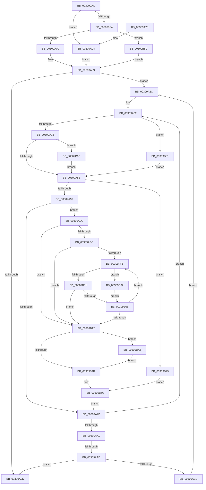

# KiMoveScbThreadsToNewReadylist

- RVA: `0x003099AC`–`0x00309BBE` (길이 `530` bytes)
- VA: `0x00000001403099AC`
- 실행 섹션: `.text`
- PDB 이름 있음: `예`; PDB Function 태그: `예`
- unwind 정보 RVA: `0x00073BA0`
- 디코드: `139`개 명령, `530/530` bytes 표시
- 미해석 바이트: `0` (있으면 어셈블리에 `.byte`로 보존)

> 이 문서는 커널 이미지의 기계어와 PDB 기호를 분석해 생성했습니다. 4번과 5번은 함수 원형과 자료형을 바이너리 사용 방식에서 추정한 C 해석이며 원본 소스 복구 결과는 아닙니다.

## 1. Dependencies

- 직접 호출 지점: **5**; 고유 호출 대상: **5**
- 직접 호출자로 확인된 함수: **3**
- RIP 상대 이미지 참조: **1**

### Outgoing calls
- `0x00309AE3` → [KiIsThreadConstrainedBySchedulingGroup](KiIsThreadConstrainedBySchedulingGroup_function_0030B200.md) (function, `0x0030B200`)
- `0x00309AEF` → [KiCheckForMaxOverQuotaScb](../20/KiCheckForMaxOverQuotaScb_function_002027A0.md) (function, `0x002027A0`)
- `0x00309B3A` → [KiAddThreadToPrcbQueue](../21/KiAddThreadToPrcbQueue_function_00218B00.md) (function, `0x00218B00`)
- `0x00309B9F` → [KiInsertDeferredReadyList](../20/KiInsertDeferredReadyList_function_00201310.md) (function, `0x00201310`)
- `0x00309BB7` → [EtwTraceReadyQueueInsertion](../22/EtwTraceReadyQueueInsertion_function_00223444.md) (function, `0x00223444`)

### Direct callers
- [KiTransitionSchedulingGroupGeneration](KiTransitionSchedulingGroupGeneration_function_003094C8.md) at `0x0030967D`
- [KiResetScb](../46/KiResetScb_function_0046DA94.md) at `0x0046DB1E`
- [sub_006F340E](../6F/Unknown_function_006F340E.md) at `0x006F3451`

### Static image references
- `0x00309B3F` → RVA `0x00FC6B14` (`ALMOSTRO`; read)

## 2. Other-region calls and transfers

- 다른 실행 섹션으로 향하는 call: **0**
- call이 아닌 외부 분기/꼬리 이동: **1**
  - `0x00309AA7` → [sub_006E0BE6](../6E/Unknown_function_006E0BE6.md) (`tail-transfer`)

## 3. Assembly (complete function range)

```asm
003099AC  48 8B C4                        mov rax, rsp
003099AF  4C 89 48 20                     mov qword ptr [rax + 0x20], r9
003099B3  4C 89 40 18                     mov qword ptr [rax + 0x18], r8
003099B7  53                              push rbx
003099B8  55                              push rbp
003099B9  56                              push rsi
003099BA  57                              push rdi
003099BB  41 54                           push r12
003099BD  41 55                           push r13
003099BF  41 56                           push r14
003099C1  41 57                           push r15
003099C3  48 83 EC 48                     sub rsp, 0x48
003099C7  45 33 DB                        xor r11d, r11d
003099CA  4C 8B F1                        mov r14, rcx
003099CD  44 89 58 10                     mov dword ptr [rax + 0x10], r11d
003099D1  41 8A CB                        mov cl, r11b
003099D4  4C 89 5C 24 38                  mov qword ptr [rsp + 0x38], r11
003099D9  4C 8B FA                        mov r15, rdx
003099DC  45 0F B6 E3                     movzx r12d, r11b
003099E0  45 8A EB                        mov r13b, r11b
003099E3  41 0F B7 6E 78                  movzx ebp, word ptr [r14 + 0x78]
003099E8  88 8C 24 90 00 00 00            mov byte ptr [rsp + 0x90], cl
003099EF  48 85 D2                        test rdx, rdx
003099F2  75 30                           jne 0x140309a24
003099F4  8D 42 01                        lea eax, [rdx + 1]
003099F7  4D 85 C0                        test r8, r8
003099FA  0F 84 8D 01 00 00               je 0x140309b8d
00309A00  8A C8                           mov cl, al
00309A02  88 84 24 90 00 00 00            mov byte ptr [rsp + 0x90], al
00309A09  85 ED                           test ebp, ebp
00309A0B  75 2F                           jne 0x140309a3c
00309A0D  66 45 89 5E 78                  mov word ptr [r14 + 0x78], r11w
00309A12  48 83 C4 48                     add rsp, 0x48
00309A16  41 5F                           pop r15
00309A18  41 5E                           pop r14
00309A1A  41 5D                           pop r13
00309A1C  41 5C                           pop r12
00309A1E  5F                              pop rdi
00309A1F  5E                              pop rsi
00309A20  5D                              pop rbp
00309A21  5B                              pop rbx
00309A22  C3                              ret
00309A23  CC                              int3
00309A24  66 09 6A 78                     or word ptr [rdx + 0x78], bp
00309A28  48 8D 82 90 00 00 00            lea rax, [rdx + 0x90]
00309A2F  48 89 44 24 38                  mov qword ptr [rsp + 0x38], rax
00309A34  41 BD 01 00 00 00               mov r13d, 1
00309A3A  EB CD                           jmp 0x140309a09
00309A3C  0F BD C5                        bsr eax, ebp
00309A3F  0F BB C5                        btc ebp, eax
00309A42  8B D8                           mov ebx, eax
00309A44  48 83 C3 09                     add rbx, 9
00309A48  89 6C 24 34                     mov dword ptr [rsp + 0x34], ebp
00309A4C  48 8B AC 24 A0 00 00 00         mov rbp, qword ptr [rsp + 0xa0]
00309A54  48 C1 E3 04                     shl rbx, 4
00309A58  49 03 DE                        add rbx, r14
00309A5B  89 44 24 30                     mov dword ptr [rsp + 0x30], eax
00309A5F  48 8B 33                        mov rsi, qword ptr [rbx]
00309A62  48 8D BE 28 FF FF FF            lea rdi, [rsi - 0xd8]
00309A69  45 84 ED                        test r13b, r13b
00309A6C  0F 85 0F 01 00 00               jne 0x140309b81
00309A72  0F BA 77 74 0D                  btr dword ptr [rdi + 0x74], 0xd
00309A77  F7 47 78 00 00 40 00            test dword ptr [rdi + 0x78], 0x400000
00309A7E  4C 89 9F B0 03 00 00            mov qword ptr [rdi + 0x3b0], r11
00309A85  0F 85 E3 00 00 00               jne 0x140309b6e
00309A8B  48 8B 36                        mov rsi, qword ptr [rsi]
00309A8E  45 84 E4                        test r12b, r12b
00309A91  0F 85 02 01 00 00               jne 0x140309b99
00309A97  84 C9                           test cl, cl
00309A99  75 35                           jne 0x140309ad0
00309A9B  48 3B F3                        cmp rsi, rbx
00309A9E  75 C2                           jne 0x140309a62
00309AA0  8B 6C 24 34                     mov ebp, dword ptr [rsp + 0x34]
00309AA4  45 84 ED                        test r13b, r13b
00309AA7  0F 85 39 71 3D 00               jne 0x1406e0be6
00309AAD  48 89 5B 08                     mov qword ptr [rbx + 8], rbx
00309AB1  48 89 1B                        mov qword ptr [rbx], rbx
00309AB4  85 ED                           test ebp, ebp
00309AB6  0F 84 51 FF FF FF               je 0x140309a0d
00309ABC  8A 8C 24 90 00 00 00            mov cl, byte ptr [rsp + 0x90]
00309AC3  4C 8B 8C 24 A8 00 00 00         mov r9, qword ptr [rsp + 0xa8]
00309ACB  E9 6C FF FF FF                  jmp 0x140309a3c
00309AD0  4D 8B 96 80 00 00 00            mov r10, qword ptr [r14 + 0x80]
00309AD7  48 8B CF                        mov rcx, rdi
00309ADA  49 8B D6                        mov rdx, r14
00309ADD  45 8B C3                        mov r8d, r11d
00309AE0  45 8B CB                        mov r9d, r11d
00309AE3  E8 18 17 00 00                  call 0x14030b200
00309AE8  84 C0                           test al, al
00309AEA  74 26                           je 0x140309b12
00309AEC  49 8B CE                        mov rcx, r14
00309AEF  E8 AC 8C EF FF                  call 0x1402027a0
00309AF4  84 C0                           test al, al
00309AF6  75 1A                           jne 0x140309b12
00309AF8  44 03 42 7C                     add r8d, dword ptr [rdx + 0x7c]
00309AFC  4D 85 D2                        test r10, r10
00309AFF  75 61                           jne 0x140309b62
00309B01  45 85 C0                        test r8d, r8d
00309B04  75 0C                           jne 0x140309b12
00309B06  48 8B 92 A0 01 00 00            mov rdx, qword ptr [rdx + 0x1a0]
00309B0D  48 85 D2                        test rdx, rdx
00309B10  75 E6                           jne 0x140309af8
00309B12  44 0F BE 87 C3 00 00 00         movsx r8d, byte ptr [rdi + 0xc3]
00309B1A  48 8D 8C 24 98 00 00 00         lea rcx, [rsp + 0x98]
00309B22  45 85 C9                        test r9d, r9d
00309B25  48 89 4C 24 28                  mov qword ptr [rsp + 0x28], rcx
00309B2A  48 8B D7                        mov rdx, rdi
00309B2D  48 8B CD                        mov rcx, rbp
00309B30  0F 95 C0                        setne al
00309B33  45 33 C9                        xor r9d, r9d
00309B36  88 44 24 20                     mov byte ptr [rsp + 0x20], al
00309B3A  E8 C1 EF F0 FF                  call 0x140218b00
00309B3F  F7 05 CB CF CB 00 00 08 00 00   test dword ptr [rip + 0xcbcfcb], 0x800
00309B49  75 5B                           jne 0x140309ba6
00309B4B  4C 8B 8C 24 A8 00 00 00         mov r9, qword ptr [rsp + 0xa8]
00309B53  45 33 DB                        xor r11d, r11d
00309B56  8A 8C 24 90 00 00 00            mov cl, byte ptr [rsp + 0x90]
00309B5D  E9 39 FF FF FF                  jmp 0x140309a9b
00309B62  48 8B 82 80 00 00 00            mov rax, qword ptr [rdx + 0x80]
00309B69  44 03 08                        add r9d, dword ptr [rax]
00309B6C  EB 98                           jmp 0x140309b06
00309B6E  48 8B 87 C8 03 00 00            mov rax, qword ptr [rdi + 0x3c8]
00309B75  F0 81 20 FF FF FB FF            lock and dword ptr [rax], 0xfffbffff
00309B7C  E9 0A FF FF FF                  jmp 0x140309a8b
00309B81  4C 89 BF B0 03 00 00            mov qword ptr [rdi + 0x3b0], r15
00309B88  E9 FE FE FF FF                  jmp 0x140309a8b
00309B8D  4D 85 C9                        test r9, r9
00309B90  44 0F 45 E0                     cmovne r12d, eax
00309B94  E9 70 FE FF FF                  jmp 0x140309a09
00309B99  48 8B D7                        mov rdx, rdi
00309B9C  49 8B C9                        mov rcx, r9
00309B9F  E8 6C 77 EF FF                  call 0x140201310
00309BA4  EB B0                           jmp 0x140309b56
00309BA6  44 8B 84 24 98 00 00 00         mov r8d, dword ptr [rsp + 0x98]
00309BAE  45 33 C9                        xor r9d, r9d
00309BB1  8B 55 24                        mov edx, dword ptr [rbp + 0x24]
00309BB4  48 8B CF                        mov rcx, rdi
00309BB7  E8 88 98 F1 FF                  call 0x140223444
00309BBC  EB 8D                           jmp 0x140309b4b
```

## 4. C-style interpretation (structured pseudocode)

```c
__int64 __fastcall KiMoveScbThreadsToNewReadylist(__int64 a1, __int64 a2, __int64 a3, __int64 a4)
{
    __int64 result;
    __int64 v_r11;
    __int64 v_r12;
    __int64 v_rbx;
    __int64 v_rsp;
    unsigned __int64 v_stack_m50;
    unsigned __int8 v_stack_p20;
    unsigned __int64 v_stack_p28;
    unsigned int v_stack_p30;
    unsigned int v_stack_p34;
    unsigned __int64 v_stack_p38;
    unsigned __int8 v_stack_p8;
    unsigned __int8 v_stack_p90;
    unsigned __int64 v_stack_p98;
    unsigned __int64 v_stack_pA0;
    unsigned __int64 v_stack_pA8;

    *(unsigned __int64 *)(v_rsp + 32) = a4;
    *(unsigned __int64 *)(v_rsp + 24) = a3;
    v_rsp = (v_rsp) - (72);
    v_r11 = 0;
    *(unsigned int *)(v_rsp + 16) = 0;
    v_stack_m50 = 0;
    v_stack_p8 = 0;
    if (a2 != 0) goto loc_00309A24;
    if (a3 == 0) goto loc_00309B8D;
    v_stack_p8 = (unsigned __int8)(a2 + 1);
loc_00309A09:
    if ((unsigned int)(*(unsigned __int16 *)(a1 + 120)) != 0) goto loc_00309A3C;
loc_00309A0D:
    *(unsigned __int16 *)(a1 + 120) = 0;
    v_rsp = (v_rsp) + (72);
    return a2 + 1;
loc_00309A24:
    v_stack_p38 = a2 + 144;
    goto loc_00309A09;
loc_00309A3C:
    v_rbx = ((unsigned int)((unsigned int)(a2 + 144))) + (9);
    v_stack_p34 = (unsigned int)(*(unsigned __int16 *)(a1 + 120));
    v_rbx = (v_rbx) << (4);
    v_rbx = (v_rbx) + (a1);
    v_stack_p30 = (unsigned int)(a2 + 144);
loc_00309A62:
    if (1 != 0) goto loc_00309B81;
    *(unsigned __int64 *)(*(unsigned __int64 *)(v_rbx) - 216 + 944) = 0;
    if (((*(unsigned int *)(*(unsigned __int64 *)(v_rbx) - 216 + 120)) & (0x400000ULL)) != 0) goto loc_00309B6E;
loc_00309A8B:
    if (0 != 0) goto loc_00309B99;
    if ((unsigned __int8)((unsigned __int8)(a2 + 1)) != 0) goto loc_00309AD0;
loc_00309A9B:
    if ((*(unsigned __int64 *)(*(unsigned __int64 *)(v_rbx))) != v_rbx) goto loc_00309A62;
    *(unsigned __int64 *)(v_rbx + 8) = v_rbx;
    *(unsigned __int64 *)(v_rbx) = v_rbx;
    if ((unsigned int)((unsigned int)(v_stack_p34)) == 0) goto loc_00309A0D;
    goto loc_00309A3C;
loc_00309AD0:
    result = KiIsThreadConstrainedBySchedulingGroup(*(unsigned __int64 *)(v_rbx) - 216, a1, 0, 0);
    if ((unsigned __int8)(result) == 0) goto loc_00309B12;
    result = KiCheckForMaxOverQuotaScb(a1, a1, 0, 0);
    if ((unsigned __int8)(result) != 0) goto loc_00309B12;
loc_00309AF8:
    a3 = (unsigned int)((0) + (*(unsigned int *)(a1 + 124)));
    if (*(unsigned __int64 *)(a1 + 128) != 0) goto loc_00309B62;
    if ((unsigned int)(a3) != 0) goto loc_00309B12;
loc_00309B06:
    if (*(unsigned __int64 *)(a1 + 416) != 0) goto loc_00309AF8;
loc_00309B12:
    v_stack_p28 = v_stack_p98;
    result = (0 != 0) ? 1 : 0;
    a4 = 0;
    v_stack_p20 = (unsigned __int8)(result);
    result = KiAddThreadToPrcbQueue((unsigned int)(v_stack_p34), *(unsigned __int64 *)(v_rbx) - 216, (__int8)(*(unsigned __int8 *)(*(unsigned __int64 *)(v_rbx) - 216 + 195)), a4);
    if (((*(unsigned int *)(v_rip + 13357003)) & (0x800ULL)) != 0) goto loc_00309BA6;
loc_00309B4B:
    v_r11 = 0;
loc_00309B56:
    goto loc_00309A9B;
loc_00309B62:
    a4 = (unsigned int)((v_stack_pA8) + (*(unsigned int *)(*(unsigned __int64 *)(*(unsigned __int64 *)(v_rbx) - 216 + 128))));
    goto loc_00309B06;
loc_00309B6E:
    goto loc_00309A8B;
loc_00309B81:
    *(unsigned __int64 *)(*(unsigned __int64 *)(v_rbx) - 216 + 944) = a2;
    goto loc_00309A8B;
loc_00309B8D:
    v_r12 = 0;
    if (a4 != 0) { v_r12 = (unsigned int)(*(unsigned __int64 *)(*(unsigned __int64 *)(v_rbx) - 216 + 968)); }
    goto loc_00309A09;
loc_00309B99:
    result = KiInsertDeferredReadyList(a4, *(unsigned __int64 *)(v_rbx) - 216, (__int8)(*(unsigned __int8 *)(*(unsigned __int64 *)(v_rbx) - 216 + 195)), a4);
    goto loc_00309B56;
loc_00309BA6:
    a4 = 0;
    result = EtwTraceReadyQueueInsertion(*(unsigned __int64 *)(v_rbx) - 216, (unsigned int)(*(unsigned int *)((unsigned int)(v_stack_p34) + 36)), (unsigned int)(v_stack_p98), a4);
    goto loc_00309B4B;
}
```

## 5. (Beta) C Style

```c
int64_t KiMoveScbThreadsToNewReadylist(void *Arg1, int64_t Arg2, int64_t Arg3, int64_t Arg4)
{
    uint8_t *arg1 = (uint8_t *)Arg1;

    int64_t result;
    int64_t local_r11;
    int64_t local_r12;
    int64_t local_rbx;
    int64_t local_rsp;
    uint64_t v_stack_m50;
    uint8_t v_stack_p20;
    uint64_t v_stack_p28;
    uint32_t v_stack_p30;
    uint32_t v_stack_p34;
    uint64_t v_stack_p38;
    uint8_t v_stack_p8;
    uint8_t v_stack_p90;
    uint64_t v_stack_p98;
    uint64_t v_stack_pA0;
    uint64_t v_stack_pA8;

    *(uint64_t *)(local_rsp + 0x20) = Arg4;
    *(uint64_t *)(local_rsp + 0x18) = Arg3;
    local_rsp = (local_rsp) - (72);
    local_r11 = 0;
    *(uint32_t *)(local_rsp + 0x10) = 0;
    v_stack_m50 = 0;
    v_stack_p8 = 0;
    if (Arg2 != 0) goto loc_00309A24;
    if (Arg3 == 0) goto loc_00309B8D;
    v_stack_p8 = (uint8_t)(Arg2 + 1);
loc_00309A09:
    if ((uint32_t)(*(uint16_t *)(arg1 + 0x78)) != 0) goto loc_00309A3C;
loc_00309A0D:
    *(uint16_t *)(arg1 + 0x78) = 0;
    local_rsp = (local_rsp) + (72);
    return Arg2 + 1;
loc_00309A24:
    v_stack_p38 = Arg2 + 144;
    goto loc_00309A09;
loc_00309A3C:
    local_rbx = ((uint32_t)((uint32_t)(Arg2 + 144))) + (9);
    v_stack_p34 = (uint32_t)(*(uint16_t *)(arg1 + 0x78));
    local_rbx = (local_rbx) << (4);
    local_rbx = (local_rbx) + (Arg1);
    v_stack_p30 = (uint32_t)(Arg2 + 144);
loc_00309A62:
    if (1 != 0) goto loc_00309B81;
    *(uint64_t *)(*(uint64_t *)(local_rbx) - 0xD8 + 0x3B0) = 0;
    if (((*(uint32_t *)(*(uint64_t *)(local_rbx) - 0xD8 + 0x78)) & (0x400000ULL)) != 0) goto loc_00309B6E;
loc_00309A8B:
    if (0 != 0) goto loc_00309B99;
    if ((uint8_t)((uint8_t)(Arg2 + 1)) != 0) goto loc_00309AD0;
loc_00309A9B:
    if ((*(uint64_t *)(*(uint64_t *)(local_rbx))) != local_rbx) goto loc_00309A62;
    *(uint64_t *)(local_rbx + 0x8) = local_rbx;
    *(uint64_t *)(local_rbx) = local_rbx;
    if ((uint32_t)((uint32_t)(v_stack_p34)) == 0) goto loc_00309A0D;
    goto loc_00309A3C;
loc_00309AD0:
    result = KiIsThreadConstrainedBySchedulingGroup(*(uint64_t *)(local_rbx) - 216, Arg1, 0, 0);
    if ((uint8_t)(result) == 0) goto loc_00309B12;
    result = KiCheckForMaxOverQuotaScb(Arg1, Arg1, 0, 0);
    if ((uint8_t)(result) != 0) goto loc_00309B12;
loc_00309AF8:
    Arg3 = (uint32_t)((0) + (*(uint32_t *)(arg1 + 0x7C)));
    if (*(uint64_t *)(arg1 + 0x80) != 0) goto loc_00309B62;
    if ((uint32_t)(Arg3) != 0) goto loc_00309B12;
loc_00309B06:
    if (*(uint64_t *)(arg1 + 0x1A0) != 0) goto loc_00309AF8;
loc_00309B12:
    v_stack_p28 = v_stack_p98;
    result = (0 != 0) ? 1 : 0;
    Arg4 = 0;
    v_stack_p20 = (uint8_t)(result);
    result = KiAddThreadToPrcbQueue((uint32_t)(v_stack_p34), *(uint64_t *)(local_rbx) - 216, (int8_t)(*(uint8_t *)(*(uint64_t *)(local_rbx) - 0xD8 + 0xC3)), Arg4);
    if (((*(uint32_t *)(v_rip + 0xCBCFCB)) & (0x800ULL)) != 0) goto loc_00309BA6;
loc_00309B4B:
    local_r11 = 0;
loc_00309B56:
    goto loc_00309A9B;
loc_00309B62:
    Arg4 = (uint32_t)((v_stack_pA8) + (*(uint32_t *)(*(uint64_t *)(*(uint64_t *)(local_rbx) - 0xD8 + 0x80))));
    goto loc_00309B06;
loc_00309B6E:
    goto loc_00309A8B;
loc_00309B81:
    *(uint64_t *)(*(uint64_t *)(local_rbx) - 0xD8 + 0x3B0) = Arg2;
    goto loc_00309A8B;
loc_00309B8D:
    local_r12 = 0;
    if (Arg4 != 0) { local_r12 = (uint32_t)(*(uint64_t *)(*(uint64_t *)(local_rbx) - 0xD8 + 0x3C8)); }
    goto loc_00309A09;
loc_00309B99:
    result = KiInsertDeferredReadyList(Arg4, *(uint64_t *)(local_rbx) - 216, (int8_t)(*(uint8_t *)(*(uint64_t *)(local_rbx) - 0xD8 + 0xC3)), Arg4);
    goto loc_00309B56;
loc_00309BA6:
    Arg4 = 0;
    result = EtwTraceReadyQueueInsertion(*(uint64_t *)(local_rbx) - 216, (uint32_t)(*(uint32_t *)((uint32_t)(v_stack_p34) + 0x24)), (uint32_t)(v_stack_p98), Arg4);
    goto loc_00309B4B;
}
```

### 관측된 메모리 오프셋

구조체 형식이 확인되지 않은 접근은 인자 기준의 오프셋으로만 기록했습니다.

| 기준 인자 | 오프셋 표현 | 폭 (bit) | 접근 |
|---|---:|---:|---|
| `Arg1` | `+ 0x78` | `16` | `R` |
| `Arg1` | `+ 0x78` | `16` | `W` |
| `Arg1` | `+ 0x80` | `64` | `R` |

## 6. Execution-region graph

[열기: 2D/3D 그래프와 함수 탐색 컨트롤 패널](../../../control-panel.html?section=text&rva=0x003099AC&view=graph)

- 2D 그래프는 위에서 아래로 흐르고, 3D 그래프는 빈 공간을 드래그해 회전합니다. Shift+드래그는 이동, 휠은 확대·축소, 함수 노드 선택은 대상 보고서 이동입니다.

### Static fallback


