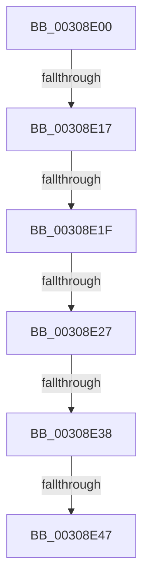

# KiPreprocessFlushTb

- RVA: `0x00308E00`–`0x00308E50` (길이 `80` bytes)
- VA: `0x0000000140308E00`
- 실행 섹션: `.text`
- PDB 이름 있음: `예`; PDB Function 태그: `아니요`
- unwind 정보 RVA: `0x00073A98`
- 디코드: `19`개 명령, `80/80` bytes 표시
- 미해석 바이트: `0` (있으면 어셈블리에 `.byte`로 보존)

> 이 문서는 커널 이미지의 기계어와 PDB 기호를 분석해 생성했습니다. 4번과 5번은 함수 원형과 자료형을 바이너리 사용 방식에서 추정한 C 해석이며 원본 소스 복구 결과는 아닙니다.

## 1. Dependencies

- 직접 호출 지점: **0**; 고유 호출 대상: **0**
- 직접 호출자로 확인된 함수: **3**
- RIP 상대 이미지 참조: **3**

### Outgoing calls
- 직접 디코드된 call 명령이 없습니다.

### Direct callers
- [MiFlushEntireTbDueToAttributeChange](MiFlushEntireTbDueToAttributeChange_function_00308AE0.md) at `0x00308B1C`
- [KeFlushEntireTb](../5B/KeFlushEntireTb_function_005BDBF0.md) at `0x005BDC19`
- [KeFlushSingleTb](../5B/KeFlushSingleTb_function_005BDE84.md) at `0x005BDECC`

### Static image references
- `0x00308E06` → RVA `0x00FC6AB8` (`ALMOSTRO`; read)
- `0x00308E27` → RVA `0x00FC6A87` (`ALMOSTRO`; read)
- `0x00308E38` → RVA `0x00FC6A80` (`ALMOSTRO`; read)

## 2. Other-region calls and transfers

- 다른 실행 섹션으로 향하는 call: **0**
- call이 아닌 외부 분기/꼬리 이동: **6**
  - `0x00308E11` → [sub_00308ED6 + 0x1](Unknown_function_00308ED6.md) (`tail-transfer`)
  - `0x00308E19` → [sub_00308F24 + 0x19](Unknown_function_00308F24.md) (`tail-transfer`)
  - `0x00308E21` → [sub_00308F24](Unknown_function_00308F24.md) (`tail-transfer`)
  - `0x00308E32` → [sub_00308F24 + 0x19](Unknown_function_00308F24.md) (`tail-transfer`)
  - `0x00308E41` → [sub_00308ED6 + 0x1](Unknown_function_00308ED6.md) (`tail-transfer`)
  - `0x00308E4A` → [sub_00308F24 + 0x19](Unknown_function_00308F24.md) (`tail-transfer`)

## 3. Assembly (complete function range)

```asm
00308E00  40 53                           push rbx
00308E02  48 83 EC 20                     sub rsp, 0x20
00308E06  8B 05 AC DC CB 00               mov eax, dword ptr [rip + 0xcbdcac]
00308E0C  49 8B D9                        mov rbx, r9
00308E0F  A8 04                           test al, 4
00308E11  0F 84 C0 00 00 00               je 0x140308ed7
00308E17  A8 02                           test al, 2
00308E19  0F 85 1E 01 00 00               jne 0x140308f3d
00308E1F  84 C9                           test cl, cl
00308E21  0F 85 FD 00 00 00               jne 0x140308f24
00308E27  0F B6 05 59 DC CB 00            movzx eax, byte ptr [rip + 0xcbdc59]
00308E2E  24 03                           and al, 3
00308E30  3C 01                           cmp al, 1
00308E32  0F 84 05 01 00 00               je 0x140308f3d
00308E38  8B 05 42 DC CB 00               mov eax, dword ptr [rip + 0xcbdc42]
00308E3E  83 F8 01                        cmp eax, 1
00308E41  0F 84 90 00 00 00               je 0x140308ed7
00308E47  45 85 C0                        test r8d, r8d
00308E4A  0F 85 ED 00 00 00               jne 0x140308f3d
```

## 4. C-style interpretation (structured pseudocode)

```c
__int64 __fastcall KiPreprocessFlushTb(unsigned __int8 a1, __int64 a2, int a3, __int64 a4)
{
    __int64 result;
    __int64 v_rsp;

    v_rsp = (v_rsp) - (32);
    result = (unsigned __int8)((*(unsigned __int8 *)(v_rip + 13360217)) & (3));
}
```

## 5. (Beta) C Style

```c
int64_t KiPreprocessFlushTb(uint8_t Arg1, int64_t Arg2, int32_t Arg3, int64_t Arg4)
{
    int64_t result;
    int64_t local_rsp;

    local_rsp = (local_rsp) - (32);
    result = (uint8_t)((*(uint8_t *)(v_rip + 0xCBDC59)) & (3));
}
```

## 6. Execution-region graph

[열기: 2D/3D 그래프와 함수 탐색 컨트롤 패널](../../../control-panel.html?section=text&rva=0x00308E00&view=graph)

- 2D 그래프는 위에서 아래로 흐르고, 3D 그래프는 빈 공간을 드래그해 회전합니다. Shift+드래그는 이동, 휠은 확대·축소, 함수 노드 선택은 대상 보고서 이동입니다.

### Static fallback


