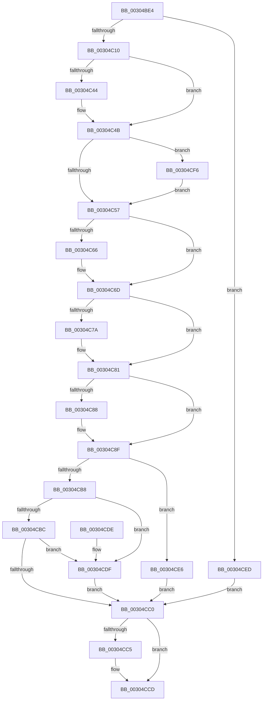

# KiReadGuestSchedulerAssistPriority

- RVA: `0x00304BE4`–`0x00304D02` (길이 `286` bytes)
- VA: `0x0000000140304BE4`
- 실행 섹션: `.text`
- PDB 이름 있음: `예`; PDB Function 태그: `아니요`
- unwind 정보 RVA: `0x000735A8`
- 디코드: `82`개 명령, `286/286` bytes 표시
- 미해석 바이트: `0` (있으면 어셈블리에 `.byte`로 보존)

> 이 문서는 커널 이미지의 기계어와 PDB 기호를 분석해 생성했습니다. 4번과 5번은 함수 원형과 자료형을 바이너리 사용 방식에서 추정한 C 해석이며 원본 소스 복구 결과는 아닙니다.

## 1. Dependencies

- 직접 호출 지점: **0**; 고유 호출 대상: **0**
- 직접 호출자로 확인된 함수: **9**
- RIP 상대 이미지 참조: **1**

### Outgoing calls
- 직접 디코드된 call 명령이 없습니다.

### Direct callers
- [sub_00218E7C](../21/Unknown_function_00218E7C.md) at `0x00218E8B`
- [KiNormalPriorityReadyScan](../21/KiNormalPriorityReadyScan_function_0021B400.md) at `0x0021B6B1`
- [sub_0021C284](../21/Unknown_function_0021C284.md) at `0x0021C37D`
- [KiUpdateVpBackingThreadPriorityOnReadyQueueInsertion](../21/KiUpdateVpBackingThreadPriorityOnReadyQueueInsertion_function_0021D360.md) at `0x0021D383`
- [sub_0021D7F8](../21/Unknown_function_0021D7F8.md) at `0x0021E57E`
- [sub_002546EC](../25/Unknown_function_002546EC.md) at `0x00254943`
- [KiUpdateVpBackingThreadPriorityFromTopLevel](KiUpdateVpBackingThreadPriorityFromTopLevel_function_00303BA0.md) at `0x00303BED`
- [KiUpdateVPBackingThreadPriority](KiUpdateVPBackingThreadPriority_function_00306040.md) at `0x00306096`
- [KiScanSharedReadyThreads](../46/KiScanSharedReadyThreads_function_0046F120.md) at `0x0046F5A5`

### Static image references
- `0x00304CA9` → RVA `0x00FC504C` (`ALMOSTRO`; read)

## 2. Other-region calls and transfers

- 다른 실행 섹션으로 향하는 call: **0**
- 별도 외부 분기/꼬리 이동을 확인하지 못했습니다.

## 3. Assembly (complete function range)

```asm
00304BE4  48 89 5C 24 10                  mov qword ptr [rsp + 0x10], rbx
00304BE9  48 89 6C 24 18                  mov qword ptr [rsp + 0x18], rbp
00304BEE  48 89 74 24 20                  mov qword ptr [rsp + 0x20], rsi
00304BF3  57                              push rdi
00304BF4  48 83 64 24 10 00               and qword ptr [rsp + 0x10], 0
00304BFA  4C 8B DA                        mov r11, rdx
00304BFD  4C 8B 81 C8 03 00 00            mov r8, qword ptr [rcx + 0x3c8]
00304C04  4C 8B C9                        mov r9, rcx
00304C07  4D 85 C0                        test r8, r8
00304C0A  0F 84 DD 00 00 00               je 0x140304ced
00304C10  45 8B 10                        mov r10d, dword ptr [r8]
00304C13  BD 01 00 00 00                  mov ebp, 1
00304C18  8A 54 24 10                     mov dl, byte ptr [rsp + 0x10]
00304C1C  41 8B F2                        mov esi, r10d
00304C1F  81 E6 00 00 02 00               and esi, 0x20000
00304C25  8B C5                           mov eax, ebp
00304C27  41 8B FA                        mov edi, r10d
00304C2A  8D 4D 02                        lea ecx, [rbp + 2]
00304C2D  0F 45 C1                        cmovne eax, ecx
00304C30  C1 EF 08                        shr edi, 8
00304C33  88 44 24 11                     mov byte ptr [rsp + 0x11], al
00304C37  41 8B 40 1C                     mov eax, dword ptr [r8 + 0x1c]
00304C3B  40 88 7C 24 12                  mov byte ptr [rsp + 0x12], dil
00304C40  85 C0                           test eax, eax
00304C42  74 07                           je 0x140304c4b
00304C44  40 0A D5                        or dl, bpl
00304C47  88 54 24 10                     mov byte ptr [rsp + 0x10], dl
00304C4B  41 8B 40 20                     mov eax, dword ptr [r8 + 0x20]
00304C4F  85 C0                           test eax, eax
00304C51  0F 85 9F 00 00 00               jne 0x140304cf6
00304C57  41 8B 58 14                     mov ebx, dword ptr [r8 + 0x14]
00304C5B  89 5C 24 14                     mov dword ptr [rsp + 0x14], ebx
00304C5F  41 0F BA E2 13                  bt r10d, 0x13
00304C64  73 07                           jae 0x140304c6d
00304C66  80 CA 04                        or dl, 4
00304C69  88 54 24 10                     mov byte ptr [rsp + 0x10], dl
00304C6D  49 8B 48 28                     mov rcx, qword ptr [r8 + 0x28]
00304C71  49 8B 40 30                     mov rax, qword ptr [r8 + 0x30]
00304C75  48 3B C8                        cmp rcx, rax
00304C78  74 07                           je 0x140304c81
00304C7A  80 CA 08                        or dl, 8
00304C7D  88 54 24 10                     mov byte ptr [rsp + 0x10], dl
00304C81  41 0F BA E2 15                  bt r10d, 0x15
00304C86  73 07                           jae 0x140304c8f
00304C88  80 CA 10                        or dl, 0x10
00304C8B  88 54 24 10                     mov byte ptr [rsp + 0x10], dl
00304C8F  40 0F BE CF                     movsx ecx, dil
00304C93  8D 41 FF                        lea eax, [rcx - 1]
00304C96  83 F8 1E                        cmp eax, 0x1e
00304C99  41 0F BE 81 33 02 00 00         movsx eax, byte ptr [r9 + 0x233]
00304CA1  0F 47 CD                        cmova ecx, ebp
00304CA4  3B C8                           cmp ecx, eax
00304CA6  0F 4D C1                        cmovge eax, ecx
00304CA9  8B 0D 9D 03 CC 00               mov ecx, dword ptr [rip + 0xcc039d]
00304CAF  3B C1                           cmp eax, ecx
00304CB1  0F 4F C1                        cmovg eax, ecx
00304CB4  85 F6                           test esi, esi
00304CB6  75 2E                           jne 0x140304ce6
00304CB8  84 D2                           test dl, dl
00304CBA  75 23                           jne 0x140304cdf
00304CBC  85 DB                           test ebx, ebx
00304CBE  75 1F                           jne 0x140304cdf
00304CC0  4D 85 DB                        test r11, r11
00304CC3  74 08                           je 0x140304ccd
00304CC5  48 8B 4C 24 10                  mov rcx, qword ptr [rsp + 0x10]
00304CCA  49 89 0B                        mov qword ptr [r11], rcx
00304CCD  48 8B 5C 24 18                  mov rbx, qword ptr [rsp + 0x18]
00304CD2  48 8B 6C 24 20                  mov rbp, qword ptr [rsp + 0x20]
00304CD7  48 8B 74 24 28                  mov rsi, qword ptr [rsp + 0x28]
00304CDC  5F                              pop rdi
00304CDD  C3                              ret
00304CDE  CC                              int3
00304CDF  3B C1                           cmp eax, ecx
00304CE1  0F 4C C1                        cmovl eax, ecx
00304CE4  EB DA                           jmp 0x140304cc0
00304CE6  B8 07 00 00 00                  mov eax, 7
00304CEB  EB D3                           jmp 0x140304cc0
00304CED  0F BE 81 C3 00 00 00            movsx eax, byte ptr [rcx + 0xc3]
00304CF4  EB CA                           jmp 0x140304cc0
00304CF6  80 CA 02                        or dl, 2
00304CF9  88 54 24 10                     mov byte ptr [rsp + 0x10], dl
00304CFD  E9 55 FF FF FF                  jmp 0x140304c57
```

## 4. C-style interpretation (structured pseudocode)

```c
__int64 __fastcall KiReadGuestSchedulerAssistPriority(__int64 a1, __int64 a2)
{
    __int64 result;
    __int64 v_rdi;
    __int64 v_rsi;
    unsigned __int64 v_stack_p10;
    unsigned __int64 v_stack_p18;
    unsigned __int64 v_stack_p20;
    unsigned __int64 v_stack_p8;
    unsigned __int8 v_stack_p9;
    unsigned __int8 v_stack_pA;
    unsigned int v_stack_pC;

    v_stack_p10 = v_rbx;
    v_stack_p18 = v_rbp;
    v_stack_p20 = v_rsi;
    if (*(unsigned __int64 *)(a1 + 968) == 0) goto loc_00304CED;
    v_rsi = (unsigned int)(((unsigned int)((unsigned int)((unsigned int)(*(unsigned int *)(*(unsigned __int64 *)(a1 + 968)))))) & (0x20000ULL));
    result = 1;
    if (condition_is_not_equal) { result = (unsigned int)(1 + 2); }
    v_rdi = (unsigned int)(((unsigned int)((unsigned int)((unsigned int)(*(unsigned int *)(*(unsigned __int64 *)(a1 + 968)))))) >> (8));
    v_stack_p9 = (unsigned __int8)(result);
    v_stack_pA = (unsigned __int8)(v_rdi);
    if ((unsigned int)((unsigned int)(*(unsigned int *)(*(unsigned __int64 *)(a1 + 968) + 28))) != 0) {
        a2 = (unsigned __int8)((v_stack_p8) | (1));
        v_stack_p8 = (unsigned __int8)(a2);
    }
    if ((unsigned int)((unsigned int)(*(unsigned int *)(*(unsigned __int64 *)(a1 + 968) + 32))) != 0) goto loc_00304CF6;
loc_00304C57:
    v_stack_pC = (unsigned int)((unsigned int)(*(unsigned int *)(*(unsigned __int64 *)(a1 + 968) + 20)));
    if (!(condition_is_above_or_equal)) {
        a2 = (unsigned __int8)((a2) | (4));
        v_stack_p8 = (unsigned __int8)(a2);
    }
    if ((*(unsigned __int64 *)(*(unsigned __int64 *)(a1 + 968) + 40)) != (*(unsigned __int64 *)(*(unsigned __int64 *)(a1 + 968) + 48))) {
        a2 = (unsigned __int8)((a2) | (8));
        v_stack_p8 = (unsigned __int8)(a2);
    }
    if (!(condition_is_above_or_equal)) {
        a2 = (unsigned __int8)((a2) | (16));
        v_stack_p8 = (unsigned __int8)(a2);
    }
    a1 = (__int8)((unsigned __int8)(v_rdi));
    if (((unsigned int)((__int8)((unsigned __int8)(v_rdi)) - 1)) > 30) { a1 = 1; }
    result = (__int8)(*(unsigned __int8 *)(a1 + 563));
    if (((unsigned int)(a1)) >= ((unsigned int)((__int8)(*(unsigned __int8 *)(a1 + 563))))) { result = (unsigned int)(a1); }
    if (((unsigned int)(result)) > ((unsigned int)((unsigned int)(*(unsigned int *)(v_rip + 13370269))))) { result = (unsigned int)((unsigned int)(*(unsigned int *)(v_rip + 13370269))); }
    if ((unsigned int)(v_rsi) != 0) goto loc_00304CE6;
    if ((unsigned __int8)(a2) != 0) goto loc_00304CDF;
    if ((unsigned int)((unsigned int)(*(unsigned int *)(*(unsigned __int64 *)(a1 + 968) + 20))) != 0) goto loc_00304CDF;
loc_00304CC0:
    if (a2 != 0) {
        a1 = v_stack_p8;
        *(unsigned __int64 *)(a2) = a1;
    }
    return result;
loc_00304CDF:
    if (((unsigned int)(result)) < ((unsigned int)(a1))) { result = (unsigned int)(a1); }
    goto loc_00304CC0;
loc_00304CE6:
    goto loc_00304CC0;
loc_00304CED:
    goto loc_00304CC0;
loc_00304CF6:
    a2 = (unsigned __int8)((a2) | (2));
    v_stack_p10 = (unsigned __int8)(a2);
    goto loc_00304C57;
}
```

## 5. (Beta) C Style

```c
int64_t KiReadGuestSchedulerAssistPriority(void *Arg1, int64_t Arg2)
{
    uint8_t *arg1 = (uint8_t *)Arg1;

    int64_t result;
    int64_t local_rdi;
    int64_t local_rsi;
    uint64_t v_stack_p10;
    uint64_t v_stack_p18;
    uint64_t v_stack_p20;
    uint64_t v_stack_p8;
    uint8_t v_stack_p9;
    uint8_t v_stack_pA;
    uint32_t v_stack_pC;

    v_stack_p10 = local_rbx;
    v_stack_p18 = local_rbp;
    v_stack_p20 = local_rsi;
    if (*(uint64_t *)(arg1 + 0x3C8) == 0) goto loc_00304CED;
    local_rsi = (uint32_t)(((uint32_t)((uint32_t)((uint32_t)(*(uint32_t *)(*(uint64_t *)(arg1 + 0x3C8)))))) & (0x20000ULL));
    result = 1;
    if (condition_is_not_equal) { result = (uint32_t)(1 + 2); }
    local_rdi = (uint32_t)(((uint32_t)((uint32_t)((uint32_t)(*(uint32_t *)(*(uint64_t *)(arg1 + 0x3C8)))))) >> (8));
    v_stack_p9 = (uint8_t)(result);
    v_stack_pA = (uint8_t)(local_rdi);
    if ((uint32_t)((uint32_t)(*(uint32_t *)(*(uint64_t *)(arg1 + 0x3C8) + 0x1C))) != 0) {
        Arg2 = (uint8_t)((v_stack_p8) | (1));
        v_stack_p8 = (uint8_t)(Arg2);
    }
    if ((uint32_t)((uint32_t)(*(uint32_t *)(*(uint64_t *)(arg1 + 0x3C8) + 0x20))) != 0) goto loc_00304CF6;
loc_00304C57:
    v_stack_pC = (uint32_t)((uint32_t)(*(uint32_t *)(*(uint64_t *)(arg1 + 0x3C8) + 0x14)));
    if (!(condition_is_above_or_equal)) {
        Arg2 = (uint8_t)((Arg2) | (4));
        v_stack_p8 = (uint8_t)(Arg2);
    }
    if ((*(uint64_t *)(*(uint64_t *)(arg1 + 0x3C8) + 0x28)) != (*(uint64_t *)(*(uint64_t *)(arg1 + 0x3C8) + 0x30))) {
        Arg2 = (uint8_t)((Arg2) | (8));
        v_stack_p8 = (uint8_t)(Arg2);
    }
    if (!(condition_is_above_or_equal)) {
        Arg2 = (uint8_t)((Arg2) | (16));
        v_stack_p8 = (uint8_t)(Arg2);
    }
    Arg1 = (int8_t)((uint8_t)(local_rdi));
    if (((uint32_t)((int8_t)((uint8_t)(local_rdi)) - 1)) > 30) { Arg1 = 1; }
    result = (int8_t)(*(uint8_t *)(arg1 + 0x233));
    if (((uint32_t)(Arg1)) >= ((uint32_t)((int8_t)(*(uint8_t *)(arg1 + 0x233))))) { result = (uint32_t)(Arg1); }
    if (((uint32_t)(result)) > ((uint32_t)((uint32_t)(*(uint32_t *)(v_rip + 0xCC039D))))) { result = (uint32_t)((uint32_t)(*(uint32_t *)(v_rip + 0xCC039D))); }
    if ((uint32_t)(local_rsi) != 0) goto loc_00304CE6;
    if ((uint8_t)(Arg2) != 0) goto loc_00304CDF;
    if ((uint32_t)((uint32_t)(*(uint32_t *)(*(uint64_t *)(arg1 + 0x3C8) + 0x14))) != 0) goto loc_00304CDF;
loc_00304CC0:
    if (Arg2 != 0) {
        Arg1 = v_stack_p8;
        *(void **)(Arg2) = Arg1;
    }
    return result;
loc_00304CDF:
    if (((uint32_t)(result)) < ((uint32_t)(Arg1))) { result = (uint32_t)(Arg1); }
    goto loc_00304CC0;
loc_00304CE6:
    goto loc_00304CC0;
loc_00304CED:
    goto loc_00304CC0;
loc_00304CF6:
    Arg2 = (uint8_t)((Arg2) | (2));
    v_stack_p10 = (uint8_t)(Arg2);
    goto loc_00304C57;
}
```

### 관측된 메모리 오프셋

구조체 형식이 확인되지 않은 접근은 인자 기준의 오프셋으로만 기록했습니다.

| 기준 인자 | 오프셋 표현 | 폭 (bit) | 접근 |
|---|---:|---:|---|
| `Arg1` | `+ 0xC3` | `8` | `R` |
| `Arg1` | `+ 0x233` | `8` | `R` |
| `Arg1` | `+ 0x3C8` | `64` | `R` |

## 6. Execution-region graph

[열기: 2D/3D 그래프와 함수 탐색 컨트롤 패널](../../../control-panel.html?section=text&rva=0x00304BE4&view=graph)

- 2D 그래프는 위에서 아래로 흐르고, 3D 그래프는 빈 공간을 드래그해 회전합니다. Shift+드래그는 이동, 휠은 확대·축소, 함수 노드 선택은 대상 보고서 이동입니다.

### Static fallback


