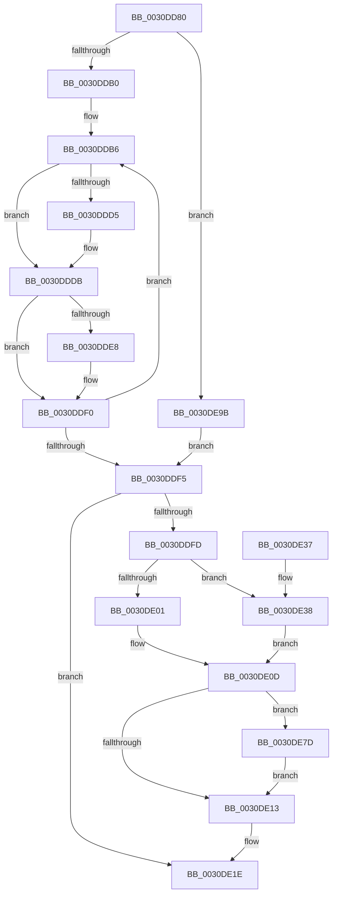

# KiReadyDeferredReadyList

- RVA: `0x0030DD80`–`0x0030DEA7` (길이 `295` bytes)
- VA: `0x000000014030DD80`
- 실행 섹션: `.text`
- PDB 이름 있음: `예`; PDB Function 태그: `아니요`
- unwind 정보 RVA: `0x00073EEC`
- 디코드: `77`개 명령, `295/295` bytes 표시
- 미해석 바이트: `0` (있으면 어셈블리에 `.byte`로 보존)

> 이 문서는 커널 이미지의 기계어와 PDB 기호를 분석해 생성했습니다. 4번과 5번은 함수 원형과 자료형을 바이너리 사용 방식에서 추정한 C 해석이며 원본 소스 복구 결과는 아닙니다.

## 1. Dependencies

- 직접 호출 지점: **5**; 고유 호출 대상: **5**
- 직접 호출자로 확인된 함수: **15**
- RIP 상대 이미지 참조: **0**

### Outgoing calls
- `0x0030DDC6` → [KiDeferredReadySingleThread](../25/KiDeferredReadySingleThread_function_00252FE0.md) (function, `0x00252FE0`)
- `0x0030DDEB` → [KiFlushSoftwareInterruptBatch](../25/KiFlushSoftwareInterruptBatch_function_00252200.md) (function, `0x00252200`)
- `0x0030DE08` → [KiSendSoftwareInterruptAffinity](KiSendSoftwareInterruptAffinity_function_0030E834.md) (function, `0x0030E834`)
- `0x0030DE76` → [HalpInterruptSendIpi](../25/HalpInterruptSendIpi_function_00252310.md) (function, `0x00252310`)
- `0x0030DE91` → [memset](../6C/memset_function_006C6C40.md) (function, `0x006C6C40`)

### Direct callers
- [KiDeferGroupSchedulingPreemption](../20/KiDeferGroupSchedulingPreemption_function_0020076C.md) at `0x00200E41`
- [KiHandleDeferredPreemption](../20/KiHandleDeferredPreemption_function_00202ECC.md) at `0x00203214`
- [KeYieldExecution](../20/KeYieldExecution_function_00209FA0.md) at `0x0020A4A1`
- [KiRemoveBoostThread](../21/KiRemoveBoostThread_function_00219128.md) at `0x002192E5`
- [sub_0021C78A](../21/Unknown_function_0021C78A.md) at `0x0021C791`
- [sub_0021D7F8](../21/Unknown_function_0021D7F8.md) at `0x0021E270`
- [KiExecuteAllDpcs](../25/KiExecuteAllDpcs_function_0025B740.md) at `0x0025C1BC`
- [KiGroupSchedulingGenerationEnd](KiGroupSchedulingGenerationEnd_function_0030A9B4.md) at `0x0030AED1`
- [KiGroupSchedulingQuantumEnd](KiGroupSchedulingQuantumEnd_function_0030B220.md) at `0x0030B73A`
- [KiEnterLongDpcProcessing](KiEnterLongDpcProcessing_function_0030BE54.md) at `0x0030C0D1`
- [KiAttemptToStealStandbyThread](KiAttemptToStealStandbyThread_function_0030D790.md) at `0x0030DC8F`
- [KiSearchForNewThreadsOnTarget](KiSearchForNewThreadsOnTarget_function_0030F500.md) at `0x00310868`
- [KiSearchForNewThread](../35/KiSearchForNewThread_function_00355C98.md) at `0x00355F1F`
- [KiProcessPendingForegroundBoosts](../4C/KiProcessPendingForegroundBoosts_function_004C5A80.md) at `0x004C5BEC`
- [sub_006D68CE](../6D/Unknown_function_006D68CE.md) at `0x006D68CE`

### Static image references
- 디코드된 RIP-relative 메모리 참조가 없습니다.

## 2. Other-region calls and transfers

- 다른 실행 섹션으로 향하는 call: **0**
- 별도 외부 분기/꼬리 이동을 확인하지 못했습니다.

## 3. Assembly (complete function range)

```asm
0030DD80  48 89 5C 24 08                  mov qword ptr [rsp + 8], rbx
0030DD85  48 89 6C 24 10                  mov qword ptr [rsp + 0x10], rbp
0030DD8A  48 89 74 24 18                  mov qword ptr [rsp + 0x18], rsi
0030DD8F  57                              push rdi
0030DD90  41 56                           push r14
0030DD92  41 57                           push r15
0030DD94  48 83 EC 40                     sub rsp, 0x40
0030DD98  48 8B 3A                        mov rdi, qword ptr [rdx]
0030DD9B  45 33 FF                        xor r15d, r15d
0030DD9E  48 8B F2                        mov rsi, rdx
0030DDA1  4C 8B F1                        mov r14, rcx
0030DDA4  41 8B EF                        mov ebp, r15d
0030DDA7  48 85 FF                        test rdi, rdi
0030DDAA  0F 84 EB 00 00 00               je 0x14030de9b
0030DDB0  48 8B 07                        mov rax, qword ptr [rdi]
0030DDB3  48 89 02                        mov qword ptr [rdx], rax
0030DDB6  48 8D 97 28 FF FF FF            lea rdx, [rdi - 0xd8]
0030DDBD  45 33 C9                        xor r9d, r9d
0030DDC0  4C 8B C6                        mov r8, rsi
0030DDC3  49 8B CE                        mov rcx, r14
0030DDC6  E8 15 52 F4 FF                  call 0x140252fe0
0030DDCB  48 8B 3E                        mov rdi, qword ptr [rsi]
0030DDCE  FF C5                           inc ebp
0030DDD0  48 85 FF                        test rdi, rdi
0030DDD3  74 06                           je 0x14030dddb
0030DDD5  48 8B 07                        mov rax, qword ptr [rdi]
0030DDD8  48 89 06                        mov qword ptr [rsi], rax
0030DDDB  49 8D 9E D8 35 00 00            lea rbx, [r14 + 0x35d8]
0030DDE2  40 F6 C5 0F                     test bpl, 0xf
0030DDE6  75 08                           jne 0x14030ddf0
0030DDE8  48 8B CB                        mov rcx, rbx
0030DDEB  E8 10 44 F4 FF                  call 0x140252200
0030DDF0  48 85 FF                        test rdi, rdi
0030DDF3  75 C1                           jne 0x14030ddb6
0030DDF5  0F B6 43 01                     movzx eax, byte ptr [rbx + 1]
0030DDF9  84 C0                           test al, al
0030DDFB  74 21                           je 0x14030de1e
0030DDFD  3C 01                           cmp al, 1
0030DDFF  74 37                           je 0x14030de38
0030DE01  0F B6 13                        movzx edx, byte ptr [rbx]
0030DE04  48 8D 4B 08                     lea rcx, [rbx + 8]
0030DE08  E8 27 0A 00 00                  call 0x14030e834
0030DE0D  80 7B 01 02                     cmp byte ptr [rbx + 1], 2
0030DE11  74 6A                           je 0x14030de7d
0030DE13  44 88 7B 01                     mov byte ptr [rbx + 1], r15b
0030DE17  C7 43 04 FF FF 00 00            mov dword ptr [rbx + 4], 0xffff
0030DE1E  48 8B 5C 24 60                  mov rbx, qword ptr [rsp + 0x60]
0030DE23  48 8B 6C 24 68                  mov rbp, qword ptr [rsp + 0x68]
0030DE28  48 8B 74 24 70                  mov rsi, qword ptr [rsp + 0x70]
0030DE2D  48 83 C4 40                     add rsp, 0x40
0030DE31  41 5F                           pop r15
0030DE33  41 5E                           pop r14
0030DE35  5F                              pop rdi
0030DE36  C3                              ret
0030DE37  CC                              int3
0030DE38  65 48 8B 04 25 20 00 00 00      mov rax, qword ptr gs:[0x20]
0030DE41  BA 1F 00 00 00                  mov edx, 0x1f
0030DE46  8B 4B 04                        mov ecx, dword ptr [rbx + 4]
0030DE49  44 0F B6 03                     movzx r8d, byte ptr [rbx]
0030DE4D  89 4C 24 28                     mov dword ptr [rsp + 0x28], ecx
0030DE51  48 8D 4C 24 20                  lea rcx, [rsp + 0x20]
0030DE56  FF 80 D4 8E 00 00               inc dword ptr [rax + 0x8ed4]
0030DE5C  B8 2F 00 00 00                  mov eax, 0x2f
0030DE61  41 80 F8 01                     cmp r8b, 1
0030DE65  48 C7 44 24 20 06 00 00 00      mov qword ptr [rsp + 0x20], 6
0030DE6E  4C 89 7C 24 2C                  mov qword ptr [rsp + 0x2c], r15
0030DE73  0F 45 D0                        cmovne edx, eax
0030DE76  E8 95 44 F4 FF                  call 0x140252310
0030DE7B  EB 90                           jmp 0x14030de0d
0030DE7D  48 8D 4B 10                     lea rcx, [rbx + 0x10]
0030DE81  48 C7 43 08 01 00 20 00         mov qword ptr [rbx + 8], 0x200001
0030DE89  33 D2                           xor edx, edx
0030DE8B  41 B8 00 01 00 00               mov r8d, 0x100
0030DE91  E8 AA 8D 3B 00                  call 0x1406c6c40
0030DE96  E9 78 FF FF FF                  jmp 0x14030de13
0030DE9B  48 8D 99 D8 35 00 00            lea rbx, [rcx + 0x35d8]
0030DEA2  E9 4E FF FF FF                  jmp 0x14030ddf5
```

## 4. C-style interpretation (structured pseudocode)

```c
__int64 __fastcall KiReadyDeferredReadyList(__int64 a1, __int64 a2, __int64 a3, int a4)
{
    __int64 result;
    __int64 v_r15;
    __int64 v_rbp;
    __int64 v_rsp;
    unsigned __int64 v_stack_p10;
    unsigned __int64 v_stack_p18;
    unsigned __int64 v_stack_p20;
    unsigned int v_stack_p28;
    unsigned __int64 v_stack_p2C;
    unsigned __int64 v_stack_p8;

    v_stack_p8 = v_rbx;
    v_stack_p10 = v_rbp;
    v_stack_p18 = v_rsi;
    v_rsp = (v_rsp) - (64);
    v_r15 = 0;
    if (*(unsigned __int64 *)(a2) == 0) goto loc_0030DE9B;
    *(unsigned __int64 *)(a2) = *(unsigned __int64 *)(*(unsigned __int64 *)(a2));
loc_0030DDB6:
    a4 = 0;
    result = KiDeferredReadySingleThread(a1, *(unsigned __int64 *)(a2) - 216, a2, a4);
    v_rbp = (unsigned int)((0) + 1);
    if (*(unsigned __int64 *)(a2) != 0) {
        result = *(unsigned __int64 *)(*(unsigned __int64 *)(a2));
        *(unsigned __int64 *)(a2) = result;
    }
    if ((((unsigned __int8)(v_rbp)) & (15)) == 0) {
        a1 = a1 + 13784;
        result = KiFlushSoftwareInterruptBatch(a1, *(unsigned __int64 *)(a2) - 216, a2, a4);
    }
    if (*(unsigned __int64 *)(a2) != 0) goto loc_0030DDB6;
loc_0030DDF5:
    if ((unsigned __int8)(*(unsigned __int8 *)(a1 + 13784 + 1)) == 0) goto loc_0030DE1E;
    if (((unsigned __int8)(*(unsigned __int8 *)(a1 + 13784 + 1))) == 1) goto loc_0030DE38;
    result = KiSendSoftwareInterruptAffinity(a1 + 13784 + 8, *(unsigned __int8 *)(a1 + 13784), a2, a4);
loc_0030DE0D:
    if ((*(unsigned __int8 *)(a1 + 13784 + 1)) == 2) goto loc_0030DE7D;
loc_0030DE13:
    *(unsigned __int8 *)(a1 + 13784 + 1) = 0;
    *(unsigned int *)(a1 + 13784 + 4) = 0xFFFFULL;
loc_0030DE1E:
    v_rsp = (v_rsp) + (64);
    return result;
loc_0030DE38:
    v_stack_p28 = (unsigned int)((unsigned int)(*(unsigned int *)(v_stack_p8 + 4)));
    v_stack_p20 = 6;
    v_stack_p2C = 0;
    a2 = 31;
    if (((unsigned __int8)(*(unsigned __int8 *)(v_stack_p8))) != 1) { a2 = 47; }
    result = HalpInterruptSendIpi(v_stack_p20, a2, *(unsigned __int8 *)(v_stack_p8), a4);
    goto loc_0030DE0D;
loc_0030DE7D:
    *(unsigned __int64 *)(v_stack_p8 + 8) = 0x200001ULL;
    a2 = 0;
    result = memset(v_stack_p8 + 16, a2, 256, a4);
    goto loc_0030DE13;
loc_0030DE9B:
    goto loc_0030DDF5;
}
```

## 5. (Beta) C Style

```c
int64_t KiReadyDeferredReadyList(void *Arg1, void *Arg2, int64_t Arg3, int32_t Arg4)
{
    uint8_t *arg1 = (uint8_t *)Arg1;
    uint8_t *arg2 = (uint8_t *)Arg2;

    int64_t result;
    int64_t local_r15;
    int64_t local_rbp;
    int64_t local_rsp;
    uint64_t v_stack_p10;
    uint64_t v_stack_p18;
    uint64_t v_stack_p20;
    uint32_t v_stack_p28;
    uint64_t v_stack_p2C;
    uint64_t v_stack_p8;

    v_stack_p8 = local_rbx;
    v_stack_p10 = local_rbp;
    v_stack_p18 = local_rsi;
    local_rsp = (local_rsp) - (64);
    local_r15 = 0;
    if (*(uint64_t *)(arg2) == 0) goto loc_0030DE9B;
    *(uint64_t *)(arg2) = *(uint64_t *)(*(uint64_t *)(arg2));
loc_0030DDB6:
    Arg4 = 0;
    result = KiDeferredReadySingleThread(Arg1, *(uint64_t *)(arg2) - 216, Arg2, Arg4);
    local_rbp = (uint32_t)((0) + 1);
    if (*(uint64_t *)(arg2) != 0) {
        result = *(uint64_t *)(*(uint64_t *)(arg2));
        *(uint64_t *)(arg2) = result;
    }
    if ((((uint8_t)(local_rbp)) & (15)) == 0) {
        Arg1 = Arg1 + 13784;
        result = KiFlushSoftwareInterruptBatch(Arg1, *(uint64_t *)(arg2) - 216, Arg2, Arg4);
    }
    if (*(uint64_t *)(arg2) != 0) goto loc_0030DDB6;
loc_0030DDF5:
    if ((uint8_t)(*(uint8_t *)(arg1 + 0x35D8 + 0x1)) == 0) goto loc_0030DE1E;
    if (((uint8_t)(*(uint8_t *)(arg1 + 0x35D8 + 0x1))) == 1) goto loc_0030DE38;
    result = KiSendSoftwareInterruptAffinity(Arg1 + 13784 + 8, *(uint8_t *)(arg1 + 0x35D8), Arg2, Arg4);
loc_0030DE0D:
    if ((*(uint8_t *)(arg1 + 0x35D8 + 0x1)) == 2) goto loc_0030DE7D;
loc_0030DE13:
    *(uint8_t *)(arg1 + 0x35D8 + 0x1) = 0;
    *(uint32_t *)(arg1 + 0x35D8 + 0x4) = 0xFFFFULL;
loc_0030DE1E:
    local_rsp = (local_rsp) + (64);
    return result;
loc_0030DE38:
    v_stack_p28 = (uint32_t)((uint32_t)(*(uint32_t *)(v_stack_p8 + 0x4)));
    v_stack_p20 = 6;
    v_stack_p2C = 0;
    Arg2 = 31;
    if (((uint8_t)(*(uint8_t *)(v_stack_p8))) != 1) { Arg2 = 47; }
    result = HalpInterruptSendIpi(v_stack_p20, Arg2, *(uint8_t *)(v_stack_p8), Arg4);
    goto loc_0030DE0D;
loc_0030DE7D:
    *(uint64_t *)(v_stack_p8 + 0x8) = 0x200001ULL;
    Arg2 = 0;
    result = memset(v_stack_p8 + 16, Arg2, 256, Arg4);
    goto loc_0030DE13;
loc_0030DE9B:
    goto loc_0030DDF5;
}
```

### 관측된 메모리 오프셋

구조체 형식이 확인되지 않은 접근은 인자 기준의 오프셋으로만 기록했습니다.

| 기준 인자 | 오프셋 표현 | 폭 (bit) | 접근 |
|---|---:|---:|---|
| `Arg1` | `+ 0x0` | `8` | `R` |
| `Arg1` | `+ 0x1` | `8` | `R` |
| `Arg1` | `+ 0x1` | `8` | `W` |
| `Arg1` | `+ 0x4` | `32` | `R` |
| `Arg1` | `+ 0x4` | `32` | `W` |
| `Arg1` | `+ 0x8` | `64` | `R` |
| `Arg1` | `+ 0x8` | `64` | `W` |
| `Arg1` | `+ 0x10` | `64` | `R` |
| `Arg1` | `+ 0x35D8` | `64` | `R` |
| `Arg2` | `+ 0x0` | `64` | `R` |
| `Arg2` | `+ 0x0` | `64` | `W` |

## 6. Execution-region graph

[열기: 2D/3D 그래프와 함수 탐색 컨트롤 패널](../../../control-panel.html?section=text&rva=0x0030DD80&view=graph)

- 2D 그래프는 위에서 아래로 흐르고, 3D 그래프는 빈 공간을 드래그해 회전합니다. Shift+드래그는 이동, 휠은 확대·축소, 함수 노드 선택은 대상 보고서 이동입니다.

### Static fallback


