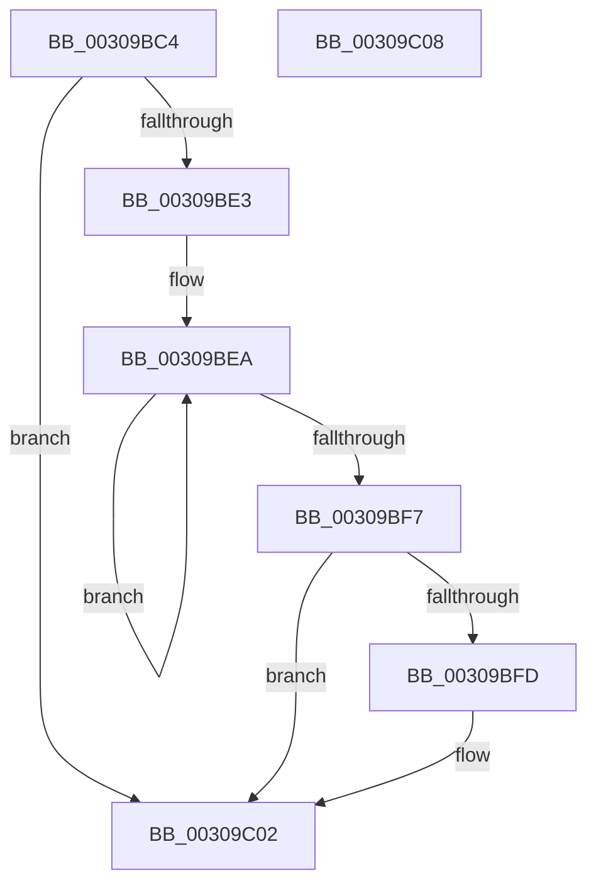

# KiResumeThreadCycleAccumulation

- RVA: `0x00309BC4`–`0x00309C09` (길이 `69` bytes)
- VA: `0x0000000140309BC4`
- 실행 섹션: `.text`
- PDB 이름 있음: `예`; PDB Function 태그: `아니요`
- unwind 정보 RVA: `0x0005C788`
- 디코드: `20`개 명령, `69/69` bytes 표시
- 미해석 바이트: `0` (있으면 어셈블리에 `.byte`로 보존)

> 이 문서는 커널 이미지의 기계어와 PDB 기호를 분석해 생성했습니다. 4번과 5번은 함수 원형과 자료형을 바이너리 사용 방식에서 추정한 C 해석이며 원본 소스 복구 결과는 아닙니다.

## 1. Dependencies

- 직접 호출 지점: **2**; 고유 호출 대상: **2**
- 직접 호출자로 확인된 함수: **4**
- RIP 상대 이미지 참조: **0**

### Outgoing calls
- `0x00309BC9` → [KiStartThreadCycleAccumulation](../37/KiStartThreadCycleAccumulation_function_0037DB30.md) (function, `0x0037DB30`)
- `0x00309BFD` → [KiRemoveSystemWorkPriorityKick](../26/KiRemoveSystemWorkPriorityKick_function_002631D0.md) (function, `0x002631D0`)

### Direct callers
- [KiGroupSchedulingGenerationEnd](KiGroupSchedulingGenerationEnd_function_0030A9B4.md) at `0x0030AAED`
- [KiIdleSchedule](../35/KiIdleSchedule_function_00355000.md) at `0x0035511B`
- [KiSwapThread](../35/KiSwapThread_function_00355640.md) at `0x00355A13`
- [KiExecuteSmtIsolationThread](../5C/KiExecuteSmtIsolationThread_function_005C4070.md) at `0x005C414B`

### Static image references
- 디코드된 RIP-relative 메모리 참조가 없습니다.

## 2. Other-region calls and transfers

- 다른 실행 섹션으로 향하는 call: **0**
- 별도 외부 분기/꼬리 이동을 확인하지 못했습니다.

## 3. Assembly (complete function range)

```asm
00309BC4  48 83 EC 28                     sub rsp, 0x28
00309BC8  FA                              cli
00309BC9  E8 62 3F 07 00                  call 0x14037db30
00309BCE  65 48 8B 0C 25 20 00 00 00      mov rcx, qword ptr gs:[0x20]
00309BD7  4C 8B 81 B8 8E 00 00            mov r8, qword ptr [rcx + 0x8eb8]
00309BDE  4D 85 C0                        test r8, r8
00309BE1  74 1F                           je 0x140309c02
00309BE3  41 0F 0D 08                     prefetchw byte ptr [r8]
00309BE7  41 8B 00                        mov eax, dword ptr [r8]
00309BEA  8B D0                           mov edx, eax
00309BEC  0F BA F2 15                     btr edx, 0x15
00309BF0  F0 41 0F B1 10                  lock cmpxchg dword ptr [r8], edx
00309BF5  75 F3                           jne 0x140309bea
00309BF7  0F BA E0 15                     bt eax, 0x15
00309BFB  73 05                           jae 0x140309c02
00309BFD  E8 CE 95 F5 FF                  call 0x1402631d0
00309C02  FB                              sti
00309C03  48 83 C4 28                     add rsp, 0x28
00309C07  C3                              ret
00309C08  CC                              int3
```

## 4. C-style interpretation (structured pseudocode)

```c
__int64 __fastcall KiResumeThreadCycleAccumulation(void)
{
    __int64 result;
    __int64 v_rsp;

    v_rsp = (v_rsp) - (40);
    result = KiStartThreadCycleAccumulation(a1, a2, a3, a4);
    if (*(unsigned __int64 *)(*(unsigned __int64 *)(gs_base + (0 + 32)) + 36536) == 0) goto loc_00309C02;
loc_00309BEA:
    if (*(unsigned __int64 *)(*(unsigned __int64 *)(gs_base + (0 + 32)) + 36536) != 0) goto loc_00309BEA;
    result = (unsigned int)(*(unsigned int *)(*(unsigned __int64 *)(*(unsigned __int64 *)(gs_base + (0 + 32)) + 36536)));
    if (!(condition_is_above_or_equal)) {
        result = KiRemoveSystemWorkPriorityKick(*(unsigned __int64 *)(gs_base + (0 + 32)), (unsigned int)((unsigned int)((unsigned int)(*(unsigned int *)(*(unsigned __int64 *)(*(unsigned __int64 *)(gs_base + (0 + 32)) + 36536))))), *(unsigned __int64 *)(*(unsigned __int64 *)(gs_base + (0 + 32)) + 36536), a4);
    }
    v_rsp = (v_rsp) + (40);
    return result;
}
```

## 5. (Beta) C Style

```c
void KiResumeThreadCycleAccumulation(void)
{
    int64_t result;
    int64_t local_rsp;

    local_rsp = (local_rsp) - (40);
    result = KiStartThreadCycleAccumulation(a1, a2, a3, a4);
    if (*(uint64_t *)(*(uint64_t *)(gs_base + (0 + 0x20)) + 0x8EB8) == 0) goto loc_00309C02;
loc_00309BEA:
    if (*(uint64_t *)(*(uint64_t *)(gs_base + (0 + 0x20)) + 0x8EB8) != 0) goto loc_00309BEA;
    result = (uint32_t)(*(uint32_t *)(*(uint64_t *)(*(uint64_t *)(gs_base + (0 + 0x20)) + 0x8EB8)));
    if (!(condition_is_above_or_equal)) {
        result = KiRemoveSystemWorkPriorityKick(*(uint64_t *)(gs_base + (0 + 0x20)), (uint32_t)((uint32_t)((uint32_t)(*(uint32_t *)(*(uint64_t *)(*(uint64_t *)(gs_base + (0 + 0x20)) + 0x8EB8))))), *(uint64_t *)(*(uint64_t *)(gs_base + (0 + 0x20)) + 0x8EB8), a4);
    }
    local_rsp = (local_rsp) + (40);
    return result;
}
```

## 6. Execution-region graph

[열기: 2D/3D 그래프와 함수 탐색 컨트롤 패널](../../../control-panel.html?section=text&rva=0x00309BC4&view=graph)

- 2D 그래프는 위에서 아래로 흐르고, 3D 그래프는 빈 공간을 드래그해 회전합니다. Shift+드래그는 이동, 휠은 확대·축소, 함수 노드 선택은 대상 보고서 이동입니다.

### Static fallback


