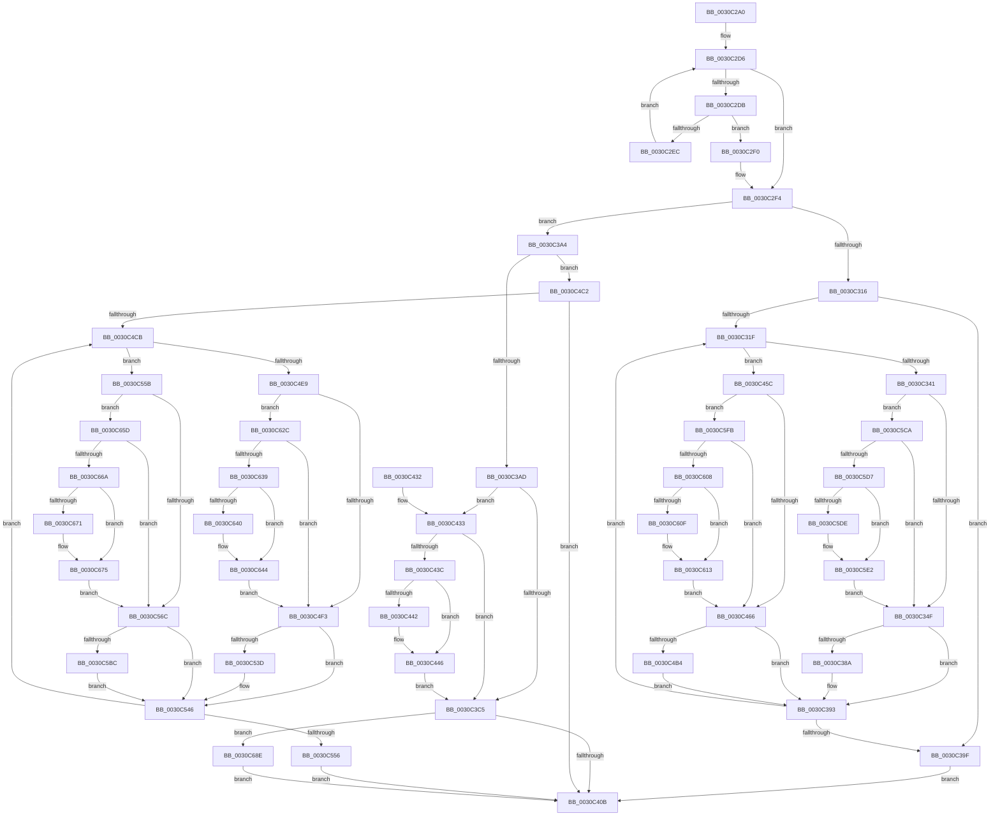

# KiScheduleThreadToRescheduleContext

- RVA: `0x0030C2A0`–`0x0030C69D` (길이 `1,021` bytes)
- VA: `0x000000014030C2A0`
- 실행 섹션: `.text`
- PDB 이름 있음: `예`; PDB Function 태그: `아니요`
- unwind 정보 RVA: `0x00073D24`
- 디코드: `277`개 명령, `1,021/1,021` bytes 표시
- 미해석 바이트: `0` (있으면 어셈블리에 `.byte`로 보존)

> 이 문서는 커널 이미지의 기계어와 PDB 기호를 분석해 생성했습니다. 4번과 5번은 함수 원형과 자료형을 바이너리 사용 방식에서 추정한 C 해석이며 원본 소스 복구 결과는 아닙니다.

## 1. Dependencies

- 직접 호출 지점: **13**; 고유 호출 대상: **2**
- 직접 호출자로 확인된 함수: **4**
- RIP 상대 이미지 참조: **1**

### Outgoing calls
- `0x0030C381` → [KiIsPrcbThread](../35/KiIsPrcbThread_function_00353230.md) (function, `0x00353230`)
- `0x0030C452` → [KiInsertDeferredReadyList](../20/KiInsertDeferredReadyList_function_00201310.md) (function, `0x00201310`)
- `0x0030C4A7` → [KiIsPrcbThread](../35/KiIsPrcbThread_function_00353230.md) (function, `0x00353230`)
- `0x0030C534` → [KiIsPrcbThread](../35/KiIsPrcbThread_function_00353230.md) (function, `0x00353230`)
- `0x0030C5B3` → [KiIsPrcbThread](../35/KiIsPrcbThread_function_00353230.md) (function, `0x00353230`)
- `0x0030C5CA` → [KiIsPrcbThread](../35/KiIsPrcbThread_function_00353230.md) (function, `0x00353230`)
- `0x0030C5F1` → [KiInsertDeferredReadyList](../20/KiInsertDeferredReadyList_function_00201310.md) (function, `0x00201310`)
- `0x0030C5FB` → [KiIsPrcbThread](../35/KiIsPrcbThread_function_00353230.md) (function, `0x00353230`)
- `0x0030C622` → [KiInsertDeferredReadyList](../20/KiInsertDeferredReadyList_function_00201310.md) (function, `0x00201310`)
- `0x0030C62C` → [KiIsPrcbThread](../35/KiIsPrcbThread_function_00353230.md) (function, `0x00353230`)
- `0x0030C653` → [KiInsertDeferredReadyList](../20/KiInsertDeferredReadyList_function_00201310.md) (function, `0x00201310`)
- `0x0030C65D` → [KiIsPrcbThread](../35/KiIsPrcbThread_function_00353230.md) (function, `0x00353230`)
- `0x0030C684` → [KiInsertDeferredReadyList](../20/KiInsertDeferredReadyList_function_00201310.md) (function, `0x00201310`)

### Direct callers
- [sub_0021D7F8](../21/Unknown_function_0021D7F8.md) at `0x0021DEB7`
- [KiEnterLongDpcProcessing](KiEnterLongDpcProcessing_function_0030BE54.md) at `0x0030BFCB`
- [KiAttemptToStealStandbyThread](KiAttemptToStealStandbyThread_function_0030D790.md) at `0x0030DB02`
- [KiSearchForNewThreadsOnTarget](KiSearchForNewThreadsOnTarget_function_0030F500.md) at `0x00310072`
- [KiSearchForNewThreadsOnTarget](KiSearchForNewThreadsOnTarget_function_0030F500.md) at `0x0031044C`
- [KiSearchForNewThreadsOnTarget](KiSearchForNewThreadsOnTarget_function_0030F500.md) at `0x00310BEB`

### Static image references
- `0x0030C3B1` → RVA `0x00FCFF00` (`CACHEALI`; read)

## 2. Other-region calls and transfers

- 다른 실행 섹션으로 향하는 call: **0**
- 별도 외부 분기/꼬리 이동을 확인하지 못했습니다.

## 3. Assembly (complete function range)

```asm
0030C2A0  48 89 5C 24 10                  mov qword ptr [rsp + 0x10], rbx
0030C2A5  48 89 74 24 18                  mov qword ptr [rsp + 0x18], rsi
0030C2AA  48 89 7C 24 20                  mov qword ptr [rsp + 0x20], rdi
0030C2AF  41 54                           push r12
0030C2B1  41 55                           push r13
0030C2B3  41 57                           push r15
0030C2B5  48 83 EC 20                     sub rsp, 0x20
0030C2B9  44 0F B6 19                     movzx r11d, byte ptr [rcx]
0030C2BD  45 32 E4                        xor r12b, r12b
0030C2C0  45 33 FF                        xor r15d, r15d
0030C2C3  45 0F B6 E9                     movzx r13d, r9b
0030C2C7  41 8B FF                        mov edi, r15d
0030C2CA  41 8B C7                        mov eax, r15d
0030C2CD  49 8B D8                        mov rbx, r8
0030C2D0  48 8B F2                        mov rsi, rdx
0030C2D3  4C 8B D1                        mov r10, rcx
0030C2D6  41 3B C3                        cmp eax, r11d
0030C2D9  73 19                           jae 0x14030c2f4
0030C2DB  8B C8                           mov ecx, eax
0030C2DD  48 8D 14 89                     lea rdx, [rcx + rcx*4]
0030C2E1  49 39 5C D2 10                  cmp qword ptr [r10 + rdx*8 + 0x10], rbx
0030C2E6  49 8D 0C D2                     lea rcx, [r10 + rdx*8]
0030C2EA  74 04                           je 0x14030c2f0
0030C2EC  FF C0                           inc eax
0030C2EE  EB E6                           jmp 0x14030c2d6
0030C2F0  48 8D 79 10                     lea rdi, [rcx + 0x10]
0030C2F4  44 8B 4E 78                     mov r9d, dword ptr [rsi + 0x78]
0030C2F8  0F B6 47 20                     movzx eax, byte ptr [rdi + 0x20]
0030C2FC  41 D1 E9                        shr r9d, 1
0030C2FF  D1 E8                           shr eax, 1
0030C301  41 83 E1 01                     and r9d, 1
0030C305  83 E0 01                        and eax, 1
0030C308  48 89 6C 24 40                  mov qword ptr [rsp + 0x40], rbp
0030C30D  44 3B C8                        cmp r9d, eax
0030C310  0F 83 8E 00 00 00               jae 0x14030c3a4
0030C316  45 84 DB                        test r11b, r11b
0030C319  0F 84 80 00 00 00               je 0x14030c39f
0030C31F  41 8B C7                        mov eax, r15d
0030C322  48 8D 0C 80                     lea rcx, [rax + rax*4]
0030C326  49 8B 7C CA 10                  mov rdi, qword ptr [r10 + rcx*8 + 0x10]
0030C32B  4D 8D 1C CA                     lea r11, [r10 + rcx*8]
0030C32F  49 8B 4C CA 28                  mov rcx, qword ptr [r10 + rcx*8 + 0x28]
0030C334  48 8D 41 FF                     lea rax, [rcx - 1]
0030C338  48 3B FB                        cmp rdi, rbx
0030C33B  0F 84 1B 01 00 00               je 0x14030c45c
0030C341  48 8B 6F 18                     mov rbp, qword ptr [rdi + 0x18]
0030C345  48 83 F8 FC                     cmp rax, -4
0030C349  0F 86 7B 02 00 00               jbe 0x14030c5ca
0030C34F  41 0F B6 4B 30                  movzx ecx, byte ptr [r11 + 0x30]
0030C354  80 C9 01                        or cl, 1
0030C357  49 89 6B 20                     mov qword ptr [r11 + 0x20], rbp
0030C35B  41 88 4B 30                     mov byte ptr [r11 + 0x30], cl
0030C35F  80 E1 FD                        and cl, 0xfd
0030C362  8B 45 78                        mov eax, dword ptr [rbp + 0x78]
0030C365  41 80 63 31 FE                  and byte ptr [r11 + 0x31], 0xfe
0030C36A  D1 E8                           shr eax, 1
0030C36C  24 01                           and al, 1
0030C36E  49 89 6B 28                     mov qword ptr [r11 + 0x28], rbp
0030C372  02 C0                           add al, al
0030C374  32 C1                           xor al, cl
0030C376  48 8B CD                        mov rcx, rbp
0030C379  24 C7                           and al, 0xc7
0030C37B  0C 04                           or al, 4
0030C37D  41 88 43 30                     mov byte ptr [r11 + 0x30], al
0030C381  E8 AA 6E 04 00                  call 0x140353230
0030C386  84 C0                           test al, al
0030C388  75 09                           jne 0x14030c393
0030C38A  8B 47 24                        mov eax, dword ptr [rdi + 0x24]
0030C38D  89 85 18 02 00 00               mov dword ptr [rbp + 0x218], eax
0030C393  41 0F B6 02                     movzx eax, byte ptr [r10]
0030C397  41 FF C7                        inc r15d
0030C39A  44 3B F8                        cmp r15d, eax
0030C39D  72 80                           jb 0x14030c31f
0030C39F  41 B4 01                        mov r12b, 1
0030C3A2  EB 67                           jmp 0x14030c40b
0030C3A4  45 85 C9                        test r9d, r9d
0030C3A7  0F 85 15 01 00 00               jne 0x14030c4c2
0030C3AD  48 8B 57 18                     mov rdx, qword ptr [rdi + 0x18]
0030C3B1  48 8D 1D 48 3B CC 00            lea rbx, [rip + 0xcc3b48]
0030C3B8  4C 8B 1F                        mov r11, qword ptr [rdi]
0030C3BB  48 8D 42 FF                     lea rax, [rdx - 1]
0030C3BF  48 83 F8 FC                     cmp rax, -4
0030C3C3  76 6E                           jbe 0x14030c433
0030C3C5  0F B6 4F 20                     movzx ecx, byte ptr [rdi + 0x20]
0030C3C9  80 E1 FE                        and cl, 0xfe
0030C3CC  48 89 77 10                     mov qword ptr [rdi + 0x10], rsi
0030C3D0  88 4F 20                        mov byte ptr [rdi + 0x20], cl
0030C3D3  80 E1 FD                        and cl, 0xfd
0030C3D6  8B 46 78                        mov eax, dword ptr [rsi + 0x78]
0030C3D9  D1 E8                           shr eax, 1
0030C3DB  24 01                           and al, 1
0030C3DD  48 89 77 18                     mov qword ptr [rdi + 0x18], rsi
0030C3E1  02 C0                           add al, al
0030C3E3  32 C1                           xor al, cl
0030C3E5  24 C7                           and al, 0xc7
0030C3E7  0C 04                           or al, 4
0030C3E9  88 47 20                        mov byte ptr [rdi + 0x20], al
0030C3EC  0F B6 47 21                     movzx eax, byte ptr [rdi + 0x21]
0030C3F0  0F B6 C8                        movzx ecx, al
0030C3F3  41 32 CD                        xor cl, r13b
0030C3F6  80 E1 01                        and cl, 1
0030C3F9  32 C8                           xor cl, al
0030C3FB  88 4F 21                        mov byte ptr [rdi + 0x21], cl
0030C3FE  48 39 9E 20 02 00 00            cmp qword ptr [rsi + 0x220], rbx
0030C405  0F 85 83 02 00 00               jne 0x14030c68e
0030C40B  48 8B 6C 24 40                  mov rbp, qword ptr [rsp + 0x40]
0030C410  41 0F B6 C4                     movzx eax, r12b
0030C414  48 8B 5C 24 48                  mov rbx, qword ptr [rsp + 0x48]
0030C419  48 8B 74 24 50                  mov rsi, qword ptr [rsp + 0x50]
0030C41E  48 8B 7C 24 58                  mov rdi, qword ptr [rsp + 0x58]
0030C423  45 89 4A 04                     mov dword ptr [r10 + 4], r9d
0030C427  48 83 C4 20                     add rsp, 0x20
0030C42B  41 5F                           pop r15
0030C42D  41 5D                           pop r13
0030C42F  41 5C                           pop r12
0030C431  C3                              ret
0030C432  CC                              int3
0030C433  48 39 9A 20 02 00 00            cmp qword ptr [rdx + 0x220], rbx
0030C43A  74 89                           je 0x14030c3c5
0030C43C  F6 47 21 01                     test byte ptr [rdi + 0x21], 1
0030C440  74 04                           je 0x14030c446
0030C442  83 4A 74 02                     or dword ptr [rdx + 0x74], 2
0030C446  48 8B 4C 24 60                  mov rcx, qword ptr [rsp + 0x60]
0030C44B  C6 82 35 02 00 00 01            mov byte ptr [rdx + 0x235], 1
0030C452  E8 B9 4E EF FF                  call 0x140201310
0030C457  E9 69 FF FF FF                  jmp 0x14030c3c5
0030C45C  48 83 F8 FC                     cmp rax, -4
0030C460  0F 86 95 01 00 00               jbe 0x14030c5fb
0030C466  41 0F B6 4B 30                  movzx ecx, byte ptr [r11 + 0x30]
0030C46B  80 E1 FE                        and cl, 0xfe
0030C46E  49 89 73 20                     mov qword ptr [r11 + 0x20], rsi
0030C472  41 88 4B 30                     mov byte ptr [r11 + 0x30], cl
0030C476  80 E1 FD                        and cl, 0xfd
0030C479  8B 46 78                        mov eax, dword ptr [rsi + 0x78]
0030C47C  D1 E8                           shr eax, 1
0030C47E  24 01                           and al, 1
0030C480  49 89 73 28                     mov qword ptr [r11 + 0x28], rsi
0030C484  02 C0                           add al, al
0030C486  32 C1                           xor al, cl
0030C488  24 C7                           and al, 0xc7
0030C48A  0C 04                           or al, 4
0030C48C  41 88 43 30                     mov byte ptr [r11 + 0x30], al
0030C490  41 0F B6 43 31                  movzx eax, byte ptr [r11 + 0x31]
0030C495  0F B6 C8                        movzx ecx, al
0030C498  41 32 CD                        xor cl, r13b
0030C49B  80 E1 01                        and cl, 1
0030C49E  32 C8                           xor cl, al
0030C4A0  41 88 4B 31                     mov byte ptr [r11 + 0x31], cl
0030C4A4  48 8B CE                        mov rcx, rsi
0030C4A7  E8 84 6D 04 00                  call 0x140353230
0030C4AC  84 C0                           test al, al
0030C4AE  0F 85 DF FE FF FF               jne 0x14030c393
0030C4B4  8B 47 24                        mov eax, dword ptr [rdi + 0x24]
0030C4B7  89 86 18 02 00 00               mov dword ptr [rsi + 0x218], eax
0030C4BD  E9 D1 FE FF FF                  jmp 0x14030c393
0030C4C2  45 84 DB                        test r11b, r11b
0030C4C5  0F 84 40 FF FF FF               je 0x14030c40b
0030C4CB  41 8B C7                        mov eax, r15d
0030C4CE  48 8D 0C 80                     lea rcx, [rax + rax*4]
0030C4D2  49 8B 7C CA 10                  mov rdi, qword ptr [r10 + rcx*8 + 0x10]
0030C4D7  4D 8D 1C CA                     lea r11, [r10 + rcx*8]
0030C4DB  49 8B 4C CA 28                  mov rcx, qword ptr [r10 + rcx*8 + 0x28]
0030C4E0  48 8D 41 FF                     lea rax, [rcx - 1]
0030C4E4  48 3B FB                        cmp rdi, rbx
0030C4E7  75 72                           jne 0x14030c55b
0030C4E9  48 83 F8 FC                     cmp rax, -4
0030C4ED  0F 86 39 01 00 00               jbe 0x14030c62c
0030C4F3  41 0F B6 4B 30                  movzx ecx, byte ptr [r11 + 0x30]
0030C4F8  80 E1 FE                        and cl, 0xfe
0030C4FB  49 89 73 20                     mov qword ptr [r11 + 0x20], rsi
0030C4FF  41 88 4B 30                     mov byte ptr [r11 + 0x30], cl
0030C503  80 E1 FD                        and cl, 0xfd
0030C506  8B 46 78                        mov eax, dword ptr [rsi + 0x78]
0030C509  D1 E8                           shr eax, 1
0030C50B  24 01                           and al, 1
0030C50D  49 89 73 28                     mov qword ptr [r11 + 0x28], rsi
0030C511  02 C0                           add al, al
0030C513  32 C1                           xor al, cl
0030C515  24 C7                           and al, 0xc7
0030C517  0C 04                           or al, 4
0030C519  41 88 43 30                     mov byte ptr [r11 + 0x30], al
0030C51D  41 0F B6 43 31                  movzx eax, byte ptr [r11 + 0x31]
0030C522  0F B6 C8                        movzx ecx, al
0030C525  41 32 CD                        xor cl, r13b
0030C528  80 E1 01                        and cl, 1
0030C52B  32 C8                           xor cl, al
0030C52D  41 88 4B 31                     mov byte ptr [r11 + 0x31], cl
0030C531  48 8B CE                        mov rcx, rsi
0030C534  E8 F7 6C 04 00                  call 0x140353230
0030C539  84 C0                           test al, al
0030C53B  75 09                           jne 0x14030c546
0030C53D  8B 47 24                        mov eax, dword ptr [rdi + 0x24]
0030C540  89 86 18 02 00 00               mov dword ptr [rsi + 0x218], eax
0030C546  41 0F B6 0A                     movzx ecx, byte ptr [r10]
0030C54A  41 FF C7                        inc r15d
0030C54D  44 3B F9                        cmp r15d, ecx
0030C550  0F 82 75 FF FF FF               jb 0x14030c4cb
0030C556  E9 B0 FE FF FF                  jmp 0x14030c40b
0030C55B  48 8B AF 80 8E 00 00            mov rbp, qword ptr [rdi + 0x8e80]
0030C562  48 83 F8 FC                     cmp rax, -4
0030C566  0F 86 F1 00 00 00               jbe 0x14030c65d
0030C56C  41 0F B6 43 30                  movzx eax, byte ptr [r11 + 0x30]
0030C571  24 FE                           and al, 0xfe
0030C573  49 89 73 20                     mov qword ptr [r11 + 0x20], rsi
0030C577  41 88 43 30                     mov byte ptr [r11 + 0x30], al
0030C57B  24 FD                           and al, 0xfd
0030C57D  8B 4E 78                        mov ecx, dword ptr [rsi + 0x78]
0030C580  D1 E9                           shr ecx, 1
0030C582  80 E1 01                        and cl, 1
0030C585  02 C9                           add cl, cl
0030C587  32 C8                           xor cl, al
0030C589  80 E1 E7                        and cl, 0xe7
0030C58C  80 C9 04                        or cl, 4
0030C58F  0F B6 C1                        movzx eax, cl
0030C592  80 C9 20                        or cl, 0x20
0030C595  24 DF                           and al, 0xdf
0030C597  0F B6 C9                        movzx ecx, cl
0030C59A  0F B6 C0                        movzx eax, al
0030C59D  48 3B F5                        cmp rsi, rbp
0030C5A0  0F 44 C8                        cmove ecx, eax
0030C5A3  41 88 4B 30                     mov byte ptr [r11 + 0x30], cl
0030C5A7  48 8B CD                        mov rcx, rbp
0030C5AA  41 80 63 31 FE                  and byte ptr [r11 + 0x31], 0xfe
0030C5AF  49 89 6B 28                     mov qword ptr [r11 + 0x28], rbp
0030C5B3  E8 78 6C 04 00                  call 0x140353230
0030C5B8  84 C0                           test al, al
0030C5BA  75 8A                           jne 0x14030c546
0030C5BC  8B 4F 24                        mov ecx, dword ptr [rdi + 0x24]
0030C5BF  89 8D 18 02 00 00               mov dword ptr [rbp + 0x218], ecx
0030C5C5  E9 7C FF FF FF                  jmp 0x14030c546
0030C5CA  E8 61 6C 04 00                  call 0x140353230
0030C5CF  84 C0                           test al, al
0030C5D1  0F 85 78 FD FF FF               jne 0x14030c34f
0030C5D7  41 F6 43 31 01                  test byte ptr [r11 + 0x31], 1
0030C5DC  74 04                           je 0x14030c5e2
0030C5DE  83 49 74 02                     or dword ptr [rcx + 0x74], 2
0030C5E2  C6 81 35 02 00 00 01            mov byte ptr [rcx + 0x235], 1
0030C5E9  48 8B D1                        mov rdx, rcx
0030C5EC  48 8B 4C 24 60                  mov rcx, qword ptr [rsp + 0x60]
0030C5F1  E8 1A 4D EF FF                  call 0x140201310
0030C5F6  E9 54 FD FF FF                  jmp 0x14030c34f
0030C5FB  E8 30 6C 04 00                  call 0x140353230
0030C600  84 C0                           test al, al
0030C602  0F 85 5E FE FF FF               jne 0x14030c466
0030C608  41 F6 43 31 01                  test byte ptr [r11 + 0x31], 1
0030C60D  74 04                           je 0x14030c613
0030C60F  83 49 74 02                     or dword ptr [rcx + 0x74], 2
0030C613  C6 81 35 02 00 00 01            mov byte ptr [rcx + 0x235], 1
0030C61A  48 8B D1                        mov rdx, rcx
0030C61D  48 8B 4C 24 60                  mov rcx, qword ptr [rsp + 0x60]
0030C622  E8 E9 4C EF FF                  call 0x140201310
0030C627  E9 3A FE FF FF                  jmp 0x14030c466
0030C62C  E8 FF 6B 04 00                  call 0x140353230
0030C631  84 C0                           test al, al
0030C633  0F 85 BA FE FF FF               jne 0x14030c4f3
0030C639  41 F6 43 31 01                  test byte ptr [r11 + 0x31], 1
0030C63E  74 04                           je 0x14030c644
0030C640  83 49 74 02                     or dword ptr [rcx + 0x74], 2
0030C644  C6 81 35 02 00 00 01            mov byte ptr [rcx + 0x235], 1
0030C64B  48 8B D1                        mov rdx, rcx
0030C64E  48 8B 4C 24 60                  mov rcx, qword ptr [rsp + 0x60]
0030C653  E8 B8 4C EF FF                  call 0x140201310
0030C658  E9 96 FE FF FF                  jmp 0x14030c4f3
0030C65D  E8 CE 6B 04 00                  call 0x140353230
0030C662  84 C0                           test al, al
0030C664  0F 85 02 FF FF FF               jne 0x14030c56c
0030C66A  41 F6 43 31 01                  test byte ptr [r11 + 0x31], 1
0030C66F  74 04                           je 0x14030c675
0030C671  83 49 74 02                     or dword ptr [rcx + 0x74], 2
0030C675  C6 81 35 02 00 00 01            mov byte ptr [rcx + 0x235], 1
0030C67C  48 8B D1                        mov rdx, rcx
0030C67F  48 8B 4C 24 60                  mov rcx, qword ptr [rsp + 0x60]
0030C684  E8 87 4C EF FF                  call 0x140201310
0030C689  E9 DE FE FF FF                  jmp 0x14030c56c
0030C68E  41 8B 43 24                     mov eax, dword ptr [r11 + 0x24]
0030C692  89 86 18 02 00 00               mov dword ptr [rsi + 0x218], eax
0030C698  E9 6E FD FF FF                  jmp 0x14030c40b
```

## 4. C-style interpretation (structured pseudocode)

```c
__int64 __fastcall KiScheduleThreadToRescheduleContext(__int64 a1, __int64 a2, __int64 a3, unsigned __int8 a4, __int64 a5)
{
    __int64 result;
    __int64 v_r12;
    __int64 v_r15;
    __int64 v_rsp;
    unsigned __int64 v_stack_p10;
    unsigned __int64 v_stack_p18;
    unsigned __int64 v_stack_p20;
    unsigned __int64 v_stack_p8;

    v_stack_p10 = v_rbx;
    v_stack_p18 = v_rsi;
    v_stack_p20 = v_rdi;
    v_rsp = (v_rsp) - (32);
    v_r12 = 0;
    v_r15 = 0;
loc_0030C2D6:
    if (0 >= ((unsigned int)(*(unsigned __int8 *)(a1)))) goto loc_0030C2F4;
    if ((*(unsigned __int64 *)(a1 + 0 + 0 * 4 * 8 + 16)) == a3) goto loc_0030C2F0;
    result = (unsigned int)((0) + 1);
    goto loc_0030C2D6;
loc_0030C2F0:
loc_0030C2F4:
    a4 = (unsigned int)(((unsigned int)(*(unsigned int *)(a2 + 120))) >> (1));
    result = (unsigned int)((*(unsigned __int8 *)(a1 + 0 + 0 * 4 * 8 + 16 + 32)) >> (1));
    a4 = (unsigned int)((a4) & (1));
    result = (unsigned int)((result) & (1));
    v_stack_p8 = v_rbp;
    if (a4 >= ((unsigned int)(result))) goto loc_0030C3A4;
    if ((unsigned __int8)(*(unsigned __int8 *)(a1)) == 0) goto loc_0030C39F;
loc_0030C31F:
    if ((*(unsigned __int64 *)(a1 + 0 + 0 * 4 * 8 + 16)) == a3) goto loc_0030C45C;
    if ((*(unsigned __int64 *)(a1 + 0 + 0 * 4 * 8 + 40) - 1) <= -4) goto loc_0030C5CA;
loc_0030C34F:
    a1 = (unsigned __int8)((*(unsigned __int8 *)(a1 + 0 + 0 * 4 * 8 + 48)) | (1));
    *(unsigned __int64 *)(a1 + 0 + 0 * 4 * 8 + 32) = *(unsigned __int64 *)(*(unsigned __int64 *)(a1 + 0 + 0 * 4 * 8 + 16) + 24);
    *(unsigned __int8 *)(a1 + 0 + 0 * 4 * 8 + 48) = (unsigned __int8)(a1);
    a1 = (unsigned __int8)((a1) & (253));
    result = (unsigned int)(((unsigned int)(*(unsigned int *)(*(unsigned __int64 *)(*(unsigned __int64 *)(a1 + 0 + 0 * 4 * 8 + 16) + 24) + 120))) >> (1));
    result = (unsigned __int8)((result) & (1));
    *(unsigned __int64 *)(a1 + 0 + 0 * 4 * 8 + 40) = *(unsigned __int64 *)(*(unsigned __int64 *)(a1 + 0 + 0 * 4 * 8 + 16) + 24);
    result = (unsigned __int8)((result) + ((unsigned __int8)(result)));
    result = (unsigned __int8)((result) ^ ((unsigned __int8)(a1)));
    result = (unsigned __int8)((result) & (199));
    result = (unsigned __int8)((result) | (4));
    *(unsigned __int8 *)(a1 + 0 + 0 * 4 * 8 + 48) = (unsigned __int8)(result);
    result = KiIsPrcbThread(*(unsigned __int64 *)(*(unsigned __int64 *)(a1 + 0 + 0 * 4 * 8 + 16) + 24), 0 + 0 * 4, a3, a4);
    if ((unsigned __int8)(result) == 0) {
        result = *(unsigned int *)(*(unsigned __int64 *)(a1 + 0 + 0 * 4 * 8 + 16) + 36);
        *(unsigned int *)(*(unsigned __int64 *)(*(unsigned __int64 *)(a1 + 0 + 0 * 4 * 8 + 16) + 24) + 536) = (unsigned int)(result);
    }
    v_r15 = (unsigned int)((v_r15) + 1);
    if (((unsigned int)(v_r15)) < ((unsigned int)(*(unsigned __int8 *)(a1)))) goto loc_0030C31F;
loc_0030C39F:
    goto loc_0030C40B;
loc_0030C3A4:
    if (a4 != 0) goto loc_0030C4C2;
    if ((*(unsigned __int64 *)(*(unsigned __int64 *)(a1 + 0 + 0 * 4 * 8 + 16) + 24) - 1) <= -4) goto loc_0030C433;
loc_0030C3C5:
    a1 = (unsigned __int8)((*(unsigned __int8 *)(*(unsigned __int64 *)(a1 + 0 + 0 * 4 * 8 + 16) + 32)) & (254));
    *(unsigned __int64 *)(*(unsigned __int64 *)(a1 + 0 + 0 * 4 * 8 + 16) + 16) = a2;
    *(unsigned __int8 *)(*(unsigned __int64 *)(a1 + 0 + 0 * 4 * 8 + 16) + 32) = (unsigned __int8)(a1);
    a1 = (unsigned __int8)((a1) & (253));
    result = (unsigned int)(((unsigned int)(*(unsigned int *)(a2 + 120))) >> (1));
    result = (unsigned __int8)((result) & (1));
    *(unsigned __int64 *)(*(unsigned __int64 *)(a1 + 0 + 0 * 4 * 8 + 16) + 24) = a2;
    result = (unsigned __int8)((result) + ((unsigned __int8)(result)));
    result = (unsigned __int8)((result) ^ ((unsigned __int8)(a1)));
    result = (unsigned __int8)((result) & (199));
    result = (unsigned __int8)((result) | (4));
    *(unsigned __int8 *)(*(unsigned __int64 *)(a1 + 0 + 0 * 4 * 8 + 16) + 32) = (unsigned __int8)(result);
    a1 = (unsigned __int8)(((unsigned __int8)(*(unsigned __int8 *)(*(unsigned __int64 *)(a1 + 0 + 0 * 4 * 8 + 16) + 33))) ^ (a4));
    a1 = (unsigned __int8)((a1) & (1));
    a1 = (unsigned __int8)((a1) ^ ((unsigned __int8)(*(unsigned __int8 *)(*(unsigned __int64 *)(a1 + 0 + 0 * 4 * 8 + 16) + 33))));
    *(unsigned __int8 *)(*(unsigned __int64 *)(a1 + 0 + 0 * 4 * 8 + 16) + 33) = (unsigned __int8)(a1);
    if ((*(unsigned __int64 *)(a2 + 544)) != (v_rip + 13384520)) goto loc_0030C68E;
loc_0030C40B:
    *(unsigned int *)(a1 + 4) = a4;
    v_rsp = (v_rsp) + (32);
    return 1;
loc_0030C433:
    if ((*(unsigned __int64 *)(*(unsigned __int64 *)(*(unsigned __int64 *)(a1 + 0 + 0 * 4 * 8 + 16) + 24) + 544)) == v_stack_p10) goto loc_0030C3C5;
    if (((*(unsigned __int8 *)(v_stack_p20 + 33)) & (1)) != 0) {
    }
    *(unsigned __int8 *)(*(unsigned __int64 *)(*(unsigned __int64 *)(a1 + 0 + 0 * 4 * 8 + 16) + 24) + 565) = 1;
    result = KiInsertDeferredReadyList(a5, *(unsigned __int64 *)(*(unsigned __int64 *)(a1 + 0 + 0 * 4 * 8 + 16) + 24), a3, a4);
    goto loc_0030C3C5;
loc_0030C45C:
    if (result <= -4) goto loc_0030C5FB;
loc_0030C466:
    a1 = (unsigned __int8)((*(unsigned __int8 *)(*(unsigned __int64 *)(*(unsigned __int64 *)(a1 + 0 + 0 * 4 * 8 + 16)) + 48)) & (254));
    *(unsigned __int64 *)(*(unsigned __int64 *)(*(unsigned __int64 *)(a1 + 0 + 0 * 4 * 8 + 16)) + 32) = v_stack_p18;
    *(unsigned __int8 *)(*(unsigned __int64 *)(*(unsigned __int64 *)(a1 + 0 + 0 * 4 * 8 + 16)) + 48) = (unsigned __int8)(a1);
    a1 = (unsigned __int8)((a1) & (253));
    result = (unsigned int)(((unsigned int)(*(unsigned int *)(v_stack_p18 + 120))) >> (1));
    result = (unsigned __int8)((result) & (1));
    *(unsigned __int64 *)(*(unsigned __int64 *)(*(unsigned __int64 *)(a1 + 0 + 0 * 4 * 8 + 16)) + 40) = v_stack_p18;
    result = (unsigned __int8)((result) + ((unsigned __int8)(result)));
    result = (unsigned __int8)((result) ^ ((unsigned __int8)(a1)));
    result = (unsigned __int8)((result) & (199));
    result = (unsigned __int8)((result) | (4));
    *(unsigned __int8 *)(*(unsigned __int64 *)(*(unsigned __int64 *)(a1 + 0 + 0 * 4 * 8 + 16)) + 48) = (unsigned __int8)(result);
    a1 = (unsigned __int8)(((unsigned __int8)(*(unsigned __int8 *)(*(unsigned __int64 *)(*(unsigned __int64 *)(a1 + 0 + 0 * 4 * 8 + 16)) + 49))) ^ (a4));
    a1 = (unsigned __int8)((a1) & (1));
    a1 = (unsigned __int8)((a1) ^ ((unsigned __int8)(*(unsigned __int8 *)(*(unsigned __int64 *)(*(unsigned __int64 *)(a1 + 0 + 0 * 4 * 8 + 16)) + 49))));
    *(unsigned __int8 *)(*(unsigned __int64 *)(*(unsigned __int64 *)(a1 + 0 + 0 * 4 * 8 + 16)) + 49) = (unsigned __int8)(a1);
    result = KiIsPrcbThread(v_stack_p18, *(unsigned __int64 *)(*(unsigned __int64 *)(a1 + 0 + 0 * 4 * 8 + 16) + 24), a3, a4);
    if ((unsigned __int8)(result) != 0) goto loc_0030C393;
    *(unsigned int *)(v_stack_p18 + 536) = (unsigned int)((unsigned int)(*(unsigned int *)(v_stack_p20 + 36)));
    goto loc_0030C393;
loc_0030C4C2:
    if ((unsigned __int8)(*(unsigned __int64 *)(*(unsigned __int64 *)(a1 + 0 + 0 * 4 * 8 + 16))) == 0) goto loc_0030C40B;
loc_0030C4CB:
    if ((*(unsigned __int64 *)(a1 + (unsigned int)((unsigned int)(v_r15)) + (unsigned int)((unsigned int)(v_r15)) * 4 * 8 + 16)) != v_stack_p10) goto loc_0030C55B;
    if ((*(unsigned __int64 *)(a1 + (unsigned int)((unsigned int)(v_r15)) + (unsigned int)((unsigned int)(v_r15)) * 4 * 8 + 40) - 1) <= -4) goto loc_0030C62C;
loc_0030C4F3:
    a1 = (unsigned __int8)((*(unsigned __int8 *)(a1 + (unsigned int)((unsigned int)(v_r15)) + (unsigned int)((unsigned int)(v_r15)) * 4 * 8 + 48)) & (254));
    *(unsigned __int64 *)(a1 + (unsigned int)((unsigned int)(v_r15)) + (unsigned int)((unsigned int)(v_r15)) * 4 * 8 + 32) = v_stack_p18;
    *(unsigned __int8 *)(a1 + (unsigned int)((unsigned int)(v_r15)) + (unsigned int)((unsigned int)(v_r15)) * 4 * 8 + 48) = (unsigned __int8)(a1);
    a1 = (unsigned __int8)((a1) & (253));
    result = (unsigned int)(((unsigned int)(*(unsigned int *)(v_stack_p18 + 120))) >> (1));
    result = (unsigned __int8)((result) & (1));
    *(unsigned __int64 *)(a1 + (unsigned int)((unsigned int)(v_r15)) + (unsigned int)((unsigned int)(v_r15)) * 4 * 8 + 40) = v_stack_p18;
    result = (unsigned __int8)((result) + ((unsigned __int8)(result)));
    result = (unsigned __int8)((result) ^ ((unsigned __int8)(a1)));
    result = (unsigned __int8)((result) & (199));
    result = (unsigned __int8)((result) | (4));
    *(unsigned __int8 *)(a1 + (unsigned int)((unsigned int)(v_r15)) + (unsigned int)((unsigned int)(v_r15)) * 4 * 8 + 48) = (unsigned __int8)(result);
    a1 = (unsigned __int8)(((unsigned __int8)(*(unsigned __int8 *)(a1 + (unsigned int)((unsigned int)(v_r15)) + (unsigned int)((unsigned int)(v_r15)) * 4 * 8 + 49))) ^ (a4));
    a1 = (unsigned __int8)((a1) & (1));
    a1 = (unsigned __int8)((a1) ^ ((unsigned __int8)(*(unsigned __int8 *)(a1 + (unsigned int)((unsigned int)(v_r15)) + (unsigned int)((unsigned int)(v_r15)) * 4 * 8 + 49))));
    *(unsigned __int8 *)(a1 + (unsigned int)((unsigned int)(v_r15)) + (unsigned int)((unsigned int)(v_r15)) * 4 * 8 + 49) = (unsigned __int8)(a1);
    result = KiIsPrcbThread(v_stack_p18, *(unsigned __int64 *)(*(unsigned __int64 *)(a1 + 0 + 0 * 4 * 8 + 16) + 24), a3, a4);
    if ((unsigned __int8)(result) == 0) {
        result = *(unsigned int *)(*(unsigned __int64 *)(a1 + (unsigned int)((unsigned int)(v_r15)) + (unsigned int)((unsigned int)(v_r15)) * 4 * 8 + 16) + 36);
        *(unsigned int *)(v_stack_p18 + 536) = (unsigned int)(result);
    }
    v_r15 = (unsigned int)((v_r15) + 1);
    if (((unsigned int)(v_r15)) < ((unsigned int)(*(unsigned __int8 *)(a1)))) goto loc_0030C4CB;
    goto loc_0030C40B;
loc_0030C55B:
    if (result <= -4) goto loc_0030C65D;
loc_0030C56C:
    result = (unsigned __int8)((*(unsigned __int8 *)(a1 + (unsigned int)((unsigned int)(v_r15)) + (unsigned int)((unsigned int)(v_r15)) * 4 * 8 + 48)) & (254));
    *(unsigned __int64 *)(a1 + (unsigned int)((unsigned int)(v_r15)) + (unsigned int)((unsigned int)(v_r15)) * 4 * 8 + 32) = v_stack_p18;
    *(unsigned __int8 *)(a1 + (unsigned int)((unsigned int)(v_r15)) + (unsigned int)((unsigned int)(v_r15)) * 4 * 8 + 48) = (unsigned __int8)(result);
    result = (unsigned __int8)((result) & (253));
    a1 = (unsigned int)(((unsigned int)(*(unsigned int *)(v_stack_p18 + 120))) >> (1));
    a1 = (unsigned __int8)((a1) & (1));
    a1 = (unsigned __int8)((a1) + ((unsigned __int8)(a1)));
    a1 = (unsigned __int8)((a1) ^ ((unsigned __int8)(result)));
    a1 = (unsigned __int8)((a1) & (231));
    a1 = (unsigned __int8)((a1) | (4));
    a1 = (unsigned __int8)((a1) | (32));
    result = (unsigned __int8)(((unsigned __int8)(a1)) & (223));
    a1 = (unsigned __int8)(a1);
    if (v_stack_p18 == (*(unsigned __int64 *)(*(unsigned __int64 *)(a1 + (unsigned int)((unsigned int)(v_r15)) + (unsigned int)((unsigned int)(v_r15)) * 4 * 8 + 16) + 36480))) { a1 = (unsigned int)((unsigned __int8)(result)); }
    *(unsigned __int8 *)(a1 + (unsigned int)((unsigned int)(v_r15)) + (unsigned int)((unsigned int)(v_r15)) * 4 * 8 + 48) = (unsigned __int8)(a1);
    *(unsigned __int64 *)(a1 + (unsigned int)((unsigned int)(v_r15)) + (unsigned int)((unsigned int)(v_r15)) * 4 * 8 + 40) = *(unsigned __int64 *)(*(unsigned __int64 *)(a1 + (unsigned int)((unsigned int)(v_r15)) + (unsigned int)((unsigned int)(v_r15)) * 4 * 8 + 16) + 36480);
    result = KiIsPrcbThread(*(unsigned __int64 *)(*(unsigned __int64 *)(a1 + (unsigned int)((unsigned int)(v_r15)) + (unsigned int)((unsigned int)(v_r15)) * 4 * 8 + 16) + 36480), *(unsigned __int64 *)(*(unsigned __int64 *)(a1 + 0 + 0 * 4 * 8 + 16) + 24), a3, a4);
    if ((unsigned __int8)(result) != 0) goto loc_0030C546;
    *(unsigned int *)(*(unsigned __int64 *)(*(unsigned __int64 *)(a1 + (unsigned int)((unsigned int)(v_r15)) + (unsigned int)((unsigned int)(v_r15)) * 4 * 8 + 16) + 36480) + 536) = (unsigned int)((unsigned int)(*(unsigned int *)(*(unsigned __int64 *)(a1 + (unsigned int)((unsigned int)(v_r15)) + (unsigned int)((unsigned int)(v_r15)) * 4 * 8 + 16) + 36)));
    goto loc_0030C546;
loc_0030C5CA:
    result = KiIsPrcbThread((unsigned int)(*(unsigned int *)(*(unsigned __int64 *)(a1 + (unsigned int)((unsigned int)(v_r15)) + (unsigned int)((unsigned int)(v_r15)) * 4 * 8 + 16) + 36)), *(unsigned __int64 *)(*(unsigned __int64 *)(a1 + 0 + 0 * 4 * 8 + 16) + 24), a3, a4);
    if ((unsigned __int8)(result) != 0) goto loc_0030C34F;
    if (((*(unsigned __int8 *)(a1 + (unsigned int)((unsigned int)(v_r15)) + (unsigned int)((unsigned int)(v_r15)) * 4 * 8 + 49)) & (1)) != 0) {
    }
    *(unsigned __int8 *)((unsigned int)(*(unsigned int *)(*(unsigned __int64 *)(a1 + (unsigned int)((unsigned int)(v_r15)) + (unsigned int)((unsigned int)(v_r15)) * 4 * 8 + 16) + 36)) + 565) = 1;
    result = KiInsertDeferredReadyList(a5, (unsigned int)(*(unsigned int *)(*(unsigned __int64 *)(a1 + (unsigned int)((unsigned int)(v_r15)) + (unsigned int)((unsigned int)(v_r15)) * 4 * 8 + 16) + 36)), a3, a4);
    goto loc_0030C34F;
loc_0030C5FB:
    result = KiIsPrcbThread(a5, (unsigned int)(*(unsigned int *)(*(unsigned __int64 *)(a1 + (unsigned int)((unsigned int)(v_r15)) + (unsigned int)((unsigned int)(v_r15)) * 4 * 8 + 16) + 36)), a3, a4);
    if ((unsigned __int8)(result) != 0) goto loc_0030C466;
    if (((*(unsigned __int8 *)(a1 + (unsigned int)((unsigned int)(v_r15)) + (unsigned int)((unsigned int)(v_r15)) * 4 * 8 + 49)) & (1)) != 0) {
    }
    *(unsigned __int8 *)(a5 + 565) = 1;
    result = KiInsertDeferredReadyList(a5, a5, a3, a4);
    goto loc_0030C466;
loc_0030C62C:
    result = KiIsPrcbThread(a5, a5, a3, a4);
    if ((unsigned __int8)(result) != 0) goto loc_0030C4F3;
    if (((*(unsigned __int8 *)(a1 + (unsigned int)((unsigned int)(v_r15)) + (unsigned int)((unsigned int)(v_r15)) * 4 * 8 + 49)) & (1)) != 0) {
    }
    *(unsigned __int8 *)(a5 + 565) = 1;
    result = KiInsertDeferredReadyList(a5, a5, a3, a4);
    goto loc_0030C4F3;
loc_0030C65D:
    result = KiIsPrcbThread(a5, a5, a3, a4);
    if ((unsigned __int8)(result) != 0) goto loc_0030C56C;
    if (((*(unsigned __int8 *)(a1 + (unsigned int)((unsigned int)(v_r15)) + (unsigned int)((unsigned int)(v_r15)) * 4 * 8 + 49)) & (1)) != 0) {
    }
    *(unsigned __int8 *)(a5 + 565) = 1;
    result = KiInsertDeferredReadyList(a5, a5, a3, a4);
    goto loc_0030C56C;
loc_0030C68E:
    *(unsigned int *)(v_stack_p18 + 536) = (unsigned int)((unsigned int)(*(unsigned int *)(a1 + (unsigned int)((unsigned int)(v_r15)) + (unsigned int)((unsigned int)(v_r15)) * 4 * 8 + 36)));
    goto loc_0030C40B;
}
```

## 5. (Beta) C Style

```c
int64_t KiScheduleThreadToRescheduleContext(void *Arg1, void *Arg2, int64_t Arg3, uint8_t Arg4, int64_t Arg5)
{
    uint8_t *arg1 = (uint8_t *)Arg1;
    uint8_t *arg2 = (uint8_t *)Arg2;

    int64_t result;
    int64_t local_r12;
    int64_t local_r15;
    int64_t local_rsp;
    uint64_t v_stack_p10;
    uint64_t v_stack_p18;
    uint64_t v_stack_p20;
    uint64_t v_stack_p8;

    v_stack_p10 = local_rbx;
    v_stack_p18 = local_rsi;
    v_stack_p20 = local_rdi;
    local_rsp = (local_rsp) - (32);
    local_r12 = 0;
    local_r15 = 0;
loc_0030C2D6:
    if (0 >= ((uint32_t)(*(uint8_t *)(arg1)))) goto loc_0030C2F4;
    if ((*(uint64_t *)(arg1 + 0x0 + 0x0 * 4 * 8 + 0x10)) == Arg3) goto loc_0030C2F0;
    result = (uint32_t)((0) + 1);
    goto loc_0030C2D6;
loc_0030C2F0:
loc_0030C2F4:
    Arg4 = (uint32_t)(((uint32_t)(*(uint32_t *)(arg2 + 0x78))) >> (1));
    result = (uint32_t)((*(uint8_t *)(arg1 + 0x0 + 0x0 * 4 * 8 + 0x10 + 0x20)) >> (1));
    Arg4 = (uint32_t)((Arg4) & (1));
    result = (uint32_t)((result) & (1));
    v_stack_p8 = local_rbp;
    if (Arg4 >= ((uint32_t)(result))) goto loc_0030C3A4;
    if ((uint8_t)(*(uint8_t *)(arg1)) == 0) goto loc_0030C39F;
loc_0030C31F:
    if ((*(uint64_t *)(arg1 + 0x0 + 0x0 * 4 * 8 + 0x10)) == Arg3) goto loc_0030C45C;
    if ((*(uint64_t *)(arg1 + 0x0 + 0x0 * 4 * 8 + 0x28) - 1) <= -4) goto loc_0030C5CA;
loc_0030C34F:
    Arg1 = (uint8_t)((*(uint8_t *)(arg1 + 0x0 + 0x0 * 4 * 8 + 0x30)) | (1));
    *(uint64_t *)(arg1 + 0x0 + 0x0 * 4 * 8 + 0x20) = *(uint64_t *)(*(uint64_t *)(arg1 + 0x0 + 0x0 * 4 * 8 + 0x10) + 0x18);
    *(uint8_t *)(arg1 + 0x0 + 0x0 * 4 * 8 + 0x30) = (uint8_t)(Arg1);
    Arg1 = (uint8_t)((Arg1) & (253));
    result = (uint32_t)(((uint32_t)(*(uint32_t *)(*(uint64_t *)(*(uint64_t *)(arg1 + 0x0 + 0x0 * 4 * 8 + 0x10) + 0x18) + 0x78))) >> (1));
    result = (uint8_t)((result) & (1));
    *(uint64_t *)(arg1 + 0x0 + 0x0 * 4 * 8 + 0x28) = *(uint64_t *)(*(uint64_t *)(arg1 + 0x0 + 0x0 * 4 * 8 + 0x10) + 0x18);
    result = (uint8_t)((result) + ((uint8_t)(result)));
    result = (uint8_t)((result) ^ ((uint8_t)(Arg1)));
    result = (uint8_t)((result) & (199));
    result = (uint8_t)((result) | (4));
    *(uint8_t *)(arg1 + 0x0 + 0x0 * 4 * 8 + 0x30) = (uint8_t)(result);
    result = KiIsPrcbThread(*(uint64_t *)(*(uint64_t *)(arg1 + 0x0 + 0x0 * 4 * 8 + 0x10) + 0x18), 0 + 0 * 4, Arg3, Arg4);
    if ((uint8_t)(result) == 0) {
        result = *(uint32_t *)(*(uint64_t *)(arg1 + 0x0 + 0x0 * 4 * 8 + 0x10) + 0x24);
        *(uint32_t *)(*(uint64_t *)(*(uint64_t *)(arg1 + 0x0 + 0x0 * 4 * 8 + 0x10) + 0x18) + 0x218) = (uint32_t)(result);
    }
    local_r15 = (uint32_t)((local_r15) + 1);
    if (((uint32_t)(local_r15)) < ((uint32_t)(*(uint8_t *)(arg1)))) goto loc_0030C31F;
loc_0030C39F:
    goto loc_0030C40B;
loc_0030C3A4:
    if (Arg4 != 0) goto loc_0030C4C2;
    if ((*(uint64_t *)(*(uint64_t *)(arg1 + 0x0 + 0x0 * 4 * 8 + 0x10) + 0x18) - 1) <= -4) goto loc_0030C433;
loc_0030C3C5:
    Arg1 = (uint8_t)((*(uint8_t *)(*(uint64_t *)(arg1 + 0x0 + 0x0 * 4 * 8 + 0x10) + 0x20)) & (254));
    *(void **)(*(uint64_t *)(arg1 + 0x0 + 0x0 * 4 * 8 + 0x10) + 0x10) = Arg2;
    *(uint8_t *)(*(uint64_t *)(arg1 + 0x0 + 0x0 * 4 * 8 + 0x10) + 0x20) = (uint8_t)(Arg1);
    Arg1 = (uint8_t)((Arg1) & (253));
    result = (uint32_t)(((uint32_t)(*(uint32_t *)(arg2 + 0x78))) >> (1));
    result = (uint8_t)((result) & (1));
    *(void **)(*(uint64_t *)(arg1 + 0x0 + 0x0 * 4 * 8 + 0x10) + 0x18) = Arg2;
    result = (uint8_t)((result) + ((uint8_t)(result)));
    result = (uint8_t)((result) ^ ((uint8_t)(Arg1)));
    result = (uint8_t)((result) & (199));
    result = (uint8_t)((result) | (4));
    *(uint8_t *)(*(uint64_t *)(arg1 + 0x0 + 0x0 * 4 * 8 + 0x10) + 0x20) = (uint8_t)(result);
    Arg1 = (uint8_t)(((uint8_t)(*(uint8_t *)(*(uint64_t *)(arg1 + 0x0 + 0x0 * 4 * 8 + 0x10) + 0x21))) ^ (Arg4));
    Arg1 = (uint8_t)((Arg1) & (1));
    Arg1 = (uint8_t)((Arg1) ^ ((uint8_t)(*(uint8_t *)(*(uint64_t *)(arg1 + 0x0 + 0x0 * 4 * 8 + 0x10) + 0x21))));
    *(uint8_t *)(*(uint64_t *)(arg1 + 0x0 + 0x0 * 4 * 8 + 0x10) + 0x21) = (uint8_t)(Arg1);
    if ((*(uint64_t *)(arg2 + 0x220)) != (v_rip + 13384520)) goto loc_0030C68E;
loc_0030C40B:
    *(uint32_t *)(arg1 + 0x4) = Arg4;
    local_rsp = (local_rsp) + (32);
    return 1;
loc_0030C433:
    if ((*(uint64_t *)(*(uint64_t *)(*(uint64_t *)(arg1 + 0x0 + 0x0 * 4 * 8 + 0x10) + 0x18) + 0x220)) == v_stack_p10) goto loc_0030C3C5;
    if (((*(uint8_t *)(v_stack_p20 + 0x21)) & (1)) != 0) {
    }
    *(uint8_t *)(*(uint64_t *)(*(uint64_t *)(arg1 + 0x0 + 0x0 * 4 * 8 + 0x10) + 0x18) + 0x235) = 1;
    result = KiInsertDeferredReadyList(Arg5, *(uint64_t *)(*(uint64_t *)(arg1 + 0x0 + 0x0 * 4 * 8 + 0x10) + 0x18), Arg3, Arg4);
    goto loc_0030C3C5;
loc_0030C45C:
    if (result <= -4) goto loc_0030C5FB;
loc_0030C466:
    Arg1 = (uint8_t)((*(uint8_t *)(*(uint64_t *)(*(uint64_t *)(arg1 + 0x0 + 0x0 * 4 * 8 + 0x10)) + 0x30)) & (254));
    *(uint64_t *)(*(uint64_t *)(*(uint64_t *)(arg1 + 0x0 + 0x0 * 4 * 8 + 0x10)) + 0x20) = v_stack_p18;
    *(uint8_t *)(*(uint64_t *)(*(uint64_t *)(arg1 + 0x0 + 0x0 * 4 * 8 + 0x10)) + 0x30) = (uint8_t)(Arg1);
    Arg1 = (uint8_t)((Arg1) & (253));
    result = (uint32_t)(((uint32_t)(*(uint32_t *)(v_stack_p18 + 0x78))) >> (1));
    result = (uint8_t)((result) & (1));
    *(uint64_t *)(*(uint64_t *)(*(uint64_t *)(arg1 + 0x0 + 0x0 * 4 * 8 + 0x10)) + 0x28) = v_stack_p18;
    result = (uint8_t)((result) + ((uint8_t)(result)));
    result = (uint8_t)((result) ^ ((uint8_t)(Arg1)));
    result = (uint8_t)((result) & (199));
    result = (uint8_t)((result) | (4));
    *(uint8_t *)(*(uint64_t *)(*(uint64_t *)(arg1 + 0x0 + 0x0 * 4 * 8 + 0x10)) + 0x30) = (uint8_t)(result);
    Arg1 = (uint8_t)(((uint8_t)(*(uint8_t *)(*(uint64_t *)(*(uint64_t *)(arg1 + 0x0 + 0x0 * 4 * 8 + 0x10)) + 0x31))) ^ (Arg4));
    Arg1 = (uint8_t)((Arg1) & (1));
    Arg1 = (uint8_t)((Arg1) ^ ((uint8_t)(*(uint8_t *)(*(uint64_t *)(*(uint64_t *)(arg1 + 0x0 + 0x0 * 4 * 8 + 0x10)) + 0x31))));
    *(uint8_t *)(*(uint64_t *)(*(uint64_t *)(arg1 + 0x0 + 0x0 * 4 * 8 + 0x10)) + 0x31) = (uint8_t)(Arg1);
    result = KiIsPrcbThread(v_stack_p18, *(uint64_t *)(*(uint64_t *)(arg1 + 0x0 + 0x0 * 4 * 8 + 0x10) + 0x18), Arg3, Arg4);
    if ((uint8_t)(result) != 0) goto loc_0030C393;
    *(uint32_t *)(v_stack_p18 + 0x218) = (uint32_t)((uint32_t)(*(uint32_t *)(v_stack_p20 + 0x24)));
    goto loc_0030C393;
loc_0030C4C2:
    if ((uint8_t)(*(uint64_t *)(*(uint64_t *)(arg1 + 0x0 + 0x0 * 4 * 8 + 0x10))) == 0) goto loc_0030C40B;
loc_0030C4CB:
    if ((*(uint64_t *)(arg1 + (uint32_t)((uint32_t)(local_r15)) + (uint32_t)((uint32_t)(local_r15)) * 4 * 8 + 0x10)) != v_stack_p10) goto loc_0030C55B;
    if ((*(uint64_t *)(arg1 + (uint32_t)((uint32_t)(local_r15)) + (uint32_t)((uint32_t)(local_r15)) * 4 * 8 + 0x28) - 1) <= -4) goto loc_0030C62C;
loc_0030C4F3:
    Arg1 = (uint8_t)((*(uint8_t *)(arg1 + (uint32_t)((uint32_t)(local_r15)) + (uint32_t)((uint32_t)(local_r15)) * 4 * 8 + 0x30)) & (254));
    *(uint64_t *)(arg1 + (uint32_t)((uint32_t)(local_r15)) + (uint32_t)((uint32_t)(local_r15)) * 4 * 8 + 0x20) = v_stack_p18;
    *(uint8_t *)(arg1 + (uint32_t)((uint32_t)(local_r15)) + (uint32_t)((uint32_t)(local_r15)) * 4 * 8 + 0x30) = (uint8_t)(Arg1);
    Arg1 = (uint8_t)((Arg1) & (253));
    result = (uint32_t)(((uint32_t)(*(uint32_t *)(v_stack_p18 + 0x78))) >> (1));
    result = (uint8_t)((result) & (1));
    *(uint64_t *)(arg1 + (uint32_t)((uint32_t)(local_r15)) + (uint32_t)((uint32_t)(local_r15)) * 4 * 8 + 0x28) = v_stack_p18;
    result = (uint8_t)((result) + ((uint8_t)(result)));
    result = (uint8_t)((result) ^ ((uint8_t)(Arg1)));
    result = (uint8_t)((result) & (199));
    result = (uint8_t)((result) | (4));
    *(uint8_t *)(arg1 + (uint32_t)((uint32_t)(local_r15)) + (uint32_t)((uint32_t)(local_r15)) * 4 * 8 + 0x30) = (uint8_t)(result);
    Arg1 = (uint8_t)(((uint8_t)(*(uint8_t *)(arg1 + (uint32_t)((uint32_t)(local_r15)) + (uint32_t)((uint32_t)(local_r15)) * 4 * 8 + 0x31))) ^ (Arg4));
    Arg1 = (uint8_t)((Arg1) & (1));
    Arg1 = (uint8_t)((Arg1) ^ ((uint8_t)(*(uint8_t *)(arg1 + (uint32_t)((uint32_t)(local_r15)) + (uint32_t)((uint32_t)(local_r15)) * 4 * 8 + 0x31))));
    *(uint8_t *)(arg1 + (uint32_t)((uint32_t)(local_r15)) + (uint32_t)((uint32_t)(local_r15)) * 4 * 8 + 0x31) = (uint8_t)(Arg1);
    result = KiIsPrcbThread(v_stack_p18, *(uint64_t *)(*(uint64_t *)(arg1 + 0x0 + 0x0 * 4 * 8 + 0x10) + 0x18), Arg3, Arg4);
    if ((uint8_t)(result) == 0) {
        result = *(uint32_t *)(*(uint64_t *)(arg1 + (uint32_t)((uint32_t)(local_r15)) + (uint32_t)((uint32_t)(local_r15)) * 4 * 8 + 0x10) + 0x24);
        *(uint32_t *)(v_stack_p18 + 0x218) = (uint32_t)(result);
    }
    local_r15 = (uint32_t)((local_r15) + 1);
    if (((uint32_t)(local_r15)) < ((uint32_t)(*(uint8_t *)(arg1)))) goto loc_0030C4CB;
    goto loc_0030C40B;
loc_0030C55B:
    if (result <= -4) goto loc_0030C65D;
loc_0030C56C:
    result = (uint8_t)((*(uint8_t *)(arg1 + (uint32_t)((uint32_t)(local_r15)) + (uint32_t)((uint32_t)(local_r15)) * 4 * 8 + 0x30)) & (254));
    *(uint64_t *)(arg1 + (uint32_t)((uint32_t)(local_r15)) + (uint32_t)((uint32_t)(local_r15)) * 4 * 8 + 0x20) = v_stack_p18;
    *(uint8_t *)(arg1 + (uint32_t)((uint32_t)(local_r15)) + (uint32_t)((uint32_t)(local_r15)) * 4 * 8 + 0x30) = (uint8_t)(result);
    result = (uint8_t)((result) & (253));
    Arg1 = (uint32_t)(((uint32_t)(*(uint32_t *)(v_stack_p18 + 0x78))) >> (1));
    Arg1 = (uint8_t)((Arg1) & (1));
    Arg1 = (uint8_t)((Arg1) + ((uint8_t)(Arg1)));
    Arg1 = (uint8_t)((Arg1) ^ ((uint8_t)(result)));
    Arg1 = (uint8_t)((Arg1) & (231));
    Arg1 = (uint8_t)((Arg1) | (4));
    Arg1 = (uint8_t)((Arg1) | (32));
    result = (uint8_t)(((uint8_t)(Arg1)) & (223));
    Arg1 = (uint8_t)(Arg1);
    if (v_stack_p18 == (*(uint64_t *)(*(uint64_t *)(arg1 + (uint32_t)((uint32_t)(local_r15)) + (uint32_t)((uint32_t)(local_r15)) * 4 * 8 + 0x10) + 0x8E80))) { Arg1 = (uint32_t)((uint8_t)(result)); }
    *(uint8_t *)(arg1 + (uint32_t)((uint32_t)(local_r15)) + (uint32_t)((uint32_t)(local_r15)) * 4 * 8 + 0x30) = (uint8_t)(Arg1);
    *(uint64_t *)(arg1 + (uint32_t)((uint32_t)(local_r15)) + (uint32_t)((uint32_t)(local_r15)) * 4 * 8 + 0x28) = *(uint64_t *)(*(uint64_t *)(arg1 + (uint32_t)((uint32_t)(local_r15)) + (uint32_t)((uint32_t)(local_r15)) * 4 * 8 + 0x10) + 0x8E80);
    result = KiIsPrcbThread(*(uint64_t *)(*(uint64_t *)(arg1 + (uint32_t)((uint32_t)(local_r15)) + (uint32_t)((uint32_t)(local_r15)) * 4 * 8 + 0x10) + 0x8E80), *(uint64_t *)(*(uint64_t *)(arg1 + 0x0 + 0x0 * 4 * 8 + 0x10) + 0x18), Arg3, Arg4);
    if ((uint8_t)(result) != 0) goto loc_0030C546;
    *(uint32_t *)(*(uint64_t *)(*(uint64_t *)(arg1 + (uint32_t)((uint32_t)(local_r15)) + (uint32_t)((uint32_t)(local_r15)) * 4 * 8 + 0x10) + 0x8E80) + 0x218) = (uint32_t)((uint32_t)(*(uint32_t *)(*(uint64_t *)(arg1 + (uint32_t)((uint32_t)(local_r15)) + (uint32_t)((uint32_t)(local_r15)) * 4 * 8 + 0x10) + 0x24)));
    goto loc_0030C546;
loc_0030C5CA:
    result = KiIsPrcbThread((uint32_t)(*(uint32_t *)(*(uint64_t *)(arg1 + (uint32_t)((uint32_t)(local_r15)) + (uint32_t)((uint32_t)(local_r15)) * 4 * 8 + 0x10) + 0x24)), *(uint64_t *)(*(uint64_t *)(arg1 + 0x0 + 0x0 * 4 * 8 + 0x10) + 0x18), Arg3, Arg4);
    if ((uint8_t)(result) != 0) goto loc_0030C34F;
    if (((*(uint8_t *)(arg1 + (uint32_t)((uint32_t)(local_r15)) + (uint32_t)((uint32_t)(local_r15)) * 4 * 8 + 0x31)) & (1)) != 0) {
    }
    *(uint8_t *)((uint32_t)(*(uint32_t *)(*(uint64_t *)(arg1 + (uint32_t)((uint32_t)(local_r15)) + (uint32_t)((uint32_t)(local_r15)) * 4 * 8 + 0x10) + 0x24)) + 0x235) = 1;
    result = KiInsertDeferredReadyList(Arg5, (uint32_t)(*(uint32_t *)(*(uint64_t *)(arg1 + (uint32_t)((uint32_t)(local_r15)) + (uint32_t)((uint32_t)(local_r15)) * 4 * 8 + 0x10) + 0x24)), Arg3, Arg4);
    goto loc_0030C34F;
loc_0030C5FB:
    result = KiIsPrcbThread(Arg5, (uint32_t)(*(uint32_t *)(*(uint64_t *)(arg1 + (uint32_t)((uint32_t)(local_r15)) + (uint32_t)((uint32_t)(local_r15)) * 4 * 8 + 0x10) + 0x24)), Arg3, Arg4);
    if ((uint8_t)(result) != 0) goto loc_0030C466;
    if (((*(uint8_t *)(arg1 + (uint32_t)((uint32_t)(local_r15)) + (uint32_t)((uint32_t)(local_r15)) * 4 * 8 + 0x31)) & (1)) != 0) {
    }
    *(uint8_t *)(Arg5 + 0x235) = 1;
    result = KiInsertDeferredReadyList(Arg5, Arg5, Arg3, Arg4);
    goto loc_0030C466;
loc_0030C62C:
    result = KiIsPrcbThread(Arg5, Arg5, Arg3, Arg4);
    if ((uint8_t)(result) != 0) goto loc_0030C4F3;
    if (((*(uint8_t *)(arg1 + (uint32_t)((uint32_t)(local_r15)) + (uint32_t)((uint32_t)(local_r15)) * 4 * 8 + 0x31)) & (1)) != 0) {
    }
    *(uint8_t *)(Arg5 + 0x235) = 1;
    result = KiInsertDeferredReadyList(Arg5, Arg5, Arg3, Arg4);
    goto loc_0030C4F3;
loc_0030C65D:
    result = KiIsPrcbThread(Arg5, Arg5, Arg3, Arg4);
    if ((uint8_t)(result) != 0) goto loc_0030C56C;
    if (((*(uint8_t *)(arg1 + (uint32_t)((uint32_t)(local_r15)) + (uint32_t)((uint32_t)(local_r15)) * 4 * 8 + 0x31)) & (1)) != 0) {
    }
    *(uint8_t *)(Arg5 + 0x235) = 1;
    result = KiInsertDeferredReadyList(Arg5, Arg5, Arg3, Arg4);
    goto loc_0030C56C;
loc_0030C68E:
    *(uint32_t *)(v_stack_p18 + 0x218) = (uint32_t)((uint32_t)(*(uint32_t *)(arg1 + (uint32_t)((uint32_t)(local_r15)) + (uint32_t)((uint32_t)(local_r15)) * 4 * 8 + 0x24)));
    goto loc_0030C40B;
}
```

### 관측된 메모리 오프셋

구조체 형식이 확인되지 않은 접근은 인자 기준의 오프셋으로만 기록했습니다.

| 기준 인자 | 오프셋 표현 | 폭 (bit) | 접근 |
|---|---:|---:|---|
| `Arg1` | `+ 0x0` | `8` | `R` |
| `Arg1` | `+ 0x0 + rdx*8` | `64` | `R` |
| `Arg1` | `+ 0x10` | `64` | `R` |
| `Arg1` | `+ 0x10 + rdx*8` | `64` | `R` |
| `Arg2` | `+ 0x78` | `32` | `R` |
| `Arg2` | `+ 0x218` | `32` | `W` |
| `Arg2` | `+ 0x220` | `64` | `R` |

## 6. Execution-region graph

[열기: 2D/3D 그래프와 함수 탐색 컨트롤 패널](../../../control-panel.html?section=text&rva=0x0030C2A0&view=graph)

- 2D 그래프는 위에서 아래로 흐르고, 3D 그래프는 빈 공간을 드래그해 회전합니다. Shift+드래그는 이동, 휠은 확대·축소, 함수 노드 선택은 대상 보고서 이동입니다.

### Static fallback


