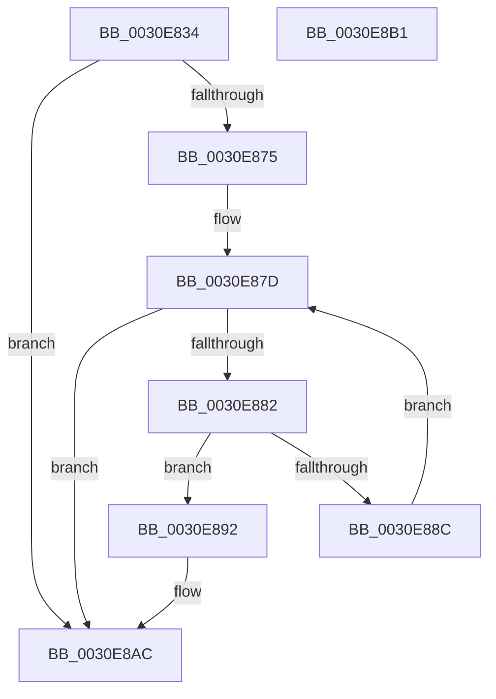

# KiSendSoftwareInterruptAffinity

- RVA: `0x0030E834`–`0x0030E8B2` (길이 `126` bytes)
- VA: `0x000000014030E834`
- 실행 섹션: `.text`
- PDB 이름 있음: `예`; PDB Function 태그: `아니요`
- unwind 정보 RVA: `0x00063458`
- 디코드: `33`개 명령, `126/126` bytes 표시
- 미해석 바이트: `0` (있으면 어셈블리에 `.byte`로 보존)

> 이 문서는 커널 이미지의 기계어와 PDB 기호를 분석해 생성했습니다. 4번과 5번은 함수 원형과 자료형을 바이너리 사용 방식에서 추정한 C 해석이며 원본 소스 복구 결과는 아닙니다.

## 1. Dependencies

- 직접 호출 지점: **1**; 고유 호출 대상: **1**
- 직접 호출자로 확인된 함수: **5**
- RIP 상대 이미지 참조: **0**

### Outgoing calls
- `0x0030E8A7` → [HalpInterruptSendIpi](../25/HalpInterruptSendIpi_function_00252310.md) (function, `0x00252310`)

### Direct callers
- [KiProcessDeferredReadyList](../25/KiProcessDeferredReadyList_function_00250800.md) at `0x00250892`
- [KiExecuteAllDpcs](../25/KiExecuteAllDpcs_function_0025B740.md) at `0x0025BCC9`
- [KiReadyDeferredReadyList](KiReadyDeferredReadyList_function_0030DD80.md) at `0x0030DE08`
- [KiAbDeferredProcessingWorker](KiAbDeferredProcessingWorker_function_0030DEB0.md) at `0x0030E148`
- [KiSearchForNewThreadsOnTarget](KiSearchForNewThreadsOnTarget_function_0030F500.md) at `0x0030F6A8`
- [KiSearchForNewThreadsOnTarget](KiSearchForNewThreadsOnTarget_function_0030F500.md) at `0x0030F745`
- [KiSearchForNewThreadsOnTarget](KiSearchForNewThreadsOnTarget_function_0030F500.md) at `0x0030F7E6`

### Static image references
- 디코드된 RIP-relative 메모리 참조가 없습니다.

## 2. Other-region calls and transfers

- 다른 실행 섹션으로 향하는 call: **0**
- 별도 외부 분기/꼬리 이동을 확인하지 못했습니다.

## 3. Assembly (complete function range)

```asm
0030E834  48 83 EC 48                     sub rsp, 0x48
0030E838  B8 2F 00 00 00                  mov eax, 0x2f
0030E83D  0F 57 C0                        xorps xmm0, xmm0
0030E840  4C 8B C1                        mov r8, rcx
0030E843  44 8D 58 D2                     lea r11d, [rax - 0x2e]
0030E847  44 8D 48 F0                     lea r9d, [rax - 0x10]
0030E84B  41 3A D3                        cmp dl, r11b
0030E84E  44 0F 45 C8                     cmovne r9d, eax
0030E852  65 48 8B 04 25 20 00 00 00      mov rax, qword ptr gs:[0x20]
0030E85B  45 33 D2                        xor r10d, r10d
0030E85E  0F 11 44 24 20                  movups xmmword ptr [rsp + 0x20], xmm0
0030E863  44 01 98 D4 8E 00 00            add dword ptr [rax + 0x8ed4], r11d
0030E86A  33 C0                           xor eax, eax
0030E86C  89 44 24 30                     mov dword ptr [rsp + 0x30], eax
0030E870  48 85 C9                        test rcx, rcx
0030E873  74 37                           je 0x14030e8ac
0030E875  41 0F B7 10                     movzx edx, word ptr [r8]
0030E879  41 0F B7 CA                     movzx ecx, r10w
0030E87D  66 3B CA                        cmp cx, dx
0030E880  73 2A                           jae 0x14030e8ac
0030E882  0F B7 C1                        movzx eax, cx
0030E885  4D 39 54 C0 08                  cmp qword ptr [r8 + rax*8 + 8], r10
0030E88A  75 06                           jne 0x14030e892
0030E88C  66 41 03 CB                     add cx, r11w
0030E890  EB EB                           jmp 0x14030e87d
0030E892  41 8B D1                        mov edx, r9d
0030E895  C7 44 24 20 02 00 00 00         mov dword ptr [rsp + 0x20], 2
0030E89D  48 8D 4C 24 20                  lea rcx, [rsp + 0x20]
0030E8A2  4C 89 44 24 28                  mov qword ptr [rsp + 0x28], r8
0030E8A7  E8 64 3A F4 FF                  call 0x140252310
0030E8AC  48 83 C4 48                     add rsp, 0x48
0030E8B0  C3                              ret
0030E8B1  CC                              int3
```

## 4. C-style interpretation (structured pseudocode)

```c
__int64 __fastcall KiSendSoftwareInterruptAffinity(__int64 a1, unsigned __int8 a2)
{
    __int64 result;
    __int64 v_r10;
    __int64 v_rsp;
    unsigned int v_stack_m18;
    unsigned __int64 v_stack_m20;
    unsigned __int64 v_stack_m28;

    v_rsp = (v_rsp) - (72);
    a4 = 47 - 16;
    if (a2 != ((unsigned __int8)(47 - 46))) { a4 = 47; }
    v_r10 = 0;
    v_stack_m28 = v_xmm0;
    result = 0;
    v_stack_m18 = 0;
    if (a1 == 0) goto loc_0030E8AC;
loc_0030E87D:
    if (0 >= ((unsigned __int16)(*(unsigned __int16 *)(a1)))) goto loc_0030E8AC;
    if ((*(unsigned __int64 *)(a1 + 0 * 8 + 8)) != 0) goto loc_0030E892;
    a1 = (unsigned __int16)((0) + ((unsigned __int16)(47 - 46)));
    goto loc_0030E87D;
loc_0030E892:
    v_stack_m28 = 2;
    v_stack_m20 = a1;
    result = HalpInterruptSendIpi(v_stack_m28, (unsigned int)((unsigned int)(a4)), a1, a4);
loc_0030E8AC:
    v_rsp = (v_rsp) + (72);
    return result;
}
```

## 5. (Beta) C Style

```c
int64_t KiSendSoftwareInterruptAffinity(void *Arg1, uint8_t Arg2)
{
    uint8_t *arg1 = (uint8_t *)Arg1;

    int64_t result;
    int64_t local_r10;
    int64_t local_rsp;
    uint32_t v_stack_m18;
    uint64_t v_stack_m20;
    uint64_t v_stack_m28;

    local_rsp = (local_rsp) - (72);
    a4 = 47 - 16;
    if (Arg2 != ((uint8_t)(47 - 46))) { a4 = 47; }
    local_r10 = 0;
    v_stack_m28 = v_xmm0;
    result = 0;
    v_stack_m18 = 0;
    if (Arg1 == NULL) goto loc_0030E8AC;
loc_0030E87D:
    if (0 >= ((uint16_t)(*(uint16_t *)(arg1)))) goto loc_0030E8AC;
    if ((*(uint64_t *)(arg1 + 0x0 * 8 + 0x8)) != 0) goto loc_0030E892;
    Arg1 = (uint16_t)((0) + ((uint16_t)(47 - 46)));
    goto loc_0030E87D;
loc_0030E892:
    v_stack_m28 = 2;
    v_stack_m20 = Arg1;
    result = HalpInterruptSendIpi(v_stack_m28, (uint32_t)((uint32_t)(a4)), Arg1, a4);
loc_0030E8AC:
    local_rsp = (local_rsp) + (72);
    return result;
}
```

### 관측된 메모리 오프셋

구조체 형식이 확인되지 않은 접근은 인자 기준의 오프셋으로만 기록했습니다.

| 기준 인자 | 오프셋 표현 | 폭 (bit) | 접근 |
|---|---:|---:|---|
| `Arg1` | `+ 0x0` | `16` | `R` |
| `Arg1` | `+ 0x8 + rax*8` | `64` | `R` |

## 6. Execution-region graph

[열기: 2D/3D 그래프와 함수 탐색 컨트롤 패널](../../../control-panel.html?section=text&rva=0x0030E834&view=graph)

- 2D 그래프는 위에서 아래로 흐르고, 3D 그래프는 빈 공간을 드래그해 회전합니다. Shift+드래그는 이동, 휠은 확대·축소, 함수 노드 선택은 대상 보고서 이동입니다.

### Static fallback


