# KiStartRescheduleContextEntry

- RVA: `0x00305ED0`–`0x00306038` (길이 `360` bytes)
- VA: `0x0000000140305ED0`
- 실행 섹션: `.text`
- PDB 이름 있음: `예`; PDB Function 태그: `아니요`
- unwind 정보 RVA: `0x00073704`
- 디코드: `98`개 명령, `360/360` bytes 표시
- 미해석 바이트: `0` (있으면 어셈블리에 `.byte`로 보존)

> 이 문서는 커널 이미지의 기계어와 PDB 기호를 분석해 생성했습니다. 4번과 5번은 함수 원형과 자료형을 바이너리 사용 방식에서 추정한 C 해석이며 원본 소스 복구 결과는 아닙니다.

## 1. Dependencies

- 직접 호출 지점: **2**; 고유 호출 대상: **2**
- 직접 호출자로 확인된 함수: **1**
- RIP 상대 이미지 참조: **1**

### Outgoing calls
- `0x00305FFB` → [KiIsThreadStateControlledByProcessor](KiIsThreadStateControlledByProcessor_function_00306254.md) (function, `0x00306254`)
- `0x0030600D` → [KiUpdateVPBackingThreadPriority](KiUpdateVPBackingThreadPriority_function_00306040.md) (function, `0x00306040`)

### Direct callers
- [KiAdjustRescheduleContextForProcessorAddition](../5C/KiAdjustRescheduleContextForProcessorAddition_function_005C9284.md) at `0x005C92AF`

### Static image references
- `0x00305FB4` → RVA `0x00FC52E0` (`ALMOSTRO`; read)

## 2. Other-region calls and transfers

- 다른 실행 섹션으로 향하는 call: **0**
- 별도 외부 분기/꼬리 이동을 확인하지 못했습니다.

## 3. Assembly (complete function range)

```asm
00305ED0  48 89 5C 24 08                  mov qword ptr [rsp + 8], rbx
00305ED5  48 89 6C 24 10                  mov qword ptr [rsp + 0x10], rbp
00305EDA  48 89 74 24 18                  mov qword ptr [rsp + 0x18], rsi
00305EDF  48 89 7C 24 20                  mov qword ptr [rsp + 0x20], rdi
00305EE4  41 56                           push r14
00305EE6  48 83 EC 20                     sub rsp, 0x20
00305EEA  45 33 F6                        xor r14d, r14d
00305EED  48 89 11                        mov qword ptr [rcx], rdx
00305EF0  4C 89 71 08                     mov qword ptr [rcx + 8], r14
00305EF4  48 8B D9                        mov rbx, rcx
00305EF7  48 8B 8A 48 8E 00 00            mov rcx, qword ptr [rdx + 0x8e48]
00305EFE  48 8B FA                        mov rdi, rdx
00305F01  48 85 C9                        test rcx, rcx
00305F04  0F 85 92 00 00 00               jne 0x140305f9c
00305F0A  48 8B 77 10                     mov rsi, qword ptr [rdi + 0x10]
00305F0E  48 89 73 10                     mov qword ptr [rbx + 0x10], rsi
00305F12  48 85 F6                        test rsi, rsi
00305F15  75 08                           jne 0x140305f1f
00305F17  48 8B 77 08                     mov rsi, qword ptr [rdi + 8]
00305F1B  48 89 73 10                     mov qword ptr [rbx + 0x10], rsi
00305F1F  48 39 77 10                     cmp qword ptr [rdi + 0x10], rsi
00305F23  74 71                           je 0x140305f96
00305F25  65 48 8B 04 25 20 00 00 00      mov rax, qword ptr gs:[0x20]
00305F2E  0F B6 4B 20                     movzx ecx, byte ptr [rbx + 0x20]
00305F32  48 3B F8                        cmp rdi, rax
00305F35  74 5A                           je 0x140305f91
00305F37  80 E1 FB                        and cl, 0xfb
00305F3A  88 4B 20                        mov byte ptr [rbx + 0x20], cl
00305F3D  40 32 ED                        xor bpl, bpl
00305F40  F7 46 78 00 00 40 00            test dword ptr [rsi + 0x78], 0x400000
00305F47  0F 85 D7 00 00 00               jne 0x140306024
00305F4D  0F B6 47 23                     movzx eax, byte ptr [rdi + 0x23]
00305F51  0F B6 53 20                     movzx edx, byte ptr [rbx + 0x20]
00305F55  F6 D0                           not al
00305F57  48 8B 6C 24 38                  mov rbp, qword ptr [rsp + 0x38]
00305F5C  24 01                           and al, 1
00305F5E  48 8B 74 24 40                  mov rsi, qword ptr [rsp + 0x40]
00305F63  80 E2 FE                        and dl, 0xfe
00305F66  0A D0                           or dl, al
00305F68  88 53 20                        mov byte ptr [rbx + 0x20], dl
00305F6B  48 8B 47 38                     mov rax, qword ptr [rdi + 0x38]
00305F6F  48 8B 7C 24 48                  mov rdi, qword ptr [rsp + 0x48]
00305F74  0F B6 08                        movzx ecx, byte ptr [rax]
00305F77  C0 E9 06                        shr cl, 6
00305F7A  32 CA                           xor cl, dl
00305F7C  80 E1 02                        and cl, 2
00305F7F  32 CA                           xor cl, dl
00305F81  88 4B 20                        mov byte ptr [rbx + 0x20], cl
00305F84  48 8B 5C 24 30                  mov rbx, qword ptr [rsp + 0x30]
00305F89  48 83 C4 20                     add rsp, 0x20
00305F8D  41 5E                           pop r14
00305F8F  C3                              ret
00305F90  CC                              int3
00305F91  80 C9 04                        or cl, 4
00305F94  EB A4                           jmp 0x140305f3a
00305F96  80 4B 20 04                     or byte ptr [rbx + 0x20], 4
00305F9A  EB A1                           jmp 0x140305f3d
00305F9C  0F B6 42 23                     movzx eax, byte ptr [rdx + 0x23]
00305FA0  A8 10                           test al, 0x10
00305FA2  75 10                           jne 0x140305fb4
00305FA4  48 8B 87 48 8E 00 00            mov rax, qword ptr [rdi + 0x8e48]
00305FAB  48 89 43 08                     mov qword ptr [rbx + 8], rax
00305FAF  E9 56 FF FF FF                  jmp 0x140305f0a
00305FB4  44 39 35 25 F3 CB 00            cmp dword ptr [rip + 0xcbf325], r14d
00305FBB  48 8B 92 C0 00 00 00            mov rdx, qword ptr [rdx + 0xc0]
00305FC2  74 04                           je 0x140305fc8
00305FC4  A8 20                           test al, 0x20
00305FC6  75 18                           jne 0x140305fe0
00305FC8  48 8B 42 50                     mov rax, qword ptr [rdx + 0x50]
00305FCC  48 8B 91 C8 02 00 00            mov rdx, qword ptr [rcx + 0x2c8]
00305FD3  48 23 D0                        and rdx, rax
00305FD6  48 85 D2                        test rdx, rdx
00305FD9  74 C9                           je 0x140305fa4
00305FDB  E9 2A FF FF FF                  jmp 0x140305f0a
00305FE0  48 8B 42 68                     mov rax, qword ptr [rdx + 0x68]
00305FE4  48 F7 D0                        not rax
00305FE7  EB E3                           jmp 0x140305fcc
00305FE9  40 B5 01                        mov bpl, 1
00305FEC  F7 46 78 00 00 40 00            test dword ptr [rsi + 0x78], 0x400000
00305FF3  74 1D                           je 0x140306012
00305FF5  48 8B D7                        mov rdx, rdi
00305FF8  48 8B CE                        mov rcx, rsi
00305FFB  E8 54 02 00 00                  call 0x140306254
00306000  84 C0                           test al, al
00306002  74 0E                           je 0x140306012
00306004  41 B1 01                        mov r9b, 1
00306007  48 8B D7                        mov rdx, rdi
0030600A  48 8B CE                        mov rcx, rsi
0030600D  E8 2E 00 00 00                  call 0x140306040
00306012  40 84 ED                        test bpl, bpl
00306015  0F 84 32 FF FF FF               je 0x140305f4d
0030601B  4C 89 76 40                     mov qword ptr [rsi + 0x40], r14
0030601F  E9 29 FF FF FF                  jmp 0x140305f4d
00306024  49 3B F1                        cmp rsi, r9
00306027  74 C3                           je 0x140305fec
00306029  F0 48 0F BA 6E 40 00            lock bts qword ptr [rsi + 0x40], 0
00306030  0F 82 17 FF FF FF               jb 0x140305f4d
00306036  EB B1                           jmp 0x140305fe9
```

## 4. C-style interpretation (structured pseudocode)

```c
__int64 __fastcall KiStartRescheduleContextEntry(__int64 a1, __int64 a2)
{
    __int64 result;
    __int64 v_r14;
    __int64 v_rbp;
    __int64 v_rsi;
    __int64 v_rsp;
    unsigned __int64 v_stack_p10;
    unsigned __int64 v_stack_p18;
    unsigned __int64 v_stack_p20;
    unsigned __int64 v_stack_p8;

    v_stack_p8 = v_rbx;
    v_stack_p10 = v_rbp;
    v_stack_p18 = v_rsi;
    v_stack_p20 = v_rdi;
    v_rsp = (v_rsp) - (32);
    v_r14 = 0;
    *(unsigned __int64 *)(a1) = a2;
    *(unsigned __int64 *)(a1 + 8) = 0;
    if (*(unsigned __int64 *)(a2 + 36424) != 0) goto loc_00305F9C;
loc_00305F0A:
    *(unsigned __int64 *)(a1 + 16) = *(unsigned __int64 *)(a2 + 16);
    v_rsi = *(unsigned __int64 *)(a2 + 16);
    if (*(unsigned __int64 *)(a2 + 16) == 0) {
        v_rsi = *(unsigned __int64 *)(a2 + 8);
        *(unsigned __int64 *)(a1 + 16) = v_rsi;
    }
    if ((*(unsigned __int64 *)(a2 + 16)) == v_rsi) goto loc_00305F96;
    if (a2 == (*(unsigned __int64 *)(gs_base + (0 + 32)))) goto loc_00305F91;
    a1 = (unsigned __int8)((*(unsigned __int8 *)(a1 + 32)) & (251));
loc_00305F3A:
    *(unsigned __int8 *)(a1 + 32) = (unsigned __int8)(a1);
loc_00305F3D:
    v_rbp = 0;
    if (((*(unsigned int *)(v_rsi + 120)) & (0x400000ULL)) != 0) goto loc_00306024;
loc_00305F4D:
    result = (unsigned __int8)(~(*(unsigned __int8 *)(a2 + 35)));
    result = (unsigned __int8)((result) & (1));
    a2 = (unsigned __int8)((*(unsigned __int8 *)(a1 + 32)) & (254));
    a2 = (unsigned __int8)((a2) | ((unsigned __int8)(result)));
    *(unsigned __int8 *)(a1 + 32) = (unsigned __int8)(a2);
    a1 = (unsigned __int8)((*(unsigned __int8 *)(*(unsigned __int64 *)(a2 + 56))) >> (6));
    a1 = (unsigned __int8)((a1) ^ ((unsigned __int8)(a2)));
    a1 = (unsigned __int8)((a1) & (2));
    a1 = (unsigned __int8)((a1) ^ ((unsigned __int8)(a2)));
    *(unsigned __int8 *)(a1 + 32) = (unsigned __int8)(a1);
    v_rsp = (v_rsp) + (32);
    return *(unsigned __int64 *)(a2 + 56);
loc_00305F91:
    a1 = (unsigned __int8)((a1) | (4));
    goto loc_00305F3A;
loc_00305F96:
    goto loc_00305F3D;
loc_00305F9C:
    if ((((unsigned __int8)(*(unsigned __int8 *)(a2 + 35))) & (16)) != 0) goto loc_00305FB4;
loc_00305FA4:
    *(unsigned __int64 *)(v_stack_p8 + 8) = *(unsigned __int64 *)(v_stack_p20 + 36424);
    goto loc_00305F0A;
loc_00305FB4:
    if ((*(unsigned int *)(v_rip + 13366053)) == 0) goto loc_00305FC8;
    if ((((unsigned __int8)(*(unsigned __int64 *)(v_stack_p20 + 36424))) & (32)) != 0) goto loc_00305FE0;
loc_00305FC8:
loc_00305FCC:
    a2 = (*(unsigned __int64 *)(a1 + 712)) & (*(unsigned __int64 *)(*(unsigned __int64 *)(a2 + 192) + 80));
    if (a2 == 0) goto loc_00305FA4;
    goto loc_00305F0A;
loc_00305FE0:
    result = ~(*(unsigned __int64 *)(a2 + 104));
    goto loc_00305FCC;
loc_00305FE9:
loc_00305FEC:
    if (((*(unsigned int *)(v_stack_p18 + 120)) & (0x400000ULL)) == 0) goto loc_00306012;
    result = KiIsThreadStateControlledByProcessor(v_stack_p18, v_stack_p20, a3, a4);
    if ((unsigned __int8)(result) != 0) {
        a4 = 1;
        a2 = v_stack_p20;
        a1 = v_stack_p18;
        result = KiUpdateVPBackingThreadPriority(a1, a2, a3, a4);
    }
    if (1 == 0) goto loc_00305F4D;
    *(unsigned __int64 *)(v_stack_p18 + 64) = 0;
    goto loc_00305F4D;
loc_00306024:
    if (v_stack_p18 == a4) goto loc_00305FEC;
    if (v_stack_p18 < a4) goto loc_00305F4D;
    goto loc_00305FE9;
}
```

## 5. (Beta) C Style

```c
int64_t KiStartRescheduleContextEntry(void *Arg1, void *Arg2)
{
    uint8_t *arg1 = (uint8_t *)Arg1;
    uint8_t *arg2 = (uint8_t *)Arg2;

    int64_t result;
    int64_t local_r14;
    int64_t local_rbp;
    int64_t local_rsi;
    int64_t local_rsp;
    uint64_t v_stack_p10;
    uint64_t v_stack_p18;
    uint64_t v_stack_p20;
    uint64_t v_stack_p8;

    v_stack_p8 = local_rbx;
    v_stack_p10 = local_rbp;
    v_stack_p18 = local_rsi;
    v_stack_p20 = local_rdi;
    local_rsp = (local_rsp) - (32);
    local_r14 = 0;
    *(void **)(arg1) = Arg2;
    *(uint64_t *)(arg1 + 0x8) = 0;
    if (*(uint64_t *)(arg2 + 0x8E48) != 0) goto loc_00305F9C;
loc_00305F0A:
    *(uint64_t *)(arg1 + 0x10) = *(uint64_t *)(arg2 + 0x10);
    local_rsi = *(uint64_t *)(arg2 + 0x10);
    if (*(uint64_t *)(arg2 + 0x10) == 0) {
        local_rsi = *(uint64_t *)(arg2 + 0x8);
        *(uint64_t *)(arg1 + 0x10) = local_rsi;
    }
    if ((*(uint64_t *)(arg2 + 0x10)) == local_rsi) goto loc_00305F96;
    if (Arg2 == (*(uint64_t *)(gs_base + (0 + 0x20)))) goto loc_00305F91;
    Arg1 = (uint8_t)((*(uint8_t *)(arg1 + 0x20)) & (251));
loc_00305F3A:
    *(uint8_t *)(arg1 + 0x20) = (uint8_t)(Arg1);
loc_00305F3D:
    local_rbp = 0;
    if (((*(uint32_t *)(local_rsi + 0x78)) & (0x400000ULL)) != 0) goto loc_00306024;
loc_00305F4D:
    result = (uint8_t)(~(*(uint8_t *)(arg2 + 0x23)));
    result = (uint8_t)((result) & (1));
    Arg2 = (uint8_t)((*(uint8_t *)(arg1 + 0x20)) & (254));
    Arg2 = (uint8_t)((Arg2) | ((uint8_t)(result)));
    *(uint8_t *)(arg1 + 0x20) = (uint8_t)(Arg2);
    Arg1 = (uint8_t)((*(uint8_t *)(*(uint64_t *)(arg2 + 0x38))) >> (6));
    Arg1 = (uint8_t)((Arg1) ^ ((uint8_t)(Arg2)));
    Arg1 = (uint8_t)((Arg1) & (2));
    Arg1 = (uint8_t)((Arg1) ^ ((uint8_t)(Arg2)));
    *(uint8_t *)(arg1 + 0x20) = (uint8_t)(Arg1);
    local_rsp = (local_rsp) + (32);
    return *(uint64_t *)(arg2 + 0x38);
loc_00305F91:
    Arg1 = (uint8_t)((Arg1) | (4));
    goto loc_00305F3A;
loc_00305F96:
    goto loc_00305F3D;
loc_00305F9C:
    if ((((uint8_t)(*(uint8_t *)(arg2 + 0x23))) & (16)) != 0) goto loc_00305FB4;
loc_00305FA4:
    *(uint64_t *)(v_stack_p8 + 0x8) = *(uint64_t *)(v_stack_p20 + 0x8E48);
    goto loc_00305F0A;
loc_00305FB4:
    if ((*(uint32_t *)(v_rip + 0xCBF325)) == 0) goto loc_00305FC8;
    if ((((uint8_t)(*(uint64_t *)(v_stack_p20 + 0x8E48))) & (32)) != 0) goto loc_00305FE0;
loc_00305FC8:
loc_00305FCC:
    Arg2 = (*(uint64_t *)(arg1 + 0x2C8)) & (*(uint64_t *)(*(uint64_t *)(arg2 + 0xC0) + 0x50));
    if (Arg2 == NULL) goto loc_00305FA4;
    goto loc_00305F0A;
loc_00305FE0:
    result = ~(*(uint64_t *)(arg2 + 0x68));
    goto loc_00305FCC;
loc_00305FE9:
loc_00305FEC:
    if (((*(uint32_t *)(v_stack_p18 + 0x78)) & (0x400000ULL)) == 0) goto loc_00306012;
    result = KiIsThreadStateControlledByProcessor(v_stack_p18, v_stack_p20, a3, a4);
    if ((uint8_t)(result) != 0) {
        a4 = 1;
        Arg2 = v_stack_p20;
        Arg1 = v_stack_p18;
        result = KiUpdateVPBackingThreadPriority(Arg1, Arg2, a3, a4);
    }
    if (1 == 0) goto loc_00305F4D;
    *(uint64_t *)(v_stack_p18 + 0x40) = 0;
    goto loc_00305F4D;
loc_00306024:
    if (v_stack_p18 == a4) goto loc_00305FEC;
    if (v_stack_p18 < a4) goto loc_00305F4D;
    goto loc_00305FE9;
}
```

### 관측된 메모리 오프셋

구조체 형식이 확인되지 않은 접근은 인자 기준의 오프셋으로만 기록했습니다.

| 기준 인자 | 오프셋 표현 | 폭 (bit) | 접근 |
|---|---:|---:|---|
| `Arg1` | `+ 0x0` | `64` | `W` |
| `Arg1` | `+ 0x8` | `64` | `W` |
| `Arg1` | `+ 0x10` | `64` | `W` |
| `Arg1` | `+ 0x20` | `8` | `R` |
| `Arg1` | `+ 0x20` | `8` | `R/W` |
| `Arg1` | `+ 0x20` | `8` | `W` |
| `Arg2` | `+ 0x8` | `64` | `R` |
| `Arg2` | `+ 0x10` | `64` | `R` |
| `Arg2` | `+ 0x23` | `8` | `R` |
| `Arg2` | `+ 0xC0` | `64` | `R` |
| `Arg2` | `+ 0x8E48` | `64` | `R` |

## 6. Execution-region graph

[열기: 2D/3D 그래프와 함수 탐색 컨트롤 패널](../../../control-panel.html?section=text&rva=0x00305ED0&view=graph)

- 2D 그래프는 위에서 아래로 흐르고, 3D 그래프는 빈 공간을 드래그해 회전합니다. Shift+드래그는 이동, 휠은 확대·축소, 함수 노드 선택은 대상 보고서 이동입니다.

### Static fallback

```mermaid
flowchart TD
  bb_00305ED0[BB_00305ED0]
  bb_00305F0A[BB_00305F0A]
  bb_00305F17[BB_00305F17]
  bb_00305F1F[BB_00305F1F]
  bb_00305F25[BB_00305F25]
  bb_00305F37[BB_00305F37]
  bb_00305F3A[BB_00305F3A]
  bb_00305F3D[BB_00305F3D]
  bb_00305F4D[BB_00305F4D]
  bb_00305F90[BB_00305F90]
  bb_00305F91[BB_00305F91]
  bb_00305F96[BB_00305F96]
  bb_00305F9C[BB_00305F9C]
  bb_00305FA4[BB_00305FA4]
  bb_00305FB4[BB_00305FB4]
  bb_00305FC4[BB_00305FC4]
  bb_00305FC8[BB_00305FC8]
  bb_00305FCC[BB_00305FCC]
  bb_00305FDB[BB_00305FDB]
  bb_00305FE0[BB_00305FE0]
  bb_00305FE9[BB_00305FE9]
  bb_00305FEC[BB_00305FEC]
  bb_00305FF5[BB_00305FF5]
  bb_00306004[BB_00306004]
  bb_00306012[BB_00306012]
  bb_0030601B[BB_0030601B]
  bb_00306024[BB_00306024]
  bb_00306029[BB_00306029]
  bb_00306036[BB_00306036]
  bb_00305ED0 -->|branch| bb_00305F9C
  bb_00305ED0 -->|fallthrough| bb_00305F0A
  bb_00305F0A -->|branch| bb_00305F1F
  bb_00305F0A -->|fallthrough| bb_00305F17
  bb_00305F17 -->|flow| bb_00305F1F
  bb_00305F1F -->|branch| bb_00305F96
  bb_00305F1F -->|fallthrough| bb_00305F25
  bb_00305F25 -->|branch| bb_00305F91
  bb_00305F25 -->|fallthrough| bb_00305F37
  bb_00305F37 -->|flow| bb_00305F3A
  bb_00305F3A -->|flow| bb_00305F3D
  bb_00305F3D -->|branch| bb_00306024
  bb_00305F3D -->|fallthrough| bb_00305F4D
  bb_00305F90 -->|flow| bb_00305F91
  bb_00305F91 -->|branch| bb_00305F3A
  bb_00305F96 -->|branch| bb_00305F3D
  bb_00305F9C -->|branch| bb_00305FB4
  bb_00305F9C -->|fallthrough| bb_00305FA4
  bb_00305FA4 -->|branch| bb_00305F0A
  bb_00305FB4 -->|branch| bb_00305FC8
  bb_00305FB4 -->|fallthrough| bb_00305FC4
  bb_00305FC4 -->|branch| bb_00305FE0
  bb_00305FC4 -->|fallthrough| bb_00305FC8
  bb_00305FC8 -->|flow| bb_00305FCC
  bb_00305FCC -->|branch| bb_00305FA4
  bb_00305FCC -->|fallthrough| bb_00305FDB
  bb_00305FDB -->|branch| bb_00305F0A
  bb_00305FE0 -->|branch| bb_00305FCC
  bb_00305FE9 -->|flow| bb_00305FEC
  bb_00305FEC -->|branch| bb_00306012
  bb_00305FEC -->|fallthrough| bb_00305FF5
  bb_00305FF5 -->|branch| bb_00306012
  bb_00305FF5 -->|fallthrough| bb_00306004
  bb_00306004 -->|flow| bb_00306012
  bb_00306012 -->|branch| bb_00305F4D
  bb_00306012 -->|fallthrough| bb_0030601B
  bb_0030601B -->|branch| bb_00305F4D
  bb_00306024 -->|branch| bb_00305FEC
  bb_00306024 -->|fallthrough| bb_00306029
  bb_00306029 -->|branch| bb_00305F4D
  bb_00306029 -->|fallthrough| bb_00306036
  bb_00306036 -->|branch| bb_00305FE9
```


