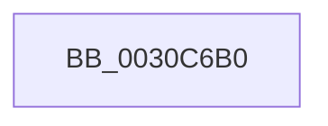

# KiStartRescheduleContext

- RVA: `0x0030C6B0`–`0x0030C6C0` (길이 `16` bytes)
- VA: `0x000000014030C6B0`
- 실행 섹션: `.text`
- PDB 이름 있음: `예`; PDB Function 태그: `아니요`
- unwind 정보 RVA: `0x00073D44`
- 디코드: `6`개 명령, `16/16` bytes 표시
- 미해석 바이트: `0` (있으면 어셈블리에 `.byte`로 보존)

> 이 문서는 커널 이미지의 기계어와 PDB 기호를 분석해 생성했습니다. 4번과 5번은 함수 원형과 자료형을 바이너리 사용 방식에서 추정한 C 해석이며 원본 소스 복구 결과는 아닙니다.

## 1. Dependencies

- 직접 호출 지점: **0**; 고유 호출 대상: **0**
- 직접 호출자로 확인된 함수: **24**
- RIP 상대 이미지 참조: **0**

### Outgoing calls
- 직접 디코드된 call 명령이 없습니다.

### Direct callers
- [KiDeferGroupSchedulingPreemption](../20/KiDeferGroupSchedulingPreemption_function_0020076C.md) at `0x002009D2`
- [KiHandleDeferredPreemption](../20/KiHandleDeferredPreemption_function_00202ECC.md) at `0x00203007`
- [KeYieldExecution](../20/KeYieldExecution_function_00209FA0.md) at `0x0020A261`
- [KiRemoveBoostThread](../21/KiRemoveBoostThread_function_00219128.md) at `0x0021925F`
- [sub_0021C00A](../21/Unknown_function_0021C00A.md) at `0x0021C040`
- [sub_0021D7F8](../21/Unknown_function_0021D7F8.md) at `0x0021DD8A`
- [KiSetPriorityThread](../22/KiSetPriorityThread_function_00220E78.md) at `0x0022103E`
- [KiExecuteAllDpcs](../25/KiExecuteAllDpcs_function_0025B740.md) at `0x0025C5F4`
- [KiUpdateGlobalCpuSetConfiguration](KiUpdateGlobalCpuSetConfiguration_function_00305AB8.md) at `0x00305B65`
- [KiGroupSchedulingGenerationEnd](KiGroupSchedulingGenerationEnd_function_0030A9B4.md) at `0x0030AA42`
- [KiGroupSchedulingQuantumEnd](KiGroupSchedulingQuantumEnd_function_0030B220.md) at `0x0030B37F`
- [KiSoftParkElectionUnparkProcessor](KiSoftParkElectionUnparkProcessor_function_0030B818.md) at `0x0030B94F`
- [KiEnterLongDpcProcessing](KiEnterLongDpcProcessing_function_0030BE54.md) at `0x0030BFAD`
- [KiRescheduleThreadAfterAffinityChange](KiRescheduleThreadAfterAffinityChange_function_0030C9E8.md) at `0x0030CAC6`
- [KiAttemptToStealStandbyThread](KiAttemptToStealStandbyThread_function_0030D790.md) at `0x0030D960`
- [KiAttemptToStealStandbyThread](KiAttemptToStealStandbyThread_function_0030D790.md) at `0x0030D994`
- [KiSearchForNewThreadsOnTarget](KiSearchForNewThreadsOnTarget_function_0030F500.md) at `0x00310055`
- [KiSearchForNewThreadsOnTarget](KiSearchForNewThreadsOnTarget_function_0030F500.md) at `0x00310431`
- [KiSearchForNewThreadsOnTarget](KiSearchForNewThreadsOnTarget_function_0030F500.md) at `0x00310BD0`
- [KiExitThreadWaitReschedule](../35/KiExitThreadWaitReschedule_function_00352EC8.md) at `0x00352F36`
- [KiParkCurrentProcessor](../35/KiParkCurrentProcessor_function_003533A4.md) at `0x0035348A`
- [KiSearchForNewThread](../35/KiSearchForNewThread_function_00355C98.md) at `0x00355CEB`
- [KiSetSystemAffinityThread](../39/KiSetSystemAffinityThread_function_003993E0.md) at `0x00399757`
- [KiApplyForegroundBoostThread](../4F/KiApplyForegroundBoostThread_function_004F7DC0.md) at `0x004F7F54`
- [KiFinalizeCoreControlBlockAssignment](../5B/KiFinalizeCoreControlBlockAssignment_function_005B7D0C.md) at `0x005B7DD2`
- [KiAdjustCoreIsolationReasonThread](../5C/KiAdjustCoreIsolationReasonThread_function_005C3818.md) at `0x005C39CE`
- [KiForceParkDutyCycleDpcCallback](../5C/KiForceParkDutyCycleDpcCallback_function_005C97D0.md) at `0x005C989E`

### Static image references
- 디코드된 RIP-relative 메모리 참조가 없습니다.

## 2. Other-region calls and transfers

- 다른 실행 섹션으로 향하는 call: **0**
- 별도 외부 분기/꼬리 이동을 확인하지 못했습니다.

## 3. Assembly (complete function range)

```asm
0030C6B0  4C 89 44 24 18                  mov qword ptr [rsp + 0x18], r8
0030C6B5  56                              push rsi
0030C6B6  57                              push rdi
0030C6B7  41 56                           push r14
0030C6B9  48 83 EC 70                     sub rsp, 0x70
0030C6BD  45 33 F6                        xor r14d, r14d
```

## 4. C-style interpretation (structured pseudocode)

```c
void __fastcall KiStartRescheduleContext(__int64 a1, __int64 a2, __int64 a3)
{
    __int64 v_r14;
    __int64 v_rsp;
    unsigned __int64 v_stack_p18;

    v_stack_p18 = a3;
    v_rsp = (v_rsp) - (112);
    v_r14 = 0;
    return;
}
```

## 5. (Beta) C Style

```c
void KiStartRescheduleContext(int64_t Arg1, int64_t Arg2, int64_t Arg3)
{
    int64_t local_r14;
    int64_t local_rsp;
    uint64_t v_stack_p18;

    v_stack_p18 = Arg3;
    local_rsp = (local_rsp) - (112);
    local_r14 = 0;
    return;
}
```

## 6. Execution-region graph

[열기: 2D/3D 그래프와 함수 탐색 컨트롤 패널](../../../control-panel.html?section=text&rva=0x0030C6B0&view=graph)

- 2D 그래프는 위에서 아래로 흐르고, 3D 그래프는 빈 공간을 드래그해 회전합니다. Shift+드래그는 이동, 휠은 확대·축소, 함수 노드 선택은 대상 보고서 이동입니다.

### Static fallback


