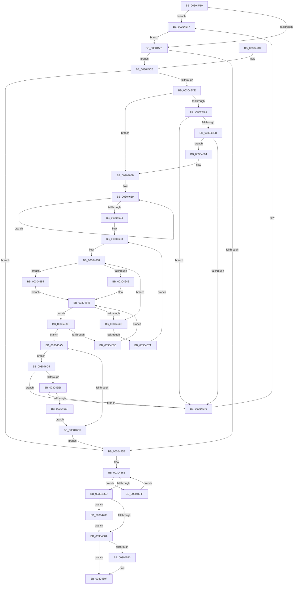

# KiStopProfileTarget

- RVA: `0x00304510`–`0x00304717` (길이 `519` bytes)
- VA: `0x0000000140304510`
- 실행 섹션: `.text`
- PDB 이름 있음: `예`; PDB Function 태그: `아니요`
- unwind 정보 RVA: `0x00073514`
- 디코드: `137`개 명령, `519/519` bytes 표시
- 미해석 바이트: `0` (있으면 어셈블리에 `.byte`로 보존)

> 이 문서는 커널 이미지의 기계어와 PDB 기호를 분석해 생성했습니다. 4번과 5번은 함수 원형과 자료형을 바이너리 사용 방식에서 추정한 C 해석이며 원본 소스 복구 결과는 아닙니다.

## 1. Dependencies

- 직접 호출 지점: **7**; 고유 호출 대상: **7**
- 직접 호출자로 확인된 함수: **1**
- RIP 상대 이미지 참조: **4**

### Outgoing calls
- `0x0030457D` → [KeCheckProcessorAffinityEx](KeCheckProcessorAffinityEx_function_00305150.md) (function, `0x00305150`)
- `0x0030459A` → [KiLowerIrqlProcessIrqlFlags](../4F/KiLowerIrqlProcessIrqlFlags_function_004F5698.md) (function, `0x004F5698`)
- `0x003045FA` → [KiRaiseIrqlProcessIrqlFlags](../4F/KiRaiseIrqlProcessIrqlFlags_function_004F56FC.md) (function, `0x004F56FC`)
- `0x0030467E` → [KeAddProcessorAffinityEx](../25/KeAddProcessorAffinityEx_function_0025B6F0.md) (function, `0x0025B6F0`)
- `0x003046B8` → [KeSubtractAffinityEx2](../2D/KeSubtractAffinityEx2_function_002D5BA0.md) (function, `0x002D5BA0`)
- `0x003046C0` → [KeIsEmptyAffinityEx](../2D/KeIsEmptyAffinityEx_function_002D1580.md) (function, `0x002D1580`)
- `0x0030470D` → [HalStopProfileInterrupt](../54/HalStopProfileInterrupt_function_00546C90.md) (function, `0x00546C90`)

### Direct callers
- [KeStopProfile](../5C/KeStopProfile_function_005C0640.md) at `0x005C06D4`

### Static image references
- `0x00304532` → RVA `0x00FC501A` (`ALMOSTRO`; read)
- `0x00304544` → RVA `0x00FC6D20` (`ALMOSTRO`; read)
- `0x0030460B` → RVA `0x00F22D60` (`.data`; read)
- `0x00304661` → RVA `0x00F231B8` (`.data`; read)

## 2. Other-region calls and transfers

- 다른 실행 섹션으로 향하는 call: **0**
- 별도 외부 분기/꼬리 이동을 확인하지 못했습니다.

## 3. Assembly (complete function range)

```asm
00304510  48 89 5C 24 10                  mov qword ptr [rsp + 0x10], rbx
00304515  48 89 6C 24 18                  mov qword ptr [rsp + 0x18], rbp
0030451A  48 89 74 24 20                  mov qword ptr [rsp + 0x20], rsi
0030451F  57                              push rdi
00304520  41 54                           push r12
00304522  41 55                           push r13
00304524  41 56                           push r14
00304526  41 57                           push r15
00304528  48 83 EC 20                     sub rsp, 0x20
0030452C  48 8B 29                        mov rbp, qword ptr [rcx]
0030452F  48 8B F9                        mov rdi, rcx
00304532  0F B6 15 E1 0A CC 00            movzx edx, byte ptr [rip + 0xcc0ae1]
00304539  45 0F 20 C4                     mov r12, cr8
0030453D  44 0F 22 C2                     mov cr8, rdx
00304541  45 33 ED                        xor r13d, r13d
00304544  44 39 2D D5 27 CC 00            cmp dword ptr [rip + 0xcc27d5], r13d
0030454B  0F 85 A6 00 00 00               jne 0x1403045f7
00304551  83 C8 FF                        or eax, 0xffffffff
00304554  F0 0F C1 47 08                  lock xadd dword ptr [rdi + 8], eax
00304559  83 F8 01                        cmp eax, 1
0030455C  74 67                           je 0x1403045c5
0030455E  F0 FF 4F 0C                     lock dec dword ptr [rdi + 0xc]
00304562  8B 47 0C                        mov eax, dword ptr [rdi + 0xc]
00304565  85 C0                           test eax, eax
00304567  0F 8F 92 01 00 00               jg 0x1403046ff
0030456D  65 48 8B 14 25 20 00 00 00      mov rdx, qword ptr gs:[0x20]
00304576  48 8D 4F 10                     lea rcx, [rdi + 0x10]
0030457A  8B 52 24                        mov edx, dword ptr [rdx + 0x24]
0030457D  E8 CE 0B 00 00                  call 0x140305150
00304582  85 C0                           test eax, eax
00304584  0F 85 7C 01 00 00               jne 0x140304706
0030458A  44 39 2D 8F 27 CC 00            cmp dword ptr [rip + 0xcc278f], r13d
00304591  74 0C                           je 0x14030459f
00304593  44 0F 20 C1                     mov rcx, cr8
00304597  41 8A D4                        mov dl, r12b
0030459A  E8 F9 10 1F 00                  call 0x1404f5698
0030459F  41 0F B6 C4                     movzx eax, r12b
003045A3  44 0F 22 C0                     mov cr8, rax
003045A7  48 8B 5C 24 58                  mov rbx, qword ptr [rsp + 0x58]
003045AC  48 8B 6C 24 60                  mov rbp, qword ptr [rsp + 0x60]
003045B1  48 8B 74 24 68                  mov rsi, qword ptr [rsp + 0x68]
003045B6  48 83 C4 20                     add rsp, 0x20
003045BA  41 5F                           pop r15
003045BC  41 5E                           pop r14
003045BE  41 5D                           pop r13
003045C0  41 5C                           pop r12
003045C2  5F                              pop rdi
003045C3  C3                              ret
003045C4  CC                              int3
003045C5  44 38 AD 62 02 00 00            cmp byte ptr [rbp + 0x262], r13b
003045CC  74 90                           je 0x14030455e
003045CE  48 8D 45 08                     lea rax, [rbp + 8]
003045D2  44 88 AD 62 02 00 00            mov byte ptr [rbp + 0x262], r13b
003045D9  48 8B 08                        mov rcx, qword ptr [rax]
003045DC  48 3B C8                        cmp rcx, rax
003045DF  74 2A                           je 0x14030460b
003045E1  48 8B 50 08                     mov rdx, qword ptr [rax + 8]
003045E5  48 39 41 08                     cmp qword ptr [rcx + 8], rax
003045E9  75 05                           jne 0x1403045f0
003045EB  48 39 02                        cmp qword ptr [rdx], rax
003045EE  74 14                           je 0x140304604
003045F0  B9 03 00 00 00                  mov ecx, 3
003045F5  CD 29                           int 0x29
003045F7  41 8A CC                        mov cl, r12b
003045FA  E8 FD 10 1F 00                  call 0x1404f56fc
003045FF  E9 4D FF FF FF                  jmp 0x140304551
00304604  48 89 0A                        mov qword ptr [rdx], rcx
00304607  48 89 51 08                     mov qword ptr [rcx + 8], rdx
0030460B  48 8B 05 4E E7 C1 00            mov rax, qword ptr [rip + 0xc1e74e]
00304612  0F BF 8D 60 02 00 00            movsx ecx, word ptr [rbp + 0x260]
00304619  48 8B F0                        mov rsi, rax
0030461C  48 8B 00                        mov rax, qword ptr [rax]
0030461F  39 4E 10                        cmp dword ptr [rsi + 0x10], ecx
00304622  75 F5                           jne 0x140304619
00304624  4C 8D B5 50 01 00 00            lea r14, [rbp + 0x150]
0030462B  41 0F B7 DD                     movzx ebx, r13w
0030462F  4D 8B 7E 08                     mov r15, qword ptr [r14 + 8]
00304633  B8 01 00 00 00                  mov eax, 1
00304638  44 89 6C 24 50                  mov dword ptr [rsp + 0x50], r13d
0030463D  4D 85 F6                        test r14, r14
00304640  74 43                           je 0x140304685
00304642  41 0F B7 0E                     movzx ecx, word ptr [r14]
00304646  4D 85 FF                        test r15, r15
00304649  74 41                           je 0x14030468c
0030464B  49 0F BC D7                     bsf rdx, r15
0030464F  0F B7 CB                        movzx ecx, bx
00304652  0F B6 C2                        movzx eax, dl
00304655  49 0F B3 C7                     btr r15, rax
00304659  C1 E1 06                        shl ecx, 6
0030465C  0F B6 C2                        movzx eax, dl
0030465F  03 C8                           add ecx, eax
00304661  48 8B 05 50 EB C1 00            mov rax, qword ptr [rip + 0xc1eb50]
00304668  8B 14 88                        mov edx, dword ptr [rax + rcx*4]
0030466B  B8 01 00 00 00                  mov eax, 1
00304670  83 84 96 20 01 00 00 FF         add dword ptr [rsi + rdx*4 + 0x120], -1
00304678  75 BE                           jne 0x140304638
0030467A  48 8D 4F 10                     lea rcx, [rdi + 0x10]
0030467E  E8 6D 70 F5 FF                  call 0x14025b6f0
00304683  EB AE                           jmp 0x140304633
00304685  0F B7 CB                        movzx ecx, bx
00304688  03 C8                           add ecx, eax
0030468A  EB BA                           jmp 0x140304646
0030468C  66 03 D8                        add bx, ax
0030468F  0F B7 C3                        movzx eax, bx
00304692  3B C1                           cmp eax, ecx
00304694  73 0F                           jae 0x1403046a5
00304696  0F B7 C3                        movzx eax, bx
00304699  4D 8B 7C C6 08                  mov r15, qword ptr [r14 + rax*8 + 8]
0030469E  B8 01 00 00 00                  mov eax, 1
003046A3  EB A1                           jmp 0x140304646
003046A5  F0 44 09 2C 24                  lock or dword ptr [rsp], r13d
003046AA  48 8D 5E 18                     lea rbx, [rsi + 0x18]
003046AE  4C 8B C3                        mov r8, rbx
003046B1  48 8D 57 10                     lea rdx, [rdi + 0x10]
003046B5  48 8B CB                        mov rcx, rbx
003046B8  E8 E3 14 FD FF                  call 0x1402d5ba0
003046BD  48 8B CB                        mov rcx, rbx
003046C0  E8 BB CE FC FF                  call 0x1402d1580
003046C5  85 C0                           test eax, eax
003046C7  75 0C                           jne 0x1403046d5
003046C9  C6 87 20 01 00 00 01            mov byte ptr [rdi + 0x120], 1
003046D0  E9 89 FE FF FF                  jmp 0x14030455e
003046D5  48 8B 0E                        mov rcx, qword ptr [rsi]
003046D8  48 8B 46 08                     mov rax, qword ptr [rsi + 8]
003046DC  48 39 71 08                     cmp qword ptr [rcx + 8], rsi
003046E0  0F 85 0A FF FF FF               jne 0x1403045f0
003046E6  48 39 30                        cmp qword ptr [rax], rsi
003046E9  0F 85 01 FF FF FF               jne 0x1403045f0
003046EF  48 89 08                        mov qword ptr [rax], rcx
003046F2  48 89 41 08                     mov qword ptr [rcx + 8], rax
003046F6  48 89 B7 18 01 00 00            mov qword ptr [rdi + 0x118], rsi
003046FD  EB CA                           jmp 0x1403046c9
003046FF  F3 90                           pause
00304701  E9 5C FE FF FF                  jmp 0x140304562
00304706  0F BF 8D 60 02 00 00            movsx ecx, word ptr [rbp + 0x260]
0030470D  E8 7E 25 24 00                  call 0x140546c90
00304712  E9 73 FE FF FF                  jmp 0x14030458a
```

## 4. C-style interpretation (structured pseudocode)

```c
__int64 __fastcall KiStopProfileTarget(__int64 a1)
{
    __int64 result;
    __int64 v_r13;
    __int64 v_rbx;
    __int64 v_rsp;
    unsigned int v_stack_p0;
    unsigned __int64 v_stack_p10;
    unsigned __int64 v_stack_p18;
    unsigned __int64 v_stack_p20;
    unsigned int v_stack_p50;

    v_stack_p10 = v_rbx;
    v_stack_p18 = v_rbp;
    v_stack_p20 = v_rsi;
    v_rsp = (v_rsp) - (32);
    v_r13 = 0;
    if ((*(unsigned int *)(v_rip + 13379541)) != 0) goto loc_003045F7;
loc_00304551:
    result = (unsigned int)((result) | (0xFFFFFFFFULL));
    if (((unsigned int)(result)) == 1) goto loc_003045C5;
loc_0030455E:
loc_00304562:
    if (condition_is_greater) goto loc_003046FF;
    result = KeCheckProcessorAffinityEx(a1 + 16, (unsigned int)(*(unsigned int *)(*(unsigned __int64 *)(gs_base + (0 + 32)) + 36)), a3, a4);
    if ((unsigned int)(result) != 0) goto loc_00304706;
loc_0030458A:
    if ((*(unsigned int *)(v_rip + 13379471)) != 0) {
        a1 = *(unsigned __int8 *)(v_rip + 13372129);
        a2 = (unsigned __int8)(v_cr8);
        result = KiLowerIrqlProcessIrqlFlags(a1, a2, a3, a4);
    }
    v_rsp = (v_rsp) + (32);
    return (unsigned __int8)(v_cr8);
loc_003045C5:
    if ((*(unsigned __int8 *)(v_stack_p18 + 610)) == 0) goto loc_0030455E;
    *(unsigned __int8 *)(v_stack_p18 + 610) = 0;
    if ((*(unsigned __int64 *)(v_stack_p18 + 8)) == (v_stack_p18 + 8)) goto loc_0030460B;
    if ((*(unsigned __int64 *)(*(unsigned __int64 *)(v_stack_p18 + 8) + 8)) != (v_stack_p18 + 8)) goto loc_003045F0;
    if ((*(unsigned __int64 *)(*(unsigned __int64 *)(v_stack_p18 + 8 + 8))) == (v_stack_p18 + 8)) goto loc_00304604;
loc_003045F0:
loc_003045F7:
    result = KiRaiseIrqlProcessIrqlFlags((unsigned __int8)(v_cr8), *(unsigned __int64 *)(v_stack_p18 + 8 + 8), a3, a4);
    goto loc_00304551;
loc_00304604:
    *(unsigned __int64 *)(*(unsigned __int64 *)(v_stack_p18 + 8 + 8)) = (unsigned __int8)(v_cr8);
    *(unsigned __int64 *)((unsigned __int8)(v_cr8) + 8) = *(unsigned __int64 *)(v_stack_p18 + 8 + 8);
loc_0030460B:
loc_00304619:
    if ((*(unsigned int *)(*(unsigned __int64 *)(v_rip + 12707662) + 16)) != ((unsigned int)((__int16)(*(unsigned __int16 *)(v_stack_p18 + 608))))) goto loc_00304619;
loc_00304633:
loc_00304638:
    v_stack_p50 = 0;
    if (v_stack_p18 + 336 == 0) goto loc_00304685;
loc_00304646:
    if (*(unsigned __int64 *)(v_stack_p18 + 336 + 8) == 0) goto loc_0030468C;
    a1 = (unsigned int)((0) << (6));
    a1 = (unsigned int)((a1) + ((unsigned int)((unsigned __int8)(*(unsigned __int64 *)(v_stack_p18 + 8 + 8)))));
    if (condition_is_not_equal) goto loc_00304638;
    result = KeAddProcessorAffinityEx(a1 + 16, (unsigned int)(*(unsigned int *)(*(unsigned __int64 *)(v_rip + 12708688) + a1 * 4)), a3, a4);
    goto loc_00304633;
loc_00304685:
    a1 = (unsigned int)((0) + ((unsigned int)(result)));
    goto loc_00304646;
loc_0030468C:
    v_rbx = (unsigned __int16)((0) + ((unsigned __int16)(result)));
    if (((unsigned int)((unsigned __int16)(v_rbx))) >= ((unsigned int)(a1))) goto loc_003046A5;
    goto loc_00304646;
loc_003046A5:
    result = KeSubtractAffinityEx2(*(unsigned __int64 *)(v_rip + 12707662) + 24, a1 + 16, *(unsigned __int64 *)(v_rip + 12707662) + 24, a4);
    result = KeIsEmptyAffinityEx(*(unsigned __int64 *)(v_rip + 12707662) + 24, a1 + 16, *(unsigned __int64 *)(v_rip + 12707662) + 24, a4);
    if ((unsigned int)(result) != 0) goto loc_003046D5;
loc_003046C9:
    *(unsigned __int8 *)(a1 + 288) = 1;
    goto loc_0030455E;
loc_003046D5:
    if ((*(unsigned __int64 *)(*(unsigned __int64 *)(*(unsigned __int64 *)(v_rip + 12707662)) + 8)) != (*(unsigned __int64 *)(v_rip + 12707662))) goto loc_003045F0;
    if ((*(unsigned __int64 *)(*(unsigned __int64 *)(*(unsigned __int64 *)(v_rip + 12707662) + 8))) != (*(unsigned __int64 *)(v_rip + 12707662))) goto loc_003045F0;
    *(unsigned __int64 *)(*(unsigned __int64 *)(*(unsigned __int64 *)(v_rip + 12707662) + 8)) = *(unsigned __int64 *)(*(unsigned __int64 *)(v_rip + 12707662));
    *(unsigned __int64 *)(*(unsigned __int64 *)(*(unsigned __int64 *)(v_rip + 12707662)) + 8) = *(unsigned __int64 *)(*(unsigned __int64 *)(v_rip + 12707662) + 8);
    *(unsigned __int64 *)(a1 + 280) = *(unsigned __int64 *)(v_rip + 12707662);
    goto loc_003046C9;
loc_003046FF:
    goto loc_00304562;
loc_00304706:
    result = HalStopProfileInterrupt((__int16)(*(unsigned __int16 *)(v_stack_p18 + 608)), a1 + 16, *(unsigned __int64 *)(v_rip + 12707662) + 24, a4);
    goto loc_0030458A;
}
```

## 5. (Beta) C Style

```c
int64_t KiStopProfileTarget(void *Arg1)
{
    uint8_t *arg1 = (uint8_t *)Arg1;

    int64_t result;
    int64_t local_r13;
    int64_t local_rbx;
    int64_t local_rsp;
    uint32_t v_stack_p0;
    uint64_t v_stack_p10;
    uint64_t v_stack_p18;
    uint64_t v_stack_p20;
    uint32_t v_stack_p50;

    v_stack_p10 = local_rbx;
    v_stack_p18 = local_rbp;
    v_stack_p20 = local_rsi;
    local_rsp = (local_rsp) - (32);
    local_r13 = 0;
    if ((*(uint32_t *)(v_rip + 0xCC27D5)) != 0) goto loc_003045F7;
loc_00304551:
    result = (uint32_t)((result) | (0xFFFFFFFFULL));
    if (((uint32_t)(result)) == 1) goto loc_003045C5;
loc_0030455E:
loc_00304562:
    if (condition_is_greater) goto loc_003046FF;
    result = KeCheckProcessorAffinityEx(Arg1 + 16, (uint32_t)(*(uint32_t *)(*(uint64_t *)(gs_base + (0 + 0x20)) + 0x24)), a3, a4);
    if ((uint32_t)(result) != 0) goto loc_00304706;
loc_0030458A:
    if ((*(uint32_t *)(v_rip + 0xCC278F)) != 0) {
        Arg1 = *(uint8_t *)(v_rip + 0xCC0AE1);
        a2 = (uint8_t)(v_cr8);
        result = KiLowerIrqlProcessIrqlFlags(Arg1, a2, a3, a4);
    }
    local_rsp = (local_rsp) + (32);
    return (uint8_t)(v_cr8);
loc_003045C5:
    if ((*(uint8_t *)(v_stack_p18 + 0x262)) == 0) goto loc_0030455E;
    *(uint8_t *)(v_stack_p18 + 0x262) = 0;
    if ((*(uint64_t *)(v_stack_p18 + 0x8)) == (v_stack_p18 + 8)) goto loc_0030460B;
    if ((*(uint64_t *)(*(uint64_t *)(v_stack_p18 + 0x8) + 0x8)) != (v_stack_p18 + 8)) goto loc_003045F0;
    if ((*(uint64_t *)(*(uint64_t *)(v_stack_p18 + 0x8 + 0x8))) == (v_stack_p18 + 8)) goto loc_00304604;
loc_003045F0:
loc_003045F7:
    result = KiRaiseIrqlProcessIrqlFlags((uint8_t)(v_cr8), *(uint64_t *)(v_stack_p18 + 0x8 + 0x8), a3, a4);
    goto loc_00304551;
loc_00304604:
    *(uint64_t *)(*(uint64_t *)(v_stack_p18 + 0x8 + 0x8)) = (uint8_t)(v_cr8);
    *(uint64_t *)((uint8_t)(v_cr8) + 0x8) = *(uint64_t *)(v_stack_p18 + 0x8 + 0x8);
loc_0030460B:
loc_00304619:
    if ((*(uint32_t *)(*(uint64_t *)(v_rip + 0xC1E74E) + 0x10)) != ((uint32_t)((int16_t)(*(uint16_t *)(v_stack_p18 + 0x260))))) goto loc_00304619;
loc_00304633:
loc_00304638:
    v_stack_p50 = 0;
    if (v_stack_p18 + 336 == 0) goto loc_00304685;
loc_00304646:
    if (*(uint64_t *)(v_stack_p18 + 0x150 + 0x8) == 0) goto loc_0030468C;
    Arg1 = (uint32_t)((0) << (6));
    Arg1 = (uint32_t)((Arg1) + ((uint32_t)((uint8_t)(*(uint64_t *)(v_stack_p18 + 0x8 + 0x8)))));
    if (condition_is_not_equal) goto loc_00304638;
    result = KeAddProcessorAffinityEx(Arg1 + 16, (uint32_t)(*(uint32_t *)(*(uint64_t *)(v_rip + 0xC1EB50) + arg1 * 4)), a3, a4);
    goto loc_00304633;
loc_00304685:
    Arg1 = (uint32_t)((0) + ((uint32_t)(result)));
    goto loc_00304646;
loc_0030468C:
    local_rbx = (uint16_t)((0) + ((uint16_t)(result)));
    if (((uint32_t)((uint16_t)(local_rbx))) >= ((uint32_t)(Arg1))) goto loc_003046A5;
    goto loc_00304646;
loc_003046A5:
    result = KeSubtractAffinityEx2(*(uint64_t *)(v_rip + 0xC1E74E) + 24, Arg1 + 16, *(uint64_t *)(v_rip + 0xC1E74E) + 24, a4);
    result = KeIsEmptyAffinityEx(*(uint64_t *)(v_rip + 0xC1E74E) + 24, Arg1 + 16, *(uint64_t *)(v_rip + 0xC1E74E) + 24, a4);
    if ((uint32_t)(result) != 0) goto loc_003046D5;
loc_003046C9:
    *(uint8_t *)(arg1 + 0x120) = 1;
    goto loc_0030455E;
loc_003046D5:
    if ((*(uint64_t *)(*(uint64_t *)(*(uint64_t *)(v_rip + 0xC1E74E)) + 0x8)) != (*(uint64_t *)(v_rip + 0xC1E74E))) goto loc_003045F0;
    if ((*(uint64_t *)(*(uint64_t *)(*(uint64_t *)(v_rip + 0xC1E74E) + 0x8))) != (*(uint64_t *)(v_rip + 0xC1E74E))) goto loc_003045F0;
    *(uint64_t *)(*(uint64_t *)(*(uint64_t *)(v_rip + 0xC1E74E) + 0x8)) = *(uint64_t *)(*(uint64_t *)(v_rip + 0xC1E74E));
    *(uint64_t *)(*(uint64_t *)(*(uint64_t *)(v_rip + 0xC1E74E)) + 0x8) = *(uint64_t *)(*(uint64_t *)(v_rip + 0xC1E74E) + 0x8);
    *(uint64_t *)(arg1 + 0x118) = *(uint64_t *)(v_rip + 0xC1E74E);
    goto loc_003046C9;
loc_003046FF:
    goto loc_00304562;
loc_00304706:
    result = HalStopProfileInterrupt((int16_t)(*(uint16_t *)(v_stack_p18 + 0x260)), Arg1 + 16, *(uint64_t *)(v_rip + 0xC1E74E) + 24, a4);
    goto loc_0030458A;
}
```

### 관측된 메모리 오프셋

구조체 형식이 확인되지 않은 접근은 인자 기준의 오프셋으로만 기록했습니다.

| 기준 인자 | 오프셋 표현 | 폭 (bit) | 접근 |
|---|---:|---:|---|
| `Arg1` | `+ 0x0` | `64` | `R` |
| `Arg1` | `+ 0x8` | `32` | `R/W` |
| `Arg1` | `+ 0xC` | `32` | `R` |
| `Arg1` | `+ 0xC` | `32` | `R/W` |
| `Arg1` | `+ 0x10` | `64` | `R` |
| `Arg1` | `+ 0x118` | `64` | `W` |
| `Arg1` | `+ 0x120` | `8` | `W` |

## 6. Execution-region graph

[열기: 2D/3D 그래프와 함수 탐색 컨트롤 패널](../../../control-panel.html?section=text&rva=0x00304510&view=graph)

- 2D 그래프는 위에서 아래로 흐르고, 3D 그래프는 빈 공간을 드래그해 회전합니다. Shift+드래그는 이동, 휠은 확대·축소, 함수 노드 선택은 대상 보고서 이동입니다.

### Static fallback


