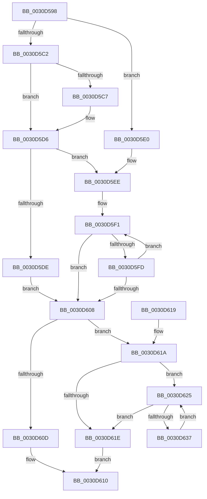

# KiTryAcquirePrcbLocksForIsolationUnit

- RVA: `0x0030D598`–`0x0030D639` (길이 `161` bytes)
- VA: `0x000000014030D598`
- 실행 섹션: `.text`
- PDB 이름 있음: `예`; PDB Function 태그: `아니요`
- unwind 정보 RVA: `0x00073E94`
- 디코드: `52`개 명령, `161/161` bytes 표시
- 미해석 바이트: `0` (있으면 어셈블리에 `.byte`로 보존)

> 이 문서는 커널 이미지의 기계어와 PDB 기호를 분석해 생성했습니다. 4번과 5번은 함수 원형과 자료형을 바이너리 사용 방식에서 추정한 C 해석이며 원본 소스 복구 결과는 아닙니다.

## 1. Dependencies

- 직접 호출 지점: **0**; 고유 호출 대상: **0**
- 직접 호출자로 확인된 함수: **1**
- RIP 상대 이미지 참조: **0**

### Outgoing calls
- 직접 디코드된 call 명령이 없습니다.

### Direct callers
- [KiSearchForNewThreadsOnTarget](KiSearchForNewThreadsOnTarget_function_0030F500.md) at `0x0030FFBC`
- [KiSearchForNewThreadsOnTarget](KiSearchForNewThreadsOnTarget_function_0030F500.md) at `0x003103AC`
- [KiSearchForNewThreadsOnTarget](KiSearchForNewThreadsOnTarget_function_0030F500.md) at `0x00310B38`

### Static image references
- 디코드된 RIP-relative 메모리 참조가 없습니다.

## 2. Other-region calls and transfers

- 다른 실행 섹션으로 향하는 call: **0**
- 별도 외부 분기/꼬리 이동을 확인하지 못했습니다.

## 3. Assembly (complete function range)

```asm
0030D598  48 89 5C 24 10                  mov qword ptr [rsp + 0x10], rbx
0030D59D  45 33 D2                        xor r10d, r10d
0030D5A0  48 63 C2                        movsxd rax, edx
0030D5A3  4C 8B C8                        mov r9, rax
0030D5A6  48 89 4C 24 08                  mov qword ptr [rsp + 8], rcx
0030D5AB  4C 33 C9                        xor r9, rcx
0030D5AE  41 8B DA                        mov ebx, r10d
0030D5B1  49 83 E1 FE                     and r9, 0xfffffffffffffffe
0030D5B5  45 8B DA                        mov r11d, r10d
0030D5B8  4C 33 C8                        xor r9, rax
0030D5BB  4D 89 08                        mov qword ptr [r8], r9
0030D5BE  85 D2                           test edx, edx
0030D5C0  74 1E                           je 0x14030d5e0
0030D5C2  83 FA 01                        cmp edx, 1
0030D5C5  75 0F                           jne 0x14030d5d6
0030D5C7  48 8B 81 58 8E 00 00            mov rax, qword ptr [rcx + 0x8e58]
0030D5CE  44 0F B6 18                     movzx r11d, byte ptr [rax]
0030D5D2  48 8D 58 08                     lea rbx, [rax + 8]
0030D5D6  41 8B D2                        mov edx, r10d
0030D5D9  45 85 DB                        test r11d, r11d
0030D5DC  75 10                           jne 0x14030d5ee
0030D5DE  EB 28                           jmp 0x14030d608
0030D5E0  48 8D 5C 24 08                  lea rbx, [rsp + 8]
0030D5E5  41 BB 01 00 00 00               mov r11d, 1
0030D5EB  41 8B D2                        mov edx, r10d
0030D5EE  48 8B CB                        mov rcx, rbx
0030D5F1  48 8B 01                        mov rax, qword ptr [rcx]
0030D5F4  F0 48 0F BA 68 30 00            lock bts qword ptr [rax + 0x30], 0
0030D5FB  72 0B                           jb 0x14030d608
0030D5FD  FF C2                           inc edx
0030D5FF  48 83 C1 08                     add rcx, 8
0030D603  41 3B D3                        cmp edx, r11d
0030D606  72 E9                           jb 0x14030d5f1
0030D608  41 3B D3                        cmp edx, r11d
0030D60B  75 0D                           jne 0x14030d61a
0030D60D  41 B2 01                        mov r10b, 1
0030D610  48 8B 5C 24 10                  mov rbx, qword ptr [rsp + 0x10]
0030D615  41 8A C2                        mov al, r10b
0030D618  C3                              ret
0030D619  CC                              int3
0030D61A  85 D2                           test edx, edx
0030D61C  75 07                           jne 0x14030d625
0030D61E  33 C0                           xor eax, eax
0030D620  49 89 00                        mov qword ptr [r8], rax
0030D623  EB EB                           jmp 0x14030d610
0030D625  8D 42 FF                        lea eax, [rdx - 1]
0030D628  48 8B 0C C3                     mov rcx, qword ptr [rbx + rax*8]
0030D62C  8B D0                           mov edx, eax
0030D62E  F0 4C 21 51 30                  lock and qword ptr [rcx + 0x30], r10
0030D633  85 C0                           test eax, eax
0030D635  74 E7                           je 0x14030d61e
0030D637  EB EC                           jmp 0x14030d625
```

## 4. C-style interpretation (structured pseudocode)

```c
__int64 __fastcall KiTryAcquirePrcbLocksForIsolationUnit(__int64 a1, int a2, __int64 a3)
{
    __int64 result;
    __int64 v_r10;
    __int64 v_r11;
    __int64 v_rbx;
    unsigned __int64 v_stack_p10;
    unsigned __int64 v_stack_p8;

    v_stack_p10 = v_rbx;
    v_r10 = 0;
    v_stack_p8 = a1;
    a4 = ((int)(a2)) ^ (a1);
    a4 = (a4) & (-2);
    a4 = (a4) ^ ((int)(a2));
    *(unsigned __int64 *)(a3) = a4;
    if (a2 == 0) goto loc_0030D5E0;
    result = (int)(a2);
    v_rbx = 0;
    v_r11 = 0;
    if (a2 == 1) {
        result = *(unsigned __int64 *)(a1 + 36440);
        v_r11 = *(unsigned __int8 *)(result);
        v_rbx = result + 8;
    }
    if ((unsigned int)(v_r11) != 0) goto loc_0030D5EE;
    goto loc_0030D608;
loc_0030D5E0:
loc_0030D5EE:
loc_0030D5F1:
    if (condition_is_below) goto loc_0030D608;
    a2 = (unsigned int)((0) + 1);
    a1 = (v_stack_p8) + (8);
    if (a2 < 1) goto loc_0030D5F1;
loc_0030D608:
    if (a2 != 1) goto loc_0030D61A;
loc_0030D610:
    return 1;
loc_0030D61A:
    if (a2 != 0) goto loc_0030D625;
loc_0030D61E:
    result = 0;
    *(unsigned __int64 *)(a3) = 0;
    goto loc_0030D610;
loc_0030D625:
    if ((unsigned int)(a2 - 1) == 0) goto loc_0030D61E;
    goto loc_0030D625;
}
```

## 5. (Beta) C Style

```c
int64_t KiTryAcquirePrcbLocksForIsolationUnit(void *Arg1, int32_t Arg2, void *Arg3)
{
    uint8_t *arg1 = (uint8_t *)Arg1;
    uint8_t *arg3 = (uint8_t *)Arg3;

    int64_t result;
    int64_t local_r10;
    int64_t local_r11;
    int64_t local_rbx;
    uint64_t v_stack_p10;
    uint64_t v_stack_p8;

    v_stack_p10 = local_rbx;
    local_r10 = 0;
    v_stack_p8 = Arg1;
    a4 = ((int32_t)(Arg2)) ^ (Arg1);
    a4 = (a4) & (-2);
    a4 = (a4) ^ ((int32_t)(Arg2));
    *(uint64_t *)(arg3) = a4;
    if (Arg2 == 0) goto loc_0030D5E0;
    result = (int32_t)(Arg2);
    local_rbx = 0;
    local_r11 = 0;
    if (Arg2 == 1) {
        result = *(uint64_t *)(arg1 + 0x8E58);
        local_r11 = *(uint8_t *)(result);
        local_rbx = result + 8;
    }
    if ((uint32_t)(local_r11) != 0) goto loc_0030D5EE;
    goto loc_0030D608;
loc_0030D5E0:
loc_0030D5EE:
loc_0030D5F1:
    if (condition_is_below) goto loc_0030D608;
    Arg2 = (uint32_t)((0) + 1);
    Arg1 = (v_stack_p8) + (8);
    if (Arg2 < 1) goto loc_0030D5F1;
loc_0030D608:
    if (Arg2 != 1) goto loc_0030D61A;
loc_0030D610:
    return 1;
loc_0030D61A:
    if (Arg2 != 0) goto loc_0030D625;
loc_0030D61E:
    result = 0;
    *(uint64_t *)(arg3) = 0;
    goto loc_0030D610;
loc_0030D625:
    if ((uint32_t)(Arg2 - 1) == 0) goto loc_0030D61E;
    goto loc_0030D625;
}
```

### 관측된 메모리 오프셋

구조체 형식이 확인되지 않은 접근은 인자 기준의 오프셋으로만 기록했습니다.

| 기준 인자 | 오프셋 표현 | 폭 (bit) | 접근 |
|---|---:|---:|---|
| `Arg1` | `+ 0x8E58` | `64` | `R` |
| `Arg3` | `+ 0x0` | `64` | `W` |

## 6. Execution-region graph

[열기: 2D/3D 그래프와 함수 탐색 컨트롤 패널](../../../control-panel.html?section=text&rva=0x0030D598&view=graph)

- 2D 그래프는 위에서 아래로 흐르고, 3D 그래프는 빈 공간을 드래그해 회전합니다. Shift+드래그는 이동, 휠은 확대·축소, 함수 노드 선택은 대상 보고서 이동입니다.

### Static fallback


