# KiUpdateGlobalCpuSetConfiguration

- RVA: `0x00305AB8`–`0x00305EC8` (길이 `1,040` bytes)
- VA: `0x0000000140305AB8`
- 실행 섹션: `.text`
- PDB 이름 있음: `예`; PDB Function 태그: `예`
- unwind 정보 RVA: `0x000736D8`
- 디코드: `235`개 명령, `1,040/1,040` bytes 표시
- 미해석 바이트: `0` (있으면 어셈블리에 `.byte`로 보존)

> 이 문서는 커널 이미지의 기계어와 PDB 기호를 분석해 생성했습니다. 4번과 5번은 함수 원형과 자료형을 바이너리 사용 방식에서 추정한 C 해석이며 원본 소스 복구 결과는 아닙니다.

## 1. Dependencies

- 직접 호출 지점: **22**; 고유 호출 대상: **18**
- 직접 호출자로 확인된 함수: **1**
- RIP 상대 이미지 참조: **7**

### Outgoing calls
- `0x00305AE5` → [Feature_Servicing_IdealProcessorEventOutsideLocks__private_ReportDeviceUsage](Feature_Servicing_IdealProcessorEventOutsideLocks__private_ReportDeviceUsage_function_00305020.md) (function, `0x00305020`)
- `0x00305B1C` → [memset](../6C/memset_function_006C6C40.md) (function, `0x006C6C40`)
- `0x00305B41` → [KiAcquirePrcbLocksForIsolationUnit](KiAcquirePrcbLocksForIsolationUnit_function_0030ED60.md) (function, `0x0030ED60`)
- `0x00305B65` → [KiStartRescheduleContext](KiStartRescheduleContext_function_0030C6B0.md) (function, `0x0030C6B0`)
- `0x00305B85` → [KiIsThreadStateControlledByProcessor](KiIsThreadStateControlledByProcessor_function_00306254.md) (function, `0x00306254`)
- `0x00305BE7` → [KiReleasePrcbLocksForIsolationUnit](../39/KiReleasePrcbLocksForIsolationUnit_function_00399C50.md) (function, `0x00399C50`)
- `0x00305C2B` → [KiFlushSoftwareInterruptBatch](../25/KiFlushSoftwareInterruptBatch_function_00252200.md) (function, `0x00252200`)
- `0x00305C53` → [KiReleasePrcbLocksForIsolationUnit](../39/KiReleasePrcbLocksForIsolationUnit_function_00399C50.md) (function, `0x00399C50`)
- `0x00305C8D` → [KiAcquirePrcbLocksForIsolationUnit](KiAcquirePrcbLocksForIsolationUnit_function_0030ED60.md) (function, `0x0030ED60`)
- `0x00305CAC` → [KiReleasePrcbLocksForIsolationUnit](../39/KiReleasePrcbLocksForIsolationUnit_function_00399C50.md) (function, `0x00399C50`)
- `0x00305CC1` → [KiCheckThreadAffinity](../25/KiCheckThreadAffinity_function_00256DD0.md) (function, `0x00256DD0`)
- `0x00305CCE` → [KiComputeThreadAffinity](../39/KiComputeThreadAffinity_function_00399DE0.md) (function, `0x00399DE0`)
- `0x00305CF9` → [KeCheckProcessorAffinityEx](KeCheckProcessorAffinityEx_function_00305150.md) (function, `0x00305150`)
- `0x00305D2D` → [KiCheckThreadAffinity](../25/KiCheckThreadAffinity_function_00256DD0.md) (function, `0x00256DD0`)
- `0x00305D46` → [KiFindRescheduleContextEntryForPrcb](../35/KiFindRescheduleContextEntryForPrcb_function_00353060.md) (function, `0x00353060`)
- `0x00305D8E` → [KiSearchForNewThreadsForRescheduleContext](../25/KiSearchForNewThreadsForRescheduleContext_function_00258620.md) (function, `0x00258620`)
- `0x00305DA4` → [KiCommitRescheduleContext](KiCommitRescheduleContext_function_0030CF20.md) (function, `0x0030CF20`)
- `0x00305DBF` → [KiCheckVpBackingLongSpinWaitHypercall](KiCheckVpBackingLongSpinWaitHypercall_function_0030F490.md) (function, `0x0030F490`)
- `0x00305DCE` → [HvlNotifyLongSpinWait](HvlNotifyLongSpinWait_function_0030F460.md) (function, `0x0030F460`)
- `0x00305E04` → [EtwTraceThreadAffinity](../3C/EtwTraceThreadAffinity_function_003C29A0.md) (function, `0x003C29A0`)
- `0x00305E48` → [KiAdjustRescheduleContextEntryForThreadRemoval](../35/KiAdjustRescheduleContextEntryForThreadRemoval_function_00352340.md) (function, `0x00352340`)
- `0x00305EBE` → [EtwTraceIdealProcessor](../3C/EtwTraceIdealProcessor_function_003C0808.md) (function, `0x003C0808`)

### Direct callers
- [KeCpuSetReportParkedProcessors](KeCpuSetReportParkedProcessors_function_003052B0.md) at `0x00305439`

### Static image references
- `0x00305AEA` → RVA `0x00FC6A80` (`ALMOSTRO`; read)
- `0x00305B06` → RVA `0x00FC8C40` (`ALMOSTRO`; read)
- `0x00305B21` → RVA `0x00FC6BF8` (`ALMOSTRO`; read)
- `0x00305BB0` → RVA `0x00FC6B10` (`ALMOSTRO`; read)
- `0x00305C66` → RVA `0x00FC52AC` (`ALMOSTRO`; reference)
- `0x00305CD3` → RVA `0x00FC6B04` (`ALMOSTRO`; read)
- `0x00305DB1` → RVA `0x00FC6AB8` (`ALMOSTRO`; read)

## 2. Other-region calls and transfers

- 다른 실행 섹션으로 향하는 call: **0**
- call이 아닌 외부 분기/꼬리 이동: **3**
  - `0x00305D0E` → [sub_006E07CE](../6E/Unknown_function_006E07CE.md) (`tail-transfer`)
  - `0x00305D16` → [sub_006E07CE + 0x6](../6E/Unknown_function_006E07CE.md) (`tail-transfer`)
  - `0x00305E9B` → [sub_006E07CE + 0x85](../6E/Unknown_function_006E07CE.md) (`tail-transfer`)

## 3. Assembly (complete function range)

```asm
00305AB8  48 8B C4                        mov rax, rsp
00305ABB  48 89 48 08                     mov qword ptr [rax + 8], rcx
00305ABF  53                              push rbx
00305AC0  55                              push rbp
00305AC1  56                              push rsi
00305AC2  57                              push rdi
00305AC3  41 54                           push r12
00305AC5  41 55                           push r13
00305AC7  41 56                           push r14
00305AC9  41 57                           push r15
00305ACB  48 83 EC 38                     sub rsp, 0x38
00305ACF  65 4C 8B 34 25 20 00 00 00      mov r14, qword ptr gs:[0x20]
00305AD8  48 83 60 20 00                  and qword ptr [rax + 0x20], 0
00305ADD  C6 84 24 88 00 00 00 00         mov byte ptr [rsp + 0x88], 0
00305AE5  E8 36 F5 FF FF                  call 0x140305020
00305AEA  8B 05 90 0F CC 00               mov eax, dword ptr [rip + 0xcc0f90]
00305AF0  45 33 FF                        xor r15d, r15d
00305AF3  49 8B BE E8 37 00 00            mov rdi, qword ptr [r14 + 0x37e8]
00305AFA  85 C0                           test eax, eax
00305AFC  0F 84 22 01 00 00               je 0x140305c24
00305B02  45 8D 67 01                     lea r12d, [r15 + 1]
00305B06  48 8D 35 33 31 CC 00            lea rsi, [rip + 0xcc3133]
00305B0D  33 D2                           xor edx, edx
00305B0F  4A 8B 34 FE                     mov rsi, qword ptr [rsi + r15*8]
00305B13  41 B8 F0 00 00 00               mov r8d, 0xf0
00305B19  48 8B CF                        mov rcx, rdi
00305B1C  E8 1F 11 3C 00                  call 0x1406c6c40
00305B21  48 8B 0D D0 10 CC 00            mov rcx, qword ptr [rip + 0xcc10d0]
00305B28  48 8B 46 18                     mov rax, qword ptr [rsi + 0x18]
00305B2C  48 89 88 38 02 00 00            mov qword ptr [rax + 0x238], rcx
00305B33  4C 8D 84 24 98 00 00 00         lea r8, [rsp + 0x98]
00305B3B  41 8B D4                        mov edx, r12d
00305B3E  48 8B CE                        mov rcx, rsi
00305B41  E8 1A 92 00 00                  call 0x14030ed60
00305B46  48 8B 5E 08                     mov rbx, qword ptr [rsi + 8]
00305B4A  F0 48 0F BA 6B 40 00            lock bts qword ptr [rbx + 0x40], 0
00305B51  0F 82 EB 00 00 00               jb 0x140305c42
00305B57  4C 8B C3                        mov r8, rbx
00305B5A  48 8D 94 24 98 00 00 00         lea rdx, [rsp + 0x98]
00305B62  48 8B CF                        mov rcx, rdi
00305B65  E8 46 6B 00 00                  call 0x14030c6b0
00305B6A  44 8B AB 4C 02 00 00            mov r13d, dword ptr [rbx + 0x24c]
00305B71  48 8B D6                        mov rdx, rsi
00305B74  48 8B CB                        mov rcx, rbx
00305B77  44 89 AC 24 90 00 00 00         mov dword ptr [rsp + 0x90], r13d
00305B7F  40 32 ED                        xor bpl, bpl
00305B82  45 8B E5                        mov r12d, r13d
00305B85  E8 CA 06 00 00                  call 0x140306254
00305B8A  84 C0                           test al, al
00305B8C  0F 85 2C 01 00 00               jne 0x140305cbe
00305B92  48 C7 43 40 00 00 00 00         mov qword ptr [rbx + 0x40], 0
00305B9A  48 8B 4E 10                     mov rcx, qword ptr [rsi + 0x10]
00305B9E  48 85 C9                        test rcx, rcx
00305BA1  0F 85 86 01 00 00               jne 0x140305d2d
00305BA7  40 84 ED                        test bpl, bpl
00305BAA  0F 85 D3 01 00 00               jne 0x140305d83
00305BB0  F7 05 56 0F CC 00 00 00 00 08   test dword ptr [rip + 0xcc0f56], 0x8000000
00305BBA  0F 85 A9 02 00 00               jne 0x140305e69
00305BC0  40 32 F6                        xor sil, sil
00305BC3  B8 01 00 00 00                  mov eax, 1
00305BC8  80 BC 24 88 00 00 00 00         cmp byte ptr [rsp + 0x88], 0
00305BD0  0F 85 A9 02 00 00               jne 0x140305e7f
00305BD6  40 84 F6                        test sil, sil
00305BD9  0F 85 A0 02 00 00               jne 0x140305e7f
00305BDF  48 8D 8C 24 98 00 00 00         lea rcx, [rsp + 0x98]
00305BE7  E8 64 40 09 00                  call 0x140399c50
00305BEC  40 84 ED                        test bpl, bpl
00305BEF  0F 85 97 02 00 00               jne 0x140305e8c
00305BF5  80 BC 24 88 00 00 00 00         cmp byte ptr [rsp + 0x88], 0
00305BFD  0F 85 D5 01 00 00               jne 0x140305dd8
00305C03  40 84 F6                        test sil, sil
00305C06  0F 85 94 02 00 00               jne 0x140305ea0
00305C0C  8B 05 6E 0E CC 00               mov eax, dword ptr [rip + 0xcc0e6e]
00305C12  41 BC 01 00 00 00               mov r12d, 1
00305C18  45 03 FC                        add r15d, r12d
00305C1B  44 3B F8                        cmp r15d, eax
00305C1E  0F 82 E2 FE FF FF               jb 0x140305b06
00305C24  49 8D 8E D8 35 00 00            lea rcx, [r14 + 0x35d8]
00305C2B  E8 D0 C5 F4 FF                  call 0x140252200
00305C30  48 83 C4 38                     add rsp, 0x38
00305C34  41 5F                           pop r15
00305C36  41 5E                           pop r14
00305C38  41 5D                           pop r13
00305C3A  41 5C                           pop r12
00305C3C  5F                              pop rdi
00305C3D  5E                              pop rsi
00305C3E  5D                              pop rbp
00305C3F  5B                              pop rbx
00305C40  C3                              ret
00305C41  CC                              int3
00305C42  66 F0 44 01 A3 64 03 00 00      lock add word ptr [rbx + 0x364], r12w
00305C4B  48 8D 8C 24 98 00 00 00         lea rcx, [rsp + 0x98]
00305C53  E8 F8 3F 09 00                  call 0x140399c50
00305C58  33 ED                           xor ebp, ebp
00305C5A  F0 48 0F BA 6B 40 00            lock bts qword ptr [rbx + 0x40], 0
00305C61  73 1C                           jae 0x140305c7f
00305C63  41 03 EC                        add ebp, r12d
00305C66  85 2D 40 F6 CB 00               test dword ptr [rip + 0xcbf640], ebp
00305C6C  0F 84 3F 01 00 00               je 0x140305db1
00305C72  F3 90                           pause
00305C74  48 8B 43 40                     mov rax, qword ptr [rbx + 0x40]
00305C78  48 85 C0                        test rax, rax
00305C7B  74 DD                           je 0x140305c5a
00305C7D  EB E4                           jmp 0x140305c63
00305C7F  4C 8D 84 24 98 00 00 00         lea r8, [rsp + 0x98]
00305C87  41 8B D4                        mov edx, r12d
00305C8A  48 8B CE                        mov rcx, rsi
00305C8D  E8 CE 90 00 00                  call 0x14030ed60
00305C92  66 F0 FF 8B 64 03 00 00         lock dec word ptr [rbx + 0x364]
00305C9A  48 3B 5E 08                     cmp rbx, qword ptr [rsi + 8]
00305C9E  0F 84 B3 FE FF FF               je 0x140305b57
00305CA4  48 8D 8C 24 98 00 00 00         lea rcx, [rsp + 0x98]
00305CAC  E8 9F 3F 09 00                  call 0x140399c50
00305CB1  48 C7 43 40 00 00 00 00         mov qword ptr [rbx + 0x40], 0
00305CB9  E9 75 FE FF FF                  jmp 0x140305b33
00305CBE  48 8B CB                        mov rcx, rbx
00305CC1  E8 0A 11 F5 FF                  call 0x140256dd0
00305CC6  85 C0                           test eax, eax
00305CC8  0F 85 C4 FE FF FF               jne 0x140305b92
00305CCE  E8 0D 41 09 00                  call 0x140399de0
00305CD3  8B 0D 2B 0E CC 00               mov ecx, dword ptr [rip + 0xcc0e2b]
00305CD9  8B 56 24                        mov edx, dword ptr [rsi + 0x24]
00305CDC  44 8B A3 4C 02 00 00            mov r12d, dword ptr [rbx + 0x24c]
00305CE3  C1 E9 0C                        shr ecx, 0xc
00305CE6  80 E1 01                        and cl, 1
00305CE9  22 C1                           and al, cl
00305CEB  48 8B 8B 40 02 00 00            mov rcx, qword ptr [rbx + 0x240]
00305CF2  89 84 24 88 00 00 00            mov dword ptr [rsp + 0x88], eax
00305CF9  E8 52 F4 FF FF                  call 0x140305150
00305CFE  85 C0                           test eax, eax
00305D00  0F 85 8C FE FF FF               jne 0x140305b92
00305D06  8A 83 84 01 00 00               mov al, byte ptr [rbx + 0x184]
00305D0C  3C 02                           cmp al, 2
00305D0E  0F 84 BA AA 3D 00               je 0x1406e07ce
00305D14  3C 03                           cmp al, 3
00305D16  0F 84 B8 AA 3D 00               je 0x1406e07d4
00305D1C  3C 05                           cmp al, 5
00305D1E  0F 85 6E FE FF FF               jne 0x140305b92
00305D24  80 4B 70 08                     or byte ptr [rbx + 0x70], 8
00305D28  E9 65 FE FF FF                  jmp 0x140305b92
00305D2D  E8 9E 10 F5 FF                  call 0x140256dd0
00305D32  85 C0                           test eax, eax
00305D34  0F 85 6D FE FF FF               jne 0x140305ba7
00305D3A  F0 0F BA 71 78 0C               lock btr dword ptr [rcx + 0x78], 0xc
00305D40  48 8B CF                        mov rcx, rdi
00305D43  48 8B D6                        mov rdx, rsi
00305D46  E8 15 D3 04 00                  call 0x140353060
00305D4B  4C 8B D8                        mov r11, rax
00305D4E  80 48 22 02                     or byte ptr [rax + 0x22], 2
00305D52  44 8A 40 20                     mov r8b, byte ptr [rax + 0x20]
00305D56  48 8B 10                        mov rdx, qword ptr [rax]
00305D59  48 8B 4A 18                     mov rcx, qword ptr [rdx + 0x18]
00305D5D  48 89 48 10                     mov qword ptr [rax + 0x10], rcx
00305D61  41 8A C8                        mov cl, r8b
00305D64  80 E1 C5                        and cl, 0xc5
00305D67  80 C9 05                        or cl, 5
00305D6A  88 48 20                        mov byte ptr [rax + 0x20], cl
00305D6D  48 8B 4A 18                     mov rcx, qword ptr [rdx + 0x18]
00305D71  80 60 21 FE                     and byte ptr [rax + 0x21], 0xfe
00305D75  48 89 48 18                     mov qword ptr [rax + 0x18], rcx
00305D79  41 F6 C0 02                     test r8b, 2
00305D7D  0F 85 9C 00 00 00               jne 0x140305e1f
00305D83  48 8B 94 24 80 00 00 00         mov rdx, qword ptr [rsp + 0x80]
00305D8B  48 8B CF                        mov rcx, rdi
00305D8E  E8 8D 28 F5 FF                  call 0x140258620
00305D93  4C 8B 8C 24 80 00 00 00         mov r9, qword ptr [rsp + 0x80]
00305D9B  45 33 C0                        xor r8d, r8d
00305D9E  49 8B D6                        mov rdx, r14
00305DA1  48 8B CF                        mov rcx, rdi
00305DA4  E8 77 71 00 00                  call 0x14030cf20
00305DA9  40 8A E8                        mov bpl, al
00305DAC  E9 FF FD FF FF                  jmp 0x140305bb0
00305DB1  8B 05 01 0D CC 00               mov eax, dword ptr [rip + 0xcc0d01]
00305DB7  A8 40                           test al, 0x40
00305DB9  0F 84 B3 FE FF FF               je 0x140305c72
00305DBF  E8 CC 96 00 00                  call 0x14030f490
00305DC4  84 C0                           test al, al
00305DC6  0F 84 A6 FE FF FF               je 0x140305c72
00305DCC  8B CD                           mov ecx, ebp
00305DCE  E8 8D 96 00 00                  call 0x14030f460
00305DD3  E9 9C FE FF FF                  jmp 0x140305c74
00305DD8  44 8B 43 74                     mov r8d, dword ptr [rbx + 0x74]
00305DDC  45 33 C9                        xor r9d, r9d
00305DDF  48 8B 83 40 02 00 00            mov rax, qword ptr [rbx + 0x240]
00305DE6  48 8B CB                        mov rcx, rbx
00305DE9  0F B7 93 48 02 00 00            movzx edx, word ptr [rbx + 0x248]
00305DF0  41 C1 E8 03                     shr r8d, 3
00305DF4  41 80 E0 01                     and r8b, 1
00305DF8  66 C7 44 24 28 36 05            mov word ptr [rsp + 0x28], 0x536
00305DFF  48 89 44 24 20                  mov qword ptr [rsp + 0x20], rax
00305E04  E8 97 CB 0B 00                  call 0x1403c29a0
00305E09  40 84 F6                        test sil, sil
00305E0C  0F 85 8E 00 00 00               jne 0x140305ea0
00305E12  66 F0 FF 8B 64 03 00 00         lock dec word ptr [rbx + 0x364]
00305E1A  E9 ED FD FF FF                  jmp 0x140305c0c
00305E1F  45 33 D2                        xor r10d, r10d
00305E22  44 38 17                        cmp byte ptr [rdi], r10b
00305E25  76 39                           jbe 0x140305e60
00305E27  45 8D 6A 01                     lea r13d, [r10 + 1]
00305E2B  41 8B C2                        mov eax, r10d
00305E2E  4A 8D 0C 95 02 00 00 00         lea rcx, [r10*4 + 2]
00305E36  48 03 C8                        add rcx, rax
00305E39  48 8D 0C CF                     lea rcx, [rdi + rcx*8]
00305E3D  49 3B CB                        cmp rcx, r11
00305E40  74 0B                           je 0x140305e4d
00305E42  45 8A CD                        mov r9b, r13b
00305E45  45 33 C0                        xor r8d, r8d
00305E48  E8 F3 C4 04 00                  call 0x140352340
00305E4D  0F B6 07                        movzx eax, byte ptr [rdi]
00305E50  45 03 D5                        add r10d, r13d
00305E53  44 3B D0                        cmp r10d, eax
00305E56  72 D3                           jb 0x140305e2b
00305E58  44 8B AC 24 90 00 00 00         mov r13d, dword ptr [rsp + 0x90]
00305E60  83 67 04 00                     and dword ptr [rdi + 4], 0
00305E64  E9 1A FF FF FF                  jmp 0x140305d83
00305E69  45 3B EC                        cmp r13d, r12d
00305E6C  0F 84 4E FD FF FF               je 0x140305bc0
00305E72  B8 01 00 00 00                  mov eax, 1
00305E77  40 8A F0                        mov sil, al
00305E7A  E9 49 FD FF FF                  jmp 0x140305bc8
00305E7F  66 F0 01 83 64 03 00 00         lock add word ptr [rbx + 0x364], ax
00305E87  E9 53 FD FF FF                  jmp 0x140305bdf
00305E8C  33 ED                           xor ebp, ebp
00305E8E  40 38 2F                        cmp byte ptr [rdi], bpl
00305E91  0F 86 5E FD FF FF               jbe 0x140305bf5
00305E97  44 8D 6D 01                     lea r13d, [rbp + 1]
00305E9B  E9 B3 A9 3D 00                  jmp 0x1406e0853
00305EA0  F7 05 66 0C CC 00 00 00 00 08   test dword ptr [rip + 0xcc0c66], 0x8000000
00305EAA  0F 84 62 FF FF FF               je 0x140305e12
00305EB0  BA 46 05 00 00                  mov edx, 0x546
00305EB5  45 8B CC                        mov r9d, r12d
00305EB8  45 8B C5                        mov r8d, r13d
00305EBB  48 8B CB                        mov rcx, rbx
00305EBE  E8 45 A9 0B 00                  call 0x1403c0808
00305EC3  E9 4A FF FF FF                  jmp 0x140305e12
```

## 4. C-style interpretation (structured pseudocode)

```c
__int64 __fastcall KiUpdateGlobalCpuSetConfiguration(__int64 a1, int a2)
{
    __int64 result;
    __int64 v_r10;
    __int64 v_r15;
    __int64 v_rbp;
    __int64 v_rsi;
    __int64 v_rsp;
    unsigned __int8 v_stack_p10;
    unsigned int v_stack_p18;
    unsigned __int64 v_stack_p20;
    unsigned __int16 v_stack_p28;
    unsigned __int64 v_stack_p80;
    unsigned int v_stack_p88;
    unsigned int v_stack_p90;
    unsigned __int64 v_stack_p98;

    *(unsigned __int64 *)(v_rsp + 8) = a1;
    v_rsp = (v_rsp) - (56);
    v_stack_p10 = 0;
    result = Feature_Servicing_IdealProcessorEventOutsideLocks__private_ReportDeviceUsage(a1, a2, a3, a4);
    v_r15 = 0;
    if ((unsigned int)((unsigned int)(*(unsigned int *)(v_rip + 13373328))) == 0) goto loc_00305C24;
loc_00305B06:
    a2 = 0;
    result = memset(*(unsigned __int64 *)(*(unsigned __int64 *)(gs_base + (0 + 32)) + 14312), a2, 240, a4);
    *(unsigned __int64 *)(*(unsigned __int64 *)(*(unsigned __int64 *)(v_rip + 13381939 + v_r15 * 8) + 24) + 568) = *(unsigned __int64 *)(v_rip + 13373648);
loc_00305B33:
    result = KiAcquirePrcbLocksForIsolationUnit(*(unsigned __int64 *)(v_rip + 13381939 + v_r15 * 8), (unsigned int)((unsigned int)(v_r15 + 1)), v_stack_p20, a4);
    if (condition_is_below) goto loc_00305C42;
loc_00305B57:
    result = KiStartRescheduleContext(*(unsigned __int64 *)(*(unsigned __int64 *)(gs_base + (0 + 32)) + 14312), v_stack_p20, *(unsigned __int64 *)(*(unsigned __int64 *)(v_rip + 13381939 + v_r15 * 8) + 8), a4);
    v_stack_p18 = (unsigned int)((unsigned int)(*(unsigned int *)(*(unsigned __int64 *)(*(unsigned __int64 *)(v_rip + 13381939 + v_r15 * 8) + 8) + 588)));
    v_rbp = 0;
    result = KiIsThreadStateControlledByProcessor(*(unsigned __int64 *)(*(unsigned __int64 *)(v_rip + 13381939 + v_r15 * 8) + 8), *(unsigned __int64 *)(v_rip + 13381939 + v_r15 * 8), *(unsigned __int64 *)(*(unsigned __int64 *)(v_rip + 13381939 + v_r15 * 8) + 8), a4);
    if ((unsigned __int8)(result) != 0) goto loc_00305CBE;
loc_00305B92:
    *(unsigned __int64 *)(*(unsigned __int64 *)(*(unsigned __int64 *)(v_rip + 13381939 + v_r15 * 8) + 8) + 64) = 0;
    if (*(unsigned __int64 *)(*(unsigned __int64 *)(v_rip + 13381939 + v_r15 * 8) + 16) != 0) goto loc_00305D2D;
loc_00305BA7:
    if (0 != 0) goto loc_00305D83;
loc_00305BB0:
    if (((*(unsigned int *)(v_rip + 13373270)) & (0x8000000ULL)) != 0) goto loc_00305E69;
loc_00305BC0:
    v_rsi = 0;
loc_00305BC8:
    if (v_stack_p10 != 0) goto loc_00305E7F;
    if (0 != 0) goto loc_00305E7F;
loc_00305BDF:
    result = KiReleasePrcbLocksForIsolationUnit(v_stack_p20, *(unsigned __int64 *)(v_rip + 13381939 + v_r15 * 8), *(unsigned __int64 *)(*(unsigned __int64 *)(v_rip + 13381939 + v_r15 * 8) + 8), a4);
    if (0 != 0) goto loc_00305E8C;
loc_00305BF5:
    if (v_stack_p10 != 0) goto loc_00305DD8;
    if (0 != 0) goto loc_00305EA0;
loc_00305C0C:
    v_r15 = (unsigned int)((v_r15) + (1));
    if (((unsigned int)(v_r15)) < ((unsigned int)((unsigned int)(*(unsigned int *)(v_rip + 13373038))))) goto loc_00305B06;
loc_00305C24:
    result = KiFlushSoftwareInterruptBatch(*(unsigned __int64 *)(gs_base + (0 + 32)) + 13784, *(unsigned __int64 *)(v_rip + 13381939 + v_r15 * 8), *(unsigned __int64 *)(*(unsigned __int64 *)(v_rip + 13381939 + v_r15 * 8) + 8), a4);
    v_rsp = (v_rsp) + (56);
    return result;
loc_00305C42:
    result = KiReleasePrcbLocksForIsolationUnit(v_stack_p98, *(unsigned __int64 *)(v_rip + 13381939 + v_r15 * 8), *(unsigned __int64 *)(*(unsigned __int64 *)(v_rip + 13381939 + v_r15 * 8) + 8), a4);
    v_rbp = 0;
loc_00305C5A:
    if (condition_is_above_or_equal) goto loc_00305C7F;
loc_00305C63:
    v_rbp = (unsigned int)((v_rbp) + (1));
    if (((*(unsigned int *)(v_rip + 13366848)) & ((unsigned int)(v_rbp))) == 0) goto loc_00305DB1;
loc_00305C72:
loc_00305C74:
    if (*(unsigned __int64 *)(*(unsigned __int64 *)(*(unsigned __int64 *)(v_rip + 13381939 + v_r15 * 8) + 8) + 64) == 0) goto loc_00305C5A;
    goto loc_00305C63;
loc_00305C7F:
    result = KiAcquirePrcbLocksForIsolationUnit(0, 1, v_stack_p98, a4);
    if ((*(unsigned __int64 *)(*(unsigned __int64 *)(v_rip + 13381939 + v_r15 * 8) + 8)) == (*(unsigned __int64 *)(v_rsi + 8))) goto loc_00305B57;
    result = KiReleasePrcbLocksForIsolationUnit(v_stack_p98, 1, v_stack_p98, a4);
    *(unsigned __int64 *)(*(unsigned __int64 *)(*(unsigned __int64 *)(v_rip + 13381939 + v_r15 * 8) + 8) + 64) = 0;
    goto loc_00305B33;
loc_00305CBE:
    result = KiCheckThreadAffinity(*(unsigned __int64 *)(*(unsigned __int64 *)(v_rip + 13381939 + v_r15 * 8) + 8), 1, v_stack_p98, a4);
    if ((unsigned int)(result) != 0) goto loc_00305B92;
    result = KiComputeThreadAffinity(*(unsigned __int64 *)(*(unsigned __int64 *)(v_rip + 13381939 + v_r15 * 8) + 8), 1, v_stack_p98, a4);
    a1 = (unsigned int)(((unsigned int)(*(unsigned int *)(v_rip + 13372971))) >> (12));
    a1 = (unsigned __int8)((a1) & (1));
    result = (unsigned __int8)((result) & ((unsigned __int8)(a1)));
    v_stack_p88 = (unsigned int)(result);
    result = KeCheckProcessorAffinityEx(*(unsigned __int64 *)(*(unsigned __int64 *)(*(unsigned __int64 *)(v_rip + 13381939 + v_r15 * 8) + 8) + 576), (unsigned int)(*(unsigned int *)(v_rsi + 36)), v_stack_p98, a4);
    if ((unsigned int)(result) != 0) goto loc_00305B92;
    if (((unsigned __int8)(*(unsigned __int8 *)(*(unsigned __int64 *)(*(unsigned __int64 *)(v_rip + 13381939 + v_r15 * 8) + 8) + 388))) != 5) goto loc_00305B92;
    goto loc_00305B92;
loc_00305D2D:
    result = KiCheckThreadAffinity(*(unsigned __int64 *)(*(unsigned __int64 *)(*(unsigned __int64 *)(v_rip + 13381939 + v_r15 * 8) + 8) + 576), (unsigned int)(*(unsigned int *)(v_rsi + 36)), v_stack_p98, a4);
    if ((unsigned int)(result) != 0) goto loc_00305BA7;
    result = KiFindRescheduleContextEntryForPrcb(*(unsigned __int64 *)(*(unsigned __int64 *)(gs_base + (0 + 32)) + 14312), 0, v_stack_p98, a4);
    *(unsigned __int64 *)(result + 16) = *(unsigned __int64 *)(*(unsigned __int64 *)(result) + 24);
    a1 = (unsigned __int8)(((unsigned __int8)(*(unsigned __int8 *)(result + 32))) & (197));
    a1 = (unsigned __int8)((a1) | (5));
    *(unsigned __int8 *)(result + 32) = (unsigned __int8)(a1);
    *(unsigned __int64 *)(result + 24) = *(unsigned __int64 *)(*(unsigned __int64 *)(result) + 24);
    if ((((unsigned __int8)(*(unsigned __int8 *)(result + 32))) & (2)) != 0) goto loc_00305E1F;
loc_00305D83:
    result = KiSearchForNewThreadsForRescheduleContext(*(unsigned __int64 *)(*(unsigned __int64 *)(gs_base + (0 + 32)) + 14312), v_stack_p80, *(unsigned __int8 *)(result + 32), a4);
    a3 = 0;
    result = KiCommitRescheduleContext(*(unsigned __int64 *)(*(unsigned __int64 *)(gs_base + (0 + 32)) + 14312), *(unsigned __int64 *)(gs_base + (0 + 32)), a3, v_stack_p80);
    goto loc_00305BB0;
loc_00305DB1:
    if ((((unsigned __int8)((unsigned int)(*(unsigned int *)(v_rip + 13372673)))) & (64)) == 0) goto loc_00305C72;
    result = KiCheckVpBackingLongSpinWaitHypercall(*(unsigned __int64 *)(*(unsigned __int64 *)(gs_base + (0 + 32)) + 14312), *(unsigned __int64 *)(gs_base + (0 + 32)), a3, v_stack_p80);
    if ((unsigned __int8)(result) == 0) goto loc_00305C72;
    result = HvlNotifyLongSpinWait((unsigned int)((unsigned int)((unsigned __int8)(result))), *(unsigned __int64 *)(gs_base + (0 + 32)), a3, v_stack_p80);
    goto loc_00305C74;
loc_00305DD8:
    a4 = 0;
    a3 = (unsigned int)(((unsigned int)(*(unsigned int *)(*(unsigned __int64 *)(*(unsigned __int64 *)(v_rip + 13381939 + v_r15 * 8) + 8) + 116))) >> (3));
    a3 = (unsigned __int8)((a3) & (1));
    v_stack_p28 = 0x536ULL;
    v_stack_p20 = *(unsigned __int64 *)(*(unsigned __int64 *)(*(unsigned __int64 *)(v_rip + 13381939 + v_r15 * 8) + 8) + 576);
    result = EtwTraceThreadAffinity(*(unsigned __int64 *)(*(unsigned __int64 *)(v_rip + 13381939 + v_r15 * 8) + 8), *(unsigned __int16 *)(*(unsigned __int64 *)(*(unsigned __int64 *)(v_rip + 13381939 + v_r15 * 8) + 8) + 584), a3, a4);
    if (0 != 0) goto loc_00305EA0;
loc_00305E12:
    goto loc_00305C0C;
loc_00305E1F:
    v_r10 = 0;
    if ((*(unsigned __int8 *)(*(unsigned __int64 *)(*(unsigned __int64 *)(gs_base + (0 + 32)) + 14312))) <= 0) goto loc_00305E60;
loc_00305E2B:
    a1 = (v_r10 * 4 + 2) + (0);
    result = 0;
    if ((*(unsigned __int64 *)(*(unsigned __int64 *)(gs_base + (0 + 32)) + 14312) + a1 * 8) != result) {
        a4 = (unsigned __int8)(v_r10 + 1);
        a3 = 0;
        result = KiAdjustRescheduleContextEntryForThreadRemoval(*(unsigned __int64 *)(*(unsigned __int64 *)(gs_base + (0 + 32)) + 14312) + a1 * 8, *(unsigned __int16 *)(*(unsigned __int64 *)(*(unsigned __int64 *)(v_rip + 13381939 + v_r15 * 8) + 8) + 584), a3, a4);
    }
    v_r10 = (unsigned int)((v_r10) + ((unsigned int)(v_r10 + 1)));
    if (((unsigned int)(v_r10)) < ((unsigned int)(*(unsigned __int8 *)(*(unsigned __int64 *)(*(unsigned __int64 *)(gs_base + (0 + 32)) + 14312))))) goto loc_00305E2B;
loc_00305E60:
    goto loc_00305D83;
loc_00305E69:
    if (((unsigned int)((unsigned int)(v_stack_p90))) == ((unsigned int)((unsigned int)(*(unsigned int *)(*(unsigned __int64 *)(*(unsigned __int64 *)(v_rip + 13381939 + v_r15 * 8) + 8) + 588))))) goto loc_00305BC0;
    goto loc_00305BC8;
loc_00305E7F:
    goto loc_00305BDF;
loc_00305E8C:
    v_rbp = 0;
    if ((*(unsigned __int8 *)(*(unsigned __int64 *)(*(unsigned __int64 *)(gs_base + (0 + 32)) + 14312))) <= 0) goto loc_00305BF5;
loc_00305EA0:
    if (((*(unsigned int *)(v_rip + 13372518)) & (0x8000000ULL)) == 0) goto loc_00305E12;
    result = EtwTraceIdealProcessor(*(unsigned __int64 *)(*(unsigned __int64 *)(v_rip + 13381939 + v_r15 * 8) + 8), (unsigned int)(0x546ULL), (unsigned int)((unsigned int)(v_rbp + 1)), (unsigned int)((unsigned int)((unsigned int)(*(unsigned int *)(*(unsigned __int64 *)(*(unsigned __int64 *)(v_rip + 13381939 + v_r15 * 8) + 8) + 588)))));
    goto loc_00305E12;
}
```

## 5. (Beta) C Style

```c
int64_t KiUpdateGlobalCpuSetConfiguration(int64_t Arg1, int32_t Arg2)
{
    int64_t result;
    int64_t local_r10;
    int64_t local_r15;
    int64_t local_rbp;
    int64_t local_rsi;
    int64_t local_rsp;
    uint8_t v_stack_p10;
    uint32_t v_stack_p18;
    uint64_t v_stack_p20;
    uint16_t v_stack_p28;
    uint64_t v_stack_p80;
    uint32_t v_stack_p88;
    uint32_t v_stack_p90;
    uint64_t v_stack_p98;

    *(uint64_t *)(local_rsp + 0x8) = Arg1;
    local_rsp = (local_rsp) - (56);
    v_stack_p10 = 0;
    result = Feature_Servicing_IdealProcessorEventOutsideLocks__private_ReportDeviceUsage(Arg1, Arg2, a3, a4);
    local_r15 = 0;
    if ((uint32_t)((uint32_t)(*(uint32_t *)(v_rip + 0xCC0F90))) == 0) goto loc_00305C24;
loc_00305B06:
    Arg2 = 0;
    result = memset(*(uint64_t *)(*(uint64_t *)(gs_base + (0 + 0x20)) + 0x37E8), Arg2, 240, a4);
    *(uint64_t *)(*(uint64_t *)(*(uint64_t *)(v_rip + 0xCC3133 + local_r15 * 8) + 0x18) + 0x238) = *(uint64_t *)(v_rip + 0xCC10D0);
loc_00305B33:
    result = KiAcquirePrcbLocksForIsolationUnit(*(uint64_t *)(v_rip + 0xCC3133 + local_r15 * 8), (uint32_t)((uint32_t)(local_r15 + 1)), v_stack_p20, a4);
    if (condition_is_below) goto loc_00305C42;
loc_00305B57:
    result = KiStartRescheduleContext(*(uint64_t *)(*(uint64_t *)(gs_base + (0 + 0x20)) + 0x37E8), v_stack_p20, *(uint64_t *)(*(uint64_t *)(v_rip + 0xCC3133 + local_r15 * 8) + 0x8), a4);
    v_stack_p18 = (uint32_t)((uint32_t)(*(uint32_t *)(*(uint64_t *)(*(uint64_t *)(v_rip + 0xCC3133 + local_r15 * 8) + 0x8) + 0x24C)));
    local_rbp = 0;
    result = KiIsThreadStateControlledByProcessor(*(uint64_t *)(*(uint64_t *)(v_rip + 0xCC3133 + local_r15 * 8) + 0x8), *(uint64_t *)(v_rip + 0xCC3133 + local_r15 * 8), *(uint64_t *)(*(uint64_t *)(v_rip + 0xCC3133 + local_r15 * 8) + 0x8), a4);
    if ((uint8_t)(result) != 0) goto loc_00305CBE;
loc_00305B92:
    *(uint64_t *)(*(uint64_t *)(*(uint64_t *)(v_rip + 0xCC3133 + local_r15 * 8) + 0x8) + 0x40) = 0;
    if (*(uint64_t *)(*(uint64_t *)(v_rip + 0xCC3133 + local_r15 * 8) + 0x10) != 0) goto loc_00305D2D;
loc_00305BA7:
    if (0 != 0) goto loc_00305D83;
loc_00305BB0:
    if (((*(uint32_t *)(v_rip + 0xCC0F56)) & (0x8000000ULL)) != 0) goto loc_00305E69;
loc_00305BC0:
    local_rsi = 0;
loc_00305BC8:
    if (v_stack_p10 != 0) goto loc_00305E7F;
    if (0 != 0) goto loc_00305E7F;
loc_00305BDF:
    result = KiReleasePrcbLocksForIsolationUnit(v_stack_p20, *(uint64_t *)(v_rip + 0xCC3133 + local_r15 * 8), *(uint64_t *)(*(uint64_t *)(v_rip + 0xCC3133 + local_r15 * 8) + 0x8), a4);
    if (0 != 0) goto loc_00305E8C;
loc_00305BF5:
    if (v_stack_p10 != 0) goto loc_00305DD8;
    if (0 != 0) goto loc_00305EA0;
loc_00305C0C:
    local_r15 = (uint32_t)((local_r15) + (1));
    if (((uint32_t)(local_r15)) < ((uint32_t)((uint32_t)(*(uint32_t *)(v_rip + 0xCC0E6E))))) goto loc_00305B06;
loc_00305C24:
    result = KiFlushSoftwareInterruptBatch(*(uint64_t *)(gs_base + (0 + 0x20)) + 13784, *(uint64_t *)(v_rip + 0xCC3133 + local_r15 * 8), *(uint64_t *)(*(uint64_t *)(v_rip + 0xCC3133 + local_r15 * 8) + 0x8), a4);
    local_rsp = (local_rsp) + (56);
    return result;
loc_00305C42:
    result = KiReleasePrcbLocksForIsolationUnit(v_stack_p98, *(uint64_t *)(v_rip + 0xCC3133 + local_r15 * 8), *(uint64_t *)(*(uint64_t *)(v_rip + 0xCC3133 + local_r15 * 8) + 0x8), a4);
    local_rbp = 0;
loc_00305C5A:
    if (condition_is_above_or_equal) goto loc_00305C7F;
loc_00305C63:
    local_rbp = (uint32_t)((local_rbp) + (1));
    if (((*(uint32_t *)(v_rip + 0xCBF640)) & ((uint32_t)(local_rbp))) == 0) goto loc_00305DB1;
loc_00305C72:
loc_00305C74:
    if (*(uint64_t *)(*(uint64_t *)(*(uint64_t *)(v_rip + 0xCC3133 + local_r15 * 8) + 0x8) + 0x40) == 0) goto loc_00305C5A;
    goto loc_00305C63;
loc_00305C7F:
    result = KiAcquirePrcbLocksForIsolationUnit(0, 1, v_stack_p98, a4);
    if ((*(uint64_t *)(*(uint64_t *)(v_rip + 0xCC3133 + local_r15 * 8) + 0x8)) == (*(uint64_t *)(local_rsi + 0x8))) goto loc_00305B57;
    result = KiReleasePrcbLocksForIsolationUnit(v_stack_p98, 1, v_stack_p98, a4);
    *(uint64_t *)(*(uint64_t *)(*(uint64_t *)(v_rip + 0xCC3133 + local_r15 * 8) + 0x8) + 0x40) = 0;
    goto loc_00305B33;
loc_00305CBE:
    result = KiCheckThreadAffinity(*(uint64_t *)(*(uint64_t *)(v_rip + 0xCC3133 + local_r15 * 8) + 0x8), 1, v_stack_p98, a4);
    if ((uint32_t)(result) != 0) goto loc_00305B92;
    result = KiComputeThreadAffinity(*(uint64_t *)(*(uint64_t *)(v_rip + 0xCC3133 + local_r15 * 8) + 0x8), 1, v_stack_p98, a4);
    Arg1 = (uint32_t)(((uint32_t)(*(uint32_t *)(v_rip + 0xCC0E2B))) >> (12));
    Arg1 = (uint8_t)((Arg1) & (1));
    result = (uint8_t)((result) & ((uint8_t)(Arg1)));
    v_stack_p88 = (uint32_t)(result);
    result = KeCheckProcessorAffinityEx(*(uint64_t *)(*(uint64_t *)(*(uint64_t *)(v_rip + 0xCC3133 + local_r15 * 8) + 0x8) + 0x240), (uint32_t)(*(uint32_t *)(local_rsi + 0x24)), v_stack_p98, a4);
    if ((uint32_t)(result) != 0) goto loc_00305B92;
    if (((uint8_t)(*(uint8_t *)(*(uint64_t *)(*(uint64_t *)(v_rip + 0xCC3133 + local_r15 * 8) + 0x8) + 0x184))) != 5) goto loc_00305B92;
    goto loc_00305B92;
loc_00305D2D:
    result = KiCheckThreadAffinity(*(uint64_t *)(*(uint64_t *)(*(uint64_t *)(v_rip + 0xCC3133 + local_r15 * 8) + 0x8) + 0x240), (uint32_t)(*(uint32_t *)(local_rsi + 0x24)), v_stack_p98, a4);
    if ((uint32_t)(result) != 0) goto loc_00305BA7;
    result = KiFindRescheduleContextEntryForPrcb(*(uint64_t *)(*(uint64_t *)(gs_base + (0 + 0x20)) + 0x37E8), 0, v_stack_p98, a4);
    *(uint64_t *)(result + 0x10) = *(uint64_t *)(*(uint64_t *)(result) + 0x18);
    Arg1 = (uint8_t)(((uint8_t)(*(uint8_t *)(result + 0x20))) & (197));
    Arg1 = (uint8_t)((Arg1) | (5));
    *(uint8_t *)(result + 0x20) = (uint8_t)(Arg1);
    *(uint64_t *)(result + 0x18) = *(uint64_t *)(*(uint64_t *)(result) + 0x18);
    if ((((uint8_t)(*(uint8_t *)(result + 0x20))) & (2)) != 0) goto loc_00305E1F;
loc_00305D83:
    result = KiSearchForNewThreadsForRescheduleContext(*(uint64_t *)(*(uint64_t *)(gs_base + (0 + 0x20)) + 0x37E8), v_stack_p80, *(uint8_t *)(result + 0x20), a4);
    a3 = 0;
    result = KiCommitRescheduleContext(*(uint64_t *)(*(uint64_t *)(gs_base + (0 + 0x20)) + 0x37E8), *(uint64_t *)(gs_base + (0 + 0x20)), a3, v_stack_p80);
    goto loc_00305BB0;
loc_00305DB1:
    if ((((uint8_t)((uint32_t)(*(uint32_t *)(v_rip + 0xCC0D01)))) & (64)) == 0) goto loc_00305C72;
    result = KiCheckVpBackingLongSpinWaitHypercall(*(uint64_t *)(*(uint64_t *)(gs_base + (0 + 0x20)) + 0x37E8), *(uint64_t *)(gs_base + (0 + 0x20)), a3, v_stack_p80);
    if ((uint8_t)(result) == 0) goto loc_00305C72;
    result = HvlNotifyLongSpinWait((uint32_t)((uint32_t)((uint8_t)(result))), *(uint64_t *)(gs_base + (0 + 0x20)), a3, v_stack_p80);
    goto loc_00305C74;
loc_00305DD8:
    a4 = 0;
    a3 = (uint32_t)(((uint32_t)(*(uint32_t *)(*(uint64_t *)(*(uint64_t *)(v_rip + 0xCC3133 + local_r15 * 8) + 0x8) + 0x74))) >> (3));
    a3 = (uint8_t)((a3) & (1));
    v_stack_p28 = 0x536ULL;
    v_stack_p20 = *(uint64_t *)(*(uint64_t *)(*(uint64_t *)(v_rip + 0xCC3133 + local_r15 * 8) + 0x8) + 0x240);
    result = EtwTraceThreadAffinity(*(uint64_t *)(*(uint64_t *)(v_rip + 0xCC3133 + local_r15 * 8) + 0x8), *(uint16_t *)(*(uint64_t *)(*(uint64_t *)(v_rip + 0xCC3133 + local_r15 * 8) + 0x8) + 0x248), a3, a4);
    if (0 != 0) goto loc_00305EA0;
loc_00305E12:
    goto loc_00305C0C;
loc_00305E1F:
    local_r10 = 0;
    if ((*(uint8_t *)(*(uint64_t *)(*(uint64_t *)(gs_base + (0 + 0x20)) + 0x37E8))) <= 0) goto loc_00305E60;
loc_00305E2B:
    Arg1 = (local_r10 * 4 + 2) + (0);
    result = 0;
    if ((*(uint64_t *)(*(uint64_t *)(gs_base + (0 + 0x20)) + 0x37E8) + Arg1 * 8) != result) {
        a4 = (uint8_t)(local_r10 + 1);
        a3 = 0;
        result = KiAdjustRescheduleContextEntryForThreadRemoval(*(uint64_t *)(*(uint64_t *)(gs_base + (0 + 0x20)) + 0x37E8) + Arg1 * 8, *(uint16_t *)(*(uint64_t *)(*(uint64_t *)(v_rip + 0xCC3133 + local_r15 * 8) + 0x8) + 0x248), a3, a4);
    }
    local_r10 = (uint32_t)((local_r10) + ((uint32_t)(local_r10 + 1)));
    if (((uint32_t)(local_r10)) < ((uint32_t)(*(uint8_t *)(*(uint64_t *)(*(uint64_t *)(gs_base + (0 + 0x20)) + 0x37E8))))) goto loc_00305E2B;
loc_00305E60:
    goto loc_00305D83;
loc_00305E69:
    if (((uint32_t)((uint32_t)(v_stack_p90))) == ((uint32_t)((uint32_t)(*(uint32_t *)(*(uint64_t *)(*(uint64_t *)(v_rip + 0xCC3133 + local_r15 * 8) + 0x8) + 0x24C))))) goto loc_00305BC0;
    goto loc_00305BC8;
loc_00305E7F:
    goto loc_00305BDF;
loc_00305E8C:
    local_rbp = 0;
    if ((*(uint8_t *)(*(uint64_t *)(*(uint64_t *)(gs_base + (0 + 0x20)) + 0x37E8))) <= 0) goto loc_00305BF5;
loc_00305EA0:
    if (((*(uint32_t *)(v_rip + 0xCC0C66)) & (0x8000000ULL)) == 0) goto loc_00305E12;
    result = EtwTraceIdealProcessor(*(uint64_t *)(*(uint64_t *)(v_rip + 0xCC3133 + local_r15 * 8) + 0x8), (uint32_t)(0x546ULL), (uint32_t)((uint32_t)(local_rbp + 1)), (uint32_t)((uint32_t)((uint32_t)(*(uint32_t *)(*(uint64_t *)(*(uint64_t *)(v_rip + 0xCC3133 + local_r15 * 8) + 0x8) + 0x24C)))));
    goto loc_00305E12;
}
```

## 6. Execution-region graph

[열기: 2D/3D 그래프와 함수 탐색 컨트롤 패널](../../../control-panel.html?section=text&rva=0x00305AB8&view=graph)

- 2D 그래프는 위에서 아래로 흐르고, 3D 그래프는 빈 공간을 드래그해 회전합니다. Shift+드래그는 이동, 휠은 확대·축소, 함수 노드 선택은 대상 보고서 이동입니다.

### Static fallback

```mermaid
flowchart TD
  bb_00305AB8[BB_00305AB8]
  bb_00305B02[BB_00305B02]
  bb_00305B06[BB_00305B06]
  bb_00305B33[BB_00305B33]
  bb_00305B57[BB_00305B57]
  bb_00305B92[BB_00305B92]
  bb_00305BA7[BB_00305BA7]
  bb_00305BB0[BB_00305BB0]
  bb_00305BC0[BB_00305BC0]
  bb_00305BC8[BB_00305BC8]
  bb_00305BD6[BB_00305BD6]
  bb_00305BDF[BB_00305BDF]
  bb_00305BF5[BB_00305BF5]
  bb_00305C03[BB_00305C03]
  bb_00305C0C[BB_00305C0C]
  bb_00305C24[BB_00305C24]
  bb_00305C41[BB_00305C41]
  bb_00305C42[BB_00305C42]
  bb_00305C5A[BB_00305C5A]
  bb_00305C63[BB_00305C63]
  bb_00305C72[BB_00305C72]
  bb_00305C74[BB_00305C74]
  bb_00305C7D[BB_00305C7D]
  bb_00305C7F[BB_00305C7F]
  bb_00305CA4[BB_00305CA4]
  bb_00305CBE[BB_00305CBE]
  bb_00305CCE[BB_00305CCE]
  bb_00305D06[BB_00305D06]
  bb_00305D14[BB_00305D14]
  bb_00305D1C[BB_00305D1C]
  bb_00305D24[BB_00305D24]
  bb_00305D2D[BB_00305D2D]
  bb_00305D3A[BB_00305D3A]
  bb_00305D83[BB_00305D83]
  bb_00305DB1[BB_00305DB1]
  bb_00305DBF[BB_00305DBF]
  bb_00305DCC[BB_00305DCC]
  bb_00305DD8[BB_00305DD8]
  bb_00305E12[BB_00305E12]
  bb_00305E1F[BB_00305E1F]
  bb_00305E27[BB_00305E27]
  bb_00305E2B[BB_00305E2B]
  bb_00305E42[BB_00305E42]
  bb_00305E4D[BB_00305E4D]
  bb_00305E58[BB_00305E58]
  bb_00305E60[BB_00305E60]
  bb_00305E69[BB_00305E69]
  bb_00305E72[BB_00305E72]
  bb_00305E7F[BB_00305E7F]
  bb_00305E8C[BB_00305E8C]
  bb_00305E97[BB_00305E97]
  bb_00305EA0[BB_00305EA0]
  bb_00305EB0[BB_00305EB0]
  bb_00305AB8 -->|branch| bb_00305C24
  bb_00305AB8 -->|fallthrough| bb_00305B02
  bb_00305B02 -->|flow| bb_00305B06
  bb_00305B06 -->|flow| bb_00305B33
  bb_00305B33 -->|branch| bb_00305C42
  bb_00305B33 -->|fallthrough| bb_00305B57
  bb_00305B57 -->|branch| bb_00305CBE
  bb_00305B57 -->|fallthrough| bb_00305B92
  bb_00305B92 -->|branch| bb_00305D2D
  bb_00305B92 -->|fallthrough| bb_00305BA7
  bb_00305BA7 -->|branch| bb_00305D83
  bb_00305BA7 -->|fallthrough| bb_00305BB0
  bb_00305BB0 -->|branch| bb_00305E69
  bb_00305BB0 -->|fallthrough| bb_00305BC0
  bb_00305BC0 -->|flow| bb_00305BC8
  bb_00305BC8 -->|branch| bb_00305E7F
  bb_00305BC8 -->|fallthrough| bb_00305BD6
  bb_00305BD6 -->|branch| bb_00305E7F
  bb_00305BD6 -->|fallthrough| bb_00305BDF
  bb_00305BDF -->|branch| bb_00305E8C
  bb_00305BDF -->|fallthrough| bb_00305BF5
  bb_00305BF5 -->|branch| bb_00305DD8
  bb_00305BF5 -->|fallthrough| bb_00305C03
  bb_00305C03 -->|branch| bb_00305EA0
  bb_00305C03 -->|fallthrough| bb_00305C0C
  bb_00305C0C -->|branch| bb_00305B06
  bb_00305C0C -->|fallthrough| bb_00305C24
  bb_00305C41 -->|flow| bb_00305C42
  bb_00305C42 -->|flow| bb_00305C5A
  bb_00305C5A -->|branch| bb_00305C7F
  bb_00305C5A -->|fallthrough| bb_00305C63
  bb_00305C63 -->|branch| bb_00305DB1
  bb_00305C63 -->|fallthrough| bb_00305C72
  bb_00305C72 -->|flow| bb_00305C74
  bb_00305C74 -->|branch| bb_00305C5A
  bb_00305C74 -->|fallthrough| bb_00305C7D
  bb_00305C7D -->|branch| bb_00305C63
  bb_00305C7F -->|branch| bb_00305B57
  bb_00305C7F -->|fallthrough| bb_00305CA4
  bb_00305CA4 -->|branch| bb_00305B33
  bb_00305CBE -->|branch| bb_00305B92
  bb_00305CBE -->|fallthrough| bb_00305CCE
  bb_00305CCE -->|branch| bb_00305B92
  bb_00305CCE -->|fallthrough| bb_00305D06
  bb_00305D06 -->|fallthrough| bb_00305D14
  bb_00305D14 -->|fallthrough| bb_00305D1C
  bb_00305D1C -->|branch| bb_00305B92
  bb_00305D1C -->|fallthrough| bb_00305D24
  bb_00305D24 -->|branch| bb_00305B92
  bb_00305D2D -->|branch| bb_00305BA7
  bb_00305D2D -->|fallthrough| bb_00305D3A
  bb_00305D3A -->|branch| bb_00305E1F
  bb_00305D3A -->|fallthrough| bb_00305D83
  bb_00305D83 -->|branch| bb_00305BB0
  bb_00305DB1 -->|branch| bb_00305C72
  bb_00305DB1 -->|fallthrough| bb_00305DBF
  bb_00305DBF -->|branch| bb_00305C72
  bb_00305DBF -->|fallthrough| bb_00305DCC
  bb_00305DCC -->|branch| bb_00305C74
  bb_00305DD8 -->|branch| bb_00305EA0
  bb_00305DD8 -->|fallthrough| bb_00305E12
  bb_00305E12 -->|branch| bb_00305C0C
  bb_00305E1F -->|branch| bb_00305E60
  bb_00305E1F -->|fallthrough| bb_00305E27
  bb_00305E27 -->|flow| bb_00305E2B
  bb_00305E2B -->|branch| bb_00305E4D
  bb_00305E2B -->|fallthrough| bb_00305E42
  bb_00305E42 -->|flow| bb_00305E4D
  bb_00305E4D -->|branch| bb_00305E2B
  bb_00305E4D -->|fallthrough| bb_00305E58
  bb_00305E58 -->|flow| bb_00305E60
  bb_00305E60 -->|branch| bb_00305D83
  bb_00305E69 -->|branch| bb_00305BC0
  bb_00305E69 -->|fallthrough| bb_00305E72
  bb_00305E72 -->|branch| bb_00305BC8
  bb_00305E7F -->|branch| bb_00305BDF
  bb_00305E8C -->|branch| bb_00305BF5
  bb_00305E8C -->|fallthrough| bb_00305E97
  bb_00305EA0 -->|branch| bb_00305E12
  bb_00305EA0 -->|fallthrough| bb_00305EB0
  bb_00305EB0 -->|branch| bb_00305E12
```


