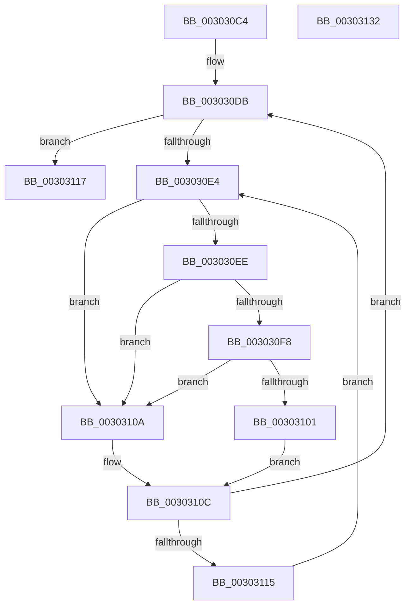

# KiUpdateThreadCpuSetAffinitiesFromDpcLevel

- RVA: `0x003030C4`–`0x00303133` (길이 `111` bytes)
- VA: `0x00000001403030C4`
- 실행 섹션: `.text`
- PDB 이름 있음: `예`; PDB Function 태그: `아니요`
- unwind 정보 RVA: `0x00060BC4`
- 디코드: `35`개 명령, `111/111` bytes 표시
- 미해석 바이트: `0` (있으면 어셈블리에 `.byte`로 보존)

> 이 문서는 커널 이미지의 기계어와 PDB 기호를 분석해 생성했습니다. 4번과 5번은 함수 원형과 자료형을 바이너리 사용 방식에서 추정한 C 해석이며 원본 소스 복구 결과는 아닙니다.

## 1. Dependencies

- 직접 호출 지점: **3**; 고유 호출 대상: **3**
- 직접 호출자로 확인된 함수: **2**
- RIP 상대 이미지 참조: **2**

### Outgoing calls
- `0x003030F8` → [KiCheckVpBackingLongSpinWaitHypercall](KiCheckVpBackingLongSpinWaitHypercall_function_0030F490.md) (function, `0x0030F490`)
- `0x00303103` → [HvlNotifyLongSpinWait](HvlNotifyLongSpinWait_function_0030F460.md) (function, `0x0030F460`)
- `0x0030311D` → [KiUpdateThreadCpuSets](KiUpdateThreadCpuSets_function_0030313C.md) (function, `0x0030313C`)

### Direct callers
- [KeUpdateThreadCpuSets](KeUpdateThreadCpuSets_function_0030305C.md) at `0x00303094`
- [KiUpdateThreadCpuSetAffinitiesProcess](../5C/KiUpdateThreadCpuSetAffinitiesProcess_function_005C1660.md) at `0x005C1689`

### Static image references
- `0x003030E6` → RVA `0x00FC52AC` (`ALMOSTRO`; reference)
- `0x003030EE` → RVA `0x00FC6AB8` (`ALMOSTRO`; read)

## 2. Other-region calls and transfers

- 다른 실행 섹션으로 향하는 call: **0**
- 별도 외부 분기/꼬리 이동을 확인하지 못했습니다.

## 3. Assembly (complete function range)

```asm
003030C4  48 89 5C 24 08                  mov qword ptr [rsp + 8], rbx
003030C9  48 89 74 24 10                  mov qword ptr [rsp + 0x10], rsi
003030CE  57                              push rdi
003030CF  48 83 EC 20                     sub rsp, 0x20
003030D3  48 8B F2                        mov rsi, rdx
003030D6  48 8B D9                        mov rbx, rcx
003030D9  33 FF                           xor edi, edi
003030DB  F0 48 0F BA 6B 40 00            lock bts qword ptr [rbx + 0x40], 0
003030E2  73 33                           jae 0x140303117
003030E4  FF C7                           inc edi
003030E6  85 3D C0 21 CC 00               test dword ptr [rip + 0xcc21c0], edi
003030EC  75 1C                           jne 0x14030310a
003030EE  8B 05 C4 39 CC 00               mov eax, dword ptr [rip + 0xcc39c4]
003030F4  A8 40                           test al, 0x40
003030F6  74 12                           je 0x14030310a
003030F8  E8 93 C3 00 00                  call 0x14030f490
003030FD  84 C0                           test al, al
003030FF  74 09                           je 0x14030310a
00303101  8B CF                           mov ecx, edi
00303103  E8 58 C3 00 00                  call 0x14030f460
00303108  EB 02                           jmp 0x14030310c
0030310A  F3 90                           pause
0030310C  48 8B 43 40                     mov rax, qword ptr [rbx + 0x40]
00303110  48 85 C0                        test rax, rax
00303113  74 C6                           je 0x1403030db
00303115  EB CD                           jmp 0x1403030e4
00303117  48 8B D6                        mov rdx, rsi
0030311A  48 8B CB                        mov rcx, rbx
0030311D  E8 1A 00 00 00                  call 0x14030313c
00303122  48 8B 5C 24 30                  mov rbx, qword ptr [rsp + 0x30]
00303127  48 8B 74 24 38                  mov rsi, qword ptr [rsp + 0x38]
0030312C  48 83 C4 20                     add rsp, 0x20
00303130  5F                              pop rdi
00303131  C3                              ret
00303132  CC                              int3
```

## 4. C-style interpretation (structured pseudocode)

```c
__int64 __fastcall KiUpdateThreadCpuSetAffinitiesFromDpcLevel(__int64 a1, __int64 a2)
{
    __int64 result;
    __int64 v_rdi;
    __int64 v_rsp;
    unsigned __int64 v_stack_p10;
    unsigned __int64 v_stack_p8;

    v_stack_p8 = v_rbx;
    v_stack_p10 = v_rsi;
    v_rsp = (v_rsp) - (32);
    v_rdi = 0;
loc_003030DB:
    if (condition_is_above_or_equal) goto loc_00303117;
loc_003030E4:
    v_rdi = (unsigned int)((v_rdi) + 1);
    if (((*(unsigned int *)(v_rip + 13377984)) & ((unsigned int)(v_rdi))) != 0) goto loc_0030310A;
    if ((((unsigned __int8)((unsigned int)(*(unsigned int *)(v_rip + 13384132)))) & (64)) == 0) goto loc_0030310A;
    result = KiCheckVpBackingLongSpinWaitHypercall(a1, a2, a3, a4);
    if ((unsigned __int8)(result) == 0) goto loc_0030310A;
    result = HvlNotifyLongSpinWait((unsigned int)((unsigned int)(v_rdi)), a2, a3, a4);
    goto loc_0030310C;
loc_0030310A:
loc_0030310C:
    if (*(unsigned __int64 *)(a1 + 64) == 0) goto loc_003030DB;
    goto loc_003030E4;
loc_00303117:
    result = KiUpdateThreadCpuSets(a1, a2, a3, a4);
    v_rsp = (v_rsp) + (32);
    return result;
}
```

## 5. (Beta) C Style

```c
int64_t KiUpdateThreadCpuSetAffinitiesFromDpcLevel(void *Arg1, int64_t Arg2)
{
    uint8_t *arg1 = (uint8_t *)Arg1;

    int64_t result;
    int64_t local_rdi;
    int64_t local_rsp;
    uint64_t v_stack_p10;
    uint64_t v_stack_p8;

    v_stack_p8 = local_rbx;
    v_stack_p10 = local_rsi;
    local_rsp = (local_rsp) - (32);
    local_rdi = 0;
loc_003030DB:
    if (condition_is_above_or_equal) goto loc_00303117;
loc_003030E4:
    local_rdi = (uint32_t)((local_rdi) + 1);
    if (((*(uint32_t *)(v_rip + 0xCC21C0)) & ((uint32_t)(local_rdi))) != 0) goto loc_0030310A;
    if ((((uint8_t)((uint32_t)(*(uint32_t *)(v_rip + 0xCC39C4)))) & (64)) == 0) goto loc_0030310A;
    result = KiCheckVpBackingLongSpinWaitHypercall(Arg1, Arg2, a3, a4);
    if ((uint8_t)(result) == 0) goto loc_0030310A;
    result = HvlNotifyLongSpinWait((uint32_t)((uint32_t)(local_rdi)), Arg2, a3, a4);
    goto loc_0030310C;
loc_0030310A:
loc_0030310C:
    if (*(uint64_t *)(arg1 + 0x40) == 0) goto loc_003030DB;
    goto loc_003030E4;
loc_00303117:
    result = KiUpdateThreadCpuSets(Arg1, Arg2, a3, a4);
    local_rsp = (local_rsp) + (32);
    return result;
}
```

### 관측된 메모리 오프셋

구조체 형식이 확인되지 않은 접근은 인자 기준의 오프셋으로만 기록했습니다.

| 기준 인자 | 오프셋 표현 | 폭 (bit) | 접근 |
|---|---:|---:|---|
| `Arg1` | `+ 0x40` | `64` | `R` |
| `Arg1` | `+ 0x40` | `64` | `R/W` |

## 6. Execution-region graph

[열기: 2D/3D 그래프와 함수 탐색 컨트롤 패널](../../../control-panel.html?section=text&rva=0x003030C4&view=graph)

- 2D 그래프는 위에서 아래로 흐르고, 3D 그래프는 빈 공간을 드래그해 회전합니다. Shift+드래그는 이동, 휠은 확대·축소, 함수 노드 선택은 대상 보고서 이동입니다.

### Static fallback


