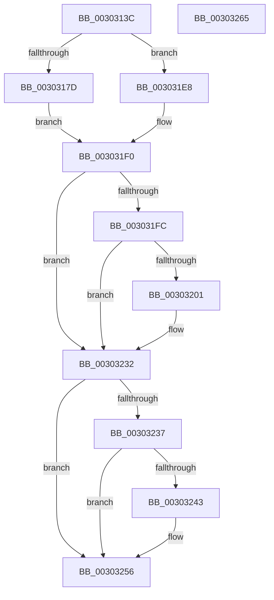

# KiUpdateThreadCpuSets

- RVA: `0x0030313C`–`0x00303266` (길이 `298` bytes)
- VA: `0x000000014030313C`
- 실행 섹션: `.text`
- PDB 이름 있음: `예`; PDB Function 태그: `아니요`
- unwind 정보 RVA: `0x000733CC`
- 디코드: `81`개 명령, `298/298` bytes 표시
- 미해석 바이트: `0` (있으면 어셈블리에 `.byte`로 보존)

> 이 문서는 커널 이미지의 기계어와 PDB 기호를 분석해 생성했습니다. 4번과 5번은 함수 원형과 자료형을 바이너리 사용 방식에서 추정한 C 해석이며 원본 소스 복구 결과는 아닙니다.

## 1. Dependencies

- 직접 호출 지점: **5**; 고유 호출 대상: **5**
- 직접 호출자로 확인된 함수: **2**
- RIP 상대 이미지 참조: **2**

### Outgoing calls
- `0x00303192` → [KiAcquireThreadStateLockForWrite](KiAcquireThreadStateLockForWrite_function_0030E8C0.md) (function, `0x0030E8C0`)
- `0x0030319C` → [KiComputeThreadAffinity](../39/KiComputeThreadAffinity_function_00399DE0.md) (function, `0x00399DE0`)
- `0x003031E1` → [KiRescheduleThreadAfterAffinityChange](KiRescheduleThreadAfterAffinityChange_function_0030C9E8.md) (function, `0x0030C9E8`)
- `0x0030322D` → [EtwTraceThreadAffinity](../3C/EtwTraceThreadAffinity_function_003C29A0.md) (function, `0x003C29A0`)
- `0x00303251` → [EtwTraceIdealProcessor](../3C/EtwTraceIdealProcessor_function_003C0808.md) (function, `0x003C0808`)

### Direct callers
- [KiUpdateThreadCpuSetAffinitiesFromDpcLevel](KiUpdateThreadCpuSetAffinitiesFromDpcLevel_function_003030C4.md) at `0x0030311D`
- [KeSetSelectedCpuSetsThread](KeSetSelectedCpuSetsThread_function_003033D0.md) at `0x00303498`

### Static image references
- `0x003031F0` → RVA `0x00FC6B04` (`ALMOSTRO`; read)
- `0x00303237` → RVA `0x00FC6B10` (`ALMOSTRO`; read)

## 2. Other-region calls and transfers

- 다른 실행 섹션으로 향하는 call: **0**
- 별도 외부 분기/꼬리 이동을 확인하지 못했습니다.

## 3. Assembly (complete function range)

```asm
0030313C  40 55                           push rbp
0030313E  53                              push rbx
0030313F  56                              push rsi
00303140  57                              push rdi
00303141  41 54                           push r12
00303143  41 56                           push r14
00303145  41 57                           push r15
00303147  48 8B EC                        mov rbp, rsp
0030314A  48 83 EC 60                     sub rsp, 0x60
0030314E  48 83 65 40 00                  and qword ptr [rbp + 0x40], 0
00303153  45 32 FF                        xor r15b, r15b
00303156  48 83 65 58 00                  and qword ptr [rbp + 0x58], 0
0030315B  0F 57 C0                        xorps xmm0, xmm0
0030315E  48 83 65 50 00                  and qword ptr [rbp + 0x50], 0
00303163  4C 8B E2                        mov r12, rdx
00303166  8B 41 74                        mov eax, dword ptr [rcx + 0x74]
00303169  48 8B F9                        mov rdi, rcx
0030316C  8B B1 4C 02 00 00               mov esi, dword ptr [rcx + 0x24c]
00303172  44 8B F6                        mov r14d, esi
00303175  0F 11 45 F0                     movups xmmword ptr [rbp - 0x10], xmm0
00303179  A8 08                           test al, 8
0030317B  75 6B                           jne 0x1403031e8
0030317D  48 8D 45 F0                     lea rax, [rbp - 0x10]
00303181  4C 8D 4D 40                     lea r9, [rbp + 0x40]
00303185  48 89 44 24 20                  mov qword ptr [rsp + 0x20], rax
0030318A  4C 8D 45 50                     lea r8, [rbp + 0x50]
0030318E  48 8D 55 58                     lea rdx, [rbp + 0x58]
00303192  E8 29 B7 00 00                  call 0x14030e8c0
00303197  48 8B CF                        mov rcx, rdi
0030319A  8A D8                           mov bl, al
0030319C  E8 3F 6C 09 00                  call 0x140399de0
003031A1  48 8B 4D 40                     mov rcx, qword ptr [rbp + 0x40]
003031A5  44 8B F8                        mov r15d, eax
003031A8  48 8B 97 40 02 00 00            mov rdx, qword ptr [rdi + 0x240]
003031AF  48 8D 45 F0                     lea rax, [rbp - 0x10]
003031B3  44 8B B7 4C 02 00 00            mov r14d, dword ptr [rdi + 0x24c]
003031BA  44 8A CB                        mov r9b, bl
003031BD  4C 89 64 24 40                  mov qword ptr [rsp + 0x40], r12
003031C2  48 89 44 24 38                  mov qword ptr [rsp + 0x38], rax
003031C7  48 8D 45 50                     lea rax, [rbp + 0x50]
003031CB  48 89 4C 24 30                  mov qword ptr [rsp + 0x30], rcx
003031D0  48 8B 4D 58                     mov rcx, qword ptr [rbp + 0x58]
003031D4  48 89 44 24 28                  mov qword ptr [rsp + 0x28], rax
003031D9  48 89 4C 24 20                  mov qword ptr [rsp + 0x20], rcx
003031DE  48 8B CF                        mov rcx, rdi
003031E1  E8 02 98 00 00                  call 0x14030c9e8
003031E6  EB 08                           jmp 0x1403031f0
003031E8  48 C7 41 40 00 00 00 00         mov qword ptr [rcx + 0x40], 0
003031F0  F7 05 0A 39 CC 00 00 10 00 00   test dword ptr [rip + 0xcc390a], 0x1000
003031FA  74 36                           je 0x140303232
003031FC  45 84 FF                        test r15b, r15b
003031FF  74 31                           je 0x140303232
00303201  44 8B 47 74                     mov r8d, dword ptr [rdi + 0x74]
00303205  45 33 C9                        xor r9d, r9d
00303208  48 8B 87 40 02 00 00            mov rax, qword ptr [rdi + 0x240]
0030320F  48 8B CF                        mov rcx, rdi
00303212  0F B7 97 48 02 00 00            movzx edx, word ptr [rdi + 0x248]
00303219  41 C1 E8 03                     shr r8d, 3
0030321D  41 80 E0 01                     and r8b, 1
00303221  66 C7 44 24 28 36 05            mov word ptr [rsp + 0x28], 0x536
00303228  48 89 44 24 20                  mov qword ptr [rsp + 0x20], rax
0030322D  E8 6E F7 0B 00                  call 0x1403c29a0
00303232  41 3B F6                        cmp esi, r14d
00303235  74 1F                           je 0x140303256
00303237  F7 05 CF 38 CC 00 00 00 00 08   test dword ptr [rip + 0xcc38cf], 0x8000000
00303241  74 13                           je 0x140303256
00303243  BA 46 05 00 00                  mov edx, 0x546
00303248  45 8B CE                        mov r9d, r14d
0030324B  44 8B C6                        mov r8d, esi
0030324E  48 8B CF                        mov rcx, rdi
00303251  E8 B2 D5 0B 00                  call 0x1403c0808
00303256  48 83 C4 60                     add rsp, 0x60
0030325A  41 5F                           pop r15
0030325C  41 5E                           pop r14
0030325E  41 5C                           pop r12
00303260  5F                              pop rdi
00303261  5E                              pop rsi
00303262  5B                              pop rbx
00303263  5D                              pop rbp
00303264  C3                              ret
00303265  CC                              int3
```

## 4. C-style interpretation (structured pseudocode)

```c
__int64 __fastcall KiUpdateThreadCpuSets(__int64 a1, __int64 a2)
{
    __int64 result;
    __int64 v_r15;
    __int64 v_rsp;
    unsigned __int64 v_stack_m48;
    unsigned __int64 v_stack_m58;
    unsigned __int64 v_stack_m60;
    unsigned __int64 v_stack_m68;
    unsigned __int64 v_stack_m70;
    unsigned __int64 v_stack_m78;
    unsigned __int64 v_stack_p18;
    unsigned __int64 v_stack_p20;
    unsigned __int64 v_stack_p8;

    v_rsp = (v_rsp) - (96);
    v_r15 = 0;
    v_stack_m48 = v_xmm0;
    if ((((unsigned __int8)((unsigned int)(*(unsigned int *)(a1 + 116)))) & (8)) != 0) goto loc_003031E8;
    v_stack_m78 = v_stack_m48;
    result = KiAcquireThreadStateLockForWrite(a1, v_stack_p20, v_stack_p18, v_stack_p8);
    result = KiComputeThreadAffinity(a1, v_stack_p20, v_stack_p18, v_stack_p8);
    v_stack_m58 = a2;
    v_stack_m60 = v_stack_m48;
    v_stack_m68 = v_stack_p8;
    v_stack_m70 = v_stack_p18;
    v_stack_m78 = v_stack_p20;
    result = KiRescheduleThreadAfterAffinityChange(a1, *(unsigned __int64 *)(a1 + 576), v_stack_p18, (unsigned __int8)((unsigned __int8)(result)));
    goto loc_003031F0;
loc_003031E8:
    *(unsigned __int64 *)(a1 + 64) = 0;
loc_003031F0:
    if (((*(unsigned int *)(v_rip + 13383946)) & (0x1000ULL)) == 0) goto loc_00303232;
    if ((unsigned __int8)((unsigned int)((unsigned int)(result))) != 0) {
        a3 = *(unsigned int *)(a1 + 116);
        a4 = 0;
        result = *(unsigned __int64 *)(a1 + 576);
        a1 = a1;
        a2 = *(unsigned __int16 *)(a1 + 584);
        a3 = (unsigned int)((a3) >> (3));
        a3 = (unsigned __int8)((a3) & (1));
        v_stack_m70 = 0x536ULL;
        v_stack_m78 = result;
        result = EtwTraceThreadAffinity(a1, a2, a3, a4);
    }
    if (((unsigned int)((unsigned int)(*(unsigned int *)(a1 + 588)))) == ((unsigned int)((unsigned int)(*(unsigned int *)(a1 + 588))))) goto loc_00303256;
    if (((*(unsigned int *)(v_rip + 13383887)) & (0x8000000ULL)) != 0) {
        a2 = 0x546ULL;
        a4 = (unsigned int)((unsigned int)(*(unsigned int *)(a1 + 588)));
        a3 = (unsigned int)((unsigned int)(*(unsigned int *)(a1 + 588)));
        a1 = a1;
        result = EtwTraceIdealProcessor(a1, a2, a3, a4);
    }
    v_rsp = (v_rsp) + (96);
    return result;
}
```

## 5. (Beta) C Style

```c
int64_t KiUpdateThreadCpuSets(void *Arg1, int64_t Arg2)
{
    uint8_t *arg1 = (uint8_t *)Arg1;

    int64_t result;
    int64_t local_r15;
    int64_t local_rsp;
    uint64_t v_stack_m48;
    uint64_t v_stack_m58;
    uint64_t v_stack_m60;
    uint64_t v_stack_m68;
    uint64_t v_stack_m70;
    uint64_t v_stack_m78;
    uint64_t v_stack_p18;
    uint64_t v_stack_p20;
    uint64_t v_stack_p8;

    local_rsp = (local_rsp) - (96);
    local_r15 = 0;
    v_stack_m48 = v_xmm0;
    if ((((uint8_t)((uint32_t)(*(uint32_t *)(arg1 + 0x74)))) & (8)) != 0) goto loc_003031E8;
    v_stack_m78 = v_stack_m48;
    result = KiAcquireThreadStateLockForWrite(Arg1, v_stack_p20, v_stack_p18, v_stack_p8);
    result = KiComputeThreadAffinity(Arg1, v_stack_p20, v_stack_p18, v_stack_p8);
    v_stack_m58 = Arg2;
    v_stack_m60 = v_stack_m48;
    v_stack_m68 = v_stack_p8;
    v_stack_m70 = v_stack_p18;
    v_stack_m78 = v_stack_p20;
    result = KiRescheduleThreadAfterAffinityChange(Arg1, *(uint64_t *)(arg1 + 0x240), v_stack_p18, (uint8_t)((uint8_t)(result)));
    goto loc_003031F0;
loc_003031E8:
    *(uint64_t *)(arg1 + 0x40) = 0;
loc_003031F0:
    if (((*(uint32_t *)(v_rip + 0xCC390A)) & (0x1000ULL)) == 0) goto loc_00303232;
    if ((uint8_t)((uint32_t)((uint32_t)(result))) != 0) {
        a3 = *(uint32_t *)(arg1 + 0x74);
        a4 = 0;
        result = *(uint64_t *)(arg1 + 0x240);
        Arg1 = Arg1;
        Arg2 = *(uint16_t *)(arg1 + 0x248);
        a3 = (uint32_t)((a3) >> (3));
        a3 = (uint8_t)((a3) & (1));
        v_stack_m70 = 0x536ULL;
        v_stack_m78 = result;
        result = EtwTraceThreadAffinity(Arg1, Arg2, a3, a4);
    }
    if (((uint32_t)((uint32_t)(*(uint32_t *)(arg1 + 0x24C)))) == ((uint32_t)((uint32_t)(*(uint32_t *)(arg1 + 0x24C))))) goto loc_00303256;
    if (((*(uint32_t *)(v_rip + 0xCC38CF)) & (0x8000000ULL)) != 0) {
        Arg2 = 0x546ULL;
        a4 = (uint32_t)((uint32_t)(*(uint32_t *)(arg1 + 0x24C)));
        a3 = (uint32_t)((uint32_t)(*(uint32_t *)(arg1 + 0x24C)));
        Arg1 = Arg1;
        result = EtwTraceIdealProcessor(Arg1, Arg2, a3, a4);
    }
    local_rsp = (local_rsp) + (96);
    return result;
}
```

### 관측된 메모리 오프셋

구조체 형식이 확인되지 않은 접근은 인자 기준의 오프셋으로만 기록했습니다.

| 기준 인자 | 오프셋 표현 | 폭 (bit) | 접근 |
|---|---:|---:|---|
| `Arg1` | `+ 0x40` | `64` | `W` |
| `Arg1` | `+ 0x74` | `32` | `R` |
| `Arg1` | `+ 0x240` | `64` | `R` |
| `Arg1` | `+ 0x248` | `16` | `R` |
| `Arg1` | `+ 0x24C` | `32` | `R` |

## 6. Execution-region graph

[열기: 2D/3D 그래프와 함수 탐색 컨트롤 패널](../../../control-panel.html?section=text&rva=0x0030313C&view=graph)

- 2D 그래프는 위에서 아래로 흐르고, 3D 그래프는 빈 공간을 드래그해 회전합니다. Shift+드래그는 이동, 휠은 확대·축소, 함수 노드 선택은 대상 보고서 이동입니다.

### Static fallback


