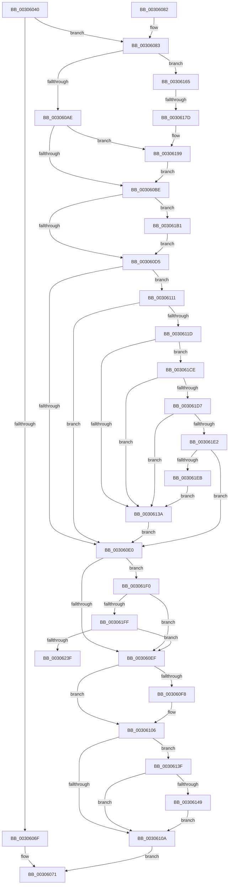

# KiUpdateVPBackingThreadPriority

- RVA: `0x00306040`–`0x0030624C` (길이 `524` bytes)
- VA: `0x0000000140306040`
- 실행 섹션: `.text`
- PDB 이름 있음: `예`; PDB Function 태그: `예`
- unwind 정보 RVA: `0x00073720`
- 디코드: `130`개 명령, `524/524` bytes 표시
- 미해석 바이트: `0` (있으면 어셈블리에 `.byte`로 보존)

> 이 문서는 커널 이미지의 기계어와 PDB 기호를 분석해 생성했습니다. 4번과 5번은 함수 원형과 자료형을 바이너리 사용 방식에서 추정한 C 해석이며 원본 소스 복구 결과는 아닙니다.

## 1. Dependencies

- 직접 호출 지점: **6**; 고유 호출 대상: **6**
- 직접 호출자로 확인된 함수: **8**
- RIP 상대 이미지 참조: **1**

### Outgoing calls
- `0x00306096` → [KiReadGuestSchedulerAssistPriority](KiReadGuestSchedulerAssistPriority_function_00304BE4.md) (function, `0x00304BE4`)
- `0x003060C6` → [KiComputeThreadPriority](../3C/KiComputeThreadPriority_function_003C45F4.md) (function, `0x003C45F4`)
- `0x0030615E` → [EtwTraceXSchedulerPriorityUpdate](../4D/EtwTraceXSchedulerPriorityUpdate_function_004D2358.md) (function, `0x004D2358`)
- `0x00306193` → [KeBugCheckEx](../4F/KeBugCheckEx_function_004FD660.md) (function, `0x004FD660`)
- `0x003061C4` → [KiUpdateThreadPriority](../25/KiUpdateThreadPriority_function_00257810.md) (function, `0x00257810`)
- `0x0030622B` → [KiPrcbArrayForIsolationWidth](../3F/KiPrcbArrayForIsolationWidth_function_003F5930.md) (function, `0x003F5930`)

### Direct callers
- [KeYieldExecution](../20/KeYieldExecution_function_00209FA0.md) at `0x0020A16E`
- [sub_0021BDD6](../21/Unknown_function_0021BDD6.md) at `0x0021BE92`
- [KiQueueReadyThread](../21/KiQueueReadyThread_function_0021C7B0.md) at `0x0021CEDB`
- [sub_002546EC](../25/Unknown_function_002546EC.md) at `0x002551B0`
- [KiAttemptToScheduleThreadToBusyIsolationUnit](../25/KiAttemptToScheduleThreadToBusyIsolationUnit_function_00259B00.md) at `0x0025B630`
- [KiStartRescheduleContextEntry](KiStartRescheduleContextEntry_function_00305ED0.md) at `0x0030600D`
- [sub_0030C95E](Unknown_function_0030C95E.md) at `0x0030C996`
- [sub_006E2870](../6E/Unknown_function_006E2870.md) at `0x006E2902`

### Static image references
- `0x0030613F` → RVA `0x00FC6B14` (`ALMOSTRO`; read)

## 2. Other-region calls and transfers

- 다른 실행 섹션으로 향하는 call: **0**
- call이 아닌 외부 분기/꼬리 이동: **2**
  - `0x00306177` → [sub_006E0886](../6E/Unknown_function_006E0886.md) (`tail-transfer`)
  - `0x00306247` → [sub_006E0886 + 0x71](../6E/Unknown_function_006E0886.md) (`tail-transfer`)

## 3. Assembly (complete function range)

```asm
00306040  48 89 5C 24 10                  mov qword ptr [rsp + 0x10], rbx
00306045  4C 89 44 24 18                  mov qword ptr [rsp + 0x18], r8
0030604A  55                              push rbp
0030604B  56                              push rsi
0030604C  57                              push rdi
0030604D  41 56                           push r14
0030604F  41 57                           push r15
00306051  48 83 EC 40                     sub rsp, 0x40
00306055  45 33 F6                        xor r14d, r14d
00306058  41 8A F9                        mov dil, r9b
0030605B  F7 41 78 00 00 40 00            test dword ptr [rcx + 0x78], 0x400000
00306062  48 8B F2                        mov rsi, rdx
00306065  48 8B D9                        mov rbx, rcx
00306068  4C 89 74 24 30                  mov qword ptr [rsp + 0x30], r14
0030606D  75 14                           jne 0x140306083
0030606F  32 C0                           xor al, al
00306071  48 8B 5C 24 78                  mov rbx, qword ptr [rsp + 0x78]
00306076  48 83 C4 40                     add rsp, 0x40
0030607A  41 5F                           pop r15
0030607C  41 5E                           pop r14
0030607E  5F                              pop rdi
0030607F  5E                              pop rsi
00306080  5D                              pop rbp
00306081  C3                              ret
00306082  CC                              int3
00306083  48 8B 81 C8 03 00 00            mov rax, qword ptr [rcx + 0x3c8]
0030608A  F0 81 08 00 00 10 00            lock or dword ptr [rax], 0x100000
00306091  48 8D 54 24 30                  lea rdx, [rsp + 0x30]
00306096  E8 49 EB FF FF                  call 0x140304be4
0030609B  4C 63 83 00 04 00 00            movsxd r8, dword ptr [rbx + 0x400]
003060A2  4C 63 F8                        movsxd r15, eax
003060A5  45 3B F8                        cmp r15d, r8d
003060A8  0F 85 B7 00 00 00               jne 0x140306165
003060AE  0F BE AB C3 00 00 00            movsx ebp, byte ptr [rbx + 0xc3]
003060B5  40 84 FF                        test dil, dil
003060B8  0F 84 DB 00 00 00               je 0x140306199
003060BE  45 33 C0                        xor r8d, r8d
003060C1  33 D2                           xor edx, edx
003060C3  48 8B CB                        mov rcx, rbx
003060C6  E8 29 E5 0B 00                  call 0x1403c45f4
003060CB  8B F8                           mov edi, eax
003060CD  3B C5                           cmp eax, ebp
003060CF  0F 85 DC 00 00 00               jne 0x1403061b1
003060D5  0F B6 8B 62 04 00 00            movzx ecx, byte ptr [rbx + 0x462]
003060DC  85 C9                           test ecx, ecx
003060DE  75 31                           jne 0x140306111
003060E0  0F B6 83 04 02 00 00            movzx eax, byte ptr [rbx + 0x204]
003060E7  3B C8                           cmp ecx, eax
003060E9  0F 85 01 01 00 00               jne 0x1403061f0
003060EF  F7 43 78 00 00 40 00            test dword ptr [rbx + 0x78], 0x400000
003060F6  74 0E                           je 0x140306106
003060F8  48 8B 83 C8 03 00 00            mov rax, qword ptr [rbx + 0x3c8]
003060FF  F0 81 20 FF FF EF FF            lock and dword ptr [rax], 0xffefffff
00306106  3B EF                           cmp ebp, edi
00306108  75 35                           jne 0x14030613f
0030610A  B0 01                           mov al, 1
0030610C  E9 60 FF FF FF                  jmp 0x140306071
00306111  48 8B 93 C8 03 00 00            mov rdx, qword ptr [rbx + 0x3c8]
00306118  48 85 D2                        test rdx, rdx
0030611B  74 C3                           je 0x1403060e0
0030611D  8B 42 1C                        mov eax, dword ptr [rdx + 0x1c]
00306120  44 8B 4A 20                     mov r9d, dword ptr [rdx + 0x20]
00306124  44 8B 52 14                     mov r10d, dword ptr [rdx + 0x14]
00306128  44 8B 02                        mov r8d, dword ptr [rdx]
0030612B  41 81 E0 00 00 20 00            and r8d, 0x200000
00306132  85 C0                           test eax, eax
00306134  0F 84 94 00 00 00               je 0x1403061ce
0030613A  41 8B CE                        mov ecx, r14d
0030613D  EB A1                           jmp 0x1403060e0
0030613F  8B 05 CF 09 CC 00               mov eax, dword ptr [rip + 0xcc09cf]
00306145  A8 20                           test al, 0x20
00306147  74 C1                           je 0x14030610a
00306149  48 8D 44 24 30                  lea rax, [rsp + 0x30]
0030614E  44 8B CF                        mov r9d, edi
00306151  45 8B C7                        mov r8d, r15d
00306154  48 89 44 24 20                  mov qword ptr [rsp + 0x20], rax
00306159  8B D5                           mov edx, ebp
0030615B  48 8B CB                        mov rcx, rbx
0030615E  E8 F5 C1 1C 00                  call 0x1404d2358
00306163  EB A5                           jmp 0x14030610a
00306165  4D 0F BE CF                     movsx r9, r15b
00306169  49 8B C9                        mov rcx, r9
0030616C  41 8A 94 19 38 03 00 00         mov dl, byte ptr [r9 + rbx + 0x338]
00306174  80 FA FF                        cmp dl, 0xff
00306177  0F 85 09 A7 3D 00               jne 0x1406e0886
0030617D  4C 8B C1                        mov r8, rcx
00306180  4C 89 74 24 20                  mov qword ptr [rsp + 0x20], r14
00306185  B9 57 01 00 00                  mov ecx, 0x157
0030618A  41 B9 01 00 00 00               mov r9d, 1
00306190  48 8B D3                        mov rdx, rbx
00306193  E8 C8 74 1F 00                  call 0x1404fd660
00306198  CC                              int3
00306199  B8 0F F0 00 00                  mov eax, 0xf00f
0030619E  44 88 B3 66 03 00 00            mov byte ptr [rbx + 0x366], r14b
003061A5  66 21 83 06 02 00 00            and word ptr [rbx + 0x206], ax
003061AC  E9 0D FF FF FF                  jmp 0x1403060be
003061B1  48 85 F6                        test rsi, rsi
003061B4  44 8B CF                        mov r9d, edi
003061B7  4C 8B C3                        mov r8, rbx
003061BA  0F 95 C1                        setne cl
003061BD  88 4C 24 20                     mov byte ptr [rsp + 0x20], cl
003061C1  48 8B CE                        mov rcx, rsi
003061C4  E8 47 16 F5 FF                  call 0x140257810
003061C9  E9 07 FF FF FF                  jmp 0x1403060d5
003061CE  45 85 C9                        test r9d, r9d
003061D1  0F 85 63 FF FF FF               jne 0x14030613a
003061D7  41 0F BA E2 0E                  bt r10d, 0xe
003061DC  0F 82 58 FF FF FF               jb 0x14030613a
003061E2  45 85 C0                        test r8d, r8d
003061E5  0F 84 F5 FE FF FF               je 0x1403060e0
003061EB  E9 4A FF FF FF                  jmp 0x14030613a
003061F0  88 8B 04 02 00 00               mov byte ptr [rbx + 0x204], cl
003061F6  48 85 F6                        test rsi, rsi
003061F9  0F 84 F0 FE FF FF               je 0x1403060ef
003061FF  8B 53 78                        mov edx, dword ptr [rbx + 0x78]
00306202  4C 8D 8C 24 80 00 00 00         lea r9, [rsp + 0x80]
0030620A  D1 EA                           shr edx, 1
0030620C  4C 8D 44 24 70                  lea r8, [rsp + 0x70]
00306211  83 E2 01                        and edx, 1
00306214  48 89 74 24 38                  mov qword ptr [rsp + 0x38], rsi
00306219  48 8D 4C 24 38                  lea rcx, [rsp + 0x38]
0030621E  4C 89 74 24 70                  mov qword ptr [rsp + 0x70], r14
00306223  44 89 B4 24 80 00 00 00         mov dword ptr [rsp + 0x80], r14d
0030622B  E8 00 F7 0E 00                  call 0x1403f5930
00306230  8B 94 24 80 00 00 00            mov edx, dword ptr [rsp + 0x80]
00306237  85 D2                           test edx, edx
00306239  0F 84 B0 FE FF FF               je 0x1403060ef
0030623F  48 8B 74 24 70                  mov rsi, qword ptr [rsp + 0x70]
00306244  44 8B F2                        mov r14d, edx
00306247  E9 AB A6 3D 00                  jmp 0x1406e08f7
```

## 4. C-style interpretation (structured pseudocode)

```c
__int64 __fastcall KiUpdateVPBackingThreadPriority(__int64 a1, __int64 a2, __int64 a3, unsigned __int8 a4)
{
    __int64 result;
    __int64 v_r14;
    __int64 v_rsp;
    unsigned __int64 v_stack_m38;
    unsigned __int64 v_stack_p10;
    unsigned __int64 v_stack_p18;
    unsigned __int64 v_stack_p20;
    unsigned __int64 v_stack_p30;
    unsigned __int64 v_stack_p38;
    unsigned __int64 v_stack_p70;
    unsigned __int64 v_stack_p80;

    v_stack_p10 = v_rbx;
    v_stack_p18 = a3;
    v_rsp = (v_rsp) - (64);
    v_r14 = 0;
    v_stack_m38 = 0;
    if (((*(unsigned int *)(a1 + 120)) & (0x400000ULL)) != 0) goto loc_00306083;
    result = 0;
loc_00306071:
    v_rsp = (v_rsp) + (64);
    return result;
loc_00306083:
    result = KiReadGuestSchedulerAssistPriority(a1, v_stack_p30, a3, a4);
    if (((unsigned int)((int)((unsigned int)(result)))) != ((unsigned int)((int)(*(unsigned int *)(v_stack_p10 + 1024))))) goto loc_00306165;
    if (a4 == 0) goto loc_00306199;
loc_003060BE:
    a3 = 0;
    a2 = 0;
    result = KiComputeThreadPriority(v_stack_p10, a2, a3, a4);
    if (((unsigned int)(result)) != ((unsigned int)((__int8)(*(unsigned __int8 *)(v_stack_p10 + 195))))) goto loc_003061B1;
loc_003060D5:
    if ((unsigned int)(*(unsigned __int8 *)(v_stack_p10 + 1122)) != 0) goto loc_00306111;
loc_003060E0:
    if (((unsigned int)(*(unsigned __int8 *)(v_stack_p10 + 1122))) != ((unsigned int)(*(unsigned __int8 *)(v_stack_p10 + 516)))) goto loc_003061F0;
loc_003060EF:
    result = *(unsigned __int8 *)(v_stack_p10 + 516);
    if (((*(unsigned int *)(v_stack_p10 + 120)) & (0x400000ULL)) != 0) {
        result = *(unsigned __int64 *)(v_stack_p10 + 968);
    }
    if (((unsigned int)((__int8)(*(unsigned __int8 *)(v_stack_p10 + 195)))) != ((unsigned int)((unsigned int)((unsigned int)(result))))) goto loc_0030613F;
loc_0030610A:
    goto loc_00306071;
loc_00306111:
    if (*(unsigned __int64 *)(v_stack_p10 + 968) == 0) goto loc_003060E0;
    a3 = (unsigned int)(((unsigned int)(*(unsigned int *)(*(unsigned __int64 *)(v_stack_p10 + 968)))) & (0x200000ULL));
    if ((unsigned int)((unsigned int)(*(unsigned int *)(*(unsigned __int64 *)(v_stack_p10 + 968) + 28))) == 0) goto loc_003061CE;
loc_0030613A:
    goto loc_003060E0;
loc_0030613F:
    if ((((unsigned __int8)((unsigned int)(*(unsigned int *)(v_rip + 13371855)))) & (32)) == 0) goto loc_0030610A;
    v_stack_p20 = v_stack_p30;
    result = EtwTraceXSchedulerPriorityUpdate(v_stack_p10, (unsigned int)((unsigned int)((__int8)(*(unsigned __int8 *)(v_stack_p10 + 195)))), (unsigned int)((unsigned int)((int)((unsigned int)(result)))), (unsigned int)((unsigned int)((unsigned int)((unsigned int)(result)))));
    goto loc_0030610A;
loc_00306165:
    v_stack_p20 = 0;
    result = KeBugCheckEx(343, v_stack_p10, (__int8)((unsigned __int8)((int)((unsigned int)(result)))), 1);
loc_00306199:
    *(unsigned __int8 *)(v_stack_p10 + 870) = 0;
    goto loc_003060BE;
loc_003061B1:
    a1 = (0 != 0) ? 1 : 0;
    v_stack_p20 = (unsigned __int8)(a1);
    result = KiUpdateThreadPriority(0, v_stack_p10, v_stack_p10, (unsigned int)((unsigned int)((unsigned int)((unsigned int)(result)))));
    goto loc_003060D5;
loc_003061CE:
    if ((unsigned int)((unsigned int)((unsigned int)((unsigned int)((unsigned int)(result))))) != 0) goto loc_0030613A;
    if (condition_is_below) goto loc_0030613A;
    if ((unsigned int)(v_stack_p10) == 0) goto loc_003060E0;
    goto loc_0030613A;
loc_003061F0:
    *(unsigned __int8 *)(v_stack_p10 + 516) = 0;
    if (0 == 0) goto loc_003060EF;
    a2 = (unsigned int)(((unsigned int)(*(unsigned int *)(v_stack_p10 + 120))) >> (1));
    a2 = (unsigned int)((a2) & (1));
    v_stack_p38 = a2;
    v_stack_p70 = 0;
    v_stack_p80 = 0;
    result = KiPrcbArrayForIsolationWidth(v_stack_p38, a2, v_stack_p70, v_stack_p80);
    if ((unsigned int)((unsigned int)(v_stack_p80)) == 0) goto loc_003060EF;
}
```

## 5. (Beta) C Style

```c
int64_t KiUpdateVPBackingThreadPriority(void *Arg1, int64_t Arg2, int64_t Arg3, uint8_t Arg4)
{
    uint8_t *arg1 = (uint8_t *)Arg1;

    int64_t result;
    int64_t local_r14;
    int64_t local_rsp;
    uint64_t v_stack_m38;
    uint64_t v_stack_p10;
    uint64_t v_stack_p18;
    uint64_t v_stack_p20;
    uint64_t v_stack_p30;
    uint64_t v_stack_p38;
    uint64_t v_stack_p70;
    uint64_t v_stack_p80;

    v_stack_p10 = local_rbx;
    v_stack_p18 = Arg3;
    local_rsp = (local_rsp) - (64);
    local_r14 = 0;
    v_stack_m38 = 0;
    if (((*(uint32_t *)(arg1 + 0x78)) & (0x400000ULL)) != 0) goto loc_00306083;
    result = 0;
loc_00306071:
    local_rsp = (local_rsp) + (64);
    return result;
loc_00306083:
    result = KiReadGuestSchedulerAssistPriority(Arg1, v_stack_p30, Arg3, Arg4);
    if (((uint32_t)((int32_t)((uint32_t)(result)))) != ((uint32_t)((int32_t)(*(uint32_t *)(v_stack_p10 + 0x400))))) goto loc_00306165;
    if (Arg4 == 0) goto loc_00306199;
loc_003060BE:
    Arg3 = 0;
    Arg2 = 0;
    result = KiComputeThreadPriority(v_stack_p10, Arg2, Arg3, Arg4);
    if (((uint32_t)(result)) != ((uint32_t)((int8_t)(*(uint8_t *)(v_stack_p10 + 0xC3))))) goto loc_003061B1;
loc_003060D5:
    if ((uint32_t)(*(uint8_t *)(v_stack_p10 + 0x462)) != 0) goto loc_00306111;
loc_003060E0:
    if (((uint32_t)(*(uint8_t *)(v_stack_p10 + 0x462))) != ((uint32_t)(*(uint8_t *)(v_stack_p10 + 0x204)))) goto loc_003061F0;
loc_003060EF:
    result = *(uint8_t *)(v_stack_p10 + 0x204);
    if (((*(uint32_t *)(v_stack_p10 + 0x78)) & (0x400000ULL)) != 0) {
        result = *(uint64_t *)(v_stack_p10 + 0x3C8);
    }
    if (((uint32_t)((int8_t)(*(uint8_t *)(v_stack_p10 + 0xC3)))) != ((uint32_t)((uint32_t)((uint32_t)(result))))) goto loc_0030613F;
loc_0030610A:
    goto loc_00306071;
loc_00306111:
    if (*(uint64_t *)(v_stack_p10 + 0x3C8) == 0) goto loc_003060E0;
    Arg3 = (uint32_t)(((uint32_t)(*(uint32_t *)(*(uint64_t *)(v_stack_p10 + 0x3C8)))) & (0x200000ULL));
    if ((uint32_t)((uint32_t)(*(uint32_t *)(*(uint64_t *)(v_stack_p10 + 0x3C8) + 0x1C))) == 0) goto loc_003061CE;
loc_0030613A:
    goto loc_003060E0;
loc_0030613F:
    if ((((uint8_t)((uint32_t)(*(uint32_t *)(v_rip + 0xCC09CF)))) & (32)) == 0) goto loc_0030610A;
    v_stack_p20 = v_stack_p30;
    result = EtwTraceXSchedulerPriorityUpdate(v_stack_p10, (uint32_t)((uint32_t)((int8_t)(*(uint8_t *)(v_stack_p10 + 0xC3)))), (uint32_t)((uint32_t)((int32_t)((uint32_t)(result)))), (uint32_t)((uint32_t)((uint32_t)((uint32_t)(result)))));
    goto loc_0030610A;
loc_00306165:
    v_stack_p20 = 0;
    result = KeBugCheckEx(343, v_stack_p10, (int8_t)((uint8_t)((int32_t)((uint32_t)(result)))), 1);
loc_00306199:
    *(uint8_t *)(v_stack_p10 + 0x366) = 0;
    goto loc_003060BE;
loc_003061B1:
    Arg1 = (0 != 0) ? 1 : 0;
    v_stack_p20 = (uint8_t)(Arg1);
    result = KiUpdateThreadPriority(0, v_stack_p10, v_stack_p10, (uint32_t)((uint32_t)((uint32_t)((uint32_t)(result)))));
    goto loc_003060D5;
loc_003061CE:
    if ((uint32_t)((uint32_t)((uint32_t)((uint32_t)((uint32_t)(result))))) != 0) goto loc_0030613A;
    if (condition_is_below) goto loc_0030613A;
    if ((uint32_t)(v_stack_p10) == 0) goto loc_003060E0;
    goto loc_0030613A;
loc_003061F0:
    *(uint8_t *)(v_stack_p10 + 0x204) = 0;
    if (0 == 0) goto loc_003060EF;
    Arg2 = (uint32_t)(((uint32_t)(*(uint32_t *)(v_stack_p10 + 0x78))) >> (1));
    Arg2 = (uint32_t)((Arg2) & (1));
    v_stack_p38 = Arg2;
    v_stack_p70 = 0;
    v_stack_p80 = 0;
    result = KiPrcbArrayForIsolationWidth(v_stack_p38, Arg2, v_stack_p70, v_stack_p80);
    if ((uint32_t)((uint32_t)(v_stack_p80)) == 0) goto loc_003060EF;
}
```

### 관측된 메모리 오프셋

구조체 형식이 확인되지 않은 접근은 인자 기준의 오프셋으로만 기록했습니다.

| 기준 인자 | 오프셋 표현 | 폭 (bit) | 접근 |
|---|---:|---:|---|
| `Arg1` | `+ 0x78` | `32` | `R` |
| `Arg1` | `+ 0xC3` | `8` | `R` |
| `Arg1` | `+ 0x204` | `8` | `R` |
| `Arg1` | `+ 0x204` | `8` | `W` |
| `Arg1` | `+ 0x206` | `16` | `R/W` |
| `Arg1` | `+ 0x366` | `8` | `W` |
| `Arg1` | `+ 0x3C8` | `64` | `R` |
| `Arg1` | `+ 0x400` | `32` | `R` |
| `Arg1` | `+ 0x462` | `8` | `R` |

## 6. Execution-region graph

[열기: 2D/3D 그래프와 함수 탐색 컨트롤 패널](../../../control-panel.html?section=text&rva=0x00306040&view=graph)

- 2D 그래프는 위에서 아래로 흐르고, 3D 그래프는 빈 공간을 드래그해 회전합니다. Shift+드래그는 이동, 휠은 확대·축소, 함수 노드 선택은 대상 보고서 이동입니다.

### Static fallback


