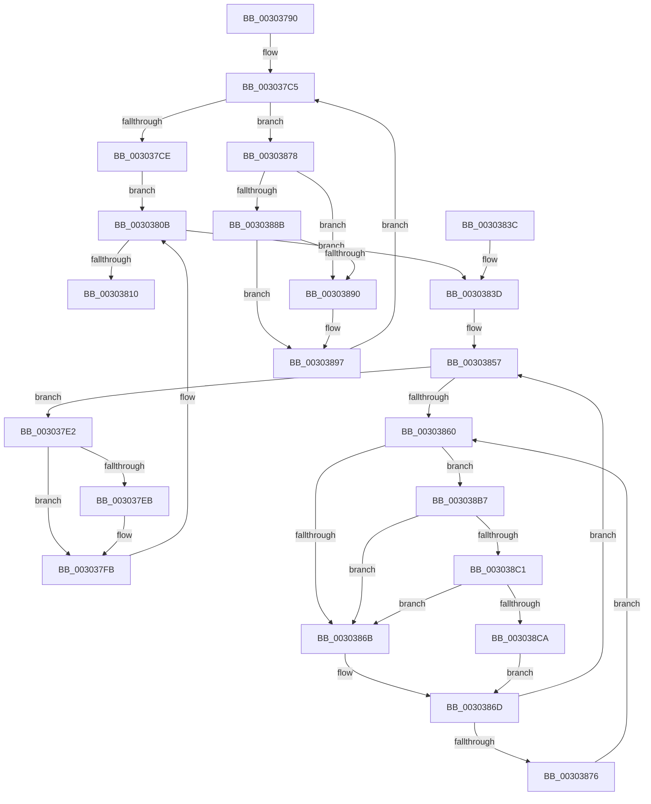

# KiUpdateVpBackingThreadPriorityDpcRoutine

- RVA: `0x00303790`–`0x003038D3` (길이 `323` bytes)
- VA: `0x0000000140303790`
- 실행 섹션: `.text`
- PDB 이름 있음: `예`; PDB Function 태그: `아니요`
- unwind 정보 RVA: `0x00073454`
- 디코드: `81`개 명령, `323/323` bytes 표시
- 미해석 바이트: `0` (있으면 어셈블리에 `.byte`로 보존)

> 이 문서는 커널 이미지의 기계어와 PDB 기호를 분석해 생성했습니다. 4번과 5번은 함수 원형과 자료형을 바이너리 사용 방식에서 추정한 C 해석이며 원본 소스 복구 결과는 아닙니다.

## 1. Dependencies

- 직접 호출 지점: **6**; 고유 호출 대상: **6**
- 직접 호출자로 확인된 함수: **0**
- RIP 상대 이미지 참조: **4**

### Outgoing calls
- `0x003037AE` → [KeAcquireSpinLockAtDpcLevel](../20/KeAcquireSpinLockAtDpcLevel_function_00208430.md) (function, `0x00208430`)
- `0x003037D5` → [KxReleaseSpinLock](../20/KxReleaseSpinLock_function_00206670.md) (function, `0x00206670`)
- `0x003037F6` → [KiUpdateVpBackingThreadPriorityFromTopLevel](KiUpdateVpBackingThreadPriorityFromTopLevel_function_00303BA0.md) (function, `0x00303BA0`)
- `0x00303821` → [KiProcessDeferredReadyList](../25/KiProcessDeferredReadyList_function_00250800.md) (function, `0x00250800`)
- `0x003038C1` → [KiCheckVpBackingLongSpinWaitHypercall](KiCheckVpBackingLongSpinWaitHypercall_function_0030F490.md) (function, `0x0030F490`)
- `0x003038CC` → [HvlNotifyLongSpinWait](HvlNotifyLongSpinWait_function_0030F460.md) (function, `0x0030F460`)

### Direct callers
- 이 함수 시작 RVA로 연결되는 직접 call은 확인되지 않았습니다. 간접 호출은 완전히 역산할 수 없습니다.

### Static image references
- `0x003037A7` → RVA `0x00F22E58` (`.data`; read)
- `0x003037B3` → RVA `0x00F22C00` (`.data`; read)
- `0x00303863` → RVA `0x00FC52AC` (`ALMOSTRO`; reference)
- `0x003038B7` → RVA `0x00FC6AB8` (`ALMOSTRO`; read)

## 2. Other-region calls and transfers

- 다른 실행 섹션으로 향하는 call: **0**
- 별도 외부 분기/꼬리 이동을 확인하지 못했습니다.

## 3. Assembly (complete function range)

```asm
00303790  48 89 5C 24 08                  mov qword ptr [rsp + 8], rbx
00303795  48 89 74 24 10                  mov qword ptr [rsp + 0x10], rsi
0030379A  48 89 7C 24 18                  mov qword ptr [rsp + 0x18], rdi
0030379F  41 56                           push r14
003037A1  48 83 EC 30                     sub rsp, 0x30
003037A5  33 DB                           xor ebx, ebx
003037A7  48 8D 0D AA F6 C1 00            lea rcx, [rip + 0xc1f6aa]
003037AE  E8 7D 4C F0 FF                  call 0x140208430
003037B3  48 8B 0D 46 F4 C1 00            mov rcx, qword ptr [rip + 0xc1f446]
003037BA  4C 8D 0D 3F F4 C1 00            lea r9, [rip + 0xc1f43f]
003037C1  44 8D 73 01                     lea r14d, [rbx + 1]
003037C5  49 3B C9                        cmp rcx, r9
003037C8  0F 85 AA 00 00 00               jne 0x140303878
003037CE  48 8D 0D 83 F6 C1 00            lea rcx, [rip + 0xc1f683]
003037D5  E8 96 2E F0 FF                  call 0x140206670
003037DA  48 83 64 24 20 00               and qword ptr [rsp + 0x20], 0
003037E0  EB 29                           jmp 0x14030380b
003037E2  F7 47 78 00 00 40 00            test dword ptr [rdi + 0x78], 0x400000
003037E9  74 10                           je 0x1403037fb
003037EB  45 8A C6                        mov r8b, r14b
003037EE  48 8D 54 24 20                  lea rdx, [rsp + 0x20]
003037F3  48 8B CF                        mov rcx, rdi
003037F6  E8 A5 03 00 00                  call 0x140303ba0
003037FB  48 C7 47 40 00 00 00 00         mov qword ptr [rdi + 0x40], 0
00303803  66 F0 FF 8F 64 03 00 00         lock dec word ptr [rdi + 0x364]
0030380B  48 85 DB                        test rbx, rbx
0030380E  75 2D                           jne 0x14030383d
00303810  65 48 8B 0C 25 20 00 00 00      mov rcx, qword ptr gs:[0x20]
00303819  48 8D 54 24 20                  lea rdx, [rsp + 0x20]
0030381E  41 B0 02                        mov r8b, 2
00303821  E8 DA CF F4 FF                  call 0x140250800
00303826  48 8B 5C 24 40                  mov rbx, qword ptr [rsp + 0x40]
0030382B  48 8B 74 24 48                  mov rsi, qword ptr [rsp + 0x48]
00303830  48 8B 7C 24 50                  mov rdi, qword ptr [rsp + 0x50]
00303835  48 83 C4 30                     add rsp, 0x30
00303839  41 5E                           pop r14
0030383B  C3                              ret
0030383C  CC                              int3
0030383D  48 8B CB                        mov rcx, rbx
00303840  48 8B FB                        mov rdi, rbx
00303843  48 8B 1B                        mov rbx, qword ptr [rbx]
00303846  48 81 C7 10 FC FF FF            add rdi, -0x3f0
0030384D  4C 89 31                        mov qword ptr [rcx], r14
00303850  F0 83 0C 24 00                  lock or dword ptr [rsp], 0
00303855  33 F6                           xor esi, esi
00303857  F0 48 0F BA 6F 40 00            lock bts qword ptr [rdi + 0x40], 0
0030385E  73 82                           jae 0x1403037e2
00303860  41 03 F6                        add esi, r14d
00303863  85 35 43 1A CC 00               test dword ptr [rip + 0xcc1a43], esi
00303869  74 4C                           je 0x1403038b7
0030386B  F3 90                           pause
0030386D  48 8B 47 40                     mov rax, qword ptr [rdi + 0x40]
00303871  48 85 C0                        test rax, rax
00303874  74 E1                           je 0x140303857
00303876  EB E8                           jmp 0x140303860
00303878  4C 8B 01                        mov r8, qword ptr [rcx]
0030387B  48 8B C1                        mov rax, rcx
0030387E  49 8B C8                        mov rcx, r8
00303881  48 8B 50 08                     mov rdx, qword ptr [rax + 8]
00303885  49 39 40 08                     cmp qword ptr [r8 + 8], rax
00303889  75 05                           jne 0x140303890
0030388B  48 39 02                        cmp qword ptr [rdx], rax
0030388E  74 07                           je 0x140303897
00303890  B9 03 00 00 00                  mov ecx, 3
00303895  CD 29                           int 0x29
00303897  4C 89 02                        mov qword ptr [rdx], r8
0030389A  49 89 50 08                     mov qword ptr [r8 + 8], rdx
0030389E  48 89 18                        mov qword ptr [rax], rbx
003038A1  48 8B D8                        mov rbx, rax
003038A4  48 83 60 08 00                  and qword ptr [rax + 8], 0
003038A9  66 F0 44 01 B0 74 FF FF FF      lock add word ptr [rax - 0x8c], r14w
003038B2  E9 0E FF FF FF                  jmp 0x1403037c5
003038B7  8B 05 FB 31 CC 00               mov eax, dword ptr [rip + 0xcc31fb]
003038BD  A8 40                           test al, 0x40
003038BF  74 AA                           je 0x14030386b
003038C1  E8 CA BB 00 00                  call 0x14030f490
003038C6  84 C0                           test al, al
003038C8  74 A1                           je 0x14030386b
003038CA  8B CE                           mov ecx, esi
003038CC  E8 8F BB 00 00                  call 0x14030f460
003038D1  EB 9A                           jmp 0x14030386d
```

## 4. C-style interpretation (structured pseudocode)

```c
__int64 __fastcall KiUpdateVpBackingThreadPriorityDpcRoutine(void)
{
    __int64 result;
    __int64 v_rbx;
    __int64 v_rdi;
    __int64 v_rsi;
    __int64 v_rsp;
    unsigned __int64 v_stack_m18;
    unsigned int v_stack_p0;
    unsigned __int64 v_stack_p10;
    unsigned __int64 v_stack_p18;
    unsigned __int64 v_stack_p8;

    v_stack_p8 = v_rbx;
    v_stack_p10 = v_rsi;
    v_stack_p18 = v_rdi;
    v_rsp = (v_rsp) - (48);
    v_rbx = 0;
    result = KeAcquireSpinLockAtDpcLevel(v_rip + 12711594, a2, a3, a4);
loc_003037C5:
    if ((*(unsigned __int64 *)(v_rip + 12710982)) != (v_rip + 12710975)) goto loc_00303878;
    result = KxReleaseSpinLock(v_rip + 12711555, a2, a3, v_rip + 12710975);
    goto loc_0030380B;
loc_003037E2:
    if (((*(unsigned int *)(v_rdi + 120)) & (0x400000ULL)) != 0) {
        a3 = (unsigned __int8)(v_rbx + 1);
        a2 = v_stack_m18;
        a1 = v_rdi;
        result = KiUpdateVpBackingThreadPriorityFromTopLevel(a1, a2, a3, v_rip + 12710975);
    }
    *(unsigned __int64 *)(v_rdi + 64) = 0;
loc_0030380B:
    if (0 != 0) goto loc_0030383D;
    result = KiProcessDeferredReadyList(*(unsigned __int64 *)(gs_base + (0 + 32)), v_stack_m18, 2, v_rip + 12710975);
    v_rsp = (v_rsp) + (48);
    return result;
loc_0030383D:
    v_rdi = (v_stack_p8) + (0xFFFFFFFFFFFFFC10ULL);
    *(unsigned __int64 *)(v_stack_p8) = v_rbx + 1;
    v_rsi = 0;
loc_00303857:
    if (condition_is_above_or_equal) goto loc_003037E2;
loc_00303860:
    v_rsi = (unsigned int)((v_rsi) + ((unsigned int)(v_rbx + 1)));
    if (((*(unsigned int *)(v_rip + 13376067)) & ((unsigned int)(v_rsi))) == 0) goto loc_003038B7;
loc_0030386B:
loc_0030386D:
    if (*(unsigned __int64 *)(v_rdi + 64) == 0) goto loc_00303857;
    goto loc_00303860;
loc_00303878:
    if ((*(unsigned __int64 *)(*(unsigned __int64 *)(v_stack_p8) + 8)) != v_stack_p8) goto loc_00303890;
    if ((*(unsigned __int64 *)(*(unsigned __int64 *)(v_stack_p8 + 8))) != v_stack_p8) {
        a1 = 3;
    }
    *(unsigned __int64 *)(*(unsigned __int64 *)(v_stack_p8 + 8)) = *(unsigned __int64 *)(v_stack_p8);
    *(unsigned __int64 *)(*(unsigned __int64 *)(v_stack_p8) + 8) = *(unsigned __int64 *)(v_stack_p8 + 8);
    *(unsigned __int64 *)(v_stack_p8) = *(unsigned __int64 *)(v_stack_p8);
    goto loc_003037C5;
loc_003038B7:
    if ((((unsigned __int8)((unsigned int)(*(unsigned int *)(v_rip + 13382139)))) & (64)) == 0) goto loc_0030386B;
    result = KiCheckVpBackingLongSpinWaitHypercall(a1, *(unsigned __int64 *)(v_stack_p8 + 8), *(unsigned __int64 *)(v_stack_p8), v_rip + 12710975);
    if ((unsigned __int8)(result) == 0) goto loc_0030386B;
    result = HvlNotifyLongSpinWait((unsigned int)((unsigned int)(v_rsi)), *(unsigned __int64 *)(v_stack_p8 + 8), *(unsigned __int64 *)(v_stack_p8), v_rip + 12710975);
    goto loc_0030386D;
}
```

## 5. (Beta) C Style

```c
void KiUpdateVpBackingThreadPriorityDpcRoutine(void)
{
    int64_t result;
    int64_t local_rbx;
    int64_t local_rdi;
    int64_t local_rsi;
    int64_t local_rsp;
    uint64_t v_stack_m18;
    uint32_t v_stack_p0;
    uint64_t v_stack_p10;
    uint64_t v_stack_p18;
    uint64_t v_stack_p8;

    v_stack_p8 = local_rbx;
    v_stack_p10 = local_rsi;
    v_stack_p18 = local_rdi;
    local_rsp = (local_rsp) - (48);
    local_rbx = 0;
    result = KeAcquireSpinLockAtDpcLevel(v_rip + 12711594, a2, a3, a4);
loc_003037C5:
    if ((*(uint64_t *)(v_rip + 0xC1F446)) != (v_rip + 12710975)) goto loc_00303878;
    result = KxReleaseSpinLock(v_rip + 12711555, a2, a3, v_rip + 12710975);
    goto loc_0030380B;
loc_003037E2:
    if (((*(uint32_t *)(local_rdi + 0x78)) & (0x400000ULL)) != 0) {
        a3 = (uint8_t)(local_rbx + 1);
        a2 = v_stack_m18;
        a1 = local_rdi;
        result = KiUpdateVpBackingThreadPriorityFromTopLevel(a1, a2, a3, v_rip + 12710975);
    }
    *(uint64_t *)(local_rdi + 0x40) = 0;
loc_0030380B:
    if (0 != 0) goto loc_0030383D;
    result = KiProcessDeferredReadyList(*(uint64_t *)(gs_base + (0 + 0x20)), v_stack_m18, 2, v_rip + 12710975);
    local_rsp = (local_rsp) + (48);
    return result;
loc_0030383D:
    local_rdi = (v_stack_p8) + (0xFFFFFFFFFFFFFC10ULL);
    *(uint64_t *)(v_stack_p8) = local_rbx + 1;
    local_rsi = 0;
loc_00303857:
    if (condition_is_above_or_equal) goto loc_003037E2;
loc_00303860:
    local_rsi = (uint32_t)((local_rsi) + ((uint32_t)(local_rbx + 1)));
    if (((*(uint32_t *)(v_rip + 0xCC1A43)) & ((uint32_t)(local_rsi))) == 0) goto loc_003038B7;
loc_0030386B:
loc_0030386D:
    if (*(uint64_t *)(local_rdi + 0x40) == 0) goto loc_00303857;
    goto loc_00303860;
loc_00303878:
    if ((*(uint64_t *)(*(uint64_t *)(v_stack_p8) + 0x8)) != v_stack_p8) goto loc_00303890;
    if ((*(uint64_t *)(*(uint64_t *)(v_stack_p8 + 0x8))) != v_stack_p8) {
        a1 = 3;
    }
    *(uint64_t *)(*(uint64_t *)(v_stack_p8 + 0x8)) = *(uint64_t *)(v_stack_p8);
    *(uint64_t *)(*(uint64_t *)(v_stack_p8) + 0x8) = *(uint64_t *)(v_stack_p8 + 0x8);
    *(uint64_t *)(v_stack_p8) = *(uint64_t *)(v_stack_p8);
    goto loc_003037C5;
loc_003038B7:
    if ((((uint8_t)((uint32_t)(*(uint32_t *)(v_rip + 0xCC31FB)))) & (64)) == 0) goto loc_0030386B;
    result = KiCheckVpBackingLongSpinWaitHypercall(a1, *(uint64_t *)(v_stack_p8 + 0x8), *(uint64_t *)(v_stack_p8), v_rip + 12710975);
    if ((uint8_t)(result) == 0) goto loc_0030386B;
    result = HvlNotifyLongSpinWait((uint32_t)((uint32_t)(local_rsi)), *(uint64_t *)(v_stack_p8 + 0x8), *(uint64_t *)(v_stack_p8), v_rip + 12710975);
    goto loc_0030386D;
}
```

## 6. Execution-region graph

[열기: 2D/3D 그래프와 함수 탐색 컨트롤 패널](../../../control-panel.html?section=text&rva=0x00303790&view=graph)

- 2D 그래프는 위에서 아래로 흐르고, 3D 그래프는 빈 공간을 드래그해 회전합니다. Shift+드래그는 이동, 휠은 확대·축소, 함수 노드 선택은 대상 보고서 이동입니다.

### Static fallback


