# KiUpdateVpBackingThreadPriorityFromTopLevel

- RVA: `0x00303BA0`–`0x00303EB7` (길이 `791` bytes)
- VA: `0x0000000140303BA0`
- 실행 섹션: `.text`
- PDB 이름 있음: `예`; PDB Function 태그: `아니요`
- unwind 정보 RVA: `0x00073494`
- 디코드: `211`개 명령, `791/791` bytes 표시
- 미해석 바이트: `0` (있으면 어셈블리에 `.byte`로 보존)

> 이 문서는 커널 이미지의 기계어와 PDB 기호를 분석해 생성했습니다. 4번과 5번은 함수 원형과 자료형을 바이너리 사용 방식에서 추정한 C 해석이며 원본 소스 복구 결과는 아닙니다.

## 1. Dependencies

- 직접 호출 지점: **12**; 고유 호출 대상: **9**
- 직접 호출자로 확인된 함수: **3**
- RIP 상대 이미지 참조: **1**

### Outgoing calls
- `0x00303BED` → [KiReadGuestSchedulerAssistPriority](KiReadGuestSchedulerAssistPriority_function_00304BE4.md) (function, `0x00304BE4`)
- `0x00303C2F` → [KeBugCheckEx](../4F/KeBugCheckEx_function_004FD660.md) (function, `0x004FD660`)
- `0x00303C7A` → [KeBugCheckEx](../4F/KeBugCheckEx_function_004FD660.md) (function, `0x004FD660`)
- `0x00303CC9` → [KiComputeThreadPriority](../3C/KiComputeThreadPriority_function_003C45F4.md) (function, `0x003C45F4`)
- `0x00303CDE` → [KiSetPriorityThread](../22/KiSetPriorityThread_function_00220E78.md) (function, `0x00220E78`)
- `0x00303D56` → [KiAcquireThreadStateLockForWrite](KiAcquireThreadStateLockForWrite_function_0030E8C0.md) (function, `0x0030E8C0`)
- `0x00303D96` → [KiPrcbArrayForIsolationWidth](../3F/KiPrcbArrayForIsolationWidth_function_003F5930.md) (function, `0x003F5930`)
- `0x00303DC9` → [KiUpdateThreadQosGroupingSummaries](../25/KiUpdateThreadQosGroupingSummaries_function_00257AEC.md) (function, `0x00257AEC`)
- `0x00303E00` → [KiPrcbArrayForIsolationWidth](../3F/KiPrcbArrayForIsolationWidth_function_003F5930.md) (function, `0x003F5930`)
- `0x00303E33` → [KiUpdateThreadQosGroupingSummaries](../25/KiUpdateThreadQosGroupingSummaries_function_00257AEC.md) (function, `0x00257AEC`)
- `0x00303E56` → [KiReleaseThreadStateLock](../21/KiReleaseThreadStateLock_function_00217910.md) (function, `0x00217910`)
- `0x00303E96` → [EtwTraceXSchedulerPriorityUpdate](../4D/EtwTraceXSchedulerPriorityUpdate_function_004D2358.md) (function, `0x004D2358`)

### Direct callers
- [KiUpdateVpBackingThreadPriorityDpcRoutine](KiUpdateVpBackingThreadPriorityDpcRoutine_function_00303790.md) at `0x003037F6`
- [KeSetThreadSchedulerAssist](KeSetThreadSchedulerAssist_function_003038F8.md) at `0x00303968`
- [KiUpdateVpBackingThreadPriorityOnPriorityQuery](../4B/KiUpdateVpBackingThreadPriorityOnPriorityQuery_function_004BF550.md) at `0x004BF5A9`

### Static image references
- `0x00303E77` → RVA `0x00FC6B14` (`ALMOSTRO`; read)

## 2. Other-region calls and transfers

- 다른 실행 섹션으로 향하는 call: **0**
- 별도 외부 분기/꼬리 이동을 확인하지 못했습니다.

## 3. Assembly (complete function range)

```asm
00303BA0  48 89 5C 24 10                  mov qword ptr [rsp + 0x10], rbx
00303BA5  55                              push rbp
00303BA6  56                              push rsi
00303BA7  57                              push rdi
00303BA8  41 54                           push r12
00303BAA  41 55                           push r13
00303BAC  41 56                           push r14
00303BAE  41 57                           push r15
00303BB0  48 8B EC                        mov rbp, rsp
00303BB3  48 81 EC 80 00 00 00            sub rsp, 0x80
00303BBA  45 33 E4                        xor r12d, r12d
00303BBD  41 8A F8                        mov dil, r8b
00303BC0  F7 41 78 00 00 40 00            test dword ptr [rcx + 0x78], 0x400000
00303BC7  4C 8B FA                        mov r15, rdx
00303BCA  48 8B D9                        mov rbx, rcx
00303BCD  4C 89 65 D8                     mov qword ptr [rbp - 0x28], r12
00303BD1  4C 89 65 B0                     mov qword ptr [rbp - 0x50], r12
00303BD5  4C 89 65 C8                     mov qword ptr [rbp - 0x38], r12
00303BD9  74 0E                           je 0x140303be9
00303BDB  48 8B 81 C8 03 00 00            mov rax, qword ptr [rcx + 0x3c8]
00303BE2  F0 81 08 00 00 10 00            lock or dword ptr [rax], 0x100000
00303BE9  48 8D 55 D8                     lea rdx, [rbp - 0x28]
00303BED  E8 F2 0F 00 00                  call 0x140304be4
00303BF2  4C 63 83 00 04 00 00            movsxd r8, dword ptr [rbx + 0x400]
00303BF9  4C 63 E8                        movsxd r13, eax
00303BFC  45 3B E8                        cmp r13d, r8d
00303BFF  0F 84 9C 00 00 00               je 0x140303ca1
00303C05  4D 0F BE CD                     movsx r9, r13b
00303C09  49 8B C9                        mov rcx, r9
00303C0C  41 8A 94 19 38 03 00 00         mov dl, byte ptr [r9 + rbx + 0x338]
00303C14  80 FA FF                        cmp dl, 0xff
00303C17  75 1C                           jne 0x140303c35
00303C19  4C 8B C1                        mov r8, rcx
00303C1C  4C 89 64 24 20                  mov qword ptr [rsp + 0x20], r12
00303C21  B9 57 01 00 00                  mov ecx, 0x157
00303C26  41 B9 01 00 00 00               mov r9d, 1
00303C2C  48 8B D3                        mov rdx, rbx
00303C2F  E8 2C 9A 1F 00                  call 0x1404fd660
00303C34  CC                              int3
00303C35  FE C2                           inc dl
00303C37  41 88 94 19 38 03 00 00         mov byte ptr [r9 + rbx + 0x338], dl
00303C3F  8B 83 58 03 00 00               mov eax, dword ptr [rbx + 0x358]
00303C45  44 0F AB C8                     bts eax, r9d
00303C49  89 83 58 03 00 00               mov dword ptr [rbx + 0x358], eax
00303C4F  41 83 F8 20                     cmp r8d, 0x20
00303C53  74 45                           je 0x140303c9a
00303C55  49 0F BE D0                     movsx rdx, r8b
00303C59  8A 84 1A 38 03 00 00            mov al, byte ptr [rdx + rbx + 0x338]
00303C60  84 C0                           test al, al
00303C62  75 1C                           jne 0x140303c80
00303C64  4C 8B C2                        mov r8, rdx
00303C67  4C 89 64 24 20                  mov qword ptr [rsp + 0x20], r12
00303C6C  48 8B D3                        mov rdx, rbx
00303C6F  41 B9 02 00 00 00               mov r9d, 2
00303C75  B9 57 01 00 00                  mov ecx, 0x157
00303C7A  E8 E1 99 1F 00                  call 0x1404fd660
00303C7F  CC                              int3
00303C80  2C 01                           sub al, 1
00303C82  88 84 1A 38 03 00 00            mov byte ptr [rdx + rbx + 0x338], al
00303C89  75 0F                           jne 0x140303c9a
00303C8B  8B 83 58 03 00 00               mov eax, dword ptr [rbx + 0x358]
00303C91  0F BB D0                        btc eax, edx
00303C94  89 83 58 03 00 00               mov dword ptr [rbx + 0x358], eax
00303C9A  44 89 AB 00 04 00 00            mov dword ptr [rbx + 0x400], r13d
00303CA1  44 0F BE B3 C3 00 00 00         movsx r14d, byte ptr [rbx + 0xc3]
00303CA9  40 84 FF                        test dil, dil
00303CAC  75 13                           jne 0x140303cc1
00303CAE  B8 0F F0 00 00                  mov eax, 0xf00f
00303CB3  44 88 A3 66 03 00 00            mov byte ptr [rbx + 0x366], r12b
00303CBA  66 21 83 06 02 00 00            and word ptr [rbx + 0x206], ax
00303CC1  45 33 C0                        xor r8d, r8d
00303CC4  33 D2                           xor edx, edx
00303CC6  48 8B CB                        mov rcx, rbx
00303CC9  E8 26 09 0C 00                  call 0x1403c45f4
00303CCE  8B F0                           mov esi, eax
00303CD0  41 3B C6                        cmp eax, r14d
00303CD3  74 0E                           je 0x140303ce3
00303CD5  44 8B C0                        mov r8d, eax
00303CD8  49 8B D7                        mov rdx, r15
00303CDB  48 8B CB                        mov rcx, rbx
00303CDE  E8 95 D1 F1 FF                  call 0x140220e78
00303CE3  0F B6 BB 62 04 00 00            movzx edi, byte ptr [rbx + 0x462]
00303CEA  85 FF                           test edi, edi
00303CEC  74 36                           je 0x140303d24
00303CEE  48 8B 8B C8 03 00 00            mov rcx, qword ptr [rbx + 0x3c8]
00303CF5  48 85 C9                        test rcx, rcx
00303CF8  74 2A                           je 0x140303d24
00303CFA  8B 41 1C                        mov eax, dword ptr [rcx + 0x1c]
00303CFD  44 8B 41 20                     mov r8d, dword ptr [rcx + 0x20]
00303D01  44 8B 49 14                     mov r9d, dword ptr [rcx + 0x14]
00303D05  8B 11                           mov edx, dword ptr [rcx]
00303D07  81 E2 00 00 20 00               and edx, 0x200000
00303D0D  85 C0                           test eax, eax
00303D0F  75 10                           jne 0x140303d21
00303D11  45 85 C0                        test r8d, r8d
00303D14  75 0B                           jne 0x140303d21
00303D16  41 0F BA E1 0E                  bt r9d, 0xe
00303D1B  72 04                           jb 0x140303d21
00303D1D  85 D2                           test edx, edx
00303D1F  74 03                           je 0x140303d24
00303D21  41 8B FC                        mov edi, r12d
00303D24  0F B6 83 04 02 00 00            movzx eax, byte ptr [rbx + 0x204]
00303D2B  3B F8                           cmp edi, eax
00303D2D  0F 84 28 01 00 00               je 0x140303e5b
00303D33  0F 57 C0                        xorps xmm0, xmm0
00303D36  4C 89 65 D0                     mov qword ptr [rbp - 0x30], r12
00303D3A  48 8D 45 F0                     lea rax, [rbp - 0x10]
00303D3E  48 8B CB                        mov rcx, rbx
00303D41  4C 8D 4D C8                     lea r9, [rbp - 0x38]
00303D45  48 89 44 24 20                  mov qword ptr [rsp + 0x20], rax
00303D4A  4C 8D 45 D0                     lea r8, [rbp - 0x30]
00303D4E  48 8D 55 B0                     lea rdx, [rbp - 0x50]
00303D52  0F 11 45 F0                     movups xmmword ptr [rbp - 0x10], xmm0
00303D56  E8 65 AB 00 00                  call 0x14030e8c0
00303D5B  0F B6 C8                        movzx ecx, al
00303D5E  40 88 BB 04 02 00 00            mov byte ptr [rbx + 0x204], dil
00303D65  48 8B 7D B0                     mov rdi, qword ptr [rbp - 0x50]
00303D69  83 E9 02                        sub ecx, 2
00303D6C  74 6C                           je 0x140303dda
00303D6E  83 F9 01                        cmp ecx, 1
00303D71  0F 85 CB 00 00 00               jne 0x140303e42
00303D77  8B 53 78                        mov edx, dword ptr [rbx + 0x78]
00303D7A  4C 8D 4D 40                     lea r9, [rbp + 0x40]
00303D7E  D1 EA                           shr edx, 1
00303D80  4C 8D 45 B8                     lea r8, [rbp - 0x48]
00303D84  23 D1                           and edx, ecx
00303D86  48 89 7D E0                     mov qword ptr [rbp - 0x20], rdi
00303D8A  48 8D 4D E0                     lea rcx, [rbp - 0x20]
00303D8E  4C 89 65 B8                     mov qword ptr [rbp - 0x48], r12
00303D92  44 89 65 40                     mov dword ptr [rbp + 0x40], r12d
00303D96  E8 95 1B 0F 00                  call 0x1403f5930
00303D9B  8B 55 40                        mov edx, dword ptr [rbp + 0x40]
00303D9E  85 D2                           test edx, edx
00303DA0  0F 84 9C 00 00 00               je 0x140303e42
00303DA6  4C 8B 7D B8                     mov r15, qword ptr [rbp - 0x48]
00303DAA  44 8B E2                        mov r12d, edx
00303DAD  49 8B 0F                        mov rcx, qword ptr [r15]
00303DB0  4C 8B 41 38                     mov r8, qword ptr [rcx + 0x38]
00303DB4  41 8A 40 40                     mov al, byte ptr [r8 + 0x40]
00303DB8  8A D0                           mov dl, al
00303DBA  32 93 04 02 00 00               xor dl, byte ptr [rbx + 0x204]
00303DC0  80 E2 07                        and dl, 7
00303DC3  32 C2                           xor al, dl
00303DC5  41 88 40 40                     mov byte ptr [r8 + 0x40], al
00303DC9  E8 1E 3D F5 FF                  call 0x140257aec
00303DCE  4D 8D 7F 08                     lea r15, [r15 + 8]
00303DD2  49 83 EC 01                     sub r12, 1
00303DD6  75 D5                           jne 0x140303dad
00303DD8  EB 68                           jmp 0x140303e42
00303DDA  4C 39 67 10                     cmp qword ptr [rdi + 0x10], r12
00303DDE  75 62                           jne 0x140303e42
00303DE0  8B 53 78                        mov edx, dword ptr [rbx + 0x78]
00303DE3  4C 8D 4D 58                     lea r9, [rbp + 0x58]
00303DE7  D1 EA                           shr edx, 1
00303DE9  4C 8D 45 C0                     lea r8, [rbp - 0x40]
00303DED  83 E2 01                        and edx, 1
00303DF0  48 89 7D E8                     mov qword ptr [rbp - 0x18], rdi
00303DF4  48 8D 4D E8                     lea rcx, [rbp - 0x18]
00303DF8  4C 89 65 C0                     mov qword ptr [rbp - 0x40], r12
00303DFC  44 89 65 58                     mov dword ptr [rbp + 0x58], r12d
00303E00  E8 2B 1B 0F 00                  call 0x1403f5930
00303E05  8B 55 58                        mov edx, dword ptr [rbp + 0x58]
00303E08  85 D2                           test edx, edx
00303E0A  74 36                           je 0x140303e42
00303E0C  4C 8B 7D C0                     mov r15, qword ptr [rbp - 0x40]
00303E10  44 8B E2                        mov r12d, edx
00303E13  49 8B 0F                        mov rcx, qword ptr [r15]
00303E16  4C 8B 49 38                     mov r9, qword ptr [rcx + 0x38]
00303E1A  41 8A 41 40                     mov al, byte ptr [r9 + 0x40]
00303E1E  44 8A C0                        mov r8b, al
00303E21  44 32 83 04 02 00 00            xor r8b, byte ptr [rbx + 0x204]
00303E28  41 80 E0 07                     and r8b, 7
00303E2C  41 32 C0                        xor al, r8b
00303E2F  41 88 41 40                     mov byte ptr [r9 + 0x40], al
00303E33  E8 B4 3C F5 FF                  call 0x140257aec
00303E38  4D 8D 7F 08                     lea r15, [r15 + 8]
00303E3C  49 83 EC 01                     sub r12, 1
00303E40  75 D1                           jne 0x140303e13
00303E42  4C 8B 4D C8                     mov r9, qword ptr [rbp - 0x38]
00303E46  48 8D 45 F0                     lea rax, [rbp - 0x10]
00303E4A  4C 8D 45 D0                     lea r8, [rbp - 0x30]
00303E4E  48 89 44 24 20                  mov qword ptr [rsp + 0x20], rax
00303E53  48 8B D7                        mov rdx, rdi
00303E56  E8 B5 3A F1 FF                  call 0x140217910
00303E5B  F7 43 78 00 00 40 00            test dword ptr [rbx + 0x78], 0x400000
00303E62  74 0E                           je 0x140303e72
00303E64  48 8B 83 C8 03 00 00            mov rax, qword ptr [rbx + 0x3c8]
00303E6B  F0 81 20 FF FF EF FF            lock and dword ptr [rax], 0xffefffff
00303E72  44 3B F6                        cmp r14d, esi
00303E75  74 24                           je 0x140303e9b
00303E77  8B 05 97 2C CC 00               mov eax, dword ptr [rip + 0xcc2c97]
00303E7D  A8 20                           test al, 0x20
00303E7F  74 1A                           je 0x140303e9b
00303E81  48 8D 45 D8                     lea rax, [rbp - 0x28]
00303E85  44 8B CE                        mov r9d, esi
00303E88  45 8B C5                        mov r8d, r13d
00303E8B  48 89 44 24 20                  mov qword ptr [rsp + 0x20], rax
00303E90  41 8B D6                        mov edx, r14d
00303E93  48 8B CB                        mov rcx, rbx
00303E96  E8 BD E4 1C 00                  call 0x1404d2358
00303E9B  48 8B 9C 24 C8 00 00 00         mov rbx, qword ptr [rsp + 0xc8]
00303EA3  48 81 C4 80 00 00 00            add rsp, 0x80
00303EAA  41 5F                           pop r15
00303EAC  41 5E                           pop r14
00303EAE  41 5D                           pop r13
00303EB0  41 5C                           pop r12
00303EB2  5F                              pop rdi
00303EB3  5E                              pop rsi
00303EB4  5D                              pop rbp
00303EB5  C3                              ret
00303EB6  CC                              int3
```

## 4. C-style interpretation (structured pseudocode)

```c
__int64 __fastcall KiUpdateVpBackingThreadPriorityFromTopLevel(__int64 a1, __int64 a2, unsigned __int8 a3)
{
    __int64 result;
    __int64 v_r12;
    __int64 v_rdi;
    __int64 v_rsp;
    unsigned __int64 v_stack_m48;
    unsigned __int64 v_stack_m50;
    unsigned __int64 v_stack_m58;
    unsigned __int64 v_stack_m60;
    unsigned __int64 v_stack_m68;
    unsigned __int64 v_stack_m70;
    unsigned __int64 v_stack_m78;
    unsigned __int64 v_stack_m80;
    unsigned __int64 v_stack_m88;
    unsigned __int64 v_stack_m98;
    unsigned __int64 v_stack_p10;
    unsigned __int64 v_stack_p20;
    unsigned __int64 v_stack_p8;

    v_stack_p10 = v_rbx;
    v_rsp = (v_rsp) - (128);
    v_r12 = 0;
    v_stack_m60 = 0;
    v_stack_m88 = 0;
    v_stack_m70 = 0;
    if (((*(unsigned int *)(a1 + 120)) & (0x400000ULL)) != 0) {
        result = *(unsigned __int64 *)(a1 + 968);
    }
    result = KiReadGuestSchedulerAssistPriority(a1, v_stack_m60, a3, a4);
    if (((unsigned int)((int)((unsigned int)(result)))) == ((unsigned int)((int)(*(unsigned int *)(a1 + 1024))))) goto loc_00303CA1;
    if (((unsigned __int8)(*(unsigned __int8 *)((__int8)((unsigned __int8)((int)((unsigned int)(result)))) + a1 * 1 + 824))) == 255) {
        a3 = (__int8)((unsigned __int8)((int)((unsigned int)(result))));
        v_stack_m98 = 0;
        a1 = 343;
        a4 = 1;
        a2 = a1;
        result = KeBugCheckEx(a1, a2, a3, a4);
    }
    a2 = (unsigned __int8)((a2) + 1);
    *(unsigned __int8 *)(a4 + a1 * 1 + 824) = (unsigned __int8)(a2);
    *(unsigned int *)(a1 + 856) = (unsigned int)((unsigned int)(*(unsigned int *)(a1 + 856)));
    if (a3 == 32) goto loc_00303C9A;
    result = *(unsigned __int8 *)((__int8)(a3) + a1 * 1 + 824);
    if ((unsigned __int8)(*(unsigned __int8 *)((__int8)(a3) + a1 * 1 + 824)) == 0) {
        a3 = (__int8)(a3);
        v_stack_m98 = 0;
        a2 = a1;
        a4 = 2;
        a1 = 343;
        result = KeBugCheckEx(a1, a2, a3, a4);
    }
    result = (unsigned __int8)((result) - (1));
    *(unsigned __int8 *)(a2 + a1 * 1 + 824) = (unsigned __int8)(result);
    if (!(condition_is_not_equal)) {
        result = *(unsigned int *)(a1 + 856);
        *(unsigned int *)(a1 + 856) = (unsigned int)(result);
    }
    *(unsigned int *)(a1 + 1024) = (unsigned int)((int)((unsigned int)(result)));
loc_00303CA1:
    if (a3 == 0) {
        result = 0xF00FULL;
        *(unsigned __int8 *)(a1 + 870) = 0;
    }
    a3 = 0;
    a2 = 0;
    result = KiComputeThreadPriority(a1, a2, a3, a4);
    if (((unsigned int)(result)) != ((unsigned int)((__int8)(*(unsigned __int8 *)(a1 + 195))))) {
        a3 = (unsigned int)(result);
        a2 = 0;
        a1 = a1;
        result = KiSetPriorityThread(a1, a2, a3, a4);
    }
    if ((unsigned int)(*(unsigned __int8 *)(a1 + 1122)) == 0) goto loc_00303D24;
    if (*(unsigned __int64 *)(a1 + 968) == 0) goto loc_00303D24;
    a2 = (unsigned int)(((unsigned int)(*(unsigned int *)(*(unsigned __int64 *)(a1 + 968)))) & (0x200000ULL));
    if ((unsigned int)((unsigned int)(*(unsigned int *)(*(unsigned __int64 *)(a1 + 968) + 28))) != 0) goto loc_00303D21;
    if ((unsigned int)((unsigned int)(*(unsigned int *)(*(unsigned __int64 *)(a1 + 968) + 32))) != 0) goto loc_00303D21;
    if (condition_is_below) goto loc_00303D21;
    v_rdi = *(unsigned __int8 *)(a1 + 1122);
    if ((unsigned int)(a2) != 0) {
        v_rdi = 0;
    }
    if (((unsigned int)(v_rdi)) == ((unsigned int)(*(unsigned __int8 *)(a1 + 516)))) goto loc_00303E5B;
    v_stack_m68 = 0;
    v_stack_m98 = v_stack_m48;
    v_stack_m48 = v_xmm0;
    result = KiAcquireThreadStateLockForWrite(a1, v_stack_m88, v_stack_m68, v_stack_m70);
    *(unsigned __int8 *)(a1 + 516) = (unsigned __int8)(v_rdi);
    a1 = (unsigned int)(((unsigned __int8)(result)) - (2));
    if (condition_is_equal) goto loc_00303DDA;
    if (((unsigned int)(a1)) != 1) goto loc_00303E42;
    a2 = (unsigned int)(((unsigned int)(*(unsigned int *)(a1 + 120))) >> (1));
    a2 = (unsigned int)((a2) & ((unsigned int)(a1)));
    v_stack_m58 = v_stack_m88;
    v_stack_m80 = 0;
    v_stack_p8 = 0;
    result = KiPrcbArrayForIsolationWidth(v_stack_m58, a2, v_stack_m80, v_stack_p8);
    if ((unsigned int)((unsigned int)(v_stack_p8)) == 0) goto loc_00303E42;
loc_00303DAD:
    a2 = (unsigned __int8)(((unsigned __int8)(*(unsigned __int8 *)(*(unsigned __int64 *)(*(unsigned __int64 *)(v_stack_m80) + 56) + 64))) ^ (*(unsigned __int8 *)(a1 + 516)));
    a2 = (unsigned __int8)((a2) & (7));
    result = (unsigned __int8)((*(unsigned __int8 *)(*(unsigned __int64 *)(*(unsigned __int64 *)(v_stack_m80) + 56) + 64)) ^ ((unsigned __int8)(a2)));
    *(unsigned __int8 *)(*(unsigned __int64 *)(*(unsigned __int64 *)(v_stack_m80) + 56) + 64) = (unsigned __int8)(result);
    result = KiUpdateThreadQosGroupingSummaries(*(unsigned __int64 *)(v_stack_m80), a2, *(unsigned __int64 *)(*(unsigned __int64 *)(v_stack_m80) + 56), v_stack_p8);
    v_r12 = ((unsigned int)((unsigned int)((unsigned int)(v_stack_p8)))) - (1);
    if (condition_is_not_equal) goto loc_00303DAD;
    goto loc_00303E42;
loc_00303DDA:
    if ((*(unsigned __int64 *)(v_stack_m88 + 16)) != v_r12) goto loc_00303E42;
    a2 = (unsigned int)(((unsigned int)(*(unsigned int *)(a1 + 120))) >> (1));
    a2 = (unsigned int)((a2) & (1));
    v_stack_m50 = v_stack_m88;
    v_stack_m78 = v_r12;
    v_stack_p20 = (unsigned int)(v_r12);
    result = KiPrcbArrayForIsolationWidth(v_stack_m50, a2, v_stack_m78, v_stack_p20);
    if ((unsigned int)((unsigned int)(v_stack_p20)) == 0) goto loc_00303E42;
loc_00303E13:
    a3 = (unsigned __int8)(((unsigned __int8)(*(unsigned __int8 *)(*(unsigned __int64 *)(*(unsigned __int64 *)(v_stack_m78) + 56) + 64))) ^ (*(unsigned __int8 *)(a1 + 516)));
    a3 = (unsigned __int8)((a3) & (7));
    result = (unsigned __int8)((*(unsigned __int8 *)(*(unsigned __int64 *)(*(unsigned __int64 *)(v_stack_m78) + 56) + 64)) ^ (a3));
    *(unsigned __int8 *)(*(unsigned __int64 *)(*(unsigned __int64 *)(v_stack_m78) + 56) + 64) = (unsigned __int8)(result);
    result = KiUpdateThreadQosGroupingSummaries(*(unsigned __int64 *)(v_stack_m78), (unsigned int)(v_stack_p20), a3, *(unsigned __int64 *)(*(unsigned __int64 *)(v_stack_m78) + 56));
    v_r12 = ((unsigned int)((unsigned int)((unsigned int)(v_stack_p20)))) - (1);
    if (condition_is_not_equal) goto loc_00303E13;
loc_00303E42:
    v_stack_m98 = v_stack_m48;
    result = KiReleaseThreadStateLock(*(unsigned __int64 *)(v_stack_m78), v_stack_m88, v_stack_m68, v_stack_m70);
loc_00303E5B:
    if (((*(unsigned int *)(a1 + 120)) & (0x400000ULL)) != 0) {
        result = *(unsigned __int64 *)(a1 + 968);
    }
    if (((unsigned int)((__int8)(*(unsigned __int8 *)(a1 + 195)))) == ((unsigned int)((unsigned int)((unsigned int)(result))))) goto loc_00303E9B;
    result = (unsigned int)(*(unsigned int *)(v_rip + 13380759));
    if ((((unsigned __int8)((unsigned int)(*(unsigned int *)(v_rip + 13380759)))) & (32)) != 0) {
        result = v_stack_m60;
        a4 = (unsigned int)((unsigned int)((unsigned int)(result)));
        a3 = (unsigned int)((int)((unsigned int)(result)));
        v_stack_m98 = result;
        a2 = (unsigned int)((__int8)(*(unsigned __int8 *)(a1 + 195)));
        a1 = a1;
        result = EtwTraceXSchedulerPriorityUpdate(a1, a2, a3, a4);
    }
    v_rsp = (v_rsp) + (128);
    return result;
}
```

## 5. (Beta) C Style

```c
int64_t KiUpdateVpBackingThreadPriorityFromTopLevel(void *Arg1, int64_t Arg2, uint8_t Arg3)
{
    uint8_t *arg1 = (uint8_t *)Arg1;

    int64_t result;
    int64_t local_r12;
    int64_t local_rdi;
    int64_t local_rsp;
    uint64_t v_stack_m48;
    uint64_t v_stack_m50;
    uint64_t v_stack_m58;
    uint64_t v_stack_m60;
    uint64_t v_stack_m68;
    uint64_t v_stack_m70;
    uint64_t v_stack_m78;
    uint64_t v_stack_m80;
    uint64_t v_stack_m88;
    uint64_t v_stack_m98;
    uint64_t v_stack_p10;
    uint64_t v_stack_p20;
    uint64_t v_stack_p8;

    v_stack_p10 = local_rbx;
    local_rsp = (local_rsp) - (128);
    local_r12 = 0;
    v_stack_m60 = 0;
    v_stack_m88 = 0;
    v_stack_m70 = 0;
    if (((*(uint32_t *)(arg1 + 0x78)) & (0x400000ULL)) != 0) {
        result = *(uint64_t *)(arg1 + 0x3C8);
    }
    result = KiReadGuestSchedulerAssistPriority(Arg1, v_stack_m60, Arg3, a4);
    if (((uint32_t)((int32_t)((uint32_t)(result)))) == ((uint32_t)((int32_t)(*(uint32_t *)(arg1 + 0x400))))) goto loc_00303CA1;
    if (((uint8_t)(*(uint8_t *)((int8_t)((uint8_t)((int32_t)((uint32_t)(result)))) + arg1 * 1 + 0x338))) == 255) {
        Arg3 = (int8_t)((uint8_t)((int32_t)((uint32_t)(result))));
        v_stack_m98 = 0;
        Arg1 = 343;
        a4 = 1;
        Arg2 = Arg1;
        result = KeBugCheckEx(Arg1, Arg2, Arg3, a4);
    }
    Arg2 = (uint8_t)((Arg2) + 1);
    *(uint8_t *)(a4 + arg1 * 1 + 0x338) = (uint8_t)(Arg2);
    *(uint32_t *)(arg1 + 0x358) = (uint32_t)((uint32_t)(*(uint32_t *)(arg1 + 0x358)));
    if (Arg3 == 32) goto loc_00303C9A;
    result = *(uint8_t *)((int8_t)(Arg3) + arg1 * 1 + 0x338);
    if ((uint8_t)(*(uint8_t *)((int8_t)(Arg3) + arg1 * 1 + 0x338)) == 0) {
        Arg3 = (int8_t)(Arg3);
        v_stack_m98 = 0;
        Arg2 = Arg1;
        a4 = 2;
        Arg1 = 343;
        result = KeBugCheckEx(Arg1, Arg2, Arg3, a4);
    }
    result = (uint8_t)((result) - (1));
    *(uint8_t *)(Arg2 + arg1 * 1 + 0x338) = (uint8_t)(result);
    if (!(condition_is_not_equal)) {
        result = *(uint32_t *)(arg1 + 0x358);
        *(uint32_t *)(arg1 + 0x358) = (uint32_t)(result);
    }
    *(uint32_t *)(arg1 + 0x400) = (uint32_t)((int32_t)((uint32_t)(result)));
loc_00303CA1:
    if (Arg3 == 0) {
        result = 0xF00FULL;
        *(uint8_t *)(arg1 + 0x366) = 0;
    }
    Arg3 = 0;
    Arg2 = 0;
    result = KiComputeThreadPriority(Arg1, Arg2, Arg3, a4);
    if (((uint32_t)(result)) != ((uint32_t)((int8_t)(*(uint8_t *)(arg1 + 0xC3))))) {
        Arg3 = (uint32_t)(result);
        Arg2 = 0;
        Arg1 = Arg1;
        result = KiSetPriorityThread(Arg1, Arg2, Arg3, a4);
    }
    if ((uint32_t)(*(uint8_t *)(arg1 + 0x462)) == 0) goto loc_00303D24;
    if (*(uint64_t *)(arg1 + 0x3C8) == 0) goto loc_00303D24;
    Arg2 = (uint32_t)(((uint32_t)(*(uint32_t *)(*(uint64_t *)(arg1 + 0x3C8)))) & (0x200000ULL));
    if ((uint32_t)((uint32_t)(*(uint32_t *)(*(uint64_t *)(arg1 + 0x3C8) + 0x1C))) != 0) goto loc_00303D21;
    if ((uint32_t)((uint32_t)(*(uint32_t *)(*(uint64_t *)(arg1 + 0x3C8) + 0x20))) != 0) goto loc_00303D21;
    if (condition_is_below) goto loc_00303D21;
    local_rdi = *(uint8_t *)(arg1 + 0x462);
    if ((uint32_t)(Arg2) != 0) {
        local_rdi = 0;
    }
    if (((uint32_t)(local_rdi)) == ((uint32_t)(*(uint8_t *)(arg1 + 0x204)))) goto loc_00303E5B;
    v_stack_m68 = 0;
    v_stack_m98 = v_stack_m48;
    v_stack_m48 = v_xmm0;
    result = KiAcquireThreadStateLockForWrite(Arg1, v_stack_m88, v_stack_m68, v_stack_m70);
    *(uint8_t *)(arg1 + 0x204) = (uint8_t)(local_rdi);
    Arg1 = (uint32_t)(((uint8_t)(result)) - (2));
    if (condition_is_equal) goto loc_00303DDA;
    if (((uint32_t)(Arg1)) != 1) goto loc_00303E42;
    Arg2 = (uint32_t)(((uint32_t)(*(uint32_t *)(arg1 + 0x78))) >> (1));
    Arg2 = (uint32_t)((Arg2) & ((uint32_t)(Arg1)));
    v_stack_m58 = v_stack_m88;
    v_stack_m80 = 0;
    v_stack_p8 = 0;
    result = KiPrcbArrayForIsolationWidth(v_stack_m58, Arg2, v_stack_m80, v_stack_p8);
    if ((uint32_t)((uint32_t)(v_stack_p8)) == 0) goto loc_00303E42;
loc_00303DAD:
    Arg2 = (uint8_t)(((uint8_t)(*(uint8_t *)(*(uint64_t *)(*(uint64_t *)(v_stack_m80) + 0x38) + 0x40))) ^ (*(uint8_t *)(arg1 + 0x204)));
    Arg2 = (uint8_t)((Arg2) & (7));
    result = (uint8_t)((*(uint8_t *)(*(uint64_t *)(*(uint64_t *)(v_stack_m80) + 0x38) + 0x40)) ^ ((uint8_t)(Arg2)));
    *(uint8_t *)(*(uint64_t *)(*(uint64_t *)(v_stack_m80) + 0x38) + 0x40) = (uint8_t)(result);
    result = KiUpdateThreadQosGroupingSummaries(*(uint64_t *)(v_stack_m80), Arg2, *(uint64_t *)(*(uint64_t *)(v_stack_m80) + 0x38), v_stack_p8);
    local_r12 = ((uint32_t)((uint32_t)((uint32_t)(v_stack_p8)))) - (1);
    if (condition_is_not_equal) goto loc_00303DAD;
    goto loc_00303E42;
loc_00303DDA:
    if ((*(uint64_t *)(v_stack_m88 + 0x10)) != local_r12) goto loc_00303E42;
    Arg2 = (uint32_t)(((uint32_t)(*(uint32_t *)(arg1 + 0x78))) >> (1));
    Arg2 = (uint32_t)((Arg2) & (1));
    v_stack_m50 = v_stack_m88;
    v_stack_m78 = local_r12;
    v_stack_p20 = (uint32_t)(local_r12);
    result = KiPrcbArrayForIsolationWidth(v_stack_m50, Arg2, v_stack_m78, v_stack_p20);
    if ((uint32_t)((uint32_t)(v_stack_p20)) == 0) goto loc_00303E42;
loc_00303E13:
    Arg3 = (uint8_t)(((uint8_t)(*(uint8_t *)(*(uint64_t *)(*(uint64_t *)(v_stack_m78) + 0x38) + 0x40))) ^ (*(uint8_t *)(arg1 + 0x204)));
    Arg3 = (uint8_t)((Arg3) & (7));
    result = (uint8_t)((*(uint8_t *)(*(uint64_t *)(*(uint64_t *)(v_stack_m78) + 0x38) + 0x40)) ^ (Arg3));
    *(uint8_t *)(*(uint64_t *)(*(uint64_t *)(v_stack_m78) + 0x38) + 0x40) = (uint8_t)(result);
    result = KiUpdateThreadQosGroupingSummaries(*(uint64_t *)(v_stack_m78), (uint32_t)(v_stack_p20), Arg3, *(uint64_t *)(*(uint64_t *)(v_stack_m78) + 0x38));
    local_r12 = ((uint32_t)((uint32_t)((uint32_t)(v_stack_p20)))) - (1);
    if (condition_is_not_equal) goto loc_00303E13;
loc_00303E42:
    v_stack_m98 = v_stack_m48;
    result = KiReleaseThreadStateLock(*(uint64_t *)(v_stack_m78), v_stack_m88, v_stack_m68, v_stack_m70);
loc_00303E5B:
    if (((*(uint32_t *)(arg1 + 0x78)) & (0x400000ULL)) != 0) {
        result = *(uint64_t *)(arg1 + 0x3C8);
    }
    if (((uint32_t)((int8_t)(*(uint8_t *)(arg1 + 0xC3)))) == ((uint32_t)((uint32_t)((uint32_t)(result))))) goto loc_00303E9B;
    result = (uint32_t)(*(uint32_t *)(v_rip + 0xCC2C97));
    if ((((uint8_t)((uint32_t)(*(uint32_t *)(v_rip + 0xCC2C97)))) & (32)) != 0) {
        result = v_stack_m60;
        a4 = (uint32_t)((uint32_t)((uint32_t)(result)));
        Arg3 = (uint32_t)((int32_t)((uint32_t)(result)));
        v_stack_m98 = result;
        Arg2 = (uint32_t)((int8_t)(*(uint8_t *)(arg1 + 0xC3)));
        Arg1 = Arg1;
        result = EtwTraceXSchedulerPriorityUpdate(Arg1, Arg2, Arg3, a4);
    }
    local_rsp = (local_rsp) + (128);
    return result;
}
```

### 관측된 메모리 오프셋

구조체 형식이 확인되지 않은 접근은 인자 기준의 오프셋으로만 기록했습니다.

| 기준 인자 | 오프셋 표현 | 폭 (bit) | 접근 |
|---|---:|---:|---|
| `Arg1` | `+ 0x78` | `32` | `R` |
| `Arg1` | `+ 0xC3` | `8` | `R` |
| `Arg1` | `+ 0x204` | `8` | `R` |
| `Arg1` | `+ 0x204` | `8` | `W` |
| `Arg1` | `+ 0x206` | `16` | `R/W` |
| `Arg1` | `+ 0x358` | `32` | `R` |
| `Arg1` | `+ 0x358` | `32` | `W` |
| `Arg1` | `+ 0x366` | `8` | `W` |
| `Arg1` | `+ 0x3C8` | `64` | `R` |
| `Arg1` | `+ 0x400` | `32` | `R` |
| `Arg1` | `+ 0x400` | `32` | `W` |
| `Arg1` | `+ 0x462` | `8` | `R` |

## 6. Execution-region graph

[열기: 2D/3D 그래프와 함수 탐색 컨트롤 패널](../../../control-panel.html?section=text&rva=0x00303BA0&view=graph)

- 2D 그래프는 위에서 아래로 흐르고, 3D 그래프는 빈 공간을 드래그해 회전합니다. Shift+드래그는 이동, 휠은 확대·축소, 함수 노드 선택은 대상 보고서 이동입니다.

### Static fallback

```mermaid
flowchart TD
  bb_00303BA0[BB_00303BA0]
  bb_00303BDB[BB_00303BDB]
  bb_00303BE9[BB_00303BE9]
  bb_00303C05[BB_00303C05]
  bb_00303C19[BB_00303C19]
  bb_00303C35[BB_00303C35]
  bb_00303C55[BB_00303C55]
  bb_00303C64[BB_00303C64]
  bb_00303C80[BB_00303C80]
  bb_00303C8B[BB_00303C8B]
  bb_00303C9A[BB_00303C9A]
  bb_00303CA1[BB_00303CA1]
  bb_00303CAE[BB_00303CAE]
  bb_00303CC1[BB_00303CC1]
  bb_00303CD5[BB_00303CD5]
  bb_00303CE3[BB_00303CE3]
  bb_00303CEE[BB_00303CEE]
  bb_00303CFA[BB_00303CFA]
  bb_00303D11[BB_00303D11]
  bb_00303D16[BB_00303D16]
  bb_00303D1D[BB_00303D1D]
  bb_00303D21[BB_00303D21]
  bb_00303D24[BB_00303D24]
  bb_00303D33[BB_00303D33]
  bb_00303D6E[BB_00303D6E]
  bb_00303D77[BB_00303D77]
  bb_00303DA6[BB_00303DA6]
  bb_00303DAD[BB_00303DAD]
  bb_00303DD8[BB_00303DD8]
  bb_00303DDA[BB_00303DDA]
  bb_00303DE0[BB_00303DE0]
  bb_00303E0C[BB_00303E0C]
  bb_00303E13[BB_00303E13]
  bb_00303E42[BB_00303E42]
  bb_00303E5B[BB_00303E5B]
  bb_00303E64[BB_00303E64]
  bb_00303E72[BB_00303E72]
  bb_00303E77[BB_00303E77]
  bb_00303E81[BB_00303E81]
  bb_00303E9B[BB_00303E9B]
  bb_00303EB6[BB_00303EB6]
  bb_00303BA0 -->|branch| bb_00303BE9
  bb_00303BA0 -->|fallthrough| bb_00303BDB
  bb_00303BDB -->|flow| bb_00303BE9
  bb_00303BE9 -->|branch| bb_00303CA1
  bb_00303BE9 -->|fallthrough| bb_00303C05
  bb_00303C05 -->|branch| bb_00303C35
  bb_00303C05 -->|fallthrough| bb_00303C19
  bb_00303C19 -->|flow| bb_00303C35
  bb_00303C35 -->|branch| bb_00303C9A
  bb_00303C35 -->|fallthrough| bb_00303C55
  bb_00303C55 -->|branch| bb_00303C80
  bb_00303C55 -->|fallthrough| bb_00303C64
  bb_00303C64 -->|flow| bb_00303C80
  bb_00303C80 -->|branch| bb_00303C9A
  bb_00303C80 -->|fallthrough| bb_00303C8B
  bb_00303C8B -->|flow| bb_00303C9A
  bb_00303C9A -->|flow| bb_00303CA1
  bb_00303CA1 -->|branch| bb_00303CC1
  bb_00303CA1 -->|fallthrough| bb_00303CAE
  bb_00303CAE -->|flow| bb_00303CC1
  bb_00303CC1 -->|branch| bb_00303CE3
  bb_00303CC1 -->|fallthrough| bb_00303CD5
  bb_00303CD5 -->|flow| bb_00303CE3
  bb_00303CE3 -->|branch| bb_00303D24
  bb_00303CE3 -->|fallthrough| bb_00303CEE
  bb_00303CEE -->|branch| bb_00303D24
  bb_00303CEE -->|fallthrough| bb_00303CFA
  bb_00303CFA -->|branch| bb_00303D21
  bb_00303CFA -->|fallthrough| bb_00303D11
  bb_00303D11 -->|branch| bb_00303D21
  bb_00303D11 -->|fallthrough| bb_00303D16
  bb_00303D16 -->|branch| bb_00303D21
  bb_00303D16 -->|fallthrough| bb_00303D1D
  bb_00303D1D -->|branch| bb_00303D24
  bb_00303D1D -->|fallthrough| bb_00303D21
  bb_00303D21 -->|flow| bb_00303D24
  bb_00303D24 -->|branch| bb_00303E5B
  bb_00303D24 -->|fallthrough| bb_00303D33
  bb_00303D33 -->|branch| bb_00303DDA
  bb_00303D33 -->|fallthrough| bb_00303D6E
  bb_00303D6E -->|branch| bb_00303E42
  bb_00303D6E -->|fallthrough| bb_00303D77
  bb_00303D77 -->|branch| bb_00303E42
  bb_00303D77 -->|fallthrough| bb_00303DA6
  bb_00303DA6 -->|flow| bb_00303DAD
  bb_00303DAD -->|branch| bb_00303DAD
  bb_00303DAD -->|fallthrough| bb_00303DD8
  bb_00303DD8 -->|branch| bb_00303E42
  bb_00303DDA -->|branch| bb_00303E42
  bb_00303DDA -->|fallthrough| bb_00303DE0
  bb_00303DE0 -->|branch| bb_00303E42
  bb_00303DE0 -->|fallthrough| bb_00303E0C
  bb_00303E0C -->|flow| bb_00303E13
  bb_00303E13 -->|branch| bb_00303E13
  bb_00303E13 -->|fallthrough| bb_00303E42
  bb_00303E42 -->|flow| bb_00303E5B
  bb_00303E5B -->|branch| bb_00303E72
  bb_00303E5B -->|fallthrough| bb_00303E64
  bb_00303E64 -->|flow| bb_00303E72
  bb_00303E72 -->|branch| bb_00303E9B
  bb_00303E72 -->|fallthrough| bb_00303E77
  bb_00303E77 -->|branch| bb_00303E9B
  bb_00303E77 -->|fallthrough| bb_00303E81
  bb_00303E81 -->|flow| bb_00303E9B
```


