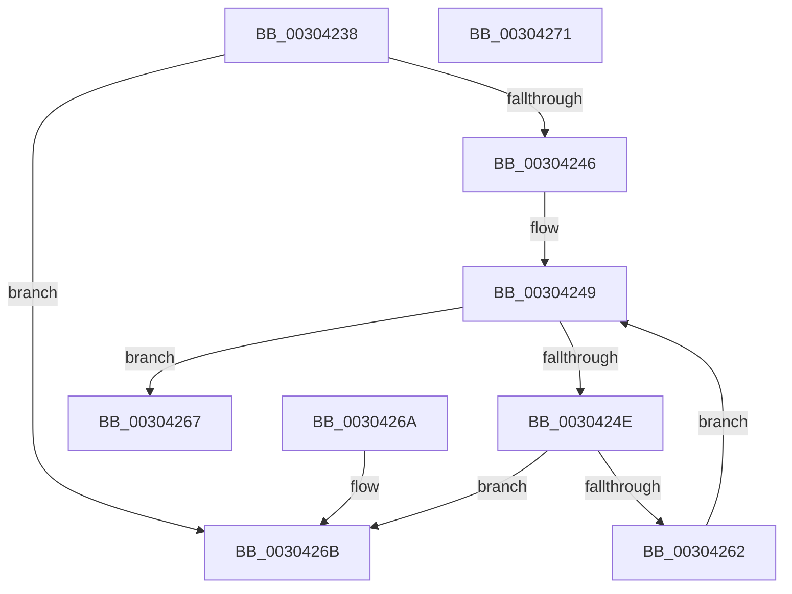

# KiValidateCpuSetMasks

- RVA: `0x00304238`–`0x00304272` (길이 `58` bytes)
- VA: `0x0000000140304238`
- 실행 섹션: `.text`
- PDB 이름 있음: `예`; PDB Function 태그: `아니요`
- unwind 정보 RVA: `0x000DB714`
- 디코드: `20`개 명령, `58/58` bytes 표시
- 미해석 바이트: `0` (있으면 어셈블리에 `.byte`로 보존)

> 이 문서는 커널 이미지의 기계어와 PDB 기호를 분석해 생성했습니다. 4번과 5번은 함수 원형과 자료형을 바이너리 사용 방식에서 추정한 C 해석이며 원본 소스 복구 결과는 아닙니다.

## 1. Dependencies

- 직접 호출 지점: **0**; 고유 호출 대상: **0**
- 직접 호출자로 확인된 함수: **6**
- RIP 상대 이미지 참조: **2**

### Outgoing calls
- 직접 디코드된 call 명령이 없습니다.

### Direct callers
- [KeSetSelectedCpuSetsThread](KeSetSelectedCpuSetsThread_function_003033D0.md) at `0x003033F7`
- [KiModifySystemAllowedCpuSetsWithLock](KiModifySystemAllowedCpuSetsWithLock_function_00304278.md) at `0x003042A6`
- [KeSetCpuSetsProcess](../5C/KeSetCpuSetsProcess_function_005C10D4.md) at `0x005C1103`
- [KeSetTagCpuSets](../5C/KeSetTagCpuSets_function_005C11BC.md) at `0x005C11DD`
- [sub_006E25FA](../6E/Unknown_function_006E25FA.md) at `0x006E2627`
- [KiInitializeReservedCpuSets](../../init/C3/KiInitializeReservedCpuSets_function_00C39DAC.md) at `0x00C39EC0`

### Static image references
- `0x00304238` → RVA `0x00FC5014` (`ALMOSTRO`; read)
- `0x0030424E` → RVA `0x00FC7128` (`ALMOSTRO`; read)

## 2. Other-region calls and transfers

- 다른 실행 섹션으로 향하는 call: **0**
- 별도 외부 분기/꼬리 이동을 확인하지 못했습니다.

## 3. Assembly (complete function range)

```asm
00304238  0F B7 05 D5 0D CC 00            movzx eax, word ptr [rip + 0xcc0dd5]
0030423F  4C 8B C9                        mov r9, rcx
00304242  3B D0                           cmp edx, eax
00304244  77 25                           ja 0x14030426b
00304246  45 33 C0                        xor r8d, r8d
00304249  44 3B C2                        cmp r8d, edx
0030424C  73 19                           jae 0x140304267
0030424E  48 8D 0D D3 2E CC 00            lea rcx, [rip + 0xcc2ed3]
00304255  4A 8B 0C C1                     mov rcx, qword ptr [rcx + r8*8]
00304259  48 F7 D1                        not rcx
0030425C  4B 85 0C C1                     test qword ptr [r9 + r8*8], rcx
00304260  75 09                           jne 0x14030426b
00304262  41 FF C0                        inc r8d
00304265  EB E2                           jmp 0x140304249
00304267  33 C0                           xor eax, eax
00304269  C3                              ret
0030426A  CC                              int3
0030426B  B8 AF 01 00 C0                  mov eax, 0xc00001af
00304270  C3                              ret
00304271  CC                              int3
```

## 4. C-style interpretation (structured pseudocode)

```c
__int64 __fastcall KiValidateCpuSetMasks(__int64 a1, int a2, int a3)
{
    __int64 result;

    if (a2 > ((unsigned int)(*(unsigned __int16 *)(v_rip + 13372885)))) goto loc_0030426B;
    a3 = 0;
loc_00304249:
    if (0 >= a2) goto loc_00304267;
    a1 = ~(*(unsigned __int64 *)(v_rip + 13381331 + a3 * 8));
    if (((*(unsigned __int64 *)(a1 + a3 * 8)) & (a1)) != 0) goto loc_0030426B;
    a3 = (unsigned int)((a3) + 1);
    goto loc_00304249;
loc_00304267:
    result = 0;
    return result;
loc_0030426B:
    return (unsigned int)(0xC00001AFULL);
}
```

## 5. (Beta) C Style

```c
int64_t KiValidateCpuSetMasks(void *Arg1, int32_t Arg2, int32_t Arg3)
{
    uint8_t *arg1 = (uint8_t *)Arg1;

    int64_t result;

    if (Arg2 > ((uint32_t)(*(uint16_t *)(v_rip + 0xCC0DD5)))) goto loc_0030426B;
    Arg3 = 0;
loc_00304249:
    if (0 >= Arg2) goto loc_00304267;
    Arg1 = ~(*(uint64_t *)(v_rip + 0xCC2ED3 + Arg3 * 8));
    if (((*(uint64_t *)(arg1 + Arg3 * 8)) & (Arg1)) != 0) goto loc_0030426B;
    Arg3 = (uint32_t)((Arg3) + 1);
    goto loc_00304249;
loc_00304267:
    result = 0;
    return result;
loc_0030426B:
    return (uint32_t)(0xC00001AFULL);
}
```

### 관측된 메모리 오프셋

구조체 형식이 확인되지 않은 접근은 인자 기준의 오프셋으로만 기록했습니다.

| 기준 인자 | 오프셋 표현 | 폭 (bit) | 접근 |
|---|---:|---:|---|
| `Arg1` | `+ 0x0 + r8*8` | `64` | `R` |

## 6. Execution-region graph

[열기: 2D/3D 그래프와 함수 탐색 컨트롤 패널](../../../control-panel.html?section=text&rva=0x00304238&view=graph)

- 2D 그래프는 위에서 아래로 흐르고, 3D 그래프는 빈 공간을 드래그해 회전합니다. Shift+드래그는 이동, 휠은 확대·축소, 함수 노드 선택은 대상 보고서 이동입니다.

### Static fallback


