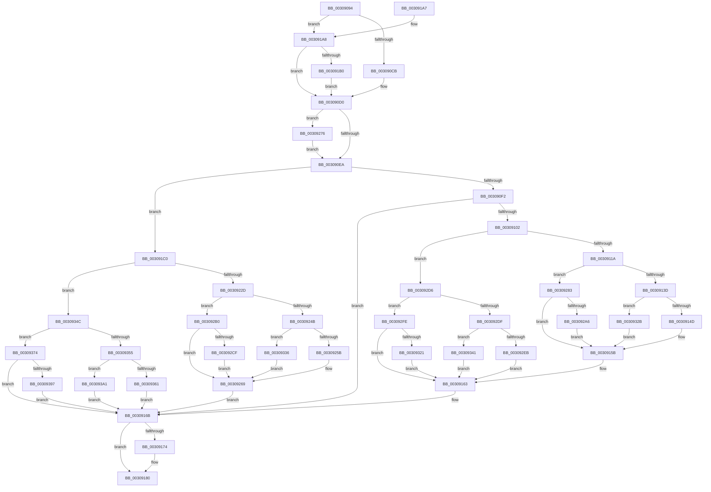

# KxFlushEntireTb

- RVA: `0x00309094`–`0x003093AC` (길이 `792` bytes)
- VA: `0x0000000140309094`
- 실행 섹션: `.text`
- PDB 이름 있음: `예`; PDB Function 태그: `아니요`
- unwind 정보 RVA: `0x00073B2C`
- 디코드: `179`개 명령, `792/792` bytes 표시
- 미해석 바이트: `0` (있으면 어셈블리에 `.byte`로 보존)

> 이 문서는 커널 이미지의 기계어와 PDB 기호를 분석해 생성했습니다. 4번과 5번은 함수 원형과 자료형을 바이너리 사용 방식에서 추정한 C 해석이며 원본 소스 복구 결과는 아닙니다.

## 1. Dependencies

- 직접 호출 지점: **15**; 고유 호출 대상: **10**
- 직접 호출자로 확인된 함수: **5**
- RIP 상대 이미지 참조: **6**

### Outgoing calls
- `0x003090F9` → [KxSetTimeStampBusy](../31/KxSetTimeStampBusy_function_00314CC0.md) (function, `0x00314CC0`)
- `0x0030912B` → [KiIpiSendRequest](../31/KiIpiSendRequest_function_003113C0.md) (function, `0x003113C0`)
- `0x0030915E` → [KiIpiWaitForRequestBarrier](../31/KiIpiWaitForRequestBarrier_function_003133C0.md) (function, `0x003133C0`)
- `0x0030917B` → [KiLowerIrqlProcessIrqlFlags](../4F/KiLowerIrqlProcessIrqlFlags_function_004F5698.md) (function, `0x004F5698`)
- `0x003091FA` → [memset](../6C/memset_function_006C6C40.md) (function, `0x006C6C40`)
- `0x0030920A` → [KiCopyAffinityEx](../2C/KiCopyAffinityEx_function_002CE860.md) (function, `0x002CE860`)
- `0x00309215` → [KeRemoveProcessorAffinityEx](KeRemoveProcessorAffinityEx_function_00304E10.md) (function, `0x00304E10`)
- `0x00309220` → [KiAffinityContainsProcessorsOtherThanSelf](KiAffinityContainsProcessorsOtherThanSelf_function_0030B1B0.md) (function, `0x0030B1B0`)
- `0x0030923D` → [KiIpiSendRequest](../31/KiIpiSendRequest_function_003113C0.md) (function, `0x003113C0`)
- `0x0030926C` → [KiIpiWaitForRequestBarrier](../31/KiIpiWaitForRequestBarrier_function_003133C0.md) (function, `0x003133C0`)
- `0x00309279` → [KiRaiseIrqlProcessIrqlFlags](../4F/KiRaiseIrqlProcessIrqlFlags_function_004F56FC.md) (function, `0x004F56FC`)
- `0x003092A6` → [KiSetUserTbFlushPending](../6B/KiSetUserTbFlushPending_function_006B20C0.md) (function, `0x006B20C0`)
- `0x003092CF` → [KiSetUserTbFlushPending](../6B/KiSetUserTbFlushPending_function_006B20C0.md) (function, `0x006B20C0`)
- `0x00309321` → [KiSetUserTbFlushPending](../6B/KiSetUserTbFlushPending_function_006B20C0.md) (function, `0x006B20C0`)
- `0x00309397` → [KiSetUserTbFlushPending](../6B/KiSetUserTbFlushPending_function_006B20C0.md) (function, `0x006B20C0`)

### Direct callers
- [MiManageUltraSpacePageTable](../2D/MiManageUltraSpacePageTable_function_002DCAF0.md) at `0x002DCE78`
- [MiFlushEntireTbDueToAttributeChange](MiFlushEntireTbDueToAttributeChange_function_00308AE0.md) at `0x00308BB3`
- [sub_0031414C](../31/Unknown_function_0031414C.md) at `0x00314279`
- [sub_00314667](../31/Unknown_function_00314667.md) at `0x003146C2`
- [KeFlushEntireTb](../5B/KeFlushEntireTb_function_005BDBF0.md) at `0x005BDC3B`

### Static image references
- `0x003090DD` → RVA `0x00FC6D20` (`ALMOSTRO`; read)
- `0x003090F2` → RVA `0x00FCF080` (`CACHEALI`; read)
- `0x0030910B` → RVA `0x00FC6A80` (`ALMOSTRO`; read)
- `0x00309130` → RVA `0x00FC6A87` (`ALMOSTRO`; read)
- `0x00309163` → RVA `0x00FCF080` (`CACHEALI`; read/write)
- `0x003091B0` → RVA `0x01201840` (`CFGRO`; read)

## 2. Other-region calls and transfers

- 다른 실행 섹션으로 향하는 call: **0**
- 별도 외부 분기/꼬리 이동을 확인하지 못했습니다.

## 3. Assembly (complete function range)

```asm
00309094  48 8B C4                        mov rax, rsp
00309097  48 89 58 08                     mov qword ptr [rax + 8], rbx
0030909B  48 89 68 10                     mov qword ptr [rax + 0x10], rbp
0030909F  48 89 70 18                     mov qword ptr [rax + 0x18], rsi
003090A3  48 89 78 20                     mov qword ptr [rax + 0x20], rdi
003090A7  41 54                           push r12
003090A9  41 56                           push r14
003090AB  41 57                           push r15
003090AD  48 83 EC 30                     sub rsp, 0x30
003090B1  41 BC 01 00 00 00               mov r12d, 1
003090B7  45 33 FF                        xor r15d, r15d
003090BA  41 8B DC                        mov ebx, r12d
003090BD  41 8D 7C 24 02                  lea edi, [r12 + 2]
003090C2  41 3B CC                        cmp ecx, r12d
003090C5  0F 85 DD 00 00 00               jne 0x1403091a8
003090CB  BF 03 00 00 80                  mov edi, 0x80000003
003090D0  44 0F 20 C6                     mov rsi, cr8
003090D4  BA 0C 00 00 00                  mov edx, 0xc
003090D9  44 0F 22 C2                     mov cr8, rdx
003090DD  44 39 3D 3C DC CB 00            cmp dword ptr [rip + 0xcbdc3c], r15d
003090E4  0F 85 8C 01 00 00               jne 0x140309276
003090EA  84 DB                           test bl, bl
003090EC  0F 84 CE 00 00 00               je 0x1403091c0
003090F2  48 8D 0D 87 5F CC 00            lea rcx, [rip + 0xcc5f87]
003090F9  E8 C2 BB 00 00                  call 0x140314cc0
003090FE  84 C0                           test al, al
00309100  74 69                           je 0x14030916b
00309102  65 48 8B 1C 25 20 00 00 00      mov rbx, qword ptr gs:[0x20]
0030910B  8B 05 6F D9 CB 00               mov eax, dword ptr [rip + 0xcbd96f]
00309111  41 3B C4                        cmp eax, r12d
00309114  0F 86 BC 01 00 00               jbe 0x1403092d6
0030911A  45 33 C9                        xor r9d, r9d
0030911D  48 89 7C 24 20                  mov qword ptr [rsp + 0x20], rdi
00309122  45 33 C0                        xor r8d, r8d
00309125  41 8B D4                        mov edx, r12d
00309128  48 8B CB                        mov rcx, rbx
0030912B  E8 90 82 00 00                  call 0x1403113c0
00309130  44 38 3D 50 D9 CB 00            cmp byte ptr [rip + 0xcbd950], r15b
00309137  0F 85 46 01 00 00               jne 0x140309283
0030913D  0F 20 E1                        mov rcx, cr4
00309140  48 F7 C1 80 00 02 00            test rcx, 0x20080
00309147  0F 84 DE 01 00 00               je 0x14030932b
0030914D  48 8B C1                        mov rax, rcx
00309150  48 0F BA F8 07                  btc rax, 7
00309155  0F 22 E0                        mov cr4, rax
00309158  0F 22 E1                        mov cr4, rcx
0030915B  48 8B CB                        mov rcx, rbx
0030915E  E8 5D A2 00 00                  call 0x1403133c0
00309163  F0 44 01 25 15 5F CC 00         lock add dword ptr [rip + 0xcc5f15], r12d
0030916B  44 39 3D AE DB CB 00            cmp dword ptr [rip + 0xcbdbae], r15d
00309172  74 0C                           je 0x140309180
00309174  44 0F 20 C1                     mov rcx, cr8
00309178  40 8A D6                        mov dl, sil
0030917B  E8 18 C5 1E 00                  call 0x1404f5698
00309180  40 0F B6 C6                     movzx eax, sil
00309184  44 0F 22 C0                     mov cr8, rax
00309188  48 8B 5C 24 50                  mov rbx, qword ptr [rsp + 0x50]
0030918D  48 8B 6C 24 58                  mov rbp, qword ptr [rsp + 0x58]
00309192  48 8B 74 24 60                  mov rsi, qword ptr [rsp + 0x60]
00309197  48 8B 7C 24 68                  mov rdi, qword ptr [rsp + 0x68]
0030919C  48 83 C4 30                     add rsp, 0x30
003091A0  41 5F                           pop r15
003091A2  41 5E                           pop r14
003091A4  41 5C                           pop r12
003091A6  C3                              ret
003091A7  CC                              int3
003091A8  85 C9                           test ecx, ecx
003091AA  0F 85 20 FF FF FF               jne 0x1403090d0
003091B0  44 38 3D 89 86 EF 00            cmp byte ptr [rip + 0xef8689], r15b
003091B7  41 0F 45 DF                     cmovne ebx, r15d
003091BB  E9 10 FF FF FF                  jmp 0x1403090d0
003091C0  F0 44 09 3C 24                  lock or dword ptr [rsp], r15d
003091C5  65 48 8B 2C 25 20 00 00 00      mov rbp, qword ptr gs:[0x20]
003091CE  33 D2                           xor edx, edx
003091D0  41 B8 00 01 00 00               mov r8d, 0x100
003091D6  48 8B 45 08                     mov rax, qword ptr [rbp + 8]
003091DA  4C 8D B5 B8 2D 00 00            lea r14, [rbp + 0x2db8]
003091E1  48 8B 88 B8 00 00 00            mov rcx, qword ptr [rax + 0xb8]
003091E8  48 8B 99 80 00 00 00            mov rbx, qword ptr [rcx + 0x80]
003091EF  49 8D 4E 08                     lea rcx, [r14 + 8]
003091F3  49 C7 06 01 00 20 00            mov qword ptr [r14], 0x200001
003091FA  E8 41 DA 3B 00                  call 0x1406c6c40
003091FF  41 0F B7 56 02                  movzx edx, word ptr [r14 + 2]
00309204  4C 8B C3                        mov r8, rbx
00309207  49 8B CE                        mov rcx, r14
0030920A  E8 51 56 FC FF                  call 0x1402ce860
0030920F  8B 55 24                        mov edx, dword ptr [rbp + 0x24]
00309212  49 8B CE                        mov rcx, r14
00309215  E8 F6 BB FF FF                  call 0x140304e10
0030921A  49 8B D6                        mov rdx, r14
0030921D  48 8B CD                        mov rcx, rbp
00309220  E8 8B 1F 00 00                  call 0x14030b1b0
00309225  85 C0                           test eax, eax
00309227  0F 84 1F 01 00 00               je 0x14030934c
0030922D  45 33 C9                        xor r9d, r9d
00309230  48 89 7C 24 20                  mov qword ptr [rsp + 0x20], rdi
00309235  4D 8B C6                        mov r8, r14
00309238  33 D2                           xor edx, edx
0030923A  48 8B CD                        mov rcx, rbp
0030923D  E8 7E 81 00 00                  call 0x1403113c0
00309242  44 38 3D 3E D8 CB 00            cmp byte ptr [rip + 0xcbd83e], r15b
00309249  75 65                           jne 0x1403092b0
0030924B  0F 20 E1                        mov rcx, cr4
0030924E  48 F7 C1 80 00 02 00            test rcx, 0x20080
00309255  0F 84 DB 00 00 00               je 0x140309336
0030925B  48 8B C1                        mov rax, rcx
0030925E  48 0F BA F8 07                  btc rax, 7
00309263  0F 22 E0                        mov cr4, rax
00309266  0F 22 E1                        mov cr4, rcx
00309269  48 8B CD                        mov rcx, rbp
0030926C  E8 4F A1 00 00                  call 0x1403133c0
00309271  E9 F5 FE FF FF                  jmp 0x14030916b
00309276  40 8A CE                        mov cl, sil
00309279  E8 7E C4 1E 00                  call 0x1404f56fc
0030927E  E9 67 FE FF FF                  jmp 0x1403090ea
00309283  0F 20 D8                        mov rax, cr3
00309286  0F 22 D8                        mov cr3, rax
00309289  65 48 8B 04 25 88 01 00 00      mov rax, qword ptr gs:[0x188]
00309292  48 8B 88 B8 00 00 00            mov rcx, qword ptr [rax + 0xb8]
00309299  44 38 B9 60 01 00 00            cmp byte ptr [rcx + 0x160], r15b
003092A0  0F 85 B5 FE FF FF               jne 0x14030915b
003092A6  E8 15 8E 3A 00                  call 0x1406b20c0
003092AB  E9 AB FE FF FF                  jmp 0x14030915b
003092B0  0F 20 D8                        mov rax, cr3
003092B3  0F 22 D8                        mov cr3, rax
003092B6  65 48 8B 04 25 88 01 00 00      mov rax, qword ptr gs:[0x188]
003092BF  48 8B 88 B8 00 00 00            mov rcx, qword ptr [rax + 0xb8]
003092C6  44 38 B9 60 01 00 00            cmp byte ptr [rcx + 0x160], r15b
003092CD  75 9A                           jne 0x140309269
003092CF  E8 EC 8D 3A 00                  call 0x1406b20c0
003092D4  EB 93                           jmp 0x140309269
003092D6  44 38 3D AA D7 CB 00            cmp byte ptr [rip + 0xcbd7aa], r15b
003092DD  75 1F                           jne 0x1403092fe
003092DF  0F 20 E1                        mov rcx, cr4
003092E2  48 F7 C1 80 00 02 00            test rcx, 0x20080
003092E9  74 56                           je 0x140309341
003092EB  48 8B C1                        mov rax, rcx
003092EE  48 0F BA F8 07                  btc rax, 7
003092F3  0F 22 E0                        mov cr4, rax
003092F6  0F 22 E1                        mov cr4, rcx
003092F9  E9 65 FE FF FF                  jmp 0x140309163
003092FE  0F 20 D8                        mov rax, cr3
00309301  0F 22 D8                        mov cr3, rax
00309304  65 48 8B 04 25 88 01 00 00      mov rax, qword ptr gs:[0x188]
0030930D  48 8B 88 B8 00 00 00            mov rcx, qword ptr [rax + 0xb8]
00309314  44 38 B9 60 01 00 00            cmp byte ptr [rcx + 0x160], r15b
0030931B  0F 85 42 FE FF FF               jne 0x140309163
00309321  E8 9A 8D 3A 00                  call 0x1406b20c0
00309326  E9 38 FE FF FF                  jmp 0x140309163
0030932B  0F 20 D8                        mov rax, cr3
0030932E  0F 22 D8                        mov cr3, rax
00309331  E9 25 FE FF FF                  jmp 0x14030915b
00309336  0F 20 D8                        mov rax, cr3
00309339  0F 22 D8                        mov cr3, rax
0030933C  E9 28 FF FF FF                  jmp 0x140309269
00309341  0F 20 D8                        mov rax, cr3
00309344  0F 22 D8                        mov cr3, rax
00309347  E9 17 FE FF FF                  jmp 0x140309163
0030934C  44 38 3D 34 D7 CB 00            cmp byte ptr [rip + 0xcbd734], r15b
00309353  75 1F                           jne 0x140309374
00309355  0F 20 E1                        mov rcx, cr4
00309358  48 F7 C1 80 00 02 00            test rcx, 0x20080
0030935F  74 40                           je 0x1403093a1
00309361  48 8B C1                        mov rax, rcx
00309364  48 0F BA F8 07                  btc rax, 7
00309369  0F 22 E0                        mov cr4, rax
0030936C  0F 22 E1                        mov cr4, rcx
0030936F  E9 F7 FD FF FF                  jmp 0x14030916b
00309374  0F 20 D8                        mov rax, cr3
00309377  0F 22 D8                        mov cr3, rax
0030937A  65 48 8B 04 25 88 01 00 00      mov rax, qword ptr gs:[0x188]
00309383  48 8B 88 B8 00 00 00            mov rcx, qword ptr [rax + 0xb8]
0030938A  44 38 B9 60 01 00 00            cmp byte ptr [rcx + 0x160], r15b
00309391  0F 85 D4 FD FF FF               jne 0x14030916b
00309397  E8 24 8D 3A 00                  call 0x1406b20c0
0030939C  E9 CA FD FF FF                  jmp 0x14030916b
003093A1  0F 20 D8                        mov rax, cr3
003093A4  0F 22 D8                        mov cr3, rax
003093A7  E9 BF FD FF FF                  jmp 0x14030916b
```

## 4. C-style interpretation (structured pseudocode)

```c
__int64 __fastcall KxFlushEntireTb(int a1, __int64 a2, int a3, int a4)
{
    __int64 result;
    __int64 v_r15;
    __int64 v_rbx;
    __int64 v_rsp;
    unsigned __int64 v_stack_m28;
    unsigned int v_stack_p0;
    unsigned __int64 v_stack_p10;
    unsigned __int64 v_stack_p18;
    unsigned __int64 v_stack_p20;
    unsigned __int64 v_stack_p8;

    *(unsigned __int64 *)(v_rsp + 8) = v_rbx;
    *(unsigned __int64 *)(v_rsp + 16) = v_rbp;
    *(unsigned __int64 *)(v_rsp + 24) = v_rsi;
    *(unsigned __int64 *)(v_rsp + 32) = v_rdi;
    v_rsp = (v_rsp) - (48);
    v_r15 = 0;
    if (a1 != 1) goto loc_003091A8;
loc_003090D0:
    if ((*(unsigned int *)(v_rip + 13360188)) != 0) goto loc_00309276;
loc_003090EA:
    if (1 == 0) goto loc_003091C0;
    result = KxSetTimeStampBusy(v_rip + 13393799, 12, a3, a4);
    if ((unsigned __int8)(result) == 0) goto loc_0030916B;
    if (((unsigned int)((unsigned int)(*(unsigned int *)(v_rip + 13359471)))) <= 1) goto loc_003092D6;
    a4 = 0;
    v_stack_m28 = (unsigned int)(0x80000003ULL);
    a3 = 0;
    result = KiIpiSendRequest(*(unsigned __int64 *)(gs_base + (0 + 32)), 1, a3, a4);
    if ((*(unsigned __int8 *)(v_rip + 13359440)) != 0) goto loc_00309283;
    if (((v_cr4) & (0x20080ULL)) == 0) goto loc_0030932B;
loc_0030915B:
    result = KiIpiWaitForRequestBarrier(*(unsigned __int64 *)(gs_base + (0 + 32)), 1, a3, a4);
loc_00309163:
loc_0030916B:
    if ((*(unsigned int *)(v_rip + 13360046)) != 0) {
        a1 = 12;
        a2 = (unsigned __int8)(v_cr8);
        result = KiLowerIrqlProcessIrqlFlags(a1, a2, a3, a4);
    }
    v_rsp = (v_rsp) + (48);
    return (unsigned __int8)(v_cr8);
loc_003091A8:
    if (a1 != 0) goto loc_003090D0;
    v_rbx = v_stack_p8;
    if ((*(unsigned __int8 *)(v_rip + 15697545)) != 0) { v_rbx = 0; }
    goto loc_003090D0;
loc_003091C0:
    a2 = 0;
    *(unsigned __int64 *)(*(unsigned __int64 *)(gs_base + (0 + 32)) + 11704) = 0x200001ULL;
    result = memset(*(unsigned __int64 *)(gs_base + (0 + 32)) + 11704 + 8, a2, 256, a4);
    result = KiCopyAffinityEx(*(unsigned __int64 *)(gs_base + (0 + 32)) + 11704, *(unsigned __int16 *)(*(unsigned __int64 *)(gs_base + (0 + 32)) + 11704 + 2), *(unsigned __int64 *)(*(unsigned __int64 *)(*(unsigned __int64 *)(*(unsigned __int64 *)(gs_base + (0 + 32)) + 8) + 184) + 128), a4);
    result = KeRemoveProcessorAffinityEx(*(unsigned __int64 *)(gs_base + (0 + 32)) + 11704, (unsigned int)(*(unsigned int *)(*(unsigned __int64 *)(gs_base + (0 + 32)) + 36)), *(unsigned __int64 *)(*(unsigned __int64 *)(*(unsigned __int64 *)(*(unsigned __int64 *)(gs_base + (0 + 32)) + 8) + 184) + 128), a4);
    result = KiAffinityContainsProcessorsOtherThanSelf(*(unsigned __int64 *)(gs_base + (0 + 32)), *(unsigned __int64 *)(gs_base + (0 + 32)) + 11704, *(unsigned __int64 *)(*(unsigned __int64 *)(*(unsigned __int64 *)(*(unsigned __int64 *)(gs_base + (0 + 32)) + 8) + 184) + 128), a4);
    if ((unsigned int)(result) == 0) goto loc_0030934C;
    a4 = 0;
    v_stack_p20 = v_stack_p20;
    a2 = 0;
    result = KiIpiSendRequest(*(unsigned __int64 *)(gs_base + (0 + 32)), a2, *(unsigned __int64 *)(gs_base + (0 + 32)) + 11704, a4);
    if ((*(unsigned __int8 *)(v_rip + 13359166)) != 0) goto loc_003092B0;
    if (((v_cr4) & (0x20080ULL)) == 0) goto loc_00309336;
loc_00309269:
    result = KiIpiWaitForRequestBarrier(*(unsigned __int64 *)(gs_base + (0 + 32)), a2, *(unsigned __int64 *)(gs_base + (0 + 32)) + 11704, a4);
    goto loc_0030916B;
loc_00309276:
    result = KiRaiseIrqlProcessIrqlFlags((unsigned __int8)(v_stack_p18), a2, *(unsigned __int64 *)(gs_base + (0 + 32)) + 11704, a4);
    goto loc_003090EA;
loc_00309283:
    if ((*(unsigned __int8 *)(*(unsigned __int64 *)(*(unsigned __int64 *)(gs_base + (0 + 392)) + 184) + 352)) != 0) goto loc_0030915B;
    result = KiSetUserTbFlushPending(*(unsigned __int64 *)(*(unsigned __int64 *)(gs_base + (0 + 392)) + 184), a2, *(unsigned __int64 *)(gs_base + (0 + 32)) + 11704, a4);
    goto loc_0030915B;
loc_003092B0:
    if ((*(unsigned __int8 *)(*(unsigned __int64 *)(*(unsigned __int64 *)(gs_base + (0 + 392)) + 184) + 352)) != 0) goto loc_00309269;
    result = KiSetUserTbFlushPending(*(unsigned __int64 *)(*(unsigned __int64 *)(gs_base + (0 + 392)) + 184), a2, *(unsigned __int64 *)(gs_base + (0 + 32)) + 11704, a4);
    goto loc_00309269;
loc_003092D6:
    if ((*(unsigned __int8 *)(v_rip + 13359018)) != 0) goto loc_003092FE;
    if (((v_cr4) & (0x20080ULL)) == 0) goto loc_00309341;
    goto loc_00309163;
loc_003092FE:
    if ((*(unsigned __int8 *)(*(unsigned __int64 *)(*(unsigned __int64 *)(gs_base + (0 + 392)) + 184) + 352)) != 0) goto loc_00309163;
    result = KiSetUserTbFlushPending(*(unsigned __int64 *)(*(unsigned __int64 *)(gs_base + (0 + 392)) + 184), a2, *(unsigned __int64 *)(gs_base + (0 + 32)) + 11704, a4);
    goto loc_00309163;
loc_0030932B:
    goto loc_0030915B;
loc_00309336:
    goto loc_00309269;
loc_00309341:
    goto loc_00309163;
loc_0030934C:
    if ((*(unsigned __int8 *)(v_rip + 13358900)) != 0) goto loc_00309374;
    if (((v_cr4) & (0x20080ULL)) == 0) goto loc_003093A1;
    goto loc_0030916B;
loc_00309374:
    if ((*(unsigned __int8 *)(*(unsigned __int64 *)(*(unsigned __int64 *)(gs_base + (0 + 392)) + 184) + 352)) != 0) goto loc_0030916B;
    result = KiSetUserTbFlushPending(*(unsigned __int64 *)(*(unsigned __int64 *)(gs_base + (0 + 392)) + 184), a2, *(unsigned __int64 *)(gs_base + (0 + 32)) + 11704, a4);
    goto loc_0030916B;
loc_003093A1:
    goto loc_0030916B;
}
```

## 5. (Beta) C Style

```c
int64_t KxFlushEntireTb(int32_t Arg1, int64_t Arg2, int32_t Arg3, int32_t Arg4)
{
    int64_t result;
    int64_t local_r15;
    int64_t local_rbx;
    int64_t local_rsp;
    uint64_t v_stack_m28;
    uint32_t v_stack_p0;
    uint64_t v_stack_p10;
    uint64_t v_stack_p18;
    uint64_t v_stack_p20;
    uint64_t v_stack_p8;

    *(uint64_t *)(local_rsp + 0x8) = local_rbx;
    *(uint64_t *)(local_rsp + 0x10) = local_rbp;
    *(uint64_t *)(local_rsp + 0x18) = local_rsi;
    *(uint64_t *)(local_rsp + 0x20) = local_rdi;
    local_rsp = (local_rsp) - (48);
    local_r15 = 0;
    if (Arg1 != 1) goto loc_003091A8;
loc_003090D0:
    if ((*(uint32_t *)(v_rip + 0xCBDC3C)) != 0) goto loc_00309276;
loc_003090EA:
    if (1 == 0) goto loc_003091C0;
    result = KxSetTimeStampBusy(v_rip + 13393799, 12, Arg3, Arg4);
    if ((uint8_t)(result) == 0) goto loc_0030916B;
    if (((uint32_t)((uint32_t)(*(uint32_t *)(v_rip + 0xCBD96F)))) <= 1) goto loc_003092D6;
    Arg4 = 0;
    v_stack_m28 = (uint32_t)(0x80000003ULL);
    Arg3 = 0;
    result = KiIpiSendRequest(*(uint64_t *)(gs_base + (0 + 0x20)), 1, Arg3, Arg4);
    if ((*(uint8_t *)(v_rip + 0xCBD950)) != 0) goto loc_00309283;
    if (((v_cr4) & (0x20080ULL)) == 0) goto loc_0030932B;
loc_0030915B:
    result = KiIpiWaitForRequestBarrier(*(uint64_t *)(gs_base + (0 + 0x20)), 1, Arg3, Arg4);
loc_00309163:
loc_0030916B:
    if ((*(uint32_t *)(v_rip + 0xCBDBAE)) != 0) {
        Arg1 = 12;
        Arg2 = (uint8_t)(v_cr8);
        result = KiLowerIrqlProcessIrqlFlags(Arg1, Arg2, Arg3, Arg4);
    }
    local_rsp = (local_rsp) + (48);
    return (uint8_t)(v_cr8);
loc_003091A8:
    if (Arg1 != 0) goto loc_003090D0;
    local_rbx = v_stack_p8;
    if ((*(uint8_t *)(v_rip + 0xEF8689)) != 0) { local_rbx = 0; }
    goto loc_003090D0;
loc_003091C0:
    Arg2 = 0;
    *(uint64_t *)(*(uint64_t *)(gs_base + (0 + 0x20)) + 0x2DB8) = 0x200001ULL;
    result = memset(*(uint64_t *)(gs_base + (0 + 0x20)) + 11704 + 8, Arg2, 256, Arg4);
    result = KiCopyAffinityEx(*(uint64_t *)(gs_base + (0 + 0x20)) + 11704, *(uint16_t *)(*(uint64_t *)(gs_base + (0 + 0x20)) + 0x2DB8 + 0x2), *(uint64_t *)(*(uint64_t *)(*(uint64_t *)(*(uint64_t *)(gs_base + (0 + 0x20)) + 0x8) + 0xB8) + 0x80), Arg4);
    result = KeRemoveProcessorAffinityEx(*(uint64_t *)(gs_base + (0 + 0x20)) + 11704, (uint32_t)(*(uint32_t *)(*(uint64_t *)(gs_base + (0 + 0x20)) + 0x24)), *(uint64_t *)(*(uint64_t *)(*(uint64_t *)(*(uint64_t *)(gs_base + (0 + 0x20)) + 0x8) + 0xB8) + 0x80), Arg4);
    result = KiAffinityContainsProcessorsOtherThanSelf(*(uint64_t *)(gs_base + (0 + 0x20)), *(uint64_t *)(gs_base + (0 + 0x20)) + 11704, *(uint64_t *)(*(uint64_t *)(*(uint64_t *)(*(uint64_t *)(gs_base + (0 + 0x20)) + 0x8) + 0xB8) + 0x80), Arg4);
    if ((uint32_t)(result) == 0) goto loc_0030934C;
    Arg4 = 0;
    v_stack_p20 = v_stack_p20;
    Arg2 = 0;
    result = KiIpiSendRequest(*(uint64_t *)(gs_base + (0 + 0x20)), Arg2, *(uint64_t *)(gs_base + (0 + 0x20)) + 11704, Arg4);
    if ((*(uint8_t *)(v_rip + 0xCBD83E)) != 0) goto loc_003092B0;
    if (((v_cr4) & (0x20080ULL)) == 0) goto loc_00309336;
loc_00309269:
    result = KiIpiWaitForRequestBarrier(*(uint64_t *)(gs_base + (0 + 0x20)), Arg2, *(uint64_t *)(gs_base + (0 + 0x20)) + 11704, Arg4);
    goto loc_0030916B;
loc_00309276:
    result = KiRaiseIrqlProcessIrqlFlags((uint8_t)(v_stack_p18), Arg2, *(uint64_t *)(gs_base + (0 + 0x20)) + 11704, Arg4);
    goto loc_003090EA;
loc_00309283:
    if ((*(uint8_t *)(*(uint64_t *)(*(uint64_t *)(gs_base + (0 + 0x188)) + 0xB8) + 0x160)) != 0) goto loc_0030915B;
    result = KiSetUserTbFlushPending(*(uint64_t *)(*(uint64_t *)(gs_base + (0 + 0x188)) + 0xB8), Arg2, *(uint64_t *)(gs_base + (0 + 0x20)) + 11704, Arg4);
    goto loc_0030915B;
loc_003092B0:
    if ((*(uint8_t *)(*(uint64_t *)(*(uint64_t *)(gs_base + (0 + 0x188)) + 0xB8) + 0x160)) != 0) goto loc_00309269;
    result = KiSetUserTbFlushPending(*(uint64_t *)(*(uint64_t *)(gs_base + (0 + 0x188)) + 0xB8), Arg2, *(uint64_t *)(gs_base + (0 + 0x20)) + 11704, Arg4);
    goto loc_00309269;
loc_003092D6:
    if ((*(uint8_t *)(v_rip + 0xCBD7AA)) != 0) goto loc_003092FE;
    if (((v_cr4) & (0x20080ULL)) == 0) goto loc_00309341;
    goto loc_00309163;
loc_003092FE:
    if ((*(uint8_t *)(*(uint64_t *)(*(uint64_t *)(gs_base + (0 + 0x188)) + 0xB8) + 0x160)) != 0) goto loc_00309163;
    result = KiSetUserTbFlushPending(*(uint64_t *)(*(uint64_t *)(gs_base + (0 + 0x188)) + 0xB8), Arg2, *(uint64_t *)(gs_base + (0 + 0x20)) + 11704, Arg4);
    goto loc_00309163;
loc_0030932B:
    goto loc_0030915B;
loc_00309336:
    goto loc_00309269;
loc_00309341:
    goto loc_00309163;
loc_0030934C:
    if ((*(uint8_t *)(v_rip + 0xCBD734)) != 0) goto loc_00309374;
    if (((v_cr4) & (0x20080ULL)) == 0) goto loc_003093A1;
    goto loc_0030916B;
loc_00309374:
    if ((*(uint8_t *)(*(uint64_t *)(*(uint64_t *)(gs_base + (0 + 0x188)) + 0xB8) + 0x160)) != 0) goto loc_0030916B;
    result = KiSetUserTbFlushPending(*(uint64_t *)(*(uint64_t *)(gs_base + (0 + 0x188)) + 0xB8), Arg2, *(uint64_t *)(gs_base + (0 + 0x20)) + 11704, Arg4);
    goto loc_0030916B;
loc_003093A1:
    goto loc_0030916B;
}
```

## 6. Execution-region graph

[열기: 2D/3D 그래프와 함수 탐색 컨트롤 패널](../../../control-panel.html?section=text&rva=0x00309094&view=graph)

- 2D 그래프는 위에서 아래로 흐르고, 3D 그래프는 빈 공간을 드래그해 회전합니다. Shift+드래그는 이동, 휠은 확대·축소, 함수 노드 선택은 대상 보고서 이동입니다.

### Static fallback


