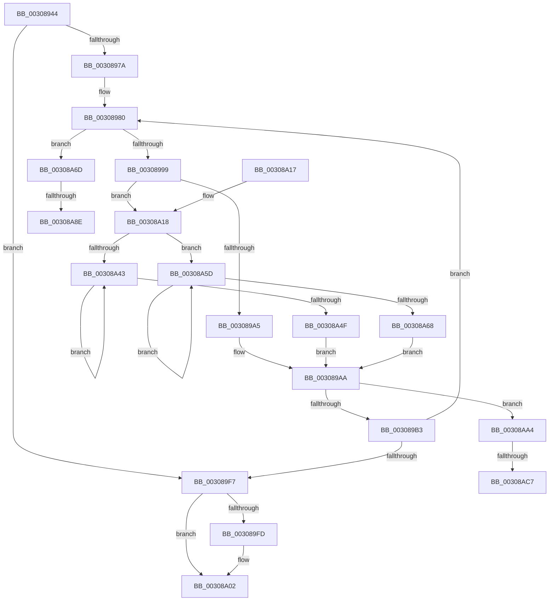

# MiFlushCacheForAttributeChange

- RVA: `0x00308944`–`0x00308ADA` (길이 `406` bytes)
- VA: `0x0000000140308944`
- 실행 섹션: `.text`
- PDB 이름 있음: `예`; PDB Function 태그: `예`
- unwind 정보 RVA: `0x00073A28`
- 디코드: `100`개 명령, `406/406` bytes 표시
- 미해석 바이트: `0` (있으면 어셈블리에 `.byte`로 보존)

> 이 문서는 커널 이미지의 기계어와 PDB 기호를 분석해 생성했습니다. 4번과 5번은 함수 원형과 자료형을 바이너리 사용 방식에서 추정한 C 해석이며 원본 소스 복구 결과는 아닙니다.

## 1. Dependencies

- 직접 호출 지점: **5**; 고유 호출 대상: **4**
- 직접 호출자로 확인된 함수: **2**
- RIP 상대 이미지 참조: **3**

### Outgoing calls
- `0x00308988` → [MiMapPageInHyperSpaceWorker](../33/MiMapPageInHyperSpaceWorker_function_00332B10.md) (function, `0x00332B10`)
- `0x003089A5` → [KeInvalidateAllCaches](KeInvalidateAllCaches_function_00308CC0.md) (function, `0x00308CC0`)
- `0x003089FD` → [MiFlushEntireTbDueToAttributeChange](MiFlushEntireTbDueToAttributeChange_function_00308AE0.md) (function, `0x00308AE0`)
- `0x00308A77` → [KeQueryPerformanceCounter](../37/KeQueryPerformanceCounter_function_0037E7E0.md) (function, `0x0037E7E0`)
- `0x00308AB3` → [KeQueryPerformanceCounter](../37/KeQueryPerformanceCounter_function_0037E7E0.md) (function, `0x0037E7E0`)

### Direct callers
- [MiFlushCacheRange](../69/MiFlushCacheRange_function_006954C8.md) at `0x00695524`
- [MiInitializeCacheFlushing](../../init/C6/MiInitializeCacheFlushing_function_00C6ACF8.md) at `0x00C6AE78`

### Static image references
- `0x00308999` → RVA `0x00FC51C8` (`ALMOSTRO`; read)
- `0x003089E4` → RVA `0x00010880` (`.rdata`; read)
- `0x00308A38` → RVA `0x00FC6B30` (`ALMOSTRO`; read)

## 2. Other-region calls and transfers

- 다른 실행 섹션으로 향하는 call: **0**
- call이 아닌 외부 분기/꼬리 이동: **4**
  - `0x00308A88` → [sub_006E0B60](../6E/Unknown_function_006E0B60.md) (`tail-transfer`)
  - `0x00308A9F` → [sub_006E0B60](../6E/Unknown_function_006E0B60.md) (`tail-transfer`)
  - `0x00308AC1` → [sub_006E0B60 + 0xA](../6E/Unknown_function_006E0B60.md) (`tail-transfer`)
  - `0x00308AD5` → [sub_006E0B60 + 0xA](../6E/Unknown_function_006E0B60.md) (`tail-transfer`)

## 3. Assembly (complete function range)

```asm
00308944  48 89 5C 24 08                  mov qword ptr [rsp + 8], rbx
00308949  55                              push rbp
0030894A  56                              push rsi
0030894B  57                              push rdi
0030894C  41 54                           push r12
0030894E  41 55                           push r13
00308950  41 56                           push r14
00308952  41 57                           push r15
00308954  48 83 EC 30                     sub rsp, 0x30
00308958  45 33 ED                        xor r13d, r13d
0030895B  49 8B E9                        mov rbp, r9
0030895E  45 8B F0                        mov r14d, r8d
00308961  4C 8B FA                        mov r15, rdx
00308964  4C 8B E1                        mov r12, rcx
00308967  41 8B FD                        mov edi, r13d
0030896A  41 8D 5D 02                     lea ebx, [r13 + 2]
0030896E  44 3B C3                        cmp r8d, ebx
00308971  41 0F 45 DD                     cmovne ebx, r13d
00308975  48 85 D2                        test rdx, rdx
00308978  74 7D                           je 0x1403089f7
0030897A  81 CB 00 00 00 C0               or ebx, 0xc0000000
00308980  44 8B C3                        mov r8d, ebx
00308983  33 D2                           xor edx, edx
00308985  49 8B CC                        mov rcx, r12
00308988  E8 83 A1 02 00                  call 0x140332b10
0030898D  48 8B F0                        mov rsi, rax
00308990  48 85 ED                        test rbp, rbp
00308993  0F 85 D4 00 00 00               jne 0x140308a6d
00308999  81 3D 25 C8 CB 00 00 10 00 00   cmp dword ptr [rip + 0xcbc825], 0x1000
003089A3  77 73                           ja 0x140308a18
003089A5  E8 16 03 00 00                  call 0x140308cc0
003089AA  48 85 ED                        test rbp, rbp
003089AD  0F 85 F1 00 00 00               jne 0x140308aa4
003089B3  48 C1 EE 09                     shr rsi, 9
003089B7  48 B8 F8 FF FF FF 7F 00 00 00   movabs rax, 0x7ffffffff8
003089C1  48 23 F0                        and rsi, rax
003089C4  48 B8 00 00 00 00 80 F6 FF FF   movabs rax, 0xfffff68000000000
003089CE  48 03 F0                        add rsi, rax
003089D1  49 FF C4                        inc r12
003089D4  65 48 8B 04 25 20 00 00 00      mov rax, qword ptr gs:[0x20]
003089DD  48 8B 88 38 88 00 00            mov rcx, qword ptr [rax + 0x8838]
003089E4  48 8B 05 95 7E D0 FF            mov rax, qword ptr [rip - 0x2f816b]
003089EB  4C 89 29                        mov qword ptr [rcx], r13
003089EE  48 89 06                        mov qword ptr [rsi], rax
003089F1  49 83 EF 01                     sub r15, 1
003089F5  75 89                           jne 0x140308980
003089F7  41 83 FE 03                     cmp r14d, 3
003089FB  75 05                           jne 0x140308a02
003089FD  E8 DE 00 00 00                  call 0x140308ae0
00308A02  48 8B 5C 24 70                  mov rbx, qword ptr [rsp + 0x70]
00308A07  48 83 C4 30                     add rsp, 0x30
00308A0B  41 5F                           pop r15
00308A0D  41 5E                           pop r14
00308A0F  41 5D                           pop r13
00308A11  41 5C                           pop r12
00308A13  5F                              pop rdi
00308A14  5E                              pop rsi
00308A15  5D                              pop rbp
00308A16  C3                              ret
00308A17  CC                              int3
00308A18  65 48 8B 04 25 20 00 00 00      mov rax, qword ptr gs:[0x20]
00308A21  4C 8D 86 00 10 00 00            lea r8, [rsi + 0x1000]
00308A28  8B 90 E8 00 00 00               mov edx, dword ptr [rax + 0xe8]
00308A2E  48 8D 4A FF                     lea rcx, [rdx - 1]
00308A32  48 F7 D1                        not rcx
00308A35  48 23 CE                        and rcx, rsi
00308A38  48 0F BA 25 EF E0 CB 00 23      bt qword ptr [rip + 0xcbe0ef], 0x23
00308A41  73 1A                           jae 0x140308a5d
00308A43  66 0F AE 39                     clflushopt byte ptr [rcx]
00308A47  48 03 CA                        add rcx, rdx
00308A4A  49 3B C8                        cmp rcx, r8
00308A4D  72 F4                           jb 0x140308a43
00308A4F  F0 44 09 AC 24 80 00 00 00      lock or dword ptr [rsp + 0x80], r13d
00308A58  E9 4D FF FF FF                  jmp 0x1403089aa
00308A5D  0F AE 39                        clflush byte ptr [rcx]
00308A60  48 03 CA                        add rcx, rdx
00308A63  49 3B C8                        cmp rcx, r8
00308A66  72 F5                           jb 0x140308a5d
00308A68  E9 3D FF FF FF                  jmp 0x1403089aa
00308A6D  48 8D 4C 24 78                  lea rcx, [rsp + 0x78]
00308A72  4C 89 6C 24 78                  mov qword ptr [rsp + 0x78], r13
00308A77  E8 64 5D 07 00                  call 0x14037e7e0
00308A7C  48 81 7C 24 78 80 96 98 00      cmp qword ptr [rsp + 0x78], 0x989680
00308A85  48 8B F8                        mov rdi, rax
00308A88  0F 84 D2 80 3D 00               je 0x1406e0b60
00308A8E  48 69 C7 80 96 98 00            imul rax, rdi, 0x989680
00308A95  48 99                           cqo
00308A97  48 F7 7C 24 78                  idiv qword ptr [rsp + 0x78]
00308A9C  48 8B F8                        mov rdi, rax
00308A9F  E9 BC 80 3D 00                  jmp 0x1406e0b60
00308AA4  F0 44 09 2C 24                  lock or dword ptr [rsp], r13d
00308AA9  48 8D 4C 24 20                  lea rcx, [rsp + 0x20]
00308AAE  4C 89 6C 24 20                  mov qword ptr [rsp + 0x20], r13
00308AB3  E8 28 5D 07 00                  call 0x14037e7e0
00308AB8  48 81 7C 24 20 80 96 98 00      cmp qword ptr [rsp + 0x20], 0x989680
00308AC1  0F 84 A3 80 3D 00               je 0x1406e0b6a
00308AC7  48 69 C0 80 96 98 00            imul rax, rax, 0x989680
00308ACE  48 99                           cqo
00308AD0  48 F7 7C 24 20                  idiv qword ptr [rsp + 0x20]
00308AD5  E9 90 80 3D 00                  jmp 0x1406e0b6a
```

## 4. C-style interpretation (structured pseudocode)

```c
__int64 __fastcall MiFlushCacheForAttributeChange(__int64 a1, __int64 a2, int a3, __int64 a4)
{
    __int64 result;
    __int64 v_r12;
    __int64 v_r13;
    __int64 v_r15;
    __int64 v_rbx;
    __int64 v_rsi;
    __int64 v_rsp;
    unsigned int v_stack_p0;
    unsigned __int64 v_stack_p20;
    unsigned __int64 v_stack_p78;
    unsigned __int64 v_stack_p8;
    unsigned int v_stack_p80;

    v_stack_p8 = v_rbx;
    v_rsp = (v_rsp) - (48);
    v_r13 = 0;
    v_rbx = v_r13 + 2;
    if (a3 != ((unsigned int)(v_r13 + 2))) { v_rbx = 0; }
    if (a2 == 0) goto loc_003089F7;
    v_rbx = (unsigned int)((v_rbx) | (0xC0000000ULL));
loc_00308980:
    a2 = 0;
    result = MiMapPageInHyperSpaceWorker(a1, a2, (unsigned int)((unsigned int)(v_rbx)), a4);
    if (a4 != 0) goto loc_00308A6D;
    if ((*(unsigned int *)(v_rip + 13355045)) > 0x1000ULL) goto loc_00308A18;
    result = KeInvalidateAllCaches(a1, a2, (unsigned int)((unsigned int)(v_rbx)), a4);
loc_003089AA:
    if (a4 != 0) goto loc_00308AA4;
    v_rsi = (result) >> (9);
    v_rsi = (v_rsi) & (result);
    v_rsi = (v_rsi) + (result);
    v_r12 = (a1) + 1;
    *(unsigned __int64 *)(*(unsigned __int64 *)(*(unsigned __int64 *)(gs_base + (0 + 32)) + 34872)) = 0;
    *(unsigned __int64 *)(v_rsi) = *(unsigned __int64 *)(v_rip - 3113323);
    v_r15 = (a2) - (1);
    if (condition_is_not_equal) goto loc_00308980;
loc_003089F7:
    result = *(unsigned __int64 *)(v_rip - 3113323);
    if (((unsigned int)((unsigned int)(a3))) == 3) {
        result = MiFlushEntireTbDueToAttributeChange(*(unsigned __int64 *)(*(unsigned __int64 *)(gs_base + (0 + 32)) + 34872), a2, (unsigned int)((unsigned int)(v_rbx)), a4);
    }
    v_rsp = (v_rsp) + (48);
    return result;
loc_00308A18:
    a1 = ~((unsigned int)(*(unsigned int *)(*(unsigned __int64 *)(gs_base + (0 + 32)) + 232)) - 1);
    a1 = (a1) & (v_rsi);
    if (condition_is_above_or_equal) goto loc_00308A5D;
loc_00308A43:
    a1 = (a1) + ((unsigned int)(*(unsigned int *)(*(unsigned __int64 *)(gs_base + (0 + 32)) + 232)));
    if (a1 < (v_rsi + 4096)) goto loc_00308A43;
    goto loc_003089AA;
loc_00308A5D:
    a1 = (a1) + ((unsigned int)(*(unsigned int *)(*(unsigned __int64 *)(gs_base + (0 + 32)) + 232)));
    if (a1 < (v_rsi + 4096)) goto loc_00308A5D;
    goto loc_003089AA;
loc_00308A6D:
    v_stack_p78 = 0;
    result = KeQueryPerformanceCounter(v_stack_p78, (unsigned int)(*(unsigned int *)(*(unsigned __int64 *)(gs_base + (0 + 32)) + 232)), v_rsi + 4096, a4);
    result = (result) * (result);
loc_00308AA4:
    v_stack_p20 = 0;
    result = KeQueryPerformanceCounter(v_stack_p20, (unsigned int)(*(unsigned int *)(*(unsigned __int64 *)(gs_base + (0 + 32)) + 232)), v_rsi + 4096, a4);
    result = (result) * (result);
}
```

## 5. (Beta) C Style

```c
int64_t MiFlushCacheForAttributeChange(int64_t Arg1, int64_t Arg2, int32_t Arg3, int64_t Arg4)
{
    int64_t result;
    int64_t local_r12;
    int64_t local_r13;
    int64_t local_r15;
    int64_t local_rbx;
    int64_t local_rsi;
    int64_t local_rsp;
    uint32_t v_stack_p0;
    uint64_t v_stack_p20;
    uint64_t v_stack_p78;
    uint64_t v_stack_p8;
    uint32_t v_stack_p80;

    v_stack_p8 = local_rbx;
    local_rsp = (local_rsp) - (48);
    local_r13 = 0;
    local_rbx = local_r13 + 2;
    if (Arg3 != ((uint32_t)(local_r13 + 2))) { local_rbx = 0; }
    if (Arg2 == 0) goto loc_003089F7;
    local_rbx = (uint32_t)((local_rbx) | (0xC0000000ULL));
loc_00308980:
    Arg2 = 0;
    result = MiMapPageInHyperSpaceWorker(Arg1, Arg2, (uint32_t)((uint32_t)(local_rbx)), Arg4);
    if (Arg4 != 0) goto loc_00308A6D;
    if ((*(uint32_t *)(v_rip + 0xCBC825)) > 0x1000ULL) goto loc_00308A18;
    result = KeInvalidateAllCaches(Arg1, Arg2, (uint32_t)((uint32_t)(local_rbx)), Arg4);
loc_003089AA:
    if (Arg4 != 0) goto loc_00308AA4;
    local_rsi = (result) >> (9);
    local_rsi = (local_rsi) & (result);
    local_rsi = (local_rsi) + (result);
    local_r12 = (Arg1) + 1;
    *(uint64_t *)(*(uint64_t *)(*(uint64_t *)(gs_base + (0 + 0x20)) + 0x8838)) = 0;
    *(uint64_t *)(local_rsi) = *(uint64_t *)(v_rip - 0x2F816B);
    local_r15 = (Arg2) - (1);
    if (condition_is_not_equal) goto loc_00308980;
loc_003089F7:
    result = *(uint64_t *)(v_rip - 0x2F816B);
    if (((uint32_t)((uint32_t)(Arg3))) == 3) {
        result = MiFlushEntireTbDueToAttributeChange(*(uint64_t *)(*(uint64_t *)(gs_base + (0 + 0x20)) + 0x8838), Arg2, (uint32_t)((uint32_t)(local_rbx)), Arg4);
    }
    local_rsp = (local_rsp) + (48);
    return result;
loc_00308A18:
    Arg1 = ~((uint32_t)(*(uint32_t *)(*(uint64_t *)(gs_base + (0 + 0x20)) + 0xE8)) - 1);
    Arg1 = (Arg1) & (local_rsi);
    if (condition_is_above_or_equal) goto loc_00308A5D;
loc_00308A43:
    Arg1 = (Arg1) + ((uint32_t)(*(uint32_t *)(*(uint64_t *)(gs_base + (0 + 0x20)) + 0xE8)));
    if (Arg1 < (local_rsi + 4096)) goto loc_00308A43;
    goto loc_003089AA;
loc_00308A5D:
    Arg1 = (Arg1) + ((uint32_t)(*(uint32_t *)(*(uint64_t *)(gs_base + (0 + 0x20)) + 0xE8)));
    if (Arg1 < (local_rsi + 4096)) goto loc_00308A5D;
    goto loc_003089AA;
loc_00308A6D:
    v_stack_p78 = 0;
    result = KeQueryPerformanceCounter(v_stack_p78, (uint32_t)(*(uint32_t *)(*(uint64_t *)(gs_base + (0 + 0x20)) + 0xE8)), local_rsi + 4096, Arg4);
    result = (result) * (result);
loc_00308AA4:
    v_stack_p20 = 0;
    result = KeQueryPerformanceCounter(v_stack_p20, (uint32_t)(*(uint32_t *)(*(uint64_t *)(gs_base + (0 + 0x20)) + 0xE8)), local_rsi + 4096, Arg4);
    result = (result) * (result);
}
```

## 6. Execution-region graph

[열기: 2D/3D 그래프와 함수 탐색 컨트롤 패널](../../../control-panel.html?section=text&rva=0x00308944&view=graph)

- 2D 그래프는 위에서 아래로 흐르고, 3D 그래프는 빈 공간을 드래그해 회전합니다. Shift+드래그는 이동, 휠은 확대·축소, 함수 노드 선택은 대상 보고서 이동입니다.

### Static fallback


