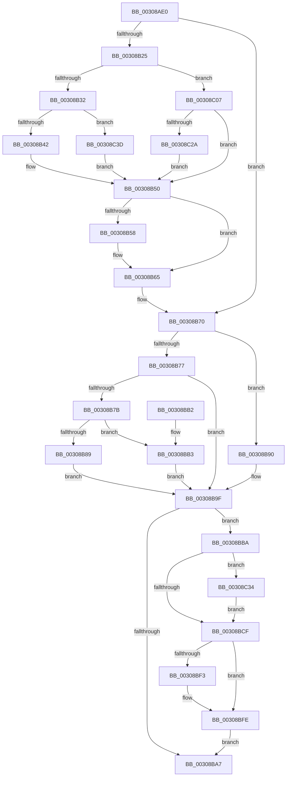

# MiFlushEntireTbDueToAttributeChange

- RVA: `0x00308AE0`–`0x00308C48` (길이 `360` bytes)
- VA: `0x0000000140308AE0`
- 실행 섹션: `.text`
- PDB 이름 있음: `예`; PDB Function 태그: `아니요`
- unwind 정보 RVA: `0x00073A54`
- 디코드: `91`개 명령, `360/360` bytes 표시
- 미해석 바이트: `0` (있으면 어셈블리에 `.byte`로 보존)

> 이 문서는 커널 이미지의 기계어와 PDB 기호를 분석해 생성했습니다. 4번과 5번은 함수 원형과 자료형을 바이너리 사용 방식에서 추정한 C 해석이며 원본 소스 복구 결과는 아닙니다.

## 1. Dependencies

- 직접 호출 지점: **10**; 고유 호출 대상: **9**
- 직접 호출자로 확인된 함수: **14**
- RIP 상대 이미지 참조: **7**

### Outgoing calls
- `0x00308AF0` → [HvlFlushTbAllPartitions](HvlFlushTbAllPartitions_function_00308D70.md) (function, `0x00308D70`)
- `0x00308B1C` → [KiPreprocessFlushTb](KiPreprocessFlushTb_function_00308E00.md) (function, `0x00308E00`)
- `0x00308B60` → [KiLowerIrqlProcessIrqlFlags](../4F/KiLowerIrqlProcessIrqlFlags_function_004F5698.md) (function, `0x004F5698`)
- `0x00308B89` → [KxFlushNonGlobalTb](../31/KxFlushNonGlobalTb_function_00314E50.md) (function, `0x00314E50`)
- `0x00308B9A` → [KiFlushAddressSpaceTb](KiFlushAddressSpaceTb_function_00308F50.md) (function, `0x00308F50`)
- `0x00308BB3` → [KxFlushEntireTb](KxFlushEntireTb_function_00309094.md) (function, `0x00309094`)
- `0x00308BE6` → [guard_dispatch_icall](../6B/guard_dispatch_icall_function_006BAAD0.md) (function, `0x006BAAD0`)
- `0x00308BF9` → [KiLowerIrqlProcessIrqlFlags](../4F/KiLowerIrqlProcessIrqlFlags_function_004F5698.md) (function, `0x004F5698`)
- `0x00308C2A` → [KiSetUserTbFlushPending](../6B/KiSetUserTbFlushPending_function_006B20C0.md) (function, `0x006B20C0`)
- `0x00308C36` → [KiRaiseIrqlProcessIrqlFlags](../4F/KiRaiseIrqlProcessIrqlFlags_function_004F56FC.md) (function, `0x004F56FC`)

### Direct callers
- [MiReferenceIoPages](../23/MiReferenceIoPages_function_0023C804.md) at `0x0023CE87`
- [MiChangePageAttributeBatch](../2A/MiChangePageAttributeBatch_function_002A06E0.md) at `0x002A0816`
- [MiChangePageAttributeBatch](../2A/MiChangePageAttributeBatch_function_002A06E0.md) at `0x002A0964`
- [sub_002B1D4E](../2B/Unknown_function_002B1D4E.md) at `0x002B204B`
- [MiFlushCacheForAttributeChange](MiFlushCacheForAttributeChange_function_00308944.md) at `0x003089FD`
- [MiChangePageAttribute](../33/MiChangePageAttribute_function_00332ECC.md) at `0x00333181`
- [MiChangePageAttribute](../33/MiChangePageAttribute_function_00332ECC.md) at `0x003331D1`
- [MiRemovePhysicalMemoryBatchComplete](../67/MiRemovePhysicalMemoryBatchComplete_function_00673B98.md) at `0x00673B9C`
- [MiDeleteStaleCacheMaps](../67/MiDeleteStaleCacheMaps_function_0067B780.md) at `0x0067B967`
- [MiIoPfnTreeExclusionCompatible](../67/MiIoPfnTreeExclusionCompatible_function_0067BE9C.md) at `0x0067BFFD`
- [MiMakeIoRangePermanent](../67/MiMakeIoRangePermanent_function_0067C29C.md) at `0x0067C3FC`
- [MiCombiningInProgress](../68/MiCombiningInProgress_function_0068BD6C.md) at `0x0068BE93`
- [sub_006E4818](../6E/Unknown_function_006E4818.md) at `0x006E48B2`
- [MiRemovePhysicalMemory](../../page/7F/MiRemovePhysicalMemory_function_007FAD3C.md) at `0x007FAFF9`
- [MiValidateSectionCreate](../../page/94/MiValidateSectionCreate_function_00940190.md) at `0x00940C29`
- [MiInitializeCacheFlushing](../../init/C6/MiInitializeCacheFlushing_function_00C6ACF8.md) at `0x00C6AEB8`

### Static image references
- `0x00308AEA` → RVA `0x00E2DC50` (`.data`; read/write)
- `0x00308B25` → RVA `0x00FC6A87` (`ALMOSTRO`; read)
- `0x00308B50` → RVA `0x00FC6D20` (`ALMOSTRO`; read)
- `0x00308B7B` → RVA `0x01201840` (`CFGRO`; read)
- `0x00308B9F` → RVA `0x00E685D4` (`.data`; read)
- `0x00308BCF` → RVA `0x00E06D28` (`.data`; read)
- `0x00308BD9` → RVA `0x00EFA8E0` (`.data`; read)

## 2. Other-region calls and transfers

- 다른 실행 섹션으로 향하는 call: **0**
- 별도 외부 분기/꼬리 이동을 확인하지 못했습니다.

## 3. Assembly (complete function range)

```asm
00308AE0  48 89 5C 24 18                  mov qword ptr [rsp + 0x18], rbx
00308AE5  57                              push rdi
00308AE6  48 83 EC 30                     sub rsp, 0x30
00308AEA  FF 05 60 51 B2 00               inc dword ptr [rip + 0xb25160]
00308AF0  E8 7B 02 00 00                  call 0x140308d70
00308AF5  33 FF                           xor edi, edi
00308AF7  48 8D 44 24 40                  lea rax, [rsp + 0x40]
00308AFC  4C 8D 4C 24 48                  lea r9, [rsp + 0x48]
00308B01  40 88 7C 24 48                  mov byte ptr [rsp + 0x48], dil
00308B06  B1 01                           mov cl, 1
00308B08  40 88 7C 24 40                  mov byte ptr [rsp + 0x40], dil
00308B0D  40 8A DF                        mov bl, dil
00308B10  48 89 44 24 20                  mov qword ptr [rsp + 0x20], rax
00308B15  8D 57 03                        lea edx, [rdi + 3]
00308B18  44 8D 47 02                     lea r8d, [rdi + 2]
00308B1C  E8 DF 02 00 00                  call 0x140308e00
00308B21  84 C0                           test al, al
00308B23  74 4B                           je 0x140308b70
00308B25  40 38 3D 5B DF CB 00            cmp byte ptr [rip + 0xcbdf5b], dil
00308B2C  0F 85 D5 00 00 00               jne 0x140308c07
00308B32  0F 20 E1                        mov rcx, cr4
00308B35  48 F7 C1 80 00 02 00            test rcx, 0x20080
00308B3C  0F 84 FB 00 00 00               je 0x140308c3d
00308B42  48 8B C1                        mov rax, rcx
00308B45  48 0F BA F8 07                  btc rax, 7
00308B4A  0F 22 E0                        mov cr4, rax
00308B4D  0F 22 E1                        mov cr4, rcx
00308B50  39 3D CA E1 CB 00               cmp dword ptr [rip + 0xcbe1ca], edi
00308B56  74 0D                           je 0x140308b65
00308B58  44 0F 20 C1                     mov rcx, cr8
00308B5C  8A 54 24 40                     mov dl, byte ptr [rsp + 0x40]
00308B60  E8 33 CB 1E 00                  call 0x1404f5698
00308B65  0F B6 44 24 40                  movzx eax, byte ptr [rsp + 0x40]
00308B6A  44 0F 22 C0                     mov cr8, rax
00308B6E  B3 01                           mov bl, 1
00308B70  40 38 7C 24 48                  cmp byte ptr [rsp + 0x48], dil
00308B75  75 19                           jne 0x140308b90
00308B77  84 DB                           test bl, bl
00308B79  75 24                           jne 0x140308b9f
00308B7B  40 38 3D BE 8C EF 00            cmp byte ptr [rip + 0xef8cbe], dil
00308B82  B9 02 00 00 00                  mov ecx, 2
00308B87  74 2A                           je 0x140308bb3
00308B89  E8 C2 C2 00 00                  call 0x140314e50
00308B8E  EB 0F                           jmp 0x140308b9f
00308B90  41 B1 01                        mov r9b, 1
00308B93  33 D2                           xor edx, edx
00308B95  45 8A C1                        mov r8b, r9b
00308B98  33 C9                           xor ecx, ecx
00308B9A  E8 B1 03 00 00                  call 0x140308f50
00308B9F  39 3D 2F FA B5 00               cmp dword ptr [rip + 0xb5fa2f], edi
00308BA5  75 13                           jne 0x140308bba
00308BA7  48 8B 5C 24 50                  mov rbx, qword ptr [rsp + 0x50]
00308BAC  48 83 C4 30                     add rsp, 0x30
00308BB0  5F                              pop rdi
00308BB1  C3                              ret
00308BB2  CC                              int3
00308BB3  E8 DC 04 00 00                  call 0x140309094
00308BB8  EB E5                           jmp 0x140308b9f
00308BBA  44 0F 20 C3                     mov rbx, cr8
00308BBE  BA 0F 00 00 00                  mov edx, 0xf
00308BC3  44 0F 22 C2                     mov cr8, rdx
00308BC7  39 3D 53 E1 CB 00               cmp dword ptr [rip + 0xcbe153], edi
00308BCD  75 65                           jne 0x140308c34
00308BCF  48 8B 05 52 E1 AF 00            mov rax, qword ptr [rip + 0xafe152]
00308BD6  45 33 C0                        xor r8d, r8d
00308BD9  48 8B 0D 00 1D BF 00            mov rcx, qword ptr [rip + 0xbf1d00]
00308BE0  33 D2                           xor edx, edx
00308BE2  48 8B 40 50                     mov rax, qword ptr [rax + 0x50]
00308BE6  E8 E5 1E 3B 00                  call 0x1406baad0
00308BEB  39 3D 2F E1 CB 00               cmp dword ptr [rip + 0xcbe12f], edi
00308BF1  74 0B                           je 0x140308bfe
00308BF3  44 0F 20 C1                     mov rcx, cr8
00308BF7  8A D3                           mov dl, bl
00308BF9  E8 9A CA 1E 00                  call 0x1404f5698
00308BFE  0F B6 C3                        movzx eax, bl
00308C01  44 0F 22 C0                     mov cr8, rax
00308C05  EB A0                           jmp 0x140308ba7
00308C07  0F 20 D8                        mov rax, cr3
00308C0A  0F 22 D8                        mov cr3, rax
00308C0D  65 48 8B 04 25 88 01 00 00      mov rax, qword ptr gs:[0x188]
00308C16  48 8B 88 B8 00 00 00            mov rcx, qword ptr [rax + 0xb8]
00308C1D  40 38 B9 60 01 00 00            cmp byte ptr [rcx + 0x160], dil
00308C24  0F 85 26 FF FF FF               jne 0x140308b50
00308C2A  E8 91 94 3A 00                  call 0x1406b20c0
00308C2F  E9 1C FF FF FF                  jmp 0x140308b50
00308C34  8A CB                           mov cl, bl
00308C36  E8 C1 CA 1E 00                  call 0x1404f56fc
00308C3B  EB 92                           jmp 0x140308bcf
00308C3D  0F 20 D8                        mov rax, cr3
00308C40  0F 22 D8                        mov cr3, rax
00308C43  E9 08 FF FF FF                  jmp 0x140308b50
```

## 4. C-style interpretation (structured pseudocode)

```c
__int64 __fastcall MiFlushEntireTbDueToAttributeChange(void)
{
    __int64 result;
    __int64 v_rdi;
    __int64 v_rsp;
    unsigned __int64 v_stack_m18;
    unsigned __int64 v_stack_p10;
    unsigned __int64 v_stack_p18;
    unsigned __int64 v_stack_p8;

    v_stack_p18 = v_rbx;
    v_rsp = (v_rsp) - (48);
    result = HvlFlushTbAllPartitions(a1, a2, a3, a4);
    v_rdi = 0;
    v_stack_p10 = 0;
    v_stack_p8 = 0;
    v_stack_m18 = v_stack_p8;
    result = KiPreprocessFlushTb(1, v_rdi + 3, v_rdi + 2, v_stack_p10);
    if ((unsigned __int8)(result) == 0) goto loc_00308B70;
    if ((*(unsigned __int8 *)(v_rip + 13360987)) != 0) goto loc_00308C07;
    if (((v_cr4) & (0x20080ULL)) == 0) goto loc_00308C3D;
loc_00308B50:
    result = v_cr4;
    if ((*(unsigned int *)(v_rip + 13361610)) != 0) {
        a1 = v_cr8;
        a2 = v_stack_p8;
        result = KiLowerIrqlProcessIrqlFlags(a1, a2, v_rdi + 2, v_stack_p10);
    }
loc_00308B70:
    if (v_stack_p10 != 0) goto loc_00308B90;
    if (1 != 0) goto loc_00308B9F;
    if ((*(unsigned __int8 *)(v_rip + 15699134)) == 0) goto loc_00308BB3;
    result = KxFlushNonGlobalTb(2, a2, v_rdi + 2, v_stack_p10);
    goto loc_00308B9F;
loc_00308B90:
    a2 = 0;
    a1 = 0;
    result = KiFlushAddressSpaceTb(a1, a2, 1, 1);
loc_00308B9F:
    if ((*(unsigned int *)(v_rip + 11926063)) != 0) goto loc_00308BBA;
loc_00308BA7:
    v_rsp = (v_rsp) + (48);
    return result;
loc_00308BB3:
    result = KxFlushEntireTb(a1, a2, 1, 1);
    goto loc_00308B9F;
loc_00308BBA:
    if ((*(unsigned int *)(v_rip + 13361491)) != 0) goto loc_00308C34;
loc_00308BCF:
    a3 = 0;
    a2 = 0;
    result = guard_dispatch_icall(*(unsigned __int64 *)(v_rip + 12524800), a2, a3, 1);
    if ((*(unsigned int *)(v_rip + 13361455)) != 0) {
        a1 = 15;
        a2 = (unsigned __int8)(v_stack_p8);
        result = KiLowerIrqlProcessIrqlFlags(a1, a2, a3, 1);
    }
    goto loc_00308BA7;
loc_00308C07:
    if ((*(unsigned __int8 *)(*(unsigned __int64 *)(*(unsigned __int64 *)(gs_base + (0 + 392)) + 184) + 352)) != 0) goto loc_00308B50;
    result = KiSetUserTbFlushPending(*(unsigned __int64 *)(*(unsigned __int64 *)(gs_base + (0 + 392)) + 184), a2, a3, 1);
    goto loc_00308B50;
loc_00308C34:
    result = KiRaiseIrqlProcessIrqlFlags((unsigned __int8)(v_stack_p8), a2, a3, 1);
    goto loc_00308BCF;
loc_00308C3D:
    goto loc_00308B50;
}
```

## 5. (Beta) C Style

```c
void MiFlushEntireTbDueToAttributeChange(void)
{
    int64_t result;
    int64_t local_rdi;
    int64_t local_rsp;
    uint64_t v_stack_m18;
    uint64_t v_stack_p10;
    uint64_t v_stack_p18;
    uint64_t v_stack_p8;

    v_stack_p18 = local_rbx;
    local_rsp = (local_rsp) - (48);
    result = HvlFlushTbAllPartitions(a1, a2, a3, a4);
    local_rdi = 0;
    v_stack_p10 = 0;
    v_stack_p8 = 0;
    v_stack_m18 = v_stack_p8;
    result = KiPreprocessFlushTb(1, local_rdi + 3, local_rdi + 2, v_stack_p10);
    if ((uint8_t)(result) == 0) goto loc_00308B70;
    if ((*(uint8_t *)(v_rip + 0xCBDF5B)) != 0) goto loc_00308C07;
    if (((v_cr4) & (0x20080ULL)) == 0) goto loc_00308C3D;
loc_00308B50:
    result = v_cr4;
    if ((*(uint32_t *)(v_rip + 0xCBE1CA)) != 0) {
        a1 = v_cr8;
        a2 = v_stack_p8;
        result = KiLowerIrqlProcessIrqlFlags(a1, a2, local_rdi + 2, v_stack_p10);
    }
loc_00308B70:
    if (v_stack_p10 != 0) goto loc_00308B90;
    if (1 != 0) goto loc_00308B9F;
    if ((*(uint8_t *)(v_rip + 0xEF8CBE)) == 0) goto loc_00308BB3;
    result = KxFlushNonGlobalTb(2, a2, local_rdi + 2, v_stack_p10);
    goto loc_00308B9F;
loc_00308B90:
    a2 = 0;
    a1 = 0;
    result = KiFlushAddressSpaceTb(a1, a2, 1, 1);
loc_00308B9F:
    if ((*(uint32_t *)(v_rip + 0xB5FA2F)) != 0) goto loc_00308BBA;
loc_00308BA7:
    local_rsp = (local_rsp) + (48);
    return result;
loc_00308BB3:
    result = KxFlushEntireTb(a1, a2, 1, 1);
    goto loc_00308B9F;
loc_00308BBA:
    if ((*(uint32_t *)(v_rip + 0xCBE153)) != 0) goto loc_00308C34;
loc_00308BCF:
    a3 = 0;
    a2 = 0;
    result = guard_dispatch_icall(*(uint64_t *)(v_rip + 0xBF1D00), a2, a3, 1);
    if ((*(uint32_t *)(v_rip + 0xCBE12F)) != 0) {
        a1 = 15;
        a2 = (uint8_t)(v_stack_p8);
        result = KiLowerIrqlProcessIrqlFlags(a1, a2, a3, 1);
    }
    goto loc_00308BA7;
loc_00308C07:
    if ((*(uint8_t *)(*(uint64_t *)(*(uint64_t *)(gs_base + (0 + 0x188)) + 0xB8) + 0x160)) != 0) goto loc_00308B50;
    result = KiSetUserTbFlushPending(*(uint64_t *)(*(uint64_t *)(gs_base + (0 + 0x188)) + 0xB8), a2, a3, 1);
    goto loc_00308B50;
loc_00308C34:
    result = KiRaiseIrqlProcessIrqlFlags((uint8_t)(v_stack_p8), a2, a3, 1);
    goto loc_00308BCF;
loc_00308C3D:
    goto loc_00308B50;
}
```

## 6. Execution-region graph

[열기: 2D/3D 그래프와 함수 탐색 컨트롤 패널](../../../control-panel.html?section=text&rva=0x00308AE0&view=graph)

- 2D 그래프는 위에서 아래로 흐르고, 3D 그래프는 빈 공간을 드래그해 회전합니다. Shift+드래그는 이동, 휠은 확대·축소, 함수 노드 선택은 대상 보고서 이동입니다.

### Static fallback


